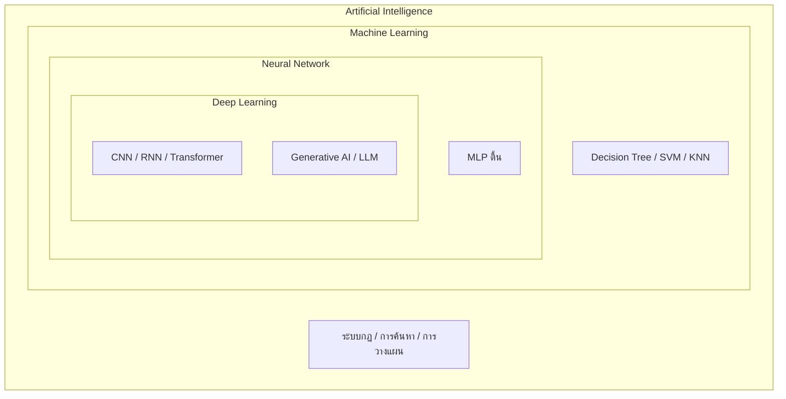
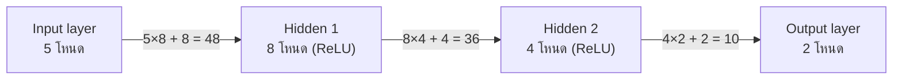

## รูปแบบข้อสอบ

ข้อสอบรายวิชา EN-012-314 ปัญญาประดิษฐ์ เป็น **ข้อสอบอัตนัยแบบเขียนตอบ** ครอบคลุมเนื้อหาทุกบท ตั้งแต่ลำดับชั้นของ AI ([บทที่ 0](/module/00)) ไปจนถึง Reinforcement Learning ([บทที่ 9](/module/09))

| หัวข้อ | รายละเอียด |
|---|---|
| จำนวนข้อ | **20 ข้อ ข้อละ 5 คะแนน** รวม 100 คะแนน (แต่ละข้อแบ่งเป็นข้อย่อย 4–5 ข้อ ข้อย่อยละ 1–2 คะแนน) |
| ลักษณะคำตอบ | เขียนตอบลงในข้อสอบ: อธิบาย ให้ความหมาย คำนวณแสดงวิธีทำ หรือเขียนโค้ด Python พร้อมยกตัวอย่าง |
| เอกสารที่นำเข้าได้ | **โน้ตที่เขียนด้วยลายมือของตนเองเท่านั้น 6 แผ่น** (พิมพ์หรือถ่ายเอกสารไม่ได้) |
| เครื่องคิดเลข | นำเข้าได้ — ใช้กับ $e^{x}$, $\sqrt{\ }$, ทศนิยม 4 ตำแหน่ง |
| ข้อมูลประกอบ | ตาราง confusion matrix และโค้ดที่ข้อสอบอ้างถึงอยู่ในตัวโจทย์หรือท้ายข้อสอบ |

**สัดส่วนประเภทคำถามโดยประมาณ**

| ประเภท | สัดส่วน | ตัวอย่าง |
|---|---|---|
| อธิบาย / ให้ความหมาย + ยกตัวอย่าง | ~60% | AI vs ML vs DL, overfitting, Markov property, transfer learning, Transformer |
| คำนวณแสดงวิธีทำ | ~25–30% | precision/recall, RMSE, Gini, K-Means 1 รอบ, Q-learning update, จำนวนพารามิเตอร์ CNN |
| อ่าน / เขียนโค้ด Python | ~10–15% | อธิบายโค้ดสั้น 5 ชิ้น, เขียน scikit-learn ตั้งแต่โหลดข้อมูลจนวัดผล |

**การกระจายเนื้อหา** — ประมาณบทละ 2 ข้อ เรียงตามลำดับบทเรียน

| ข้อ | เนื้อหา | บท |
|---|---|---|
| 1–2 | AI Hierarchy และสาขาย่อยของ AI | [บทที่ 0](/module/00) |
| 3–4 | ประเภทของ ML, ความท้าทาย, validation | [บทที่ 1](/module/01) |
| 5 | ML pipeline และการเตรียมข้อมูล | [บทที่ 2](/module/02) |
| 6, 8, 9 | Confusion matrix, Decision Tree/Ensemble, SVM/KNN | [บทที่ 3](/module/03) |
| 7 | Linear / Logistic Regression | [บทที่ 3](/module/03), [บทที่ 4](/module/04) |
| 10 | กรณีศึกษา MNIST และ California Housing | [บทที่ 3](/module/03), [บทที่ 4](/module/04) |
| 11–12 | K-Means, DBSCAN, PCA, t-SNE, Anomaly Detection | [บทที่ 5](/module/05) |
| 13–14 | RL, MDP, Q-Learning, DQN | [บทที่ 9](/module/09) |
| 15, 17 | Neural Network, การฝึกโครงข่ายลึก, สถาปัตยกรรม DL | [บทที่ 6](/module/06), [บทที่ 0](/module/00) |
| 16 | CNN | [บทที่ 7](/module/07) |
| 18 | NLP และ LLM | [บทที่ 8](/module/08) |
| 19–20 | อ่านโค้ด / เขียนโค้ด scikit-learn | ทุกบท + ใบงาน |

## คำแนะนำจากอาจารย์: ควรเตรียมตัวอย่างไร

### สิ่งที่ควรให้ความสำคัญก่อน

1. **นิยามศัพท์หลักของทุกบท** — ข้อสอบกว่าครึ่งถามว่า "คืออะไร ต่างกันอย่างไร ยกตัวอย่าง" ใช้ตาราง "คำศัพท์สำคัญ" ท้ายบทเรียนแต่ละบท และแบบทบทวน 1 หน้า (review sheet) เป็นจุดเริ่ม
2. **การคำนวณที่ทำด้วยมือได้** — ทุกสูตรในหัวข้อ "สูตรและการคำนวณที่ต้องทำได้" ด้านล่าง ต้องทำได้เองด้วยเครื่องคิดเลขภายใน 3–5 นาทีต่อข้อย่อย
3. **โค้ด scikit-learn แบบครบวงจร** — โหลดข้อมูล → แบ่ง train/test → สร้างโมเดล (หรือ Pipeline) → `fit` → `predict` → คำนวณ metric ต้องเขียนได้โดยไม่ต้องเปิดเครื่อง
4. **เข้าใจ "ทำไม"** ไม่ใช่แค่ "อะไร" — เช่น ทำไมต้อง scale ก่อนใช้ KNN ทำไม t-SNE แปลงกลับไม่ได้ ทำไม DQN ต้องมี replay buffer

### แนวการให้คะแนน (สิ่งที่ผู้ตรวจมองหา)

| ประเภทคำถาม | คำตอบที่ได้คะแนนเต็ม |
|---|---|
| อธิบาย / ให้ความหมาย | **นิยามที่ถูกต้อง + ตัวอย่างที่เป็นรูปธรรม + ศัพท์เทคนิคที่ถูกต้อง** (เช่น เขียนว่า "support vectors คือจุดบนขอบ margin" ไม่ใช่ "จุดสำคัญ") คำตอบที่มีแต่ตัวอย่างไม่มีนิยาม หรือมีนิยามไม่มีตัวอย่าง มักได้ครึ่งเดียว |
| เปรียบเทียบ (A ต่างจาก B) | บอกเกณฑ์ที่ใช้เทียบ แล้วตอบ**ทั้งสองฝั่ง** — ทำเป็นตาราง 2 คอลัมน์ได้ยิ่งดี |
| คำนวณ | **เขียนสูตร → แทนค่า → ผลลัพธ์** ตอบทศนิยม 4 ตำแหน่ง (ถ้าโจทย์กำหนด) และ**ใส่หน่วย** (บาท, GB, \$) — ถ้าคำตอบสุดท้ายผิดแต่สูตรและการแทนค่าถูกยังได้คะแนนบางส่วน ถ้าเขียนแต่ตัวเลขคำตอบจะเสี่ยงไม่ได้คะแนนเลย |
| อ่านโค้ด | อธิบายว่า**แต่ละบรรทัดทำอะไร**และ**ผลลัพธ์สุดท้ายคืออะไร** (เช่น "ได้ accuracy เฉลี่ยจาก 5 fold") ไม่ใช่อ่านชื่อฟังก์ชันซ้ำ |
| เขียนโค้ด | import ครบ ชื่อฟังก์ชันและพารามิเตอร์ถูก **รันได้จริง** และมี comment สั้น ๆ กำกับแต่ละขั้น |

### ข้อผิดพลาดที่พบบ่อย (แยกตามบท)

| บท | ข้อผิดพลาด | ที่ถูกต้อง |
|---|---|---|
| 0 | ตอบว่า AI = ML หรือ DL = NN | AI ⊃ ML ⊃ NN ⊃ DL ⊃ GenAI/LLM — ระบบกฎ IF-THEN เป็น AI แต่ไม่ใช่ ML |
| 1 | ใช้ test set เลือก hyperparameter | ใช้ validation set หรือ cross-validation แล้วแตะ test set ครั้งเดียวตอนท้าย |
| 1 | สับสน parameter กับ hyperparameter | parameter = โมเดลเรียนเอง (`coef_`, weight) / hyperparameter = เรากำหนดก่อนฝึก (`max_depth`, `k`, `C`, learning rate) |
| 2 | **Data leakage** — `fit` scaler/imputer กับข้อมูลทั้งหมดก่อนแบ่ง | split ก่อน แล้ว `fit` กับ train เท่านั้น (ใช้ `Pipeline` จะปลอดภัยที่สุด) |
| 2 | คิดจำนวนแถว test ผิด | `train_test_split` **ปัดเศษ test ขึ้น** เช่น 769 × 0.2 = 153.8 → test 154, train 615 |
| 3 | **สลับ precision กับ recall** | precision ตัวหาร = สิ่งที่**ทาย**ว่า positive (TP+FP) / recall ตัวหาร = สิ่งที่**เป็นจริง** positive (TP+FN) |
| 3 | อ่าน confusion matrix ผิดแถว | ดูหัวตารางทุกครั้ง — scikit-learn: แถว = จริง, คอลัมน์ = ทาย, เรียงคลาส 0 ก่อน |
| 3 | ตอบว่า "accuracy สูง = โมเดลดี" เมื่อข้อมูลไม่สมดุล | ดู recall/F1 ของคลาสส่วนน้อย และเทียบกับ baseline ที่ทายคลาสส่วนใหญ่ทุกตัว |
| 4 | **ลืมหน่วยของ California Housing** | target หน่วย \$100,000 → RMSE 0.50 หมายถึงประมาณ \$50,000 ต้อง**คูณ 100,000** |
| 4 | RMSE กับ MSE สลับกัน / ลืมถอดราก | RMSE $=\sqrt{\text{MSE}}$ และมีหน่วยเดียวกับ $y$ |
| 5 | บอกว่า t-SNE ใช้ `inverse_transform` หรือ `transform` ข้อมูลใหม่ได้ | t-SNE มีแค่ `fit_transform` ใช้เพื่อ visualization เท่านั้น PCA จึงจะแปลงกลับได้ |
| 5 | ลืม scale ก่อน K-Means / KNN / SVM / PCA | วิธีที่อิงระยะทางหรือ variance ต้อง scale เสมอ (Decision Tree ไม่ต้อง) |
| 6 | **ลืม bias** ตอนนับพารามิเตอร์ Dense | $(n_{in}+1)\times n_{out}$ |
| 7 | **ลืม padding / stride** ตอนหาขนาด output, ลืม $C_{in}$ หรือ $+1$ ตอนนับพารามิเตอร์ Conv2D | $O=\lfloor (n+2p-k)/s \rfloor + 1$ และ params $=(k\cdot k\cdot C_{in}+1)\cdot F$ |
| 7 | นับพารามิเตอร์ให้ MaxPooling / Flatten / Dropout | ชั้นเหล่านี้มี **0** พารามิเตอร์ |
| 8 | คิด VRAM ด้วยบิตโดยไม่หาร 8 | ไบต์ = พารามิเตอร์ × บิต / 8 เช่น 4-bit = 0.5 ไบต์ต่อค่า |
| 9 | ลืมว่า state สุดท้าย (terminal) ไม่มีอนาคต | ถ้า done แล้ว TD target $= r$ เท่านั้น |
| 9 | คิด discounted return โดยยกกำลัง $\gamma$ เริ่มจาก 1 | reward แรกคูณ $\gamma^0 = 1$ |

> [!TIP]
> ฝึกทำข้อสอบเก่า/แนวข้อสอบ**ด้วยมือบนกระดาษ** อย่างน้อย 1 ชุดเต็มโดยจับเวลา การเขียนตอบช้ากว่าการคิดในหัวมาก นักศึกษาหลายคนรู้คำตอบแต่เขียนไม่ทัน

## แผนอ่านหนังสือ 2 สัปดาห์

แผนนี้สมมติว่ามีเวลาวันละ 2–3 ชั่วโมง ทุกวันให้ทำ 3 อย่าง: อ่านบทเรียน → ทำแบบทดสอบปรนัยท้ายบท (เช็กความเข้าใจ) → เขียนโน้ตลายมือของหัวข้อนั้น

| วัน | เนื้อหา | อ่าน / ทบทวน | ฝึก | โน้ตลายมือ |
|---|---|---|---|---|
| 1 | AI Hierarchy, สาขาย่อยของ AI | [บทที่ 0](/module/00) | แนวข้อสอบข้อ 1–2 | แผ่น 1 |
| 2 | ประเภทของ ML, Batch/Online, Instance/Model-based, Overfitting, Validation, CV | [บทที่ 1](/module/01) · [แบบทบทวน 01](/api/content/SHEET/review_sheet_01.html) | [แบบทดสอบ 01](/exam/01) · ข้อ 3–4 | แผ่น 2 |
| 3 | ML Pipeline, EDA, Data Leakage, Scaling, Train/Test split | [บทที่ 2](/module/02) · [แบบทบทวน 02](/api/content/SHEET/review_sheet_02.html) | [แบบทดสอบ 02](/exam/02) · [ใบงาน 02](/lab/02) ข้อ 5, 7 · ข้อ 5 | แผ่น 2 |
| 4 | Logistic Regression, KNN, SVM, Decision Tree, Ensemble | [บทที่ 3](/module/03) หัวข้อ 2–6 | ข้อ 8–9 | แผ่น 3 |
| 5 | Confusion matrix, Precision/Recall/F1/Specificity, MNIST | [บทที่ 3](/module/03) หัวข้อ 7–8 · [แบบทบทวน 03](/api/content/SHEET/review_sheet_03.html) | [แบบทดสอบ 03](/exam/03) · ข้อ 6 · ฝึก confusion matrix 3 ชุด | แผ่น 3 |
| 6 | Linear Regression, GD, Ridge/Lasso, Metrics, California Housing | [บทที่ 4](/module/04) · [แบบทบทวน 04](/api/content/SHEET/review_sheet_04.html) | [แบบทดสอบ 04](/exam/04) · [ใบงาน 04](/lab/04) · ข้อ 7, 10 | แผ่น 3 |
| 7 | K-Means, DBSCAN, PCA, t-SNE, GMM, Isolation Forest | [บทที่ 5](/module/05) · [แบบทบทวน 05](/api/content/SHEET/review_sheet_05.html) | [แบบทดสอบ 05](/exam/05) · ข้อ 11–12 | แผ่น 4 |
| 8 | **ทบทวนครึ่งแรก** | อ่านโน้ตแผ่น 1–4 ของตัวเอง | ทำแนวข้อสอบข้อ 1–12 ใหม่โดยไม่ดูเฉลย | แก้โน้ตส่วนที่ยังตอบไม่ได้ |
| 9 | Perceptron, MLP, Activation, Backprop, Optimizer, Dropout, Vanishing gradient | [บทที่ 6](/module/06) · [แบบทบทวน 06](/api/content/SHEET/review_sheet_06.html) | [แบบทดสอบ 06](/exam/06) · ข้อ 15, 17 | แผ่น 5 |
| 10 | Convolution, Pooling, ขนาด output, ResNet, Transfer learning | [บทที่ 7](/module/07) · [แบบทบทวน 07](/api/content/SHEET/review_sheet_07.html) | [แบบทดสอบ 07](/exam/07) · [ใบงาน 07](/lab/07) · ข้อ 16 | แผ่น 5 |
| 11 | NLP pipeline, ตัดคำไทย, BoW/TF-IDF, Transformer, LLM/VRAM | [บทที่ 8](/module/08) · [แบบทบทวน 08](/api/content/SHEET/review_sheet_08.html) | [แบบทดสอบ 08](/exam/08) · ข้อ 18 | แผ่น 5 |
| 12 | RL, MDP, Return, Q-Learning, ε-greedy, DQN | [บทที่ 9](/module/09) · [แบบทบทวน 09](/api/content/SHEET/review_sheet_09.html) | [แบบทดสอบ 09](/exam/09) · ข้อ 13–14 | แผ่น 4 |
| 13 | **วันโค้ด** | โค้ดใน [ใบงาน 02](/lab/02), [ใบงาน 03](/lab/03), [ใบงาน 04](/lab/04), [ใบงาน 05](/lab/05) | ข้อ 19–20 · เขียนโค้ด 3 แบบ (classification, regression, clustering) ลงกระดาษแล้วไปรันใน Colab | แผ่น 6 |
| 14 | **ซ้อมสอบจริง** | — | ทำแนวข้อสอบครบ 20 ข้อ จับเวลา ใช้แค่โน้ต 6 แผ่น + เครื่องคิดเลข แล้วตรวจกับเฉลย | เติมสิ่งที่ขาดลงโน้ต |

> [!NOTE]
> แบบทดสอบปรนัยท้ายบท (`/exam/XX`) ใช้เช็กความเข้าใจได้รวดเร็ว แต่ข้อสอบจริงเป็น**อัตนัย** หลังทำแบบทดสอบปรนัยให้ลองอธิบายเหตุผลของแต่ละตัวเลือกเป็นประโยคของตัวเองด้วย

## วิธีทำโน้ตลายมือ 6 แผ่น

โน้ตที่นำเข้าห้องสอบได้ต้อง**เขียนด้วยลายมือของตนเองเท่านั้น** ข้อดีคือการเขียนเองบังคับให้สรุปและจำไปในตัว ให้เขียนสองหน้า (หน้า–หลัง) ถ้าข้อกำหนดของห้องสอบอนุญาต และจัดหัวข้อให้หาเจอภายใน 10 วินาที

| แผ่น | เนื้อหา | สิ่งที่ต้องมี |
|---|---|---|
| **1** | AI Hierarchy & สาขาย่อยของ AI ([บทที่ 0](/module/00)) | แผนภาพวงกลมซ้อน AI ⊃ ML ⊃ NN ⊃ DL ⊃ GenAI/LLM · นิยาม 1–2 บรรทัด + ตัวอย่าง 1 อย่างต่อระดับ · สาขาย่อย: Planning & Scheduling, Automated Reasoning, Knowledge Representation, Computer Vision, NLP, Robotics, AI Agent (นิยาม + ตัวอย่าง) · ระบบกฎ, forward/backward chaining |
| **2** | ML Landscape + Pipeline ([บทที่ 1](/module/01), [บทที่ 2](/module/02)) | ตาราง supervised / unsupervised / semi-supervised / self-supervised / RL · batch vs online · instance vs model-based · overfitting/underfitting + วิธีแก้ · train/validation/test, data snooping, k-fold CV · parameter vs hyperparameter · pipeline 6 ขั้น · data leakage · stratify · การปัดเศษ test set |
| **3** | Metrics + Regression/Classification ([บทที่ 3](/module/03), [บทที่ 4](/module/04)) | confusion matrix (วาดหัวตารางให้ชัด) + สูตร accuracy, precision, recall, specificity, F1 · MAE, MSE, RMSE, R² · $\hat{y}=\theta^T x$, sigmoid, GD + ผลของ learning rate · Ridge vs Lasso · Gini, hard/soft voting, bagging vs boosting · SVM (margin, C, kernel), KNN · California Housing ×100,000 |
| **4** | Clustering/PCA/Anomaly + RL ([บทที่ 5](/module/05), [บทที่ 9](/module/09)) | K-Means 6 ขั้น + inertia, elbow, silhouette, DBSCAN · PCA, explained variance, PCA vs t-SNE · GMM `score_samples` + `percentile`, Isolation Forest · วงจร agent–environment · return $G_t$, $1/(1-\gamma)$ · Markov property · Q-learning update, TD target/error · ε-greedy · DQN (replay, target network) |
| **5** | NN / CNN / สถาปัตยกรรม DL ([บทที่ 6](/module/06), [บทที่ 7](/module/07), [บทที่ 8](/module/08)) | params Dense, Conv2D · สูตรขนาด output · activation + output layer + loss · backprop 3 ขั้น · optimizer (Momentum, RMSProp, Adam) · vanishing gradient + วิธีแก้ · Dropout, BatchNorm, early stopping · LeNet, AlexNet, VGG, ResNet (skip connection), MobileNet · Transfer learning · GAN (generator vs discriminator) · Transformer (self-attention, encoder/decoder) · NLP pipeline, BoW/TF-IDF, VRAM |
| **6** | โค้ด Python | template scikit-learn: classification, regression, clustering, PCA, cross-validation, Pipeline · template Keras: Sequential + compile + fit · Q-table update · ชื่อ metric: `accuracy_score`, `precision_score`, `recall_score`, `f1_score`, `confusion_matrix`, `root_mean_squared_error`, `r2_score` |

> [!WARNING]
> อย่าคัดลอกบทเรียนทั้งบทลงโน้ต — จะหาไม่เจอตอนสอบ ให้เขียน**สูตร + ตัวอย่างที่คำนวณเสร็จแล้ว 1 ตัวอย่าง**ต่อเรื่อง (เช่น confusion matrix 1 ชุดที่คำนวณครบ 5 ค่า) เพราะตอนสอบจะได้ทำตามรูปแบบเดิมได้ทันที

## สูตรและการคำนวณที่ต้องทำได้

ใช้ตารางนี้เป็นเช็กลิสต์ — ทุกแถวต้องทำได้ด้วยเครื่องคิดเลข และควรอยู่ในโน้ตลายมือ

| # | การคำนวณ | สูตร | บท |
|---|---|---|---|
| 1 | Accuracy | $\dfrac{TP+TN}{TP+TN+FP+FN}$ | [3](/module/03) |
| 2 | Precision | $\dfrac{TP}{TP+FP}$ | [3](/module/03) |
| 3 | Recall (Sensitivity) | $\dfrac{TP}{TP+FN}$ | [3](/module/03) |
| 4 | Specificity | $\dfrac{TN}{TN+FP}$ | [3](/module/03) |
| 5 | F1-score | $\dfrac{2\cdot P\cdot R}{P+R} = \dfrac{2TP}{2TP+FP+FN}$ | [3](/module/03) |
| 6 | MAE / MSE / RMSE | $\frac{1}{n}\sum \lvert y_i-\hat{y}_i\rvert$ · $\frac{1}{n}\sum (y_i-\hat{y}_i)^2$ · $\sqrt{\text{MSE}}$ | [4](/module/04) |
| 7 | R² | $1-\dfrac{SS_{res}}{SS_{tot}}$ | [4](/module/04) |
| 8 | ทำนายด้วยสมการเชิงเส้น | $\hat{y}=\theta_0+\theta_1x_1+\dots+\theta_nx_n$ | [4](/module/04) |
| 9 | Gradient descent 1 ก้าว | $\theta \leftarrow \theta-\eta\nabla_\theta J$ | [4](/module/04) |
| 10 | Sigmoid | $\sigma(z)=\dfrac{1}{1+e^{-z}}$ (ทาย 1 ถ้า $\sigma(z)\ge 0.5$ หรือ $z \ge 0$) | [3](/module/03), [6](/module/06) |
| 11 | Softmax | $\dfrac{e^{z_k}}{\sum_j e^{z_j}}$ | [3](/module/03), [6](/module/06) |
| 12 | ReLU | $\max(0,z)$ | [6](/module/06) |
| 13 | Gini impurity | $1-\sum_k p_k^2$ และ cost ของการแบ่ง $\frac{m_L}{m}G_L+\frac{m_R}{m}G_R$ | [3](/module/03) |
| 14 | Hard / Soft voting | hard = นับเสียงข้างมาก · soft = เฉลี่ยความน่าจะเป็นแล้วเทียบ 0.5 | [3](/module/03) |
| 15 | KNN vote | uniform = นับเสียง · distance = รวมน้ำหนัก $1/d$ | [3](/module/03) |
| 16 | ระยะยุคลิด | $d=\sqrt{\sum_j (x_j-x'_j)^2}$ | [3](/module/03), [5](/module/05) |
| 17 | K-Means 1 รอบ | assign เข้าศูนย์ที่ใกล้สุด → ศูนย์ใหม่ = ค่าเฉลี่ยสมาชิก · inertia $=\sum \lVert x-\mu\rVert^2$ | [5](/module/05) |
| 18 | เลือกจำนวน PC | variance สะสม $\sum_{i=1}^{d}\text{ratio}_i \ge 0.95$ (หรือค่าที่โจทย์กำหนด) | [5](/module/05) |
| 19 | Discounted return | $G_t=\sum_{k=0}^{\infty}\gamma^k r_{t+k+1}$ | [9](/module/09) |
| 20 | Q-learning update | TD target $=r+\gamma\max_{a'}Q(s',a')$ · TD error $\delta=\text{target}-Q(s,a)$ · $Q\leftarrow Q+\alpha\delta$ | [9](/module/09) |
| 21 | Return เมื่อได้ +1 ทุกก้าว | $\dfrac{1}{1-\gamma}$ | [9](/module/09) |
| 22 | ε-greedy | $P(\text{best})=(1-\varepsilon)+\varepsilon/\lvert A\rvert$ · ε-decay $\varepsilon_0\cdot d^{\,n}$ | [9](/module/09) |
| 23 | พารามิเตอร์ Dense | $(n_{in}+1)\times n_{out}$ | [6](/module/06) |
| 24 | พารามิเตอร์ Conv2D | $(k_h\cdot k_w\cdot C_{in}+1)\cdot F$ | [7](/module/07) |
| 25 | ขนาด output Conv/Pool | $O=\left\lfloor\dfrac{n+2p-k}{s}\right\rfloor+1$ | [7](/module/07) |
| 26 | Dense ต่อกับภาพโดยตรง | weights $=(H\cdot W\cdot C)\times n_{out}$ (+ bias $n_{out}$) | [7](/module/07) |
| 27 | จำนวนแถว train/test | test $=\lceil n\times \text{test\_size}\rceil$, train $=n-\text{test}$ | [2](/module/02) |
| 28 | VRAM ของน้ำหนัก LLM | $\text{params}\times\dfrac{\text{bits}}{8}$ ไบต์ (16-bit = 2 ไบต์, 4-bit = 0.5 ไบต์ต่อค่า) | [8](/module/08) |
| 29 | Vanishing gradient | อนุพันธ์ sigmoid สูงสุด 0.25 → ผ่าน $L$ ชั้นเหลือไม่เกิน $0.25^L$ | [6](/module/06) |
| 30 | แปลงหน่วย California Housing | ค่าที่ทำนาย/RMSE/MAE × 100,000 = ดอลลาร์ | [4](/module/04) |

## แนวข้อสอบ (Practice Exam) 20 ข้อ

**คำสั่ง** จงอธิบาย ให้ความหมาย คำนวณ หรือเขียนโค้ดตามที่โจทย์กำหนด พร้อมยกตัวอย่างและแสดงวิธีทำ (ข้อละ 5 คะแนน รวม 100 คะแนน) — ลองทำเองบนกระดาษก่อนเปิดเฉลย

---

### ข้อ 1. ลำดับชั้นของปัญญาประดิษฐ์ (5 คะแนน)

1.1 จงวาดแผนภาพแสดงความสัมพันธ์ระหว่าง AI, Machine Learning, Neural Network, Deep Learning และ Generative AI / LLM พร้อมเขียนนิยามสั้น ๆ ของแต่ละระดับ (1 คะแนน)

1.2 ระบบต่อไปนี้จัดอยู่ใน "ระดับที่ลึกที่สุด" ระดับใดของลำดับชั้น จงให้เหตุผล (ข้อละ 0.5 คะแนน รวม 2 คะแนน)

- (ก) ระบบผู้เชี่ยวชาญวินิจฉัยโรคพืชจากกฎ IF-THEN 300 ข้อที่นักวิชาการเกษตรเขียนไว้
- (ข) โมเดล Random Forest ทำนายราคาข้าวเปลือกจากปริมาณฝนและราคาน้ำมัน
- (ค) โมเดล ResNet-50 จำแนกภาพใบข้าวเป็น 4 โรค
- (ง) แชตบอตที่ตอบคำถามระเบียบการลงทะเบียนโดยสร้างประโยคใหม่ด้วยโมเดล Llama

1.3 Neural Network แบบตื้น (มี hidden layer 1 ชั้น) ต่างจาก Deep Learning อย่างไร และ Deep Learning ได้เปรียบ ML แบบดั้งเดิมในงานภาพและเสียงเพราะอะไร (1 คะแนน)

1.4 Generative AI ต่างจาก AI แบบจำแนก (discriminative) อย่างไร และ LLM คืออะไร ยกตัวอย่างการประยุกต์ใช้ 1 ตัวอย่าง (1 คะแนน)

<details><summary>เฉลยและแนวคำตอบ</summary>

**1.1** แผนภาพวงกลมซ้อน (วงนอกครอบวงใน)



- **AI** — ศาสตร์ของการสร้างระบบที่ทำงานซึ่งต้องใช้ความฉลาด เช่น ให้เหตุผล วางแผน รับรู้ เรียนรู้ (รวมถึงระบบที่มนุษย์เขียนกฎเอง)
- **ML** — สาขาย่อยของ AI ที่ให้คอมพิวเตอร์**เรียนรู้จากข้อมูล**โดยไม่ต้องเขียนกฎเองทั้งหมด (ประสิทธิภาพในงาน T ดีขึ้นจากประสบการณ์ E วัดด้วย P)
- **Neural Network** — โมเดล ML ที่ได้แรงบันดาลใจจากเซลล์ประสาท ประกอบด้วย neuron ที่คำนวณผลรวมถ่วงน้ำหนักแล้วผ่าน activation
- **Deep Learning** — NN ที่มี**หลาย hidden layer** เรียนรู้ feature แบบลำดับชั้นได้เอง
- **Generative AI / LLM** — โมเดล DL ที่**สร้างเนื้อหาใหม่** (ข้อความ ภาพ เสียง) LLM คือโมเดลภาษาขนาดใหญ่บนสถาปัตยกรรม Transformer

**1.2**

| ระบบ | ระดับ | เหตุผล |
|---|---|---|
| (ก) ระบบผู้เชี่ยวชาญ IF-THEN | **AI** (ไม่ใช่ ML) | ความรู้มาจากมนุษย์เขียนกฎ ระบบไม่ได้เรียนรู้จากข้อมูล |
| (ข) Random Forest ทำนายราคา | **ML** | เรียนรู้จากข้อมูลตาราง แต่ไม่ใช่ neural network |
| (ค) ResNet-50 จำแนกโรคใบข้าว | **Deep Learning** | CNN ลึก 50 ชั้น เรียน feature จากพิกเซลเอง |
| (ง) แชตบอตด้วย Llama | **Generative AI / LLM** | สร้างประโยคใหม่ด้วยโมเดลภาษาขนาดใหญ่ |

**1.3** NN ตื้นมี hidden layer น้อย (1 ชั้น) ส่วน DL มีหลายชั้น แต่ละชั้นเรียน feature ที่ซับซ้อนขึ้นเรื่อย ๆ (ขอบ → ลวดลาย → ชิ้นส่วน → วัตถุ) ข้อได้เปรียบของ DL คือ **เรียน feature เองจากข้อมูลดิบ (representation learning)** ขณะที่ ML ดั้งเดิมต้องให้มนุษย์ออกแบบ feature เอง (feature engineering) ซึ่งทำได้ยากกับภาพและเสียง แต่ DL ต้องการข้อมูลและพลังคำนวณ (GPU) มากกว่า

**1.4** โมเดลแบบจำแนก (discriminative) เรียนรู้ "เส้นแบ่ง" เพื่อตอบว่าข้อมูลเป็นคลาสใด เช่น อีเมลนี้เป็นสแปมหรือไม่ ส่วน **Generative AI** เรียนรู้การแจกแจงของข้อมูลจน**สร้างตัวอย่างใหม่**ได้ เช่น สร้างภาพหรือข้อความ **LLM (Large Language Model)** คือโมเดลภาษาที่มีพารามิเตอร์หลักพันล้านขึ้นไป ฝึกด้วยข้อความจำนวนมหาศาลให้ทำนาย token ถัดไป จึงตอบคำถาม สรุปความ แปลภาษา หรือเขียนโค้ดได้ ตัวอย่าง: ผู้ช่วยตอบคำถามนักศึกษาเรื่องระเบียบมหาวิทยาลัย, สรุปรายงานการประชุม

</details>

---

### ข้อ 2. สาขาย่อยของปัญญาประดิษฐ์ (5 คะแนน)

จากสถานการณ์ต่อไปนี้ จงระบุว่าเป็นงานของ AI สาขาย่อยใด อธิบายความหมายของสาขานั้น และยกตัวอย่างการประยุกต์ใช้**อื่น**อีก 1 ตัวอย่าง (ข้อละ 1 คะแนน)

2.1 ระบบจัดเส้นทางและตารางเวลาของรถรับส่งนักศึกษา 12 คัน ให้ครอบคลุมทุกจุดจอด ไม่เกินเวลาทำงานของคนขับ และใช้น้ำมันน้อยที่สุด

2.2 ระบบตรวจสอบอัตโนมัติว่าโปรแกรมควบคุมไฟจราจร "ไม่มีทางเลย" ที่ไฟเขียวจะติดพร้อมกันทั้งสองแยก โดยพิสูจน์จากข้อกำหนดเชิงตรรกะ

2.3 การเก็บความรู้เรื่องโรคข้าวในรูปความสัมพันธ์ เช่น "โรคไหม้ — เกิดจาก — เชื้อรา", "เชื้อรา — เป็นชนิดหนึ่งของ — จุลชีพ", "โรคไหม้ — มีอาการ — แผลรูปตา"

2.4 กล้องหน้าอาคารเรียนที่ตรวจจับและนับผู้ขับขี่จักรยานยนต์ที่ไม่สวมหมวกนิรภัย

2.5 ผู้ช่วยที่รับคำสั่ง "จองห้องประชุมบ่ายวันพรุ่งนี้ให้ทีมวิจัย 6 คน แล้วส่งอีเมลเชิญ" จากนั้นวางแผนขั้นตอน เปิดดูปฏิทิน จองห้อง และส่งอีเมลเองจนเสร็จ

<details><summary>เฉลยและแนวคำตอบ</summary>

| ข้อ | สาขา | ความหมาย | ตัวอย่างอื่น |
|---|---|---|---|
| 2.1 | **Planning & Scheduling** | หาลำดับการกระทำ (plan) หรือการจัดสรรทรัพยากรและเวลา (schedule) ที่บรรลุเป้าหมายภายใต้ข้อจำกัด และดีที่สุดตามเกณฑ์ที่กำหนด | จัดตารางสอบไม่ให้ห้อง/นักศึกษาชนกัน, จัดลำดับการผลิตในโรงงาน |
| 2.2 | **Automated Reasoning** | ให้คอมพิวเตอร์**อนุมานหรือพิสูจน์ข้อสรุปเชิงตรรกะ**โดยอัตโนมัติจากข้อเท็จจริงและกฎ (เช่น theorem proving, SAT solver, forward/backward chaining) | ตรวจสอบความถูกต้องของวงจรชิป (formal verification), ระบบพิสูจน์ทฤษฎีบททางคณิตศาสตร์ |
| 2.3 | **Knowledge Representation** | การ**แทนความรู้**ในรูปแบบที่คอมพิวเตอร์นำไปให้เหตุผลต่อได้ เช่น ตรรกศาสตร์ กฎ IF-THEN, semantic network, ontology, frame | knowledge graph ของเสิร์ชเอนจิน, ontology ทางการแพทย์ (โรค–อาการ–ยา) |
| 2.4 | **Computer Vision** | ให้คอมพิวเตอร์รับรู้และเข้าใจภาพ/วิดีโอ เช่น จำแนกภาพ ตรวจจับวัตถุ (object detection) แบ่งส่วนภาพ | อ่านป้ายทะเบียนรถอัตโนมัติ, ตรวจหาโรคจากภาพถ่ายใบพืช |
| 2.5 | **AI Agent Development** | สร้าง**ตัวแทน (agent)** ที่รับรู้สภาพแวดล้อม ตัดสินใจ วางแผนหลายขั้น และลงมือกระทำผ่านเครื่องมือ (tools/API) เพื่อบรรลุเป้าหมายโดยอัตโนมัติ | ผู้ช่วยเขียนโค้ดที่แก้บั๊กและรันเทสต์เอง, agent จองตั๋วเดินทาง |

ข้อสังเกต: 2.2 กับ 2.3 ต่างกันตรงที่ KR คือ "**เก็บ**ความรู้ในรูปแบบใด" ส่วน Automated Reasoning คือ "**ใช้**ความรู้นั้นอนุมาน/พิสูจน์ข้อสรุปใหม่อย่างไร"

</details>

---

### ข้อ 3. ประเภทของระบบการเรียนรู้ของเครื่อง (5 คะแนน)

3.1 การเรียนรู้แบบมีผู้สอนและไม่มีผู้สอนต่างกันอย่างไร งาน (ก) ทำนายยอดขายกาแฟพรุ่งนี้จากยอดขายย้อนหลัง และ (ข) แบ่งลูกค้าเป็นกลุ่มตามพฤติกรรมการซื้อโดยไม่มีป้ายกำกับ เป็นงานประเภทใด (1 คะแนน)

3.2 โรงพยาบาลมีภาพเอกซเรย์ปอด 20,000 ภาพ แต่แพทย์ติดป้าย (label) ได้เพียง 300 ภาพ ควรใช้การเรียนรู้แบบใด และทำงานอย่างไร (1 คะแนน)

3.3 หุ่นยนต์ดูดฝุ่นที่เรียนรู้เส้นทางทำความสะอาดจากการลองผิดลองถูก เป็นการเรียนรู้แบบใด จงระบุ agent และ reward และบอกว่าต่างจาก supervised learning อย่างไร (1 คะแนน)

3.4 ระบบกรองอีเมลสแปมที่ต้องรับมือกับสแปมรูปแบบใหม่ทุกวัน บนเซิร์ฟเวอร์ที่เก็บข้อมูลเก่าทั้งหมดไม่ได้ ควรใช้ batch learning หรือ online learning เพราะอะไร และมีความเสี่ยงอะไร (1 คะแนน)

3.5 หลังฝึกเสร็จ KNN กับ Linear Regression "เก็บอะไรไว้" เพื่อใช้ทำนาย และต่างกันอย่างไรในแง่ instance-based กับ model-based (1 คะแนน)

<details><summary>เฉลยและแนวคำตอบ</summary>

**3.1** Supervised learning ฝึกด้วยข้อมูลที่มี**คำตอบ (label)** กำกับ เพื่อเรียนรู้การแปลง input → output ส่วน unsupervised learning ไม่มี label ต้องค้นหาโครงสร้างในข้อมูลเอง (ก) = **supervised – regression** (มียอดขายจริงในอดีตเป็นคำตอบ ทำนายค่าตัวเลข) (ข) = **unsupervised – clustering** (เช่น K-Means)

**3.2** **Semi-supervised learning** — ใช้ข้อมูลที่มี label จำนวนน้อยร่วมกับข้อมูลไม่มี label จำนวนมาก เช่น ฝึกโมเดลด้วย 300 ภาพ แล้วให้โมเดลติดป้ายเทียม (pseudo-label) ให้ภาพที่มั่นใจสูง นำมาฝึกเพิ่ม หรือจัดกลุ่มภาพก่อนแล้วกระจาย label ภายในกลุ่ม เหมาะเมื่อ**การติด label แพง** (ต้องใช้ผู้เชี่ยวชาญ) แต่ข้อมูลดิบหาง่าย (อีกทางคือ self-supervised pretraining บนภาพทั้งหมดก่อนแล้ว fine-tune ด้วย 300 ภาพ)

**3.3** **Reinforcement Learning** — agent = หุ่นยนต์ดูดฝุ่น, reward = +ต่อพื้นที่ที่ทำความสะอาดได้ / −เมื่อชนสิ่งกีดขวางหรือแบตหมด ต่างจาก supervised ตรงที่**ไม่มีใครบอกคำตอบที่ถูก**ในแต่ละก้าว agent ได้แค่สัญญาณ reward (ซึ่งมักล่าช้า) และต้องเรียนรู้ policy ที่ทำให้ผลรวม reward ระยะยาวสูงสุดจากการลองผิดลองถูก

**3.4** **Online learning** — ปรับโมเดลทีละ mini-batch เมื่อมีอีเมลใหม่เข้ามา (`partial_fit`) ไม่ต้องเก็บข้อมูลเก่าทั้งหมดและปรับตัวกับสแปมรูปแบบใหม่ได้ทันที ส่วน batch learning ต้องฝึกใหม่ทั้งชุดทุกครั้ง ความเสี่ยงคือถ้า**ข้อมูลขยะหรือข้อมูลถูกปั่น**ไหลเข้ามา ประสิทธิภาพตกทันที จึงต้องมีระบบเฝ้าระวังและเลือก learning rate ให้เหมาะ (สูง = ปรับตัวเร็วแต่ลืมเร็ว)

**3.5**

| | KNN (instance-based) | Linear Regression (model-based) |
|---|---|---|
| สิ่งที่เก็บหลังฝึก | **ตัวอย่างฝึกทั้งหมด** | **พารามิเตอร์** $\theta_0,\dots,\theta_n$ เท่านั้น |
| วิธีทำนาย | วัดความคล้าย (ระยะ) กับตัวอย่างที่จำไว้ แล้วโหวต/เฉลี่ย | แทนค่าในสมการ $\hat{y}=\theta^T x$ |
| ความเร็ว | fit เร็ว, predict ช้า | fit ต้อง optimize, predict เร็วมาก |

</details>

---

### ข้อ 4. ความท้าทายหลักและการประเมินผลโมเดล (5 คะแนน)

4.1 จากผลการทดลองต่อไปนี้ จงวินิจฉัยว่าโมเดลใด overfitting, underfitting หรือเหมาะสม พร้อมเสนอวิธีแก้ของโมเดลที่มีปัญหาอย่างละ 1 วิธี (2 คะแนน)

| โมเดล | Train accuracy | Validation accuracy |
|---|---|---|
| A: Decision Tree ไม่จำกัดความลึก | 0.99 | 0.71 |
| B: Logistic Regression ใช้ feature เดียว | 0.62 | 0.60 |
| C: Random Forest 300 ต้น | 0.88 | 0.86 |

4.2 ข้อมูล 1,200 แถว กันไว้เป็น test set 20% แล้วทำ 5-fold cross-validation กับส่วนที่เหลือ จงคำนวณจำนวนแถวของ test set, จำนวนแถวที่ใช้ฝึกและตรวจสอบในแต่ละ fold และจำนวนครั้งที่โมเดลถูกฝึก (1 คะแนน)

4.3 นักศึกษาคนหนึ่งลองค่า `n_neighbors` 40 ค่า แล้วเลือกค่าที่ได้ **test accuracy** สูงสุดไปรายงาน วิธีนี้มีปัญหาอะไร ควรทำอย่างไร (1 คะแนน)

4.4 จงจัดรายการต่อไปนี้ว่าเป็น parameter หรือ hyperparameter: `coef_` ของ LinearRegression, `max_depth`, น้ำหนัก (weight) ของ neural network, `learning_rate`, ตำแหน่ง centroid ของ K-Means, `C` ของ SVM (1 คะแนน)

<details><summary>เฉลยและแนวคำตอบ</summary>

**4.1**

| โมเดล | วินิจฉัย | เหตุผล | วิธีแก้ |
|---|---|---|---|
| A | **Overfitting** | train สูงมากแต่ validation ต่ำ ช่องว่าง 0.28 — ต้นไม้ท่องจำ noise | จำกัดความซับซ้อน (`max_depth`, `min_samples_leaf`), ใช้ ensemble, หาข้อมูลเพิ่ม |
| B | **Underfitting** | ต่ำทั้ง train และ validation — โมเดลเรียบง่ายเกินไป | เพิ่ม feature ที่มีประโยชน์, ใช้โมเดลที่ซับซ้อนขึ้น, ลด regularization |
| C | **เหมาะสม** | สูงทั้งคู่และใกล้กัน (ช่องว่าง 0.02) | — |

**4.2**
- test set $= 1{,}200 \times 0.2 = 240$ แถว เหลือ $960$ แถวสำหรับ CV
- แต่ละ fold: validation $= 960/5 = 192$ แถว, training $= 960 - 192 = 768$ แถว
- ฝึก **5 ครั้ง** (ครั้งละ fold) แล้วเฉลี่ยคะแนน 5 ค่า (ถ้านับการฝึกครั้งสุดท้ายบน 960 แถวก่อนวัด test ด้วยก็เป็น 6 ครั้ง)

**4.3** เกิด **data snooping bias** — เท่ากับใช้ test set ช่วยเลือกโมเดล ค่าที่รายงานจึงดีเกินจริง (optimistic) และใช้งานจริงจะได้ต่ำกว่า วิธีที่ถูก: เลือก `n_neighbors` ด้วย **validation set หรือ k-fold cross-validation** บนข้อมูลฝึก (เช่น `GridSearchCV`) แล้ววัด test set **ครั้งเดียว**ตอนท้าย

**4.4**
- **Parameter** (โมเดลเรียนเองระหว่างฝึก): `coef_`, weight ของ NN, ตำแหน่ง centroid ของ K-Means
- **Hyperparameter** (กำหนดก่อนฝึก คงที่ระหว่างฝึก): `max_depth`, `learning_rate`, `C`

</details>

---

### ข้อ 5. กรณีศึกษา: ทำนายนักศึกษาเสี่ยงลาออกกลางคัน (5 คะแนน)

มหาวิทยาลัยมีข้อมูลนักศึกษา 2,450 คน ในไฟล์ CSV มีคอลัมน์ `GPAX` (0.00–4.00), `FamilyIncome` (รายได้ครอบครัวต่อเดือน 5,000–200,000 บาท), `Absences` (จำนวนครั้งที่ขาดเรียน) และ `Dropout` (1 = ลาออก, 0 = เรียนต่อ) โดยมีนักศึกษาที่ลาออก 196 คน (8%)

5.1 ขั้นตอนต่อไปนี้ถูกสลับลำดับ จงเรียงลำดับไปป์ไลน์ให้ถูกต้องและอธิบายสั้น ๆ ว่าแต่ละขั้นทำอะไรในโจทย์นี้ (2 คะแนน)
(ก) ประเมินผลด้วย confusion matrix และ recall (ข) โหลดไฟล์ CSV (ค) ใช้โมเดลทำนายนักศึกษาชั้นปีที่ 1 รุ่นใหม่ (ง) ฝึกโมเดล (จ) แบ่ง train/test (ฉ) สำรวจข้อมูล ตรวจค่าว่างและค่าผิดปกติ

5.2 เหตุใดจึงต้องปรับสเกล `GPAX` กับ `FamilyIncome` ก่อนใช้ KNN และเหตุใดต้อง `fit` scaler กับ train set เท่านั้น (1 คะแนน)

5.3 ถ้าแบ่งด้วย `train_test_split(X, y, test_size=0.25, stratify=y, random_state=42)` จะได้ train และ test กี่แถว และใน test set จะมีนักศึกษาที่ลาออกประมาณกี่คน (1 คะแนน)

5.4 ถ้าโมเดลหนึ่งทายว่า "เรียนต่อ" ทุกคน จะได้ accuracy เท่าใด โมเดลนี้ดีหรือไม่ และควรใช้ metric ใดแทน (1 คะแนน)

<details><summary>เฉลยและแนวคำตอบ</summary>

**5.1** ลำดับ: **(ข) → (ฉ) → (จ) → (ง) → (ก) → (ค)**

1. (ข) **นำเข้าข้อมูล** — `pd.read_csv` ได้ features (`GPAX`, `FamilyIncome`, `Absences`) และ target `Dropout`
2. (ฉ) **EDA & Preprocessing** — ดูสถิติ สัดส่วนคลาส (8% ไม่สมดุล) หาค่าว่าง/ค่าผิดปกติ (เช่น GPAX > 4) เติมค่า เลือก feature
3. (จ) **Train/Test split** — กันข้อมูลส่วนหนึ่งไว้สอบโมเดล (ใช้ `stratify=y` เพราะคลาสไม่สมดุล)
4. (ง) **Model training** — ฝึกโมเดล เช่น Logistic Regression / Random Forest บน train set
5. (ก) **Evaluation** — วัดบน test set ด้วย confusion matrix และ recall ของคลาส "ลาออก" ถ้าไม่ผ่านเกณฑ์ให้**วนกลับ**ไปขั้นที่ 2
6. (ค) **Prediction / Inference** — ทำนายนักศึกษารุ่นใหม่ เพื่อให้อาจารย์ที่ปรึกษาดูแลกลุ่มเสี่ยงล่วงหน้า

**5.2** `FamilyIncome` มีหลักหมื่น–แสน แต่ `GPAX` อยู่ช่วง 0–4 ถ้าไม่ scale ระยะทางที่ KNN ใช้จะถูก**รายได้ครอบงำ**เกือบทั้งหมด GPAX แทบไม่มีผล จึงต้องใช้ `StandardScaler` ทำให้ทุก feature มีสเกลใกล้กัน และต้อง `fit` กับ train เท่านั้นเพื่อป้องกัน **data leakage** — ถ้า fit กับข้อมูลทั้งหมด ค่าเฉลี่ย/ส่วนเบี่ยงเบนของ test จะรั่วเข้าไปในการฝึก ทำให้ผลประเมินดีเกินจริง (test ต้องถูก `transform` ด้วยค่าที่เรียนจาก train)

**5.3**
- test $=\lceil 2{,}450 \times 0.25 \rceil = \lceil 612.5 \rceil = 613$ แถว, train $= 2{,}450 - 613 = 1{,}837$ แถว
- `stratify=y` รักษาสัดส่วน 8% → ลาออกใน test $\approx 613 \times 0.08 = 49.04 \approx$ **49 คน** (ใน train 147 คน)

```output
train 1837 | test 613 | dropout ใน test 49 | dropout ใน train 147
```

**5.4** accuracy $= \dfrac{2{,}254}{2{,}450} = 0.92$ (92%) ดูดีแต่**ไร้ประโยชน์** เพราะหานักศึกษาที่จะลาออกไม่เจอเลย (recall ของคลาส 1 = 0) — accuracy หลอกได้เมื่อข้อมูลไม่สมดุล ควรใช้ **recall** (หาคนเสี่ยงให้ครบ) ควบคู่กับ **precision** และ **F1-score** ของคลาส "ลาออก" และดู confusion matrix เทียบกับ baseline นี้

</details>

---

### ข้อ 6. Confusion Matrix ของระบบตรวจชิ้นงานบกพร่อง (5 คะแนน)

โรงงานใช้กล้องร่วมกับโมเดลตรวจชิ้นงานบนสายพาน 600 ชิ้น โดยกำหนดให้ **"บกพร่อง" เป็นคลาส positive** ได้ผลดังตาราง (จัดแบบ scikit-learn: แถว = ค่าจริง, คอลัมน์ = ค่าที่ทาย) จงคำนวณค่าต่อไปนี้ ตอบทศนิยม 4 ตำแหน่ง

| | ทายว่า "ปกติ" (Negative) | ทายว่า "บกพร่อง" (Positive) |
|---|---|---|
| **จริง: ปกติ** | 492 | 18 |
| **จริง: บกพร่อง** | 27 | 63 |

6.1 Accuracy (1 คะแนน)

6.2 Precision (1 คะแนน)

6.3 Recall (1 คะแนน)

6.4 F1-score (1 คะแนน)

6.5 Specificity และแปลความหมาย พร้อมบอกว่าในงานนี้ข้อผิดพลาดแบบ FP หรือ FN ร้ายแรงกว่า (1 คะแนน)

<details><summary>เฉลยและแนวคำตอบ</summary>

อ่านตารางก่อน: **TN = 492, FP = 18, FN = 27, TP = 63** (รวม 600 ชิ้น บกพร่องจริง 90 ชิ้น ปกติจริง 510 ชิ้น)

**6.1** Accuracy $= \dfrac{TP+TN}{\text{ทั้งหมด}} = \dfrac{63+492}{600} = \dfrac{555}{600} = $ **0.9250**

**6.2** Precision $= \dfrac{TP}{TP+FP} = \dfrac{63}{63+18} = \dfrac{63}{81} = $ **0.7778** — ในชิ้นที่โมเดลแจ้งว่าบกพร่อง บกพร่องจริง 77.78%

**6.3** Recall $= \dfrac{TP}{TP+FN} = \dfrac{63}{63+27} = \dfrac{63}{90} = $ **0.7000** — ชิ้นบกพร่องจริงถูกตรวจพบ 70%

**6.4** F1 $= \dfrac{2(0.7778)(0.7000)}{0.7778+0.7000} = $ **0.7368** (ตรวจ: $\dfrac{2TP}{2TP+FP+FN} = \dfrac{126}{171} = 0.7368$)

**6.5** Specificity $= \dfrac{TN}{TN+FP} = \dfrac{492}{510} = $ **0.9647** — ชิ้นงานปกติถูกปล่อยผ่านถูกต้อง 96.47% (มีชิ้นดีถูกคัดทิ้งผิด 3.53%)

ในงานนี้ **FN ร้ายแรงกว่า** เพราะชิ้นบกพร่อง 27 ชิ้นหลุดไปถึงลูกค้า (เสียชื่อเสียง/ต้องเรียกคืน) ส่วน FP แค่ทำให้ต้องตรวจซ้ำด้วยคน จึงควรเพิ่ม recall เช่น ลด threshold ของโมเดล แม้ precision จะลดลงบ้าง

ตรวจด้วย scikit-learn

```output
[[492  18]
 [ 27  63]]
Accuracy 0.9250 | Precision 0.7778 | Recall 0.7000 | F1 0.7368 | Specificity 0.9647
```

</details>

---

### ข้อ 7. Linear Regression และ Logistic Regression (5 คะแนน)

7.1 โมเดล $\hat{y} = 1.5 + 0.8x_1 - 2x_2$ ทำนายเวลาส่งพัสดุ (ชั่วโมง) จาก $x_1$ = ระยะทาง (สิบกิโลเมตร) และ $x_2$ = จำนวนรถที่ว่าง จงทำนายเมื่อ $x_1 = 10$, $x_2 = 1.5$ และแปลความหมายของ $\theta_2 = -2$ (1 คะแนน)

7.2 ค่าจริง $y = [10, 12, 15, 20]$ ค่าทำนาย $\hat{y} = [11, 12, 13, 23]$ จงคำนวณ MAE, MSE และ RMSE (ทศนิยม 4 ตำแหน่ง) (1 คะแนน)

7.3 กราฟ cost เทียบกับจำนวน epoch ของ Gradient Descent 3 ค่า $\eta$ มีลักษณะดังนี้ — A: cost ลดลงช้ามาก 100 รอบยังไม่ถึงจุดต่ำสุด, B: cost ลดลงเร็วแล้วนิ่ง, C: cost แกว่งขึ้นลงและพุ่งสูงขึ้นเรื่อย ๆ จนเป็น `nan` จงระบุว่าแต่ละเส้นใช้ $\eta$ เล็กเกิน พอดี หรือใหญ่เกิน และอธิบายสาเหตุ (1 คะแนน)

7.4 Logistic Regression มี $z = -4 + 0.025 \times \text{Glucose}$ จงคำนวณ $\sigma(z)$ เมื่อ Glucose = 100 และ 220 (ทศนิยม 4 ตำแหน่ง) และบอกคลาสที่ทำนายเมื่อใช้ threshold 0.5 (1 คะแนน)

7.5 ฝึกโมเดลเชิงเส้นที่มี regularization 2 แบบบนข้อมูลชุดเดียวกัน (5 features) ได้สัมประสิทธิ์ดังนี้ — โมเดล P: [0.81, 0.00, 0.00, 1.24, 0.00] และโมเดล Q: [0.74, 0.11, 0.05, 1.10, 0.02] โมเดลใดน่าจะเป็น Ridge และโมเดลใดเป็น Lasso เพราะอะไร (1 คะแนน)

<details><summary>เฉลยและแนวคำตอบ</summary>

**7.1** $\hat{y} = 1.5 + 0.8(10) - 2(1.5) = 1.5 + 8 - 3 = $ **6.5 ชั่วโมง**
$\theta_2 = -2$ หมายถึง เมื่อรถว่างเพิ่มขึ้น 1 คัน (ตัวแปรอื่นคงที่) เวลาส่งพัสดุ**ลดลง** 2 ชั่วโมง ส่วน $\theta_0 = 1.5$ คือ intercept และ $\theta_1 = 0.8$ คือความชันต่อระยะทาง

**7.2** error $e = y - \hat{y} = [-1, 0, 2, -3]$
- MAE $= \dfrac{1+0+2+3}{4} = \dfrac{6}{4} = $ **1.5000**
- MSE $= \dfrac{1+0+4+9}{4} = \dfrac{14}{4} = $ **3.5000**
- RMSE $= \sqrt{3.5} = $ **1.8708** (หน่วยเดียวกับ $y$)

**7.3**
- A = **$\eta$ เล็กเกินไป** — ก้าวสั้นมาก ลู่เข้าช้า ต้องใช้ epoch มาก
- B = **$\eta$ พอดี** — ลู่เข้าสู่จุดต่ำสุดอย่างรวดเร็วและเสถียร
- C = **$\eta$ ใหญ่เกินไป** — ก้าวข้ามจุดต่ำสุดไปมา แกว่งและขยายขึ้นจน **diverge** (ค่าระเบิด)

**7.4**
- Glucose = 100: $z = -4 + 2.5 = -1.5$, $\sigma(-1.5) = \dfrac{1}{1+e^{1.5}} = \dfrac{1}{1+4.4817} = $ **0.1824** → $< 0.5$ ทาย **คลาส 0**
- Glucose = 220: $z = -4 + 5.5 = 1.5$, $\sigma(1.5) = \dfrac{1}{1+e^{-1.5}} = \dfrac{1}{1+0.2231} = $ **0.8176** → $\ge 0.5$ ทาย **คลาส 1**

Logistic Regression แปลงผลรวมเชิงเส้น $z$ ให้เป็น**ความน่าจะเป็น** 0–1 ด้วย sigmoid แล้วเทียบกับ threshold (threshold 0.5 เท่ากับเงื่อนไข $z \ge 0$)

**7.5** **P = Lasso (L1)** เพราะสัมประสิทธิ์ 3 ตัวเป็น **0 พอดี** — L1 penalty $\alpha\sum\lvert\theta_i\rvert$ ดันค่าที่ไม่สำคัญให้เป็นศูนย์ (เลือก feature อัตโนมัติ) ส่วน **Q = Ridge (L2)** เพราะทุกตัวถูกหดให้เล็กลงแต่ไม่มีตัวใดเป็นศูนย์พอดี (penalty $\alpha\sum\theta_i^2$) ทั้งสองต้อง scale feature ก่อนและเลือก $\alpha$ ด้วย cross-validation

</details>

---

### ข้อ 8. Decision Tree และ Ensemble Learning (5 คะแนน)

8.1 โหนดหนึ่งของต้นไม้ตัดสินใจมีตัวอย่างคลาส X 12 ตัว คลาส Y 6 ตัว และคลาส Z 2 ตัว จงคำนวณ Gini impurity (1 คะแนน)

8.2 เหตุใด Decision Tree จึง**ไม่จำเป็น**ต้องปรับสเกลข้อมูล และจงบอกไฮเปอร์พารามิเตอร์ 2 ตัวที่ใช้ลด overfitting พร้อมทิศทางการปรับ (1 คะแนน)

8.3 โมเดล 5 ตัวให้ความน่าจะเป็นของคลาส 1 สำหรับตัวอย่างหนึ่งเป็น 0.52, 0.58, 0.61, 0.20 และ 0.15 จงหาผลของ hard voting และ soft voting และอธิบายว่าทำไมผลจึงต่างกัน (2 คะแนน)

8.4 Bagging ต่างจาก Boosting อย่างไร ยกตัวอย่างคลาสใน scikit-learn อย่างละ 1 ตัว (1 คะแนน)

<details><summary>เฉลยและแนวคำตอบ</summary>

**8.1** รวม 20 ตัว: $p_X = 0.6$, $p_Y = 0.3$, $p_Z = 0.1$

$$ \text{Gini} = 1 - (0.6^2 + 0.3^2 + 0.1^2) = 1 - (0.36 + 0.09 + 0.01) = 1 - 0.46 = 0.54 $$

**8.2** แต่ละโหนดเปรียบเทียบ**ฟีเจอร์ทีละตัว**กับค่าเกณฑ์ (เช่น `GPAX <= 2.15`) การคูณหรือเลื่อนสเกลไม่เปลี่ยนลำดับของค่า จุดแบ่งจึงเทียบเท่ากันทุกสเกล (ต่างจาก KNN/SVM ที่ใช้ระยะทาง) ไฮเปอร์พารามิเตอร์ที่ลด overfitting เช่น **ลด `max_depth`**, **เพิ่ม `min_samples_leaf`** หรือ `min_samples_split`, ลด `max_leaf_nodes` (หลักจำ: เพิ่ม `min_*` ลด `max_*`)

**8.3**
- **Hard voting**: ใช้ threshold 0.5 กับแต่ละโมเดล → โหวตคลาส 1 = 3 เสียง (0.52, 0.58, 0.61), คลาส 0 = 2 เสียง (0.20, 0.15) → ทาย **คลาส 1**
- **Soft voting**: เฉลี่ยความน่าจะเป็น $= \dfrac{0.52+0.58+0.61+0.20+0.15}{5} = \dfrac{2.06}{5} = 0.412 < 0.5$ → ทาย **คลาส 0**
- ผลต่างกันเพราะ 3 โมเดลที่โหวตคลาส 1 **มั่นใจแค่เล็กน้อย** (เกิน 0.5 นิดเดียว) ขณะที่ 2 โมเดลมั่นใจสูงว่าเป็นคลาส 0 — soft voting นำ**ระดับความมั่นใจ**มาคิดด้วย ส่วน hard voting นับแค่จำนวนเสียง

**8.4**

| | Bagging | Boosting |
|---|---|---|
| การฝึก | ฝึกหลายโมเดล**ขนานกัน**แต่ละตัวใช้ bootstrap sample (สุ่มแบบใส่คืน) | ฝึก**ต่อกันเป็นลำดับ** ตัวถัดไปแก้ข้อผิดพลาดของตัวก่อน |
| สิ่งที่ลด | variance (ลด overfitting) | bias (และ variance บางส่วน) |
| ตัวอย่าง | `BaggingClassifier`, `RandomForestClassifier` | `AdaBoostClassifier`, `GradientBoostingClassifier` |

</details>

---

### ข้อ 9. Support Vector Machine และ k-Nearest Neighbors (5 คะแนน)

9.1 หลังฝึก SVM แบบเชิงเส้นเสร็จ มีการเพิ่มข้อมูลใหม่ 100 จุดที่อยู่ไกลจาก "ถนน" (margin) และอยู่ถูกฝั่ง เส้นแบ่งจะเปลี่ยนหรือไม่ เพราะอะไร (1 คะแนน)

9.2 จากผลการทดลองสมมติต่อไปนี้ จงอธิบายผลของค่า `C` ต่อความกว้างของ margin และวินิจฉัยแต่ละแถว (1 คะแนน)

| `C` | Train accuracy | Test accuracy |
|---|---|---|
| 0.01 | 0.64 | 0.63 |
| 1 | 0.97 | 0.96 |
| 1000 | 1.00 | 0.90 |

9.3 ข้อมูล 1 มิติ: จุด $x = -3, -2, 2, 3$ เป็นคลาส A และ $x = -1, 0, 1$ เป็นคลาส B ซึ่งแบ่งด้วยจุดตัดเดียวไม่ได้ จงแสดงว่าการเพิ่ม feature $x^2$ ทำให้แยกได้ และอธิบายว่า kernel trick เกี่ยวข้องอย่างไร (1 คะแนน)

9.4 KNN ที่ $k = 5$ พบเพื่อนบ้านดังนี้ (ฉลาก, ระยะ): (cat, 0.2), (cat, 0.4), (dog, 1.0), (dog, 1.25), (dog, 2.0) จงหาผลการทำนายเมื่อใช้ `weights="uniform"` และ `weights="distance"` (1 คะแนน)

9.5 จุด P = (อายุ 25, รายได้ 30,000), Q = (อายุ 60, รายได้ 31,000), R = (อายุ 26, รายได้ 35,000) จงคำนวณระยะยุคลิด P–Q และ P–R **โดยไม่ scale** แล้วอธิบายว่าทำไม SVM และ KNN ต้อง scale feature (1 คะแนน)

<details><summary>เฉลยและแนวคำตอบ</summary>

**9.1** **ไม่เปลี่ยน** — SVM แบบ large margin กำหนดเส้นแบ่งจาก **support vectors** เท่านั้น ซึ่งคือจุดที่อยู่บนขอบหรือภายใน margin จุดที่อยู่ไกลจากถนนและอยู่ถูกฝั่งไม่ได้เป็น support vector จึงไม่มีผลต่อเส้นแบ่ง (ต่างจาก Logistic Regression ที่ทุกจุดมีผล)

**9.2** `C` เล็ก → margin **กว้าง** ยอมให้มีจุดล้ำเข้ามาได้มาก (regularize มาก) / `C` ใหญ่ → margin **แคบ** พยายามจัดทุกจุดให้ถูก
- C = 0.01: ต่ำทั้ง train/test → **underfitting** (regularize มากเกิน)
- C = 1: สูงและใกล้กัน → **เหมาะสม**
- C = 1000: train 1.00 แต่ test ตก → **overfitting**

**9.3** แปลง $x \to (x, x^2)$:
- คลาส A: $x^2 = 9, 4, 4, 9$
- คลาส B: $x^2 = 1, 0, 1$

ตอนนี้แยกได้ด้วยเส้นตรง $x^2 = 2.5$ (A อยู่เหนือ, B อยู่ใต้) **Kernel trick** ให้ผลเสมือนได้แปลงข้อมูลไปมิติสูง (เช่น polynomial หรือ RBF) โดย**ไม่ต้องสร้าง feature เหล่านั้นจริง** — คำนวณแค่ผลคูณภายในผ่าน kernel function ทำให้ไม่เปลืองหน่วยความจำแม้มิติใหม่จะสูงมาก

**9.4**
- `uniform`: dog 3 เสียง vs cat 2 เสียง → ทาย **dog**
- `distance` (น้ำหนัก $1/d$): cat $= \frac{1}{0.2} + \frac{1}{0.4} = 5 + 2.5 = 7.5$, dog $= \frac{1}{1.0} + \frac{1}{1.25} + \frac{1}{2.0} = 1 + 0.8 + 0.5 = 2.3$ → ทาย **cat**

เพื่อนบ้านที่ใกล้มากมีเสียงดังกว่า ผลจึงพลิก

**9.5**
- $d(P,Q) = \sqrt{(60-25)^2 + (31{,}000-30{,}000)^2} = \sqrt{1{,}225 + 1{,}000{,}000} = 1{,}000.6123$
- $d(P,R) = \sqrt{(26-25)^2 + (35{,}000-30{,}000)^2} = \sqrt{1 + 25{,}000{,}000} = 5{,}000.0001$

ผลบอกว่า Q "ใกล้" P มากกว่า ทั้งที่อายุต่างกันถึง 35 ปี เพราะรายได้มีหน่วยใหญ่กว่า**ครอบงำระยะทาง**ทั้งหมด SVM (วัดความกว้าง margin เป็นระยะ) และ KNN (วัดระยะถึงเพื่อนบ้าน) จึงต้อง scale เช่น `StandardScaler` ให้ทุก feature มีน้ำหนักใกล้กัน

</details>

---

### ข้อ 10. กรณีศึกษา MNIST และ California Housing (5 คะแนน)

10.1 ข้อมูล MNIST ที่โหลดมามี shape `(60000, 28, 28)` และค่าพิกเซล 0–255 จงบอก shape ที่ต้องแปลงเมื่อป้อนเข้า (ก) โมเดล scikit-learn และ (ข) CNN ของ Keras และเหตุใดจึงนิยมหารด้วย 255 (1 คะแนน)

10.2 ตารางต่อไปนี้เป็นส่วนหนึ่งของ confusion matrix (แถว = เลขจริง, คอลัมน์ = เลขที่ทาย) ของเลข 4, 7, 9 จงหาคู่ที่ถูกทายสับสนมากที่สุด และคำนวณ recall กับ precision ของเลข 9 (คิดเฉพาะ 3 คลาสนี้ ทศนิยม 4 ตำแหน่ง) (1 คะแนน)

| จริง \ ทาย | 4 | 7 | 9 |
|---|---|---|---|
| **4** | 180 | 2 | 18 |
| **7** | 1 | 193 | 6 |
| **9** | 12 | 15 | 173 |

10.3 จากการทดลองในบทเรียน KNN มี `fit` เร็วมากแต่ `predict` ช้า ขณะที่ Logistic Regression `fit` นานแต่ `predict` เร็ว และ CNN แม่นยำที่สุด จงอธิบายเหตุผลของแต่ละข้อสังเกต (1 คะแนน)

10.4 California Housing มี 20,640 แถว ถ้าแบ่งด้วย `test_size=0.25` จะได้ train และ test กี่แถว และถ้าโมเดลได้ MAE = 0.33 หมายถึงความคลาดเคลื่อนเฉลี่ยกี่ดอลลาร์ (1 คะแนน)

10.5 บน California Housing โมเดล Random Forest ได้ train RMSE = 0.188 แต่ test RMSE = 0.506 จงตีความ และอธิบายว่าทำไมโมเดลต้นไม้จึงยังได้ test RMSE ดีกว่า Linear Regression (0.746) (1 คะแนน)

<details><summary>เฉลยและแนวคำตอบ</summary>

**10.1** (ก) scikit-learn ต้องการตาราง 2 มิติ → `X.reshape(60000, 784)` (คลี่ $28 \times 28 = 784$ features) (ข) CNN ต้องการ channel → `(60000, 28, 28, 1)` การหาร 255 ทำให้ค่าพิกเซลอยู่ในช่วง **0–1** ช่วยให้ gradient descent ลู่เข้าเร็วและเสถียร (สำคัญกับ Logistic Regression และ NN แต่ไม่จำเป็นกับ Random Forest)

**10.2** คู่ที่สับสนมากที่สุดคือ **เลข 4 ถูกทายเป็น 9** (18 ภาพ) รองลงมาคือ 9 → 7 (15 ภาพ) และ 9 → 4 (12 ภาพ) — 4 กับ 9 มีรูปทรงด้านบนคล้ายกัน
- Recall(9) $= \dfrac{173}{12+15+173} = \dfrac{173}{200} = $ **0.8650**
- Precision(9) $= \dfrac{173}{18+6+173} = \dfrac{173}{197} = $ **0.8782**

**10.3**
- **KNN** เป็น instance-based: `fit` แค่เก็บข้อมูล แต่ `predict` ต้องวัดระยะกับภาพฝึก**ทุกภาพ** (หลายหมื่นภาพ × 784 มิติ) จึงช้า
- **Logistic Regression** ต้อง optimize น้ำหนัก $785 \times 10$ ค่าซ้ำหลายรอบจึง `fit` นาน แต่ `predict` เป็นแค่การคูณเมทริกซ์จึงเร็ว (แต่เป็นโมเดลเชิงเส้น ความแม่นยำจำกัด)
- **CNN** แม่นที่สุด (≈ 0.98–0.99) เพราะรักษา**โครงสร้างเชิงพื้นที่**ของภาพ ใช้ filter ตรวจจับขอบ/เส้นโค้งได้ทุกตำแหน่ง (weight sharing) แต่ฝึกนานและควรใช้ GPU

**10.4**
- test $= 20{,}640 \times 0.25 = 5{,}160$ แถว, train $= 15{,}480$ แถว
- target มีหน่วย **\$100,000** → MAE $0.33 \times 100{,}000 = $ **\$33,000** ต่อเขตโดยเฉลี่ย

**10.5** train RMSE ต่ำกว่า test มาก (0.188 vs 0.506) แสดงว่า Random Forest **จำข้อมูล train ได้เกือบหมด (overfit ในระดับหนึ่ง)** แต่การเฉลี่ยผลจากต้นไม้หลายต้นช่วยลด variance จึงยังทำ test ได้ดี ทำได้ดีกว่า Linear Regression เพราะราคาบ้านสัมพันธ์กับ feature แบบ**ไม่เป็นเชิงเส้น** (เช่น ทำเลตามละติจูด/ลองจิจูดเป็นโซน ๆ) ต้นไม้แบ่งพื้นที่เป็นช่วง ๆ และจับ interaction ระหว่าง feature ได้ ขณะที่เส้นตรงทำไม่ได้

</details>

---

### ข้อ 11. การจัดกลุ่มด้วย K-Means (5 คะแนน)

11.1 K-Means พยายามลดค่าอะไรให้ต่ำที่สุด และการกำหนด `init="k-means++"` กับ `n_init=10` ช่วยอะไร (1 คะแนน)

11.2 กำหนดจุด P1(2, 3), P2(3, 4), P3(7, 8), P4(8, 7), P5(6, 5) และ $K = 2$ โดยมี centroid เริ่มต้น $\mu_1 = (3, 4)$ และ $\mu_2 = (8, 7)$ จงทำ assignment step และ update step 1 รอบด้วยระยะยุคลิด (ทศนิยม 4 ตำแหน่ง) คำนวณ inertia หลังอัปเดต และบอกว่าอัลกอริทึมลู่เข้าแล้วหรือยัง (2 คะแนน)

11.3 จากผลต่อไปนี้ ควรเลือก $K$ เท่าใด จงอธิบายด้วย Elbow method และ Silhouette score (1 คะแนน)

| K | 1 | 2 | 3 | 4 | 5 | 6 |
|---|---|---|---|---|---|---|
| inertia | 520 | 210 | 95 | 80 | 70 | 63 |
| silhouette | – | 0.48 | 0.62 | 0.51 | 0.44 | 0.40 |

11.4 ข้อมูลพิกัดร้านค้ามีกลุ่มรูปทรงโค้งยาวคล้ายพระจันทร์เสี้ยว 2 กลุ่ม และมีจุดโดด ๆ ปนอยู่ ควรใช้ K-Means หรือ DBSCAN เพราะอะไร และ DBSCAN จัดการจุดโดด ๆ อย่างไร (1 คะแนน)

<details><summary>เฉลยและแนวคำตอบ</summary>

**11.1** K-Means ลด **inertia** (within-cluster sum of squares) $=\sum_i \lVert \mathbf{x}^{(i)} - \boldsymbol{\mu}_{c^{(i)}} \rVert^2$ คือผลรวมระยะกำลังสองจากทุกจุดถึง centroid ของกลุ่มตัวเอง `k-means++` วาง centroid เริ่มต้นให้**กระจายห่างกัน** (จุดถัดไปถูกสุ่มด้วยโอกาสตามระยะกำลังสองจาก centroid ที่มีแล้ว) ลดโอกาสได้คำตอบแย่ ส่วน `n_init=10` รันซ้ำ 10 ครั้งด้วยจุดเริ่มต่างกันแล้วเลือกผลที่ inertia ต่ำที่สุด เพราะ K-Means อาจติด local minimum

**11.2 Assignment** (ระยะ $d = \sqrt{\Delta x^2 + \Delta y^2}$)

| จุด | $d$ ถึง $\mu_1$(3,4) | $d$ ถึง $\mu_2$(8,7) | กลุ่ม |
|---|---|---|---|
| P1(2,3) | $\sqrt{2} = 1.4142$ | $\sqrt{52} = 7.2111$ | 1 |
| P2(3,4) | 0.0000 | $\sqrt{34} = 5.8310$ | 1 |
| P3(7,8) | $\sqrt{32} = 5.6569$ | $\sqrt{2} = 1.4142$ | 2 |
| P4(8,7) | $\sqrt{34} = 5.8310$ | 0.0000 | 2 |
| P5(6,5) | $\sqrt{10} = 3.1623$ | $\sqrt{8} = 2.8284$ | 2 |

**Update:**
- $\mu_1 = \text{mean}(P1, P2) = \left(\frac{2+3}{2}, \frac{3+4}{2}\right) = (2.5, 3.5)$
- $\mu_2 = \text{mean}(P3, P4, P5) = \left(\frac{7+8+6}{3}, \frac{8+7+5}{3}\right) = (7, 6.6667)$

**Inertia หลังอัปเดต:** P1: $0.5^2+0.5^2 = 0.5$, P2: $0.5$, P3: $0^2 + 1.3333^2 = 1.7778$, P4: $1^2 + 0.3333^2 = 1.1111$, P5: $1^2 + 1.6667^2 = 3.7778$ → รวม **7.6667**

**ลู่เข้าหรือยัง:** ทำ assignment รอบที่ 2 กับ centroid ใหม่ — P5 ห่าง $\mu_1$ = 3.8079 แต่ห่าง $\mu_2$ = 1.9437 ทุกจุดอยู่กลุ่มเดิม centroid ไม่ขยับ → **ลู่เข้าแล้ว** ตรวจด้วย scikit-learn

```output
labels   : [0 0 1 1 1]
centroids: [[2.5, 3.5], [7.0, 6.6667]]
inertia  : 7.6667 | iterations: 2
```

**11.3** เลือก **K = 3** — Elbow: inertia ลดลงมากจาก K = 1 → 2 → 3 (520 → 210 → 95) หลังจากนั้นลดลงน้อยมาก (95 → 80 → 70) จุดหักศอกจึงอยู่ที่ 3 และ Silhouette สูงสุดที่ K = 3 (0.62) แปลว่าจุดอยู่ใกล้กลุ่มตัวเองและห่างกลุ่มอื่นชัดที่สุด (ห้ามเลือก K จาก inertia ต่ำสุด เพราะ inertia ลดลงเสมอเมื่อ K เพิ่ม)

**11.4** ใช้ **DBSCAN** — K-Means สมมติว่ากลุ่มเป็นก้อนกลม ๆ รอบ centroid จึงแบ่งรูปทรงโค้งผิด และต้องกำหนด K ล่วงหน้า ส่วน DBSCAN จัดกลุ่มตาม**ความหนาแน่นที่ต่อเนื่องกัน** (พารามิเตอร์ `eps` และ `min_samples`) จึงหากลุ่มรูปทรงใดก็ได้ ไม่ต้องกำหนดจำนวนกลุ่ม และจุดที่ไม่ใช่ core และไม่อยู่ใกล้ core ใดจะถูกจัดเป็น **noise (label = −1)** — ใช้เป็นตัวตรวจจับความผิดปกติได้ในตัว

</details>

---

### ข้อ 12. การลดมิติข้อมูลและการตรวจจับความผิดปกติ (5 คะแนน)

12.1 Curse of dimensionality คืออะไร และส่งผลต่อ KNN อย่างไร (1 คะแนน)

12.2 PCA บนข้อมูล 8 features ได้ `explained_variance_ratio_` = [0.42, 0.23, 0.14, 0.08, 0.05, 0.04, 0.02, 0.02] ต้องใช้กี่ principal components จึงเก็บ variance ได้อย่างน้อย 90% และ 95% และ `PCA(n_components=0.90)` จะให้ผลอย่างไร (1 คะแนน)

12.3 หลังลดมิติด้วย PCA แล้วเรียก `inverse_transform` จะได้ข้อมูลกี่มิติ เหมือนข้อมูลเดิมทุกประการหรือไม่ เพราะอะไร (1 คะแนน)

12.4 นักศึกษาต้องการใช้ t-SNE ลดมิติข้อมูล 300 มิติเหลือ 2 มิติ แล้วนำไปเป็น input ของโมเดลจำแนกที่ต้องทำนายข้อมูลใหม่ทุกวัน วิธีนี้มีปัญหาอะไร ควรใช้ t-SNE ในงานใด และควรเรียง PCA กับ t-SNE อย่างไรเมื่อต้องการวาดกราฟ (1 คะแนน)

12.5 ธนาคารมีธุรกรรม 5,000 รายการ ใช้ `IsolationForest(contamination=0.02)` จะถูกแจ้งว่าผิดปกติประมาณกี่รายการ และถ้าใช้ GMM แทน การตั้ง `threshold = np.percentile(densities, 2)` มีความหมายอย่างไร ถ้าลดเปอร์เซ็นไทล์ลงจะเกิดอะไรขึ้น (1 คะแนน)

<details><summary>เฉลยและแนวคำตอบ</summary>

**12.1** เมื่อจำนวนมิติสูงมาก ข้อมูลจะ**กระจัดกระจาย (sparse)** ต้องใช้ข้อมูลมหาศาลจึงครอบคลุมพื้นที่ โมเดล overfit ง่าย ฝึกช้า และ**ระยะ "ใกล้" กับ "ไกล" เริ่มไม่ต่างกัน** (ในบทเรียนที่ 1,000 มิติ อัตราส่วนระยะใกล้สุด/ไกลสุด ≈ 0.85) KNN ซึ่งอาศัยเพื่อนบ้านที่ใกล้ที่สุดจึงแยกเพื่อนบ้านจริงไม่ออกและแม่นยำลดลง การลดมิติช่วยตัด noise เร่งความเร็ว และทำให้วาดภาพ 2–3 มิติได้

**12.2** variance สะสม: 0.42, 0.65, 0.79, 0.87, **0.92**, **0.96**, 0.98, 1.00
- ≥ 90% → **5 components** (0.92)
- ≥ 95% → **6 components** (0.96)
- `PCA(n_components=0.90)` (ทศนิยม 0–1) ให้ PCA **เลือกจำนวน component ให้อัตโนมัติ**น้อยที่สุดที่ variance สะสมถึง 90% → ได้ 5 มิติ

**12.3** ได้ข้อมูลกลับมา**เท่ามิติเดิม** (8 มิติ) แต่**ไม่เหมือนเดิมทุกประการ** — PCA เป็น lossy compression ส่วน variance ที่ถูกทิ้ง (component ที่ตัดออก) ไม่กลับมา ความต่างระหว่างข้อมูลเดิมกับข้อมูลที่สร้างกลับเรียกว่า **reconstruction error** ยิ่งเก็บ component มาก error ยิ่งต่ำ

**12.4** t-SNE **ไม่มี `transform()` สำหรับข้อมูลใหม่** (มีแค่ `fit_transform`) และไม่มี `inverse_transform` ทุกครั้งที่มีข้อมูลใหม่ต้อง fit ใหม่ทั้งชุด ซึ่งช้าและได้พิกัดที่ไม่คงที่ จึงใช้เป็น preprocessing ในการทำนายไม่ได้ (ควรใช้ PCA แทน) t-SNE เหมาะกับ **visualization** — ดูว่าข้อมูลมีกลุ่มก้อนอย่างไร และเมื่อจะวาดกราฟให้ใช้ **PCA ลดเหลือ 30–50 มิติก่อน** (ตัด noise เร่งความเร็ว) แล้วจึงส่งให้ t-SNE ลดเหลือ 2 มิติ

**12.5** `contamination=0.02` → แจ้งผิดปกติประมาณ $5{,}000 \times 0.02 = $ **100 รายการ** (`predict` คืน −1)
GMM: `score_samples` คืน log-density ของแต่ละจุด `np.percentile(densities, 2)` คือค่าที่ 2% ของข้อมูลมีความหนาแน่นต่ำกว่า → จุดที่ต่ำกว่า threshold (อยู่ในบริเวณความหนาแน่นต่ำ 2% ล่างสุด) ถูกมองว่าผิดปกติ ถ้า**ลดเปอร์เซ็นไทล์** (เช่น 1%) จะแจ้งเตือนน้อยลง → false positive น้อยลง (precision สูงขึ้น) แต่พลาดของจริงมากขึ้น (recall ลดลง)

</details>

---

### ข้อ 13. แนวคิดของ Reinforcement Learning (5 คะแนน)

13.1 จงอธิบายองค์ประกอบ Agent, Environment, State, Action, Reward และ Policy โดยยกตัวอย่างจาก**เกมงู (Snake)** ที่งูต้องกินผลไม้และห้ามชนกำแพงหรือตัวเอง (2 คะแนน)

13.2 Markov property คืออะไร ภาพหน้าจอเกม Pong **เพียงภาพเดียว**เป็น state ที่มี Markov property หรือไม่ และแก้อย่างไร (1 คะแนน)

13.3 agent มี 4 actions ใช้ ε-greedy ที่ $\varepsilon = 0.2$ จะเลือก action ที่ดีที่สุดด้วยความน่าจะเป็นเท่าใด และถ้าเริ่ม $\varepsilon = 1.0$ แล้วคูณด้วย 0.98 ทุก episode หลัง 100 episodes $\varepsilon$ เหลือเท่าใด (ทศนิยม 4 ตำแหน่ง) เพราะอะไรจึงต้องค่อย ๆ ลด $\varepsilon$ (1 คะแนน)

13.4 agent ได้รางวัลตามลำดับ 0, 0, −1, +10 แล้วจบเกม จงคำนวณ discounted return $G_0$ เมื่อ $\gamma = 0.8$ (1 คะแนน)

<details><summary>เฉลยและแนวคำตอบ</summary>

**13.1**

| องค์ประกอบ | ความหมาย | เกมงู |
|---|---|---|
| Agent | ผู้ตัดสินใจ/ผู้เรียนรู้ | งู (โปรแกรมที่ควบคุมงู) |
| Environment | โลกที่ agent โต้ตอบ กำหนดกฎและ reward | กระดานเกม กำแพง ตำแหน่งผลไม้ |
| State $s$ | สถานการณ์ที่ agent รับรู้ | ตำแหน่งหัวและลำตัวงู ทิศทาง ตำแหน่งผลไม้ |
| Action $a$ | สิ่งที่เลือกทำได้ | หันซ้าย / หันขวา / ตรงไป |
| Reward $r$ | ตัวเลขบอกผลดี/ร้ายของ action | กินผลไม้ +10, ชน −10, เดินหนึ่งก้าว −0.1 (กระตุ้นให้รีบ) |
| Policy $\pi(a \mid s)$ | กฎการเลือก action ในแต่ละ state | "ถ้าผลไม้อยู่ทางซ้ายและซ้ายว่าง ให้หันซ้าย" |

วงจร: agent เห็น $s_t$ → เลือก $a_t$ → environment ให้ $r_{t+1}$ และ $s_{t+1}$ → วนจนจบ episode เป้าหมายคือหา policy ที่ทำให้ผลรวม reward ระยะยาวสูงสุด

**13.2** Markov property: **อนาคตขึ้นกับ state และ action ปัจจุบันเท่านั้น** ไม่ขึ้นกับประวัติในอดีต $P(s_{t+1} \mid s_t, a_t, s_{t-1}, \dots) = P(s_{t+1} \mid s_t, a_t)$ ภาพ Pong ภาพเดียว**ไม่เป็น Markov** เพราะบอกตำแหน่งลูกบอลได้แต่บอก**ทิศทางและความเร็ว**ไม่ได้ แก้ด้วย **frame stacking** — ซ้อนภาพหลายเฟรมล่าสุด (เช่น 4 เฟรม) เป็น state เดียว

**13.3**
- $P(\text{best}) = (1-\varepsilon) + \dfrac{\varepsilon}{4} = 0.8 + 0.05 = $ **0.85** (การสุ่มก็มีโอกาสได้ action ที่ดีที่สุดด้วย)
- $\varepsilon_{100} = 1.0 \times 0.98^{100} = $ **0.1326**
- ช่วงแรก agent ยังไม่รู้อะไร ต้อง **explore** มากเพื่อเก็บข้อมูล เมื่อเรียนรู้มากขึ้นค่อยเพิ่มการ **exploit** (ใช้ action ที่รู้ว่าดี) — ถ้า exploit ตั้งแต่แรกอาจติดอยู่กับทางที่ "พอใช้" และไม่เคยเจอทางที่ดีกว่า

**13.4**

$$ G_0 = r_1 + \gamma r_2 + \gamma^2 r_3 + \gamma^3 r_4 = 0 + 0.8(0) + 0.64(-1) + 0.512(10) = -0.64 + 5.12 = 4.48 $$

</details>

---

### ข้อ 14. Q-Learning และ Deep Q-Network (5 คะแนน)

14.1 กำหนด $Q(s,a) = 4.0$, $r = -1$, $\gamma = 0.95$, $\alpha = 0.2$ และ state ถัดไปมี $Q(s', \cdot) = [3.0, 6.0, 5.5]$ จงคำนวณ TD target, TD error และ $Q(s,a)$ ใหม่ จากนั้นคำนวณอีกครั้งในกรณีที่ $s'$ เป็น state จบเกม (terminal) (2 คะแนน)

14.2 ถ้า agent ได้ reward −1 ทุกก้าวไปเรื่อย ๆ (เกมไม่จบ) ค่า return จะเข้าใกล้ $-\dfrac{1}{1-\gamma}$ จงคำนวณเมื่อ $\gamma = 0.95$ และ $\gamma = 0.995$ และอธิบายความหมายของ $\dfrac{1}{1-\gamma}$ (1 คะแนน)

14.3 CartPole มี state เป็นตัวเลขต่อเนื่อง 4 ค่า ถ้าแบ่ง (discretize) แต่ละค่าเป็น 10 ช่วง และมี 2 actions Q-table จะมีกี่ช่อง เหตุใดเกม Atari จึงใช้ Q-table ไม่ได้และต้องใช้ DQN (1 คะแนน)

14.4 ถ้าตัด experience replay ออกจาก DQN และให้ network หลักคำนวณ target เอง (ไม่มี target network) จะเกิดปัญหาอะไร (1 คะแนน)

<details><summary>เฉลยและแนวคำตอบ</summary>

**14.1** กรณีปกติ ($\max_{a'} Q(s',a') = 6.0$)
1. TD target $= r + \gamma \max_{a'} Q(s',a') = -1 + 0.95 \times 6.0 = -1 + 5.7 = $ **4.7**
2. TD error $\delta = 4.7 - 4.0 = $ **0.7**
3. $Q(s,a) \leftarrow 4.0 + 0.2 \times 0.7 = $ **4.14**

กรณี $s'$ เป็น terminal (ไม่มีอนาคต)
1. TD target $= r = $ **−1**
2. TD error $= -1 - 4.0 = $ **−5**
3. $Q(s,a) \leftarrow 4.0 + 0.2 \times (-5) = $ **3.0**

**14.2**
- $\gamma = 0.95$: $\frac{1}{1-0.95} = 20$ → return $\to$ **−20**
- $\gamma = 0.995$: $\frac{1}{1-0.995} = 200$ → return $\to$ **−200**

$\frac{1}{1-\gamma}$ คือผลรวมอนุกรมเรขาคณิต $1 + \gamma + \gamma^2 + \dots$ ตีความได้เป็น**ขอบเขตการมองไกล (effective horizon)** โดยประมาณ — $\gamma$ ใกล้ 1 agent ให้ความสำคัญกับอนาคตไกลขึ้น

**14.3** จำนวน state $= 10^4 = 10{,}000$ × 2 actions = **20,000 ช่อง** ยังพอเก็บได้ แต่การแบ่งช่วงทำให้เสียความละเอียด ส่วน Atari มี state เป็นภาพ 84×84 พิกเซล × 4 เฟรม จำนวน state ที่เป็นไปได้มหาศาล ($256^{84 \times 84 \times 4}$) ตารางเก็บไม่ได้และ agent ไม่มีทางเจอ state ซ้ำ **DQN** ใช้ neural network (CNN) ประมาณ $Q(s, a; \theta)$ รับ state แล้วทำนาย Q ของทุก action พร้อมกัน และ**สรุปทั่วไป (generalize)** ไปยัง state ที่ไม่เคยเห็นได้

**14.4**
- ไม่มี **experience replay**: ข้อมูลที่ฝึกเป็นเฟรมต่อเนื่องกันซึ่ง**สัมพันธ์กันสูง (correlated)** network จะ overfit กับสถานการณ์ล่าสุดและลืมของเก่า และใช้ประสบการณ์แต่ละชุดแค่ครั้งเดียว — replay buffer เก็บ $(s, a, r, s', \text{done})$ แล้ว**สุ่ม** mini-batch มาฝึก
- ไม่มี **target network**: เป้าหมาย $y = r + \gamma \max Q(s', \cdot; \theta)$ ขยับตามทุกครั้งที่ปรับ $\theta$ เหมือนไล่ตามเป้าที่เคลื่อนที่ การฝึกจึงแกว่ง/ไม่เสถียร — target network $\theta^-$ ถูกแช่แข็งไว้และ sync เป็นระยะ ทำให้เป้าหมายนิ่ง

</details>

---

### ข้อ 15. Artificial Neural Network (5 คะแนน)

15.1 จงวาดโครงข่ายแบบ feedforward ขนาด 5-8-4-2 (input 5, hidden 8, hidden 4, output 2) และคำนวณจำนวน weights, biases และพารามิเตอร์ทั้งหมด (2 คะแนน)

15.2 neuron หนึ่งมี input $\mathbf{x} = [1, -2, 0.5]$, weight $\mathbf{w} = [0.4, 0.3, -0.6]$ และ bias $b = 0.1$ จงคำนวณ $z$, ReLU($z$) และ $\sigma(z)$ (ทศนิยม 4 ตำแหน่ง) (1 คะแนน)

15.3 จงคำนวณ Softmax ของ logits $[1.0, 3.0, 0.5]$ (ทศนิยม 4 ตำแหน่ง) และ ReLU ของ $[-1.5, 0, 2.2]$ (1 คะแนน)

15.4 จงอธิบายขั้นตอนของ backpropagation 3 ขั้น และเหตุใดถ้าไม่มี activation ที่ไม่เป็นเชิงเส้น การซ้อนหลายชั้นจึงไม่มีประโยชน์ (1 คะแนน)

<details><summary>เฉลยและแนวคำตอบ</summary>

**15.1** (ในข้อสอบให้วาดวงกลมแทน neuron ครบทุกตัว และลากเส้นเชื่อมทุก neuron ของชั้นหนึ่งไปทุก neuron ของชั้นถัดไป)



| ชั้น | weights | biases | รวม |
|---|---|---|---|
| 5 → 8 | $5 \times 8 = 40$ | 8 | 48 |
| 8 → 4 | $8 \times 4 = 32$ | 4 | 36 |
| 4 → 2 | $4 \times 2 = 8$ | 2 | 10 |
| **รวม** | **80** | **14** | **94** |

(input layer ไม่มีพารามิเตอร์ — bias มีเท่าจำนวน neuron ของชั้นที่ไม่ใช่ input)

**15.2**
- $z = \mathbf{w} \cdot \mathbf{x} + b = 0.4(1) + 0.3(-2) + (-0.6)(0.5) + 0.1 = 0.4 - 0.6 - 0.3 + 0.1 = $ **−0.4000**
- ReLU($-0.4$) $= \max(0, -0.4) = $ **0.0000**
- $\sigma(-0.4) = \dfrac{1}{1+e^{0.4}} = \dfrac{1}{1+1.4918} = $ **0.4013**

**15.3** $e^{1.0} = 2.7183$, $e^{3.0} = 20.0855$, $e^{0.5} = 1.6487$ รวม $= 24.4525$
- Softmax $= [2.7183, 20.0855, 1.6487] / 24.4525 = $ **[0.1112, 0.8214, 0.0674]** (รวม = 1 → ทายคลาสที่ 2)
- ReLU$([-1.5, 0, 2.2]) = $ **[0, 0, 2.2]**

**15.4** Backpropagation
1. **Forward pass** — ส่ง mini-batch ผ่านทุกชั้น คำนวณ output และ loss (เก็บค่ากลางไว้)
2. **Reverse pass** — ใช้ **chain rule** คำนวณ gradient $\partial L / \partial w$ ของทุก weight ย้อนจาก output layer ไปหา input layer
3. **Gradient descent step** — ปรับ weight $w \leftarrow w - \eta \, \partial L / \partial w$ แล้ววนกับ mini-batch ถัดไป

ถ้าไม่มี activation ที่ไม่เป็นเชิงเส้น ชั้นที่ซ้อนกันยุบรวมเป็นการแปลงเชิงเส้นชั้นเดียว $(\mathbf{x}\mathbf{W}_1)\mathbf{W}_2 = \mathbf{x}(\mathbf{W}_1\mathbf{W}_2)$ จึงเรียนรูปแบบไม่เชิงเส้น (เช่น XOR) ไม่ได้ ไม่ว่าจะมีกี่ชั้น

</details>

---

### ข้อ 16. Convolutional Neural Network (5 คะแนน)

โมเดลจำแนกภาพผลไม้ 5 ชนิด (ภาพสี 64×64 พิกเซล) มีโครงสร้างดังนี้ (padding เป็น `"valid"` ทุกชั้น)

```python
model = keras.Sequential([
    keras.Input(shape=(64, 64, 3)),
    layers.Conv2D(24, kernel_size=3, activation="relu"),             # ชั้น A
    layers.MaxPooling2D(pool_size=2),                                # ชั้น B
    layers.Conv2D(48, kernel_size=3, strides=2, activation="relu"),  # ชั้น C
    layers.GlobalAveragePooling2D(),                                 # ชั้น D
    layers.Dense(5, activation="softmax"),                           # ชั้น E
])
```

16.1 ถ้าไม่ใช้ CNN แต่คลี่ภาพ 64×64×3 แล้วต่อเข้า Dense 512 โหนดโดยตรง จะมี weights กี่ค่า (และพารามิเตอร์รวม bias กี่ค่า) CNN ลดพารามิเตอร์ด้วยหลักการใด (1 คะแนน)

16.2 จงคำนวณจำนวนพารามิเตอร์ของชั้น A, C, E และรวมทั้งโมเดล (1 คะแนน)

16.3 จงหา output shape ของชั้น A, B, C และ D (1 คะแนน)

16.4 จงคำนวณ Max pooling และ Average pooling ขนาด 2×2 stride 2 ของ feature map ต่อไปนี้ และบอกประโยชน์ของ pooling layer (1 คะแนน)

$$ \begin{bmatrix} 2 & 0 & 1 & 5 \\ 4 & 3 & 2 & 1 \\ 0 & 1 & 6 & 2 \\ 7 & 2 & 3 & 3 \end{bmatrix} $$

16.5 Residual block ของ ResNet คำนวณ $y = F(x) + x$ การบวก $x$ เข้าไปตรง ๆ ช่วยแก้ปัญหาใด (1 คะแนน)

<details><summary>เฉลยและแนวคำตอบ</summary>

**16.1** input $= 64 \times 64 \times 3 = 12{,}288$ ค่า → weights $= 12{,}288 \times 512 = $ **6,291,456** ค่า (รวม bias 512 = **6,291,968** พารามิเตอร์) แค่ชั้นเดียว CNN ลดพารามิเตอร์ด้วย **local connectivity** (แต่ละ neuron มองแค่บริเวณเล็ก ๆ ขนาด kernel) และ **weight sharing** (filter ชุดเดียวเลื่อนใช้ทั้งภาพ) จำนวนพารามิเตอร์จึงไม่ขึ้นกับขนาดภาพ

**16.2** สูตร $(k \cdot k \cdot C_{in} + 1) \cdot F$ และ Dense $(n_{in}+1) \times n_{out}$
- ชั้น A: $(3 \cdot 3 \cdot 3 + 1) \cdot 24 = 28 \cdot 24 = $ **672**
- ชั้น C: $(3 \cdot 3 \cdot 24 + 1) \cdot 48 = 217 \cdot 48 = $ **10,416** ($C_{in} = 24$ จากจำนวน filter ของชั้น A)
- ชั้น E: $48 \times 5 + 5 = $ **245**
- ชั้น B และ D ไม่มีพารามิเตอร์ → รวม $672 + 10{,}416 + 245 = $ **11,333**

**16.3** สูตร $O = \lfloor (n + 2p - k)/s \rfloor + 1$
- A: $\lfloor (64 - 3)/1 \rfloor + 1 = 62$ → **(62, 62, 24)**
- B: $\lfloor (62 - 2)/2 \rfloor + 1 = 31$ → **(31, 31, 24)** (ความลึกไม่เปลี่ยน)
- C: $\lfloor (31 - 3)/2 \rfloor + 1 = 14 + 1 = 15$ → **(15, 15, 48)**
- D: เฉลี่ยทั้งแผ่นเหลือ 1 ค่าต่อ channel → **(48,)**

**16.4** แบ่งเป็น 4 บล็อก 2×2: ซ้ายบน {2,0,4,3}, ขวาบน {1,5,2,1}, ซ้ายล่าง {0,1,7,2}, ขวาล่าง {6,2,3,3}

$$ \text{Max} = \begin{bmatrix} 4 & 5 \\ 7 & 6 \end{bmatrix} \qquad \text{Average} = \begin{bmatrix} 2.25 & 2.25 \\ 2.5 & 3.5 \end{bmatrix} $$

ประโยชน์: ลดขนาด feature map (กว้าง×สูงเหลือ 1/4) → ลดการคำนวณ หน่วยความจำ และพารามิเตอร์ของชั้นถัดไป (ช่วยลด overfitting), ทำให้เกิด **translation invariance** เล็กน้อย (วัตถุเลื่อน 1–2 พิกเซลผลยังเหมือนเดิม) และไม่มีพารามิเตอร์ให้เรียนรู้

**16.5** แก้ปัญหา **vanishing gradient / degradation** ในเครือข่ายที่ลึกมาก — skip connection เป็น "ทางด่วน" ให้ gradient ไหลย้อนกลับผ่านการบวกได้โดยตรง (อนุพันธ์ของ $x$ คือ 1) และบล็อกเรียนแค่ "ส่วนต่าง" (residual) $F(x)$ ถ้าบล็อกไม่จำเป็นก็เรียน $F(x) \approx 0$ ให้ผ่านเป็น identity ได้ง่าย ทำให้ฝึกเครือข่ายลึก 50–152 ชั้นได้

</details>

---

### ข้อ 17. การฝึกโครงข่ายลึกและสถาปัตยกรรม Deep Learning (5 คะแนน)

17.1 อนุพันธ์ของ sigmoid มีค่าสูงสุด 0.25 ถ้า gradient ต้องย้อนผ่าน sigmoid 6 ชั้น จะถูกคูณด้วยค่าไม่เกินเท่าใด ปัญหานี้เรียกว่าอะไร และมีวิธีแก้อย่างไร 2 วิธี (1 คะแนน)

17.2 จงอธิบายแนวคิดของ Momentum และ RMSProp และบอกว่า Adam รวมข้อดีของอะไร ถ้าฝึกแล้ว loss กลายเป็น `nan` ควรปรับอะไรก่อน (1 คะแนน)

17.3 ชั้น Dense มี 200 neurons ตามด้วย `Dropout(0.3)` ระหว่างฝึกจะมี neuron ถูกปิดโดยเฉลี่ยกี่ตัวต่อ step และตอนทำนายเป็นอย่างไร Dropout ช่วยลด overfitting ได้อย่างไร (1 คะแนน)

17.4 Generative Adversarial Network (GAN) ประกอบด้วยส่วนใด แต่ละส่วนรับอะไรเข้าและให้อะไรออก และฝึกอย่างไร (1 คะแนน)

17.5 มีภาพโรคทุเรียน 4 ชนิดเพียง 600 ภาพ จงอธิบายขั้นตอนการใช้ transfer learning กับ MobileNetV2 และข้อดีเมื่อเทียบกับการฝึก CNN ตั้งแต่ศูนย์ (1 คะแนน)

<details><summary>เฉลยและแนวคำตอบ</summary>

**17.1** $0.25^6 = 0.000244 \approx 2.44 \times 10^{-4}$ — gradient เหลือไม่ถึง 0.03% ชั้นล่างแทบไม่ได้เรียนรู้ เรียกว่า **vanishing gradient** (ถ้าค่าที่คูณมากกว่า 1 ซ้ำ ๆ จะเป็น exploding gradient) วิธีแก้ (เลือก 2): ใช้ **ReLU** หรือตระกูล (ไม่อิ่มตัวฝั่งบวก), **weight initialization** ที่เหมาะสม (He สำหรับ ReLU, Glorot สำหรับ sigmoid/tanh), **Batch Normalization**, **skip connection** (ResNet), gradient clipping (สำหรับ exploding)

**17.2**
- **Momentum** — จำ "ความเร็ว" ของก้าวก่อน ๆ (ค่าเฉลี่ยของ gradient) เหมือนลูกบอลกลิ้งลงเขา ช่วยเร่งในทิศที่สม่ำเสมอและลดการแกว่ง
- **RMSProp** — ปรับ learning rate รายพารามิเตอร์ด้วยค่าเฉลี่ยเคลื่อนที่ของ gradient² แกนที่ชันมากจะก้าวสั้นลง
- **Adam** = Momentum + RMSProp (เก็บทั้งค่าเฉลี่ย gradient และค่าเฉลี่ย gradient²) ใช้ `learning_rate=1e-3` เป็นจุดเริ่มต้นที่ดี
- loss เป็น `nan` มักเกิดจาก **learning rate ใหญ่เกินไป** (diverge) จึงควรลด learning rate ก่อน (และตรวจว่าได้ scale ข้อมูลแล้ว)

**17.3** โดยเฉลี่ย $200 \times 0.3 = $ **60 neurons** ถูกปิดแบบสุ่มในแต่ละ step (ชุดที่ถูกปิดเปลี่ยนทุก step) ตอนทำนาย**ใช้ครบทุก neuron** (Keras ชดเชยสเกลให้อัตโนมัติ) Dropout บังคับให้ neuron แต่ละตัวไม่พึ่ง neuron หรือ feature ตัวใดตัวหนึ่งมากเกินไป เหมือนฝึกเครือข่ายย่อยจำนวนมากแล้วเฉลี่ยกัน โมเดลจึง generalize ดีขึ้น

**17.4** GAN มี 2 เครือข่ายที่แข่งกัน
- **Generator** — รับ **random noise** (เวกเตอร์สุ่ม) → สร้าง**ข้อมูลปลอม** เช่น ภาพ เปรียบเหมือนคนปลอมแบงก์
- **Discriminator** — รับภาพ (จริงหรือปลอม) → ให้**ความน่าจะเป็นว่าเป็นของจริง** เปรียบเหมือนตำรวจตรวจแบงก์

ฝึกสลับกัน: discriminator ฝึกให้แยกจริง/ปลอมได้แม่นขึ้น ส่วน generator ฝึกให้หลอก discriminator ได้ จนภาพปลอมเหมือนจริง ประยุกต์ใช้: สร้างภาพใบหน้า เพิ่มข้อมูลภาพ (data augmentation) เพิ่มความละเอียดภาพ

**17.5** ขั้นตอน
1. โหลด `MobileNetV2(weights="imagenet", include_top=False)` — ใช้เฉพาะส่วน feature extractor ที่ฝึกจากภาพนับล้านมาแล้ว ตัด classifier 1,000 คลาสเดิมทิ้ง
2. **แช่แข็ง** `base.trainable = False`
3. เพิ่มหัวใหม่: `GlobalAveragePooling2D` → `Dropout` → `Dense(4, activation="softmax")` และใช้ `preprocess_input` ของ MobileNetV2
4. ฝึกเฉพาะหัวใหม่ แล้วอาจ **fine-tune** โดยปลดแช่แข็งชั้นบน ๆ และฝึกต่อด้วย learning rate ต่ำ (เช่น 1e-5)

ข้อดี: feature ชั้นต้น (ขอบ ลวดลาย) ใช้ได้กับภาพทุกชนิด จึง**ต้องการข้อมูลน้อย** ฝึกเร็ว ใช้ทรัพยากรน้อย และ overfit น้อยกว่าการฝึกตั้งแต่ศูนย์ด้วย 600 ภาพ

</details>

---

### ข้อ 18. NLP และ Large Language Model (5 คะแนน)

18.1 เหตุใดการตัดคำ (tokenization) ภาษาไทยจึงยากกว่าภาษาอังกฤษ จงยกตัวอย่างข้อความที่ตัดคำได้มากกว่า 1 แบบ และบอกเหตุผลที่ภาษาไทยแทบไม่ต้องทำ stemming (1 คะแนน)

18.2 เอกสาร d1 = "good phone good battery" และ d2 = "bad battery" ถ้าเรียงคำศัพท์ตามตัวอักษรเป็น [bad, battery, good, phone] จงเขียนเวกเตอร์ Bag-of-Words ของทั้งสองเอกสาร และอธิบายว่า TF-IDF จะให้น้ำหนักคำว่า "battery" ต่างจาก "good" อย่างไร (1 คะแนน)

18.3 Transformer ใช้กลไกใดในการหาบริบทของคำ ประกอบด้วยส่วนใด และงานจำแนกความรู้สึกกับงานแต่งข้อความเหมาะกับตระกูลโมเดลใด (1 คะแนน)

18.4 จงคำนวณหน่วยความจำสำหรับ**เก็บค่าน้ำหนัก**ของ (ก) โมเดล 3B แบบ 32-bit และ 8-bit (ข) โมเดล 14B แบบ 4-bit (1 คะแนน)

18.5 ธนาคารต้องจำแนกข้อความร้องเรียน 2 ล้านข้อความต่อวัน ต้องตอบภายในมิลลิวินาที อธิบายเหตุผลได้ และข้อมูลห้ามออกนอกองค์กร ควรเลือก pipeline ดั้งเดิม (TF-IDF + Logistic Regression) หรือเรียก LLM ผ่าน API ภายนอก เพราะอะไร (1 คะแนน)

<details><summary>เฉลยและแนวคำตอบ</summary>

**18.1** ภาษาไทยเขียน**ติดกันโดยไม่มีช่องว่างระหว่างคำ** ต้องใช้พจนานุกรมหรือโมเดล (เช่น PyThaiNLP) ช่วยตัด และบางข้อความตัดได้หลายแบบ เช่น "ตากลม" → "ตา|กลม" (ดวงตากลม) หรือ "ตาก|ลม" (ออกไปรับลม) ซึ่งต้องอาศัยบริบท นอกจากนี้ยังมีคำใหม่/คำวิบัติ ("ดีย์", "มากกก") ที่พจนานุกรมไม่รู้จัก ภาษาไทยเป็น**ภาษาคำโดด** ไม่ผันรูปคำตาม tense หรือพจน์ (ใช้คำประกอบ เช่น "กำลังกิน", "จะกิน") จึงแทบไม่ต้องทำ stemming ต่างจากภาษาอังกฤษ (running, ran → run)

**18.2**

| | bad | battery | good | phone |
|---|---|---|---|---|
| d1 | 0 | 1 | 2 | 1 |
| d2 | 1 | 1 | 0 | 0 |

TF-IDF คูณความถี่ของคำในเอกสาร (TF) กับ IDF ซึ่ง**ต่ำสำหรับคำที่พบในทุกเอกสาร** — "battery" อยู่ในทั้ง d1 และ d2 จึงมีน้ำหนักต่ำ (บอกความต่างของเอกสารได้น้อย) ส่วน "good" พบเฉพาะ d1 และพบ 2 ครั้ง จึงมีน้ำหนักสูงกว่าและเป็นตัวบ่งบอกเนื้อหาของ d1

**18.3** กลไกหลักคือ **self-attention** — ทุก token คำนวณว่าควรให้ความสนใจ token อื่นในประโยคมากน้อยเท่าใด จึงเข้าใจบริบททั้งประโยคพร้อมกัน ส่วนประกอบ: **Encoder** (เข้ารหัสข้อความเป็นเวกเตอร์ที่มีบริบท) และ **Decoder** (สร้างข้อความทีละ token) แต่ละชั้นมี multi-head self-attention + feed-forward network และมี positional encoding บอกลำดับคำ งานจำแนกความรู้สึกเหมาะกับ **encoder-only** เช่น BERT / WangchanBERTa ส่วนงานแต่งข้อความเหมาะกับ **decoder-only** เช่น GPT, Llama

**18.4** สูตร หน่วยความจำ $= \text{params} \times \dfrac{\text{bits}}{8}$ ไบต์
- (ก) 3B แบบ 32-bit: $3 \times 10^9 \times 4 = 12 \times 10^9$ ไบต์ ≈ **12 GB** / แบบ 8-bit: $3 \times 10^9 \times 1$ ≈ **3 GB**
- (ข) 14B แบบ 4-bit: $14 \times 10^9 \times 0.5 = 7 \times 10^9$ ไบต์ ≈ **7 GB**

(ใช้งานจริงต้องเผื่อ KV cache และ overhead อีก ≈ 20% ขึ้นไป)

**18.5** เลือก **pipeline ดั้งเดิม (TF-IDF + Logistic Regression)** เพราะ (1) **ต้นทุนต่อข้อความต่ำมากและเร็วระดับมิลลิวินาที** รันบน CPU ได้ รองรับ 2 ล้านข้อความต่อวัน (2) **อธิบายได้** — ดูน้ำหนักคำ (`coef_`) ว่าคำใดทำให้ถูกจัดเป็นหมวดนั้น (3) **ข้อมูลอยู่ในองค์กร** ไม่ส่งออกไป API ภายนอก (4) ผลลัพธ์คงเส้นคงวา ข้อเสียคือเข้าใจแสลง/การประชดได้น้อยกว่า ถ้าต้องการความแม่นยำสูงขึ้นอาจใช้ mini LLM แบบ open-source รันในเครื่องขององค์กรเฉพาะข้อความที่โมเดลดั้งเดิมไม่มั่นใจ

</details>

---

### ข้อ 19. อ่านโค้ด Python (5 คะแนน)

จงอธิบายว่าโค้ดแต่ละข้อทำหน้าที่อะไร และผลลัพธ์ที่ได้คืออะไร (ข้อละ 1 คะแนน)

19.1

```python
clf = make_pipeline(StandardScaler(), LogisticRegression(max_iter=1000))
scores = cross_val_score(clf, X, y, cv=5, scoring="accuracy")
print(scores.mean())
```

19.2

```python
km = KMeans(n_clusters=3, n_init=10, random_state=0)
labels = km.fit_predict(X_scaled)
print(np.bincount(labels), km.inertia_)
```

19.3

```python
model = keras.Sequential([
    keras.Input(shape=(16,)),
    layers.Dense(32, activation="relu"),
    layers.Dropout(0.2),
    layers.Dense(1, activation="sigmoid"),
])
model.compile(optimizer="adam", loss="binary_crossentropy", metrics=["accuracy"])
```

19.4

```python
Q[s, a] += alpha * (r + gamma * np.max(Q[s_next]) * (1 - done) - Q[s, a])
```

19.5

```python
iso = IsolationForest(contamination=0.01, random_state=42)
pred = iso.fit_predict(amounts)
suspicious = amounts[pred == -1]
```

<details><summary>เฉลยและแนวคำตอบ</summary>

**19.1** สร้าง **Pipeline** ที่ทำ StandardScaler แล้วต่อด้วย Logistic Regression จากนั้นประเมินด้วย **5-fold cross-validation**: แบ่งข้อมูล 5 ส่วน วน 5 รอบ แต่ละรอบฝึก 4 ส่วนและวัด accuracy กับอีก 1 ส่วน — การใส่ scaler ใน pipeline ทำให้ scaler ถูก `fit` เฉพาะกับ fold ฝึกทุกรอบ **ไม่เกิด data leakage** ผลลัพธ์คือ accuracy 5 ค่า และ `scores.mean()` คือค่าเฉลี่ย เมื่อทดลองกับชุดข้อมูล `load_wine` ได้ผลดังนี้

```output
[0.972 0.972 1.    0.971 1.   ] 0.983
```

**19.2** สร้าง K-Means 3 กลุ่ม (รันซ้ำ 10 รอบด้วยจุดเริ่มต่างกันแล้วเลือกผลที่ inertia ต่ำสุด, `random_state` ให้ผลซ้ำได้) `fit_predict` ฝึกและคืนหมายเลขกลุ่ม (0, 1, 2) ของทุกตัวอย่าง `np.bincount(labels)` นับจำนวนสมาชิกในแต่ละกลุ่ม และ `km.inertia_` คือผลรวมระยะกำลังสองถึง centroid (ยิ่งต่ำกลุ่มยิ่งแน่น) — ข้อมูลต้อง scale มาก่อน (`X_scaled`) เพราะ K-Means ใช้ระยะยุคลิด ตัวอย่างกับ `load_wine` ที่ scale แล้ว:

```output
[65 51 62] 1277.9
```

**19.3** สร้าง MLP สำหรับ **binary classification** รับ input 16 features → Dense 32 โหนด (ReLU) → Dropout ปิด 20% ของ neuron แบบสุ่มตอนฝึก → output 1 โหนด **sigmoid** ให้ความน่าจะเป็นของคลาส 1 คอมไพล์ด้วย optimizer Adam, loss **binary cross-entropy** (คู่กับ sigmoid) และวัด accuracy จำนวนพารามิเตอร์ $= (16 \times 32 + 32) + (32 \times 1 + 1) = 544 + 33 = 577$ (Dropout ไม่มีพารามิเตอร์) — ขั้นต่อไปคือ `model.fit(...)`

**19.4** การอัปเดต **Q-learning** 1 ครั้ง: TD target $= r + \gamma \max_{a'} Q(s', a')$ โดยคูณ `(1 - done)` เพื่อตัดค่าอนาคตทิ้งเมื่อ $s'$ เป็น terminal (target เหลือ $r$) แล้วลบ $Q(s,a)$ เดิมได้ TD error จากนั้นขยับ $Q(s,a)$ เข้าหาเป้าด้วยสัดส่วน $\alpha$ เช่น $Q(s,a) = 0$, $r = 1$, $\gamma = 0.9$, $\max Q(s') = 0.5$, $\alpha = 0.1$ → $0 + 0.1(1 + 0.45 - 0) = 0.145$

**19.5** ตรวจจับความผิดปกติด้วย **Isolation Forest** — สร้างต้นไม้สุ่มที่ตัดแบ่งข้อมูล จุดที่ถูกแยกออกได้ด้วยการตัดน้อยครั้งคือจุดผิดปกติ `contamination=0.01` บอกว่าคาดว่ามีความผิดปกติ 1% `fit_predict` คืน **1 = ปกติ, −1 = ผิดปกติ** และ `amounts[pred == -1]` ดึงรายการที่น่าสงสัยออกมา เช่น ทดลองกับยอดโอน 1,000 รายการที่ฝังยอดผิดปกติไว้ 10 รายการ จะได้รายการน่าสงสัย 10 รายการ (≈ 1%)

</details>

---

### ข้อ 20. เขียนโค้ด scikit-learn: จำแนกเนื้องอกเต้านม (5 คะแนน)

จงเขียนโปรแกรม Python ด้วย scikit-learn เพื่อจำแนกเนื้องอกด้วยชุดข้อมูล Breast Cancer Wisconsin ตามขั้นตอนต่อไปนี้

20.1 โหลดข้อมูลด้วย `load_breast_cancer()` กำหนด `X` และ `y` และแสดงชื่อคลาส (1 คะแนน)

20.2 แบ่ง train 75% / test 25% โดยรักษาสัดส่วนคลาส และกำหนด `random_state=0` พร้อมระบุจำนวนแถวของแต่ละชุด (ข้อมูลมี 569 แถว) (1 คะแนน)

20.3 สร้าง Pipeline ที่ปรับสเกลด้วย `StandardScaler` แล้วตามด้วย `SVC(kernel="rbf", C=1.0)` และฝึกโมเดล (1 คะแนน)

20.4 ทำนาย test set แล้วแสดง confusion matrix และ accuracy (1 คะแนน)

20.5 ในชุดข้อมูลนี้ `0 = malignant` (มะเร็ง) และ `1 = benign` (ไม่ร้ายแรง) จงคำนวณ recall ของ**คลาสมะเร็ง** และอธิบายว่าทำไมต้องระบุ `pos_label` (1 คะแนน)

<details><summary>เฉลยและแนวคำตอบ</summary>

```python
# 20.1 โหลดข้อมูลและกำหนด X, y
from sklearn.datasets import load_breast_cancer
from sklearn.model_selection import train_test_split
from sklearn.pipeline import make_pipeline
from sklearn.preprocessing import StandardScaler
from sklearn.svm import SVC
from sklearn.metrics import accuracy_score, recall_score, confusion_matrix

data = load_breast_cancer()
X, y = data.data, data.target                 # X: 569 x 30, y: 0 = malignant, 1 = benign
print("X:", X.shape, "| classes:", data.target_names.tolist())

# 20.2 แบ่ง train 75% / test 25% รักษาสัดส่วนคลาสด้วย stratify
X_train, X_test, y_train, y_test = train_test_split(
    X, y, test_size=0.25, stratify=y, random_state=0)
print("train:", X_train.shape[0], "| test:", X_test.shape[0])

# 20.3 Pipeline: StandardScaler -> SVC (RBF kernel) ให้ scaler fit กับ train เท่านั้น
model = make_pipeline(StandardScaler(), SVC(kernel="rbf", C=1.0))
model.fit(X_train, y_train)

# 20.4 ทำนาย test set และวัดผล
y_pred = model.predict(X_test)
print(confusion_matrix(y_test, y_pred))       # แถว = จริง, คอลัมน์ = ทาย (คลาส 0 ก่อน)
print(f"Accuracy = {accuracy_score(y_test, y_pred):.4f}")

# 20.5 recall ของคลาสมะเร็ง (malignant = 0) ต้องระบุ pos_label=0
print(f"Recall (malignant) = {recall_score(y_test, y_pred, pos_label=0):.4f}")
print(f"Recall (benign)    = {recall_score(y_test, y_pred):.4f}")
```

```output
X: (569, 30) | classes: ['malignant', 'benign']
train: 426 | test: 143
[[50  3]
 [ 3 87]]
Accuracy = 0.9580
Recall (malignant) = 0.9434
Recall (benign)    = 0.9667
```

**คำอธิบาย**
- **20.2** test $= \lceil 569 \times 0.25 \rceil = \lceil 142.25 \rceil = 143$ แถว, train $= 426$ แถว `stratify=y` รักษาสัดส่วนมะเร็ง/ไม่ร้ายแรงให้เท่าข้อมูลเดิม
- **20.3** ใส่ scaler ใน Pipeline เพราะ SVM อ่อนไหวต่อสเกล และ Pipeline รับประกันว่า scaler เรียนค่าเฉลี่ย/ส่วนเบี่ยงเบนจาก train เท่านั้น (ไม่เกิด data leakage)
- **20.4** confusion matrix: มะเร็งจริง 53 ราย ทายถูก 50 พลาด 3 (FN ของคลาสมะเร็ง) / ไม่ร้ายแรงจริง 90 ราย ทายถูก 87 accuracy $= (50+87)/143 = 0.9580$
- **20.5** Recall (มะเร็ง) $= \dfrac{50}{50+3} = $ **0.9434** — ผู้ป่วยมะเร็งจริงถูกตรวจพบ 94.34% scikit-learn ถือว่า**คลาส 1 เป็น positive โดยค่าเริ่มต้น** ซึ่งในชุดข้อมูลนี้คือ benign ถ้าไม่ระบุ `pos_label=0` จะได้ recall ของคลาสไม่ร้ายแรง (0.9667) แทน ในงานคัดกรองมะเร็ง ค่าที่สำคัญคือ recall ของคลาสมะเร็ง เพราะการพลาดผู้ป่วยจริง (FN) อันตรายที่สุด

> [!TIP]
> โค้ดแบบเดียวกันใช้กับงาน regression ได้ทันทีโดยเปลี่ยน 3 จุด: ชุดข้อมูล (เช่น `load_diabetes`), โมเดล (เช่น `RandomForestRegressor`) และ metric (`root_mean_squared_error`, `r2_score`) — ฝึกเขียนทั้งสองแบบลงกระดาษ

</details>

## เช็กลิสต์ก่อนเข้าห้องสอบ

- [ ] โน้ตลายมือ **6 แผ่น** เขียนด้วยลายมือตัวเองทั้งหมด เรียงแผ่นและมีหัวข้อชัดเจน
- [ ] เครื่องคิดเลขใช้งานได้ ทดลองกด $e^{-1.5}$, $\sqrt{3.5}$, $0.98^{100}$ แล้ว
- [ ] ปากกาอย่างน้อย 2 ด้าม บัตรนักศึกษา
- [ ] ทวนสูตรที่ผิดบ่อย: precision vs recall, $+1$ bias, padding/stride, ×100,000, terminal state, bits/8
- [ ] ตอนสอบ: อ่านทุกข้อก่อน ทำข้อที่มั่นใจก่อน แบ่งเวลาเฉลี่ยต่อข้อให้เท่ากัน
- [ ] ข้อคำนวณ: เขียน **สูตร → แทนค่า → ผลลัพธ์ + หน่วย** ทศนิยม 4 ตำแหน่งเมื่อโจทย์กำหนด
- [ ] ข้ออธิบาย: **นิยาม + ตัวอย่าง** เสมอ ข้อเปรียบเทียบตอบทั้งสองฝั่ง
- [ ] ข้อโค้ด: import ครบ, split → fit → predict → metric, ใส่ comment
- [ ] เหลือเวลา 10 นาทีท้ายตรวจว่าไม่มีข้อย่อยที่เว้นว่าง — เขียนนิยามสั้น ๆ ก็ยังได้คะแนนบางส่วน
