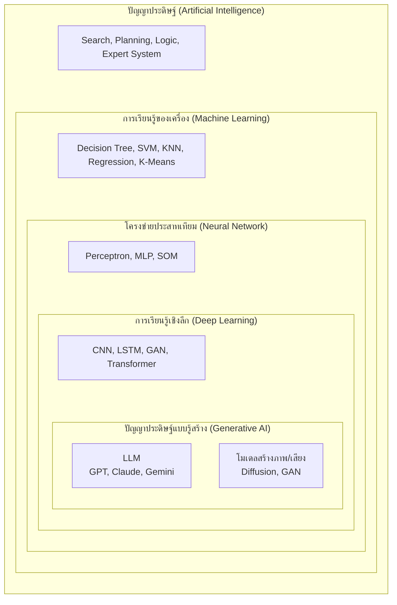
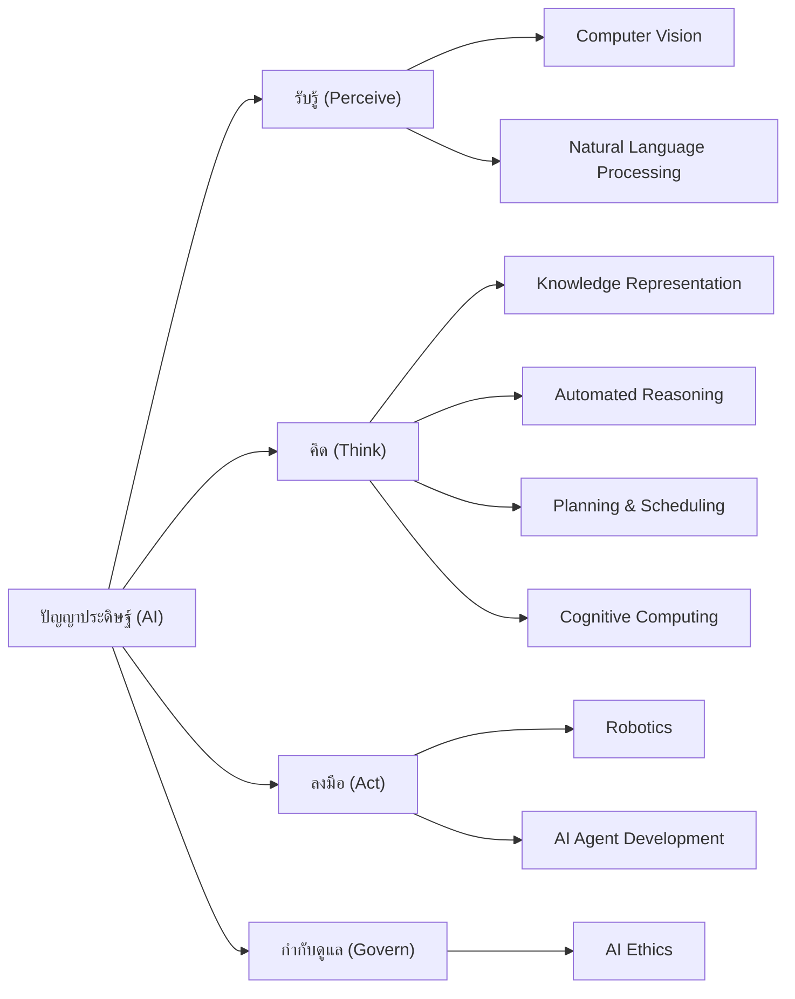
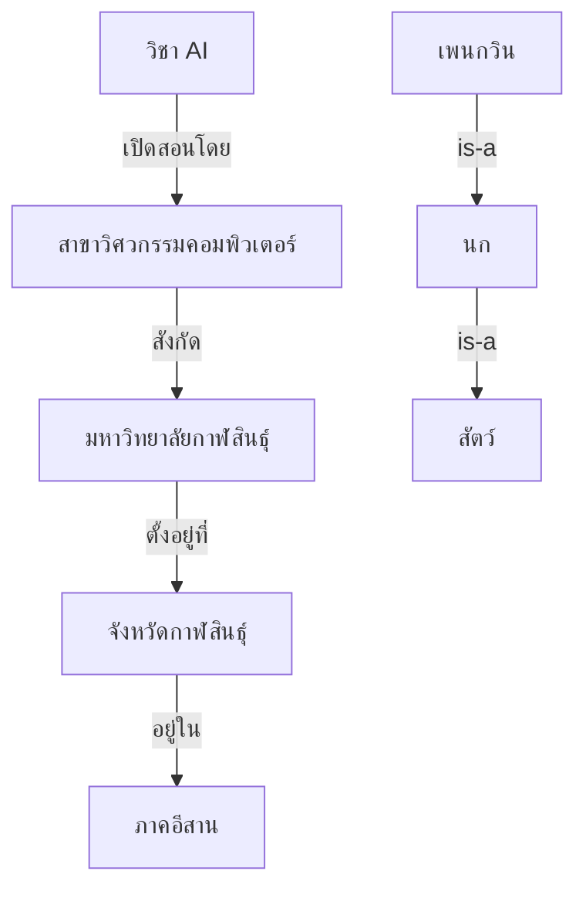
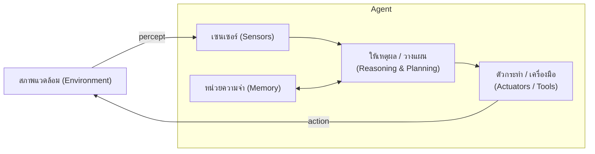
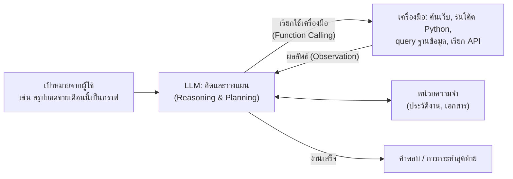
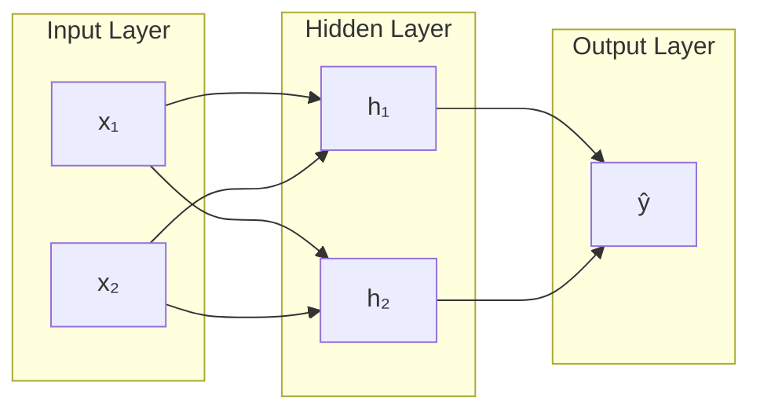
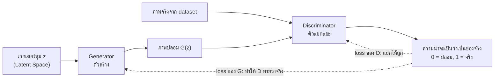
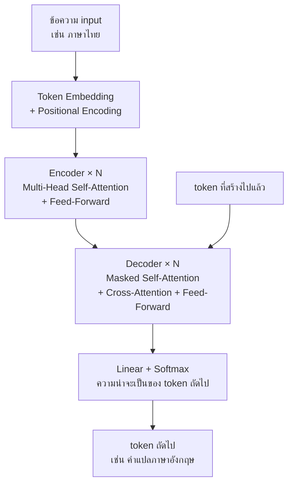
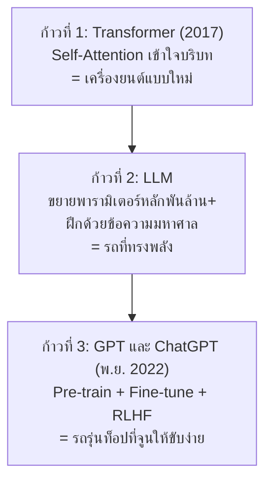
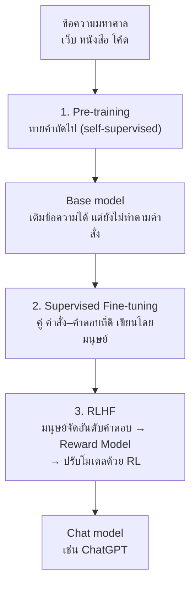

## วัตถุประสงค์การเรียนรู้

- อธิบายลำดับชั้นของปัญญาประดิษฐ์ (The AI Hierarchy) ได้แก่ AI, Machine Learning, Neural Network, Deep Learning, Generative AI และ LLM พร้อมบอกความแตกต่างของแต่ละระดับและยกตัวอย่างการประยุกต์ใช้ได้ (LLO1-1)
- จำแนกสาขาย่อยของ AI ทั้ง 9 สาขา (Planning & Scheduling, NLP, Automated Reasoning, Cognitive Computing, AI Ethics, Robotics, Knowledge Representation, Computer Vision, AI Agent Development) ตามความหมาย องค์ประกอบย่อย และการประยุกต์ใช้ได้ (LLO1-3)
- อธิบายแนวคิดการนำเสนอความรู้ (Knowledge Representation) การให้เหตุผลแบบนิรนัย อุปนัย และจารนัย และการวางแผนด้วยการค้นหาในพื้นที่สถานะได้ (LLO1-3)
- อธิบายโครงสร้างของตัวแทนปัญญาประดิษฐ์ (AI Agent) ด้วยวงจร perception → reasoning/planning → action และกรอบ PEAS ได้ (LLO1-3)
- อธิบายหลักการของ GAN และ Transformer (Self-Attention, Encoder/Decoder) และเส้นทางวิวัฒนาการ Transformer → LLM → GPT/ChatGPT พร้อมข้อจำกัดของ Generative AI ได้ (LLO1-1)

## 1. ภาพรวม: ลำดับชั้นของปัญญาประดิษฐ์ (The AI Hierarchy)

### 1.1 AI คืออะไร

**ปัญญาประดิษฐ์ (Artificial Intelligence, AI)** คือศาสตร์ของการสร้างระบบคอมพิวเตอร์ที่แสดงพฤติกรรม "ฉลาด" เช่น รับรู้สภาพแวดล้อม ให้เหตุผล วางแผน เรียนรู้ สื่อสารด้วยภาษา และตัดสินใจลงมือทำเพื่อให้บรรลุเป้าหมาย

ตำรา AIMA (Russell & Norvig) จัดนิยามของ AI ออกเป็น 4 แนวทาง จากสองคำถามคือ "เน้นการคิดหรือการกระทำ" และ "วัดเทียบกับมนุษย์หรือเทียบกับความมีเหตุผล (rationality)"

| | เทียบกับมนุษย์ | เทียบกับความมีเหตุผล |
|---|---|---|
| **การคิด** | Thinking humanly: จำลองการคิดของมนุษย์ (cognitive science) | Thinking rationally: คิดตามกฎตรรกศาสตร์ |
| **การกระทำ** | Acting humanly: ทำตัวให้แยกไม่ออกจากมนุษย์ (Turing Test) | **Acting rationally: ตัวแทนที่มีเหตุผล (rational agent)** |

ตำราสมัยใหม่ (และรายวิชานี้) ยึดแนวทาง **rational agent** คือ AI เป็น "ตัวแทน (agent) ที่เลือกการกระทำที่คาดว่าจะให้ผลดีที่สุดตามเป้าหมาย จากข้อมูลที่รับรู้ได้" แนวคิดนี้จะกลับมาอีกครั้งในหัวข้อที่ 5

> [!NOTE]
> AI ที่ใช้งานจริงทุกวันนี้เกือบทั้งหมดเป็น **Narrow AI (ANI)** คือเก่งเฉพาะงาน เช่น จดจำใบหน้า แปลภาษา เล่นหมากล้อม ส่วน **General AI (AGI)** ที่ทำงานทางปัญญาได้หลากหลายเทียบเท่ามนุษย์ยังเป็นเป้าหมายการวิจัยและเป็นประเด็นถกเถียง แม้ LLM รุ่นใหม่จะทำงานได้หลากหลายขึ้นมากก็ตาม

### 1.2 แผนภาพวงซ้อน

ภาพ The AI Hierarchy มักวาดเป็น "วงซ้อน" — วงในเป็นส่วนหนึ่งของวงนอกเสมอ ยิ่งเข้าไปข้างในยิ่งเฉพาะเจาะจงมากขึ้น



### 1.3 แต่ละระดับต่างกันอย่างไร

| ระดับ | นิยาม | ต่างจากระดับที่ครอบอยู่อย่างไร | ตัวอย่างการประยุกต์ใช้ |
|---|---|---|---|
| **AI** | ทุกเทคนิคที่ทำให้เครื่องแสดงพฤติกรรมฉลาด | — (ร่มใหญ่สุด) รวมทั้งวิธีที่ **มนุษย์เขียนกฎ/ความรู้ให้เอง** | ระบบผู้เชี่ยวชาญวินิจฉัยโรค, ระบบนำทาง GPS, AI เล่นหมากรุก (Deep Blue) |
| **Machine Learning** | ระบบที่ **เรียนรู้รูปแบบจากข้อมูล** แล้วทำงานได้ดีขึ้นเมื่อมีประสบการณ์มากขึ้น | ไม่ต้องเขียนกฎเองทั้งหมด แต่ "หากฎ" จากตัวอย่าง | กรองอีเมลขยะ, ทำนายราคาบ้าน, จัดกลุ่มลูกค้า |
| **Neural Network** | โมเดล ML ที่ประกอบด้วย **นิวรอนเทียม** ต่อกันเป็นชั้น ปรับค่าน้ำหนักด้วย backpropagation | เป็น ML ตระกูลหนึ่งที่จำลองแนวคิดเซลล์ประสาท เรียนความสัมพันธ์ไม่เชิงเส้นได้ | จดจำตัวเลขลายมือ, ทำนายความเสี่ยงสินเชื่อ |
| **Deep Learning** | Neural network ที่มี **ชั้นซ่อนหลายชั้น (deep)** เรียน feature เป็นลำดับขั้นจากข้อมูลดิบ | ไม่ต้องออกแบบ feature เอง แต่ต้องการข้อมูลและพลังคำนวณ (GPU) มาก | จดจำใบหน้า (Face ID), แปลภาษา, รถยนต์ไร้คนขับ |
| **Generative AI** | Deep learning ที่ **สร้างเนื้อหาใหม่** (ข้อความ ภาพ เสียง โค้ด) ตามรูปแบบที่เรียนมา | ไม่ได้แค่จำแนก/ทำนายค่า แต่ "สร้าง" ข้อมูลที่ไม่เคยมีมาก่อน | สร้างภาพจาก prompt, เขียนโค้ด, สังเคราะห์เสียง |
| **LLM** | Generative AI สำหรับ **ภาษา** ที่ใช้ Transformer ขนาดใหญ่ (พารามิเตอร์หลักพันล้านขึ้นไป) ฝึกด้วยข้อความมหาศาล | เน้นข้อความ/ภาษา (รุ่นใหม่รับภาพและเสียงได้ด้วย = multimodal) | ChatGPT, Claude, Gemini, ผู้ช่วยเขียนโค้ด |

**ตัวอย่างเดียว ไล่ทุกระดับ — ระบบคัดกรองอีเมล**

- **AI (กฎ):** IF หัวเรื่องมีคำว่า "ถูกรางวัล" THEN ย้ายไปถังขยะ
- **ML:** ฝึก Naive Bayes จากอีเมลเก่าที่ติดป้าย spam/ham ไว้แล้ว
- **Neural Network / Deep Learning:** โมเดลหลายชั้นอ่านทั้งข้อความและรูปแบบการเขียน จับสแปมรูปแบบใหม่ได้ดีขึ้น
- **Generative AI / LLM:** นอกจากจับสแปมแล้ว ยัง **ร่างคำตอบอีเมล** หรือ **สรุปเนื้อหาอีเมลยาว ๆ** ให้ผู้ใช้ได้

> [!WARNING]
> แผนภาพวงซ้อนเป็น **การจัดกลุ่มอย่างง่ายเพื่อการสอน** ในความเป็นจริงขอบเขตไม่ได้คมชัดทุกจุด เช่น โมเดลเชิงสร้างแบบดั้งเดิม (n-gram, Naive Bayes, HMM) ไม่ได้เป็น deep learning, LLM ก็ใช้ทำงานที่ "ไม่สร้าง" ได้ (เช่น จำแนกข้อความ) และระบบ AI จริงหลายระบบผสมหลายระดับเข้าด้วยกัน (เช่น AlphaGo ผสาน search + deep learning + reinforcement learning)

### 1.4 เส้นเวลาสำคัญ

| ปี | เหตุการณ์ | ระดับที่เกี่ยวข้อง |
|---|---|---|
| 1950 | Alan Turing เสนอ "Imitation Game" (Turing Test) | AI |
| 1956 | การประชุม Dartmouth — ใช้คำว่า "Artificial Intelligence" อย่างเป็นทางการ | AI |
| 1958 | Rosenblatt เสนอ Perceptron | Neural Network |
| ทศวรรษ 1970–80 | ยุคระบบผู้เชี่ยวชาญ (MYCIN, DENDRAL) | AI (Knowledge-based) |
| 1986 | Rumelhart, Hinton & Williams เผยแพร่ backpropagation อย่างกว้างขวาง | Neural Network |
| 1997 | Deep Blue ชนะแชมป์หมากรุกโลก Kasparov / มีการเสนอ LSTM | AI (Search) / NN |
| 2012 | AlexNet ชนะการแข่งขัน ImageNet แบบทิ้งห่าง — จุดเริ่มยุค deep learning | Deep Learning |
| 2014 | Ian Goodfellow และคณะเสนอ GAN | Deep Learning / GenAI |
| 2016 | AlphaGo ชนะ Lee Sedol ในเกมโกะ | DL + RL + Search |
| 2017 | Google เสนอ Transformer ในบทความ "Attention Is All You Need" | Deep Learning |
| 2018 | BERT (Google) และ GPT รุ่นแรก (OpenAI) | LLM |
| 2020 | GPT-3 (175B พารามิเตอร์) แสดงความสามารถ few-shot | LLM |
| พ.ย. 2022 | OpenAI เปิดตัว ChatGPT | GenAI / LLM |
| 2023 เป็นต้นไป | LLM แบบ multimodal และ AI Agent ที่ใช้เครื่องมือได้ | GenAI / Agent |

## 2. สาขาย่อยของ AI (AI Subfields)

นอกจากการแบ่ง "ตามความลึก" (AI → ML → DL) แล้ว เรายังแบ่ง AI "ตามความสามารถ" ได้เป็นสาขาย่อย เอกสารประกอบการสอนของรายวิชาจัดไว้ 9 สาขา แต่ละสาขาอาจใช้เทคนิคจากระดับใดของ hierarchy ก็ได้ เช่น Computer Vision ยุคเก่าใช้กฎและการประมวลผลภาพ ยุคปัจจุบันใช้ deep learning เป็นหลัก



### 2.1 ตารางสรุป 9 สาขา

| # | สาขา | ความหมายโดยย่อ | องค์ประกอบย่อย | ตัวอย่างการประยุกต์ใช้ |
|---|---|---|---|---|
| 1 | การวางแผนและการจัดตารางเวลา (Planning & Scheduling) | จัดลำดับการกระทำ/กิจกรรมให้บรรลุเป้าหมาย โดยใช้ทรัพยากรและเวลาอย่างคุ้มค่า | State Space Search, Temporal Planning, Resource Allocation, Heuristic Search | วางเส้นทางขนส่งสินค้า, จัดตารางการบินและลูกเรือ, จัดคิวห้องผ่าตัด, Smart Grid, หุ่นยนต์สำรวจดาวอังคาร |
| 2 | การประมวลผลภาษาธรรมชาติ (NLP) | ทำให้คอมพิวเตอร์เข้าใจ ตีความ วิเคราะห์ และสร้างภาษามนุษย์ (ข้อความและเสียง) | Syntax Analysis, Semantic Analysis, Speech Recognition, Natural Language Generation (NLG) | ผู้ช่วยเสมือน (Siri), แชทบอท, Google Translate, Sentiment Analysis, สรุปข่าว |
| 3 | การให้เหตุผลอัตโนมัติ (Automated Reasoning) | ใช้โปรแกรมพิสูจน์หรือหาข้อสรุปอย่างเป็นเหตุเป็นผลด้วยหลักตรรกศาสตร์ | Theorem Proving, Logic Programming, Deductive & Inductive Reasoning | ตรวจสอบความถูกต้องของซอฟต์แวร์, ระบบผู้เชี่ยวชาญทางการแพทย์, วิเคราะห์สัญญา, ตรวจจับการบุกรุกเครือข่าย |
| 4 | การประมวลผลเชิงพุทธิปัญญา (Cognitive Computing) | ระบบที่จำลองกระบวนการคิดของมนุษย์เพื่อแก้ปัญหาที่ซับซ้อน/กำกวม เน้นโต้ตอบกับมนุษย์อย่างเป็นธรรมชาติ | แบบจำลองการรับรู้, Machine Learning, HCI, Data Mining | Robo-advisor, บทเรียนเฉพาะบุคคล, ค้นพบยาใหม่, วิเคราะห์ความเสี่ยงธุรกิจ, IBM Watson |
| 5 | จริยธรรมปัญญาประดิษฐ์ (AI Ethics) | หลักการและแนวปฏิบัติให้ AI ยุติธรรม โปร่งใส ปลอดภัย ไม่ละเมิดสิทธิ | Explainability/Transparency, Data Privacy, Bias Mitigation, Accountability | คัดกรองเรซูเม่ที่ไม่ลำเอียง, ตรวจจับ Deepfake, อธิบายผลอนุมัติสินเชื่อ, Federated Learning |
| 6 | วิทยาการหุ่นยนต์ (Robotics) | ออกแบบ สร้าง และควบคุมหุ่นยนต์ เมื่อผสาน AI จะรับรู้ ตัดสินใจ และทำงานได้เอง | Sensors & Perception, Kinematics/Dynamics, Control Systems, HRI | แขนกลในโรงงาน, หุ่นยนต์ช่วยผ่าตัด (Da Vinci), โดรนส่งของ, หุ่นยนต์ดูดฝุ่น, หุ่นยนต์กู้ภัย |
| 7 | การนำเสนอความรู้ (Knowledge Representation) | วิธีจัดโครงสร้างและบันทึกความรู้เกี่ยวกับโลก ให้คอมพิวเตอร์นำไปประมวลผลและแก้ปัญหาได้ | Ontologies, Semantic Networks, Frames, Rule-based Systems | Google Knowledge Graph, Semantic Web, ระบบผู้เชี่ยวชาญซ่อมบำรุง, วินิจฉัยเครือข่ายล่ม, เวชระเบียน |
| 8 | คอมพิวเตอร์วิทัศน์ (Computer Vision) | ทำให้คอมพิวเตอร์ "มองเห็น" เข้าใจ และวิเคราะห์ภาพนิ่ง/วิดีโอ | Image Recognition, Object Detection, Image Segmentation, Facial Recognition | รถไร้คนขับ, วิเคราะห์ภาพ X-ray/MRI, Face ID, QC ในสายการผลิต, กล้องวงจรปิดอัจฉริยะ |
| 9 | การพัฒนาตัวแทนปัญญาประดิษฐ์ (AI Agent Development) | สร้างระบบที่รับรู้ ตัดสินใจเอง (autonomy) และลงมือทำ รวมถึงใช้เครื่องมือ เพื่อบรรลุเป้าหมายแบบหลายขั้นตอน | Perception, Decision Making & Planning, Memory (short/long-term), Tool Use/Action, Multi-Agent Systems | AutoGPT, บอทเทรดอัตโนมัติ, NPC ในเกม, Coding Agent, ตัวแทนเฝ้าระวังเซิร์ฟเวอร์ |

สาขาที่ 1, 3, 7 และ 9 มีรายละเอียดในหัวข้อที่ 3–5 ส่วนสาขาที่เหลือสรุปได้ดังนี้

### 2.2 การประมวลผลภาษาธรรมชาติ (Natural Language Processing, NLP)

**ความหมาย:** สาขาที่ทำให้คอมพิวเตอร์ทำงานกับภาษามนุษย์ได้ ทั้ง "ฝั่งเข้าใจ" (Natural Language Understanding, NLU — ตีความความหมายและเจตนา) และ "ฝั่งสร้าง" (Natural Language Generation, NLG — สร้างประโยคตอบกลับ)

**องค์ประกอบย่อย:** การวิเคราะห์วากยสัมพันธ์ (Syntax Analysis — โครงสร้างประโยค), การวิเคราะห์ความหมาย (Semantic Analysis), การรู้จำเสียงพูด (Speech Recognition), การสร้างภาษาธรรมชาติ (NLG)

**ตัวอย่างการประยุกต์ใช้:** ผู้ช่วยเสมือนที่สั่งงานด้วยเสียง, แชทบอทตอบลูกค้าแบบเรียลไทม์, แปลภาษาอัตโนมัติ, วิเคราะห์ความรู้สึก (sentiment) ของรีวิวต่อแบรนด์, สรุปข่าวยาวให้เหลือใจความสำคัญ — รายละเอียด pipeline การประมวลผลข้อความภาษาไทยอยู่ใน [บทที่ 8](/module/08)

### 2.3 การประมวลผลเชิงพุทธิปัญญา (Cognitive Computing)

**ความหมาย:** ระบบที่จำลองกระบวนการคิดของมนุษย์ (เรียนรู้ ให้เหตุผล จดจำ) เพื่อช่วยตัดสินใจในสถานการณ์ที่ซับซ้อนหรือกำกวม โดยเน้นการโต้ตอบกับมนุษย์อย่างเป็นธรรมชาติ — มักเป็น "ระบบช่วยตัดสินใจ" ที่มนุษย์ยังเป็นผู้ตัดสินขั้นสุดท้าย มากกว่าระบบที่ตัดสินใจแทนทั้งหมด

**องค์ประกอบย่อย:** แบบจำลองการรับรู้, Machine Learning, การปฏิสัมพันธ์ระหว่างมนุษย์และคอมพิวเตอร์ (HCI), เหมืองข้อมูล (Data Mining)

**ตัวอย่างการประยุกต์ใช้:** ที่ปรึกษาการลงทุนอัตโนมัติ (Robo-advisor), แพลตฟอร์มการศึกษาที่ปรับบทเรียนตามผู้เรียน, การค้นหาโมเลกุลยาใหม่ (Drug Discovery), การวิเคราะห์ความเสี่ยงทางธุรกิจ และ IBM Watson (มีชื่อเสียงจากการชนะเกมตอบคำถาม Jeopardy! ในปี 2011 และถูกนำไปทดลองช่วยแพทย์วิเคราะห์ข้อมูลผู้ป่วยมะเร็ง)

### 2.4 จริยธรรมปัญญาประดิษฐ์ (AI Ethics)

**ความหมาย:** กรอบแนวคิดและแนวปฏิบัติทางศีลธรรมในการออกแบบ พัฒนา และใช้งาน AI ให้ **ยุติธรรม โปร่งใส ปลอดภัย และไม่ละเมิดสิทธิมนุษยชน** — เป็นสาขาที่ "กำกับ" สาขาอื่นทั้งหมด

**องค์ประกอบย่อย:** ความโปร่งใสและอธิบายได้ (Explainability/Transparency), ความเป็นส่วนตัวของข้อมูล (Data Privacy), การลดความลำเอียง (Bias Mitigation), ความรับผิดชอบ (Accountability — ใครรับผิดเมื่อ AI ผิดพลาด)

**ตัวอย่างการประยุกต์ใช้:** ปรับอัลกอริทึมคัดกรองผู้สมัครงานไม่ให้ลำเอียงทางเพศ/เชื้อชาติ, กำหนดหลักการตัดสินใจของรถไร้คนขับในเหตุฉุกเฉิน, เครื่องมือตรวจจับ Deepfake, Explainable AI ที่อธิบายได้ว่าทำไมสินเชื่อไม่ผ่าน, Federated Learning ที่ฝึกโมเดลโดยข้อมูลส่วนตัวไม่ต้องออกจากเครื่องผู้ใช้ (ดูประเด็นของ Generative AI ในหัวข้อ 8.6)

### 2.5 วิทยาการหุ่นยนต์ (Robotics)

**ความหมาย:** สาขาที่ว่าด้วยการออกแบบ สร้าง และควบคุมหุ่นยนต์ เมื่อผสานกับ AI หุ่นยนต์จะ **รับรู้สภาพแวดล้อม ตัดสินใจ และทำงานซับซ้อนได้เอง** — หุ่นยนต์จึงเป็น "AI agent ที่มีร่างกายจริง" (embodied agent)

**องค์ประกอบย่อย:** เซนเซอร์และการรับรู้ (Sensors & Perception — มักใช้ Computer Vision), จลนศาสตร์และพลศาสตร์ (Kinematics/Dynamics), ระบบควบคุม (Control Systems), การปฏิสัมพันธ์ระหว่างมนุษย์และหุ่นยนต์ (HRI)

**ตัวอย่างการประยุกต์ใช้:** แขนกลประกอบรถยนต์, หุ่นยนต์ช่วยผ่าตัด (เช่น Da Vinci) ที่แผลเล็กและแม่นยำ, โดรนส่งเวชภัณฑ์ไปพื้นที่ห่างไกล, หุ่นยนต์ดูดฝุ่นที่สร้างแผนที่บ้านเอง, หุ่นยนต์กู้ภัยค้นหาผู้รอดชีวิตในซากอาคาร

### 2.6 คอมพิวเตอร์วิทัศน์ (Computer Vision)

**ความหมาย:** สาขาที่ทำให้คอมพิวเตอร์มีความสามารถคล้ายดวงตามนุษย์ คือ **มองเห็น เข้าใจ และวิเคราะห์** ข้อมูลจากภาพนิ่ง ภาพเคลื่อนไหว และวิดีโอ

**องค์ประกอบย่อย (งานหลัก 4 แบบ)**

| งาน | คำถามที่ตอบ | ผลลัพธ์ |
|---|---|---|
| การรู้จำภาพ (Image Recognition / Classification) | ภาพนี้คืออะไร | ป้ายชื่อ 1 ป้ายต่อภาพ เช่น "แมว" |
| การตรวจจับวัตถุ (Object Detection) | มีวัตถุอะไร อยู่ตรงไหน | กรอบสี่เหลี่ยม (bounding box) + ป้ายชื่อ หลายวัตถุ |
| การแบ่งส่วนภาพ (Image Segmentation) | แต่ละพิกเซลเป็นของวัตถุใด | หน้ากาก (mask) ระดับพิกเซล |
| การจดจำใบหน้า (Facial Recognition) | ใบหน้านี้เป็นของใคร | ตัวตนของบุคคล / ยืนยันตัวตน |

**ตัวอย่างการประยุกต์ใช้:** รถไร้คนขับตรวจจับเลนถนน คนข้ามถนน และป้ายจราจร, ช่วยรังสีแพทย์หาความผิดปกติจากภาพ X-ray หรือ MRI, ปลดล็อกโทรศัพท์ด้วยใบหน้า (Face ID), กล้อง QC คัดผลไม้เน่าหรือชิ้นงานบกพร่องออกจากสายการผลิต, กล้องวงจรปิดแจ้งเตือนผู้บุกรุก — สถาปัตยกรรมหลักคือ CNN ใน [บทที่ 7](/module/07)

## 3. การนำเสนอความรู้และการให้เหตุผลอัตโนมัติ

สองสาขานี้เป็นแกนของ **Symbolic AI** — ความรู้ถูกเขียนอย่างชัดแจ้งด้วยสัญลักษณ์ แล้วเครื่องใช้ตรรกะหาข้อสรุปใหม่ ต่างจาก ML ที่ความรู้ "ซ่อน" อยู่ในค่าพารามิเตอร์ของโมเดล

### 3.1 การนำเสนอความรู้ (Knowledge Representation)

**ความหมาย:** วิธีที่ AI จัดโครงสร้าง บันทึก และนำเสนอข้อมูลเกี่ยวกับโลกจริง เพื่อให้คอมพิวเตอร์ดึงไปประมวลผลและใช้แก้ปัญหาได้อย่างมีประสิทธิภาพ รูปแบบที่สำคัญมีดังนี้

| วิธี | แนวคิด | ตัวอย่าง |
|---|---|---|
| ระบบฐานกฎ (Rule-based Systems) | กฎ IF เงื่อนไข THEN ข้อสรุป | IF เกรดเฉลี่ย < 1.75 THEN สถานะ = รอพินิจ |
| ตรรกศาสตร์ (Logic) | ประพจน์และตัวบ่งปริมาณ อนุมานได้อย่างเข้มงวด | ∀x นักศึกษา(x) ⇒ มีรหัสนักศึกษา(x) |
| กรอบแนวคิด (Frames) | วัตถุหนึ่งเก็บเป็นชุด slot–value และสืบทอดค่าได้ | Frame "ห้องเรียน": ความจุ = 60, มีโปรเจกเตอร์ = ใช่ |
| เครือข่ายเชิงความหมาย (Semantic Networks) | กราฟของแนวคิด เชื่อมด้วยความสัมพันธ์ เช่น is-a, part-of | นกเพนกวิน —is-a→ นก —is-a→ สัตว์ |
| ออนโทโลยี (Ontologies) | นิยามคำศัพท์และความสัมพันธ์ของโดเมนอย่างเป็นทางการ ให้หลายระบบใช้ร่วมกันได้ | ออนโทโลยีทางการแพทย์ SNOMED CT |
| กราฟความรู้ (Knowledge Graph) | ข้อเท็จจริงเป็น triple (subject, relation, object) ขนาดใหญ่ | (กาฬสินธุ์, เป็นจังหวัดใน, ภาคอีสาน) |

ตัวอย่าง **knowledge graph** ขนาดเล็ก และการอนุมานจากความสัมพันธ์ is-a



จากกราฟนี้ระบบตอบได้ว่า "วิชา AI เปิดสอนในภาคอีสาน" ทั้งที่ไม่มีเส้นเชื่อมตรง โดยเดินตามเส้นเชื่อมหลายช่วง (multi-hop) และสรุปได้ว่า "เพนกวินเป็นสัตว์" จากการสืบทอดคุณสมบัติตาม is-a (inheritance) — แต่ต้องระวัง **ข้อยกเว้น** เช่น "นกบินได้" ไม่จริงสำหรับเพนกวิน ระบบ KR จึงต้องรองรับค่าเริ่มต้น (default) ที่ถูกแทนที่ได้

> [!TIP]
> การเขียนกฎ IF-THEN, โครงสร้างระบบผู้เชี่ยวชาญ (Knowledge base + Inference engine) และการอนุมานแบบ forward/backward chaining พร้อมโค้ด Python อยู่ใน [บทที่ 1 หัวข้อที่ 7](/module/01)

### 3.2 การให้เหตุผลอัตโนมัติ (Automated Reasoning)

**ความหมาย:** การใช้โปรแกรมคอมพิวเตอร์พิสูจน์หรือหาข้อสรุปอย่างเป็นเหตุเป็นผล โดยอาศัยหลักตรรกศาสตร์และความรู้ที่มีอยู่ เพื่อแก้ปัญหาที่ซับซ้อน

**รูปแบบการให้เหตุผล 3 แบบ**

| แบบ | ทิศทาง | ตัวอย่าง | ความแน่นอน |
|---|---|---|---|
| **นิรนัย (Deduction)** | กฎทั่วไป + ข้อเท็จจริง → ข้อสรุปเฉพาะ | "นักศึกษาทุกคนที่สอบผ่านได้หน่วยกิต" + "สมชายสอบผ่าน" → "สมชายได้หน่วยกิต" | **แน่นอน** ถ้าข้อตั้งจริง ข้อสรุปจริงเสมอ (sound) |
| **อุปนัย (Induction)** | ตัวอย่างเฉพาะหลายกรณี → กฎทั่วไป | "หงส์ 1,000 ตัวที่เห็นเป็นสีขาว" → "หงส์ทุกตัวเป็นสีขาว" | ไม่แน่นอน อาจมีตัวอย่างค้าน — **เป็นหลักของ Machine Learning** |
| **จารนัย (Abduction)** | ผลที่สังเกตได้ + กฎ → คำอธิบายที่เป็นไปได้มากที่สุด | "ถ้าฝนตกถนนจะเปียก" + "ถนนเปียก" → "น่าจะฝนตก" | ไม่แน่นอน (อาจเป็นเพราะรดน้ำต้นไม้) — **เป็นหลักของการวินิจฉัย** |

**องค์ประกอบย่อย**

- **การพิสูจน์ทฤษฎีบท (Theorem Proving):** ให้เครื่องพิสูจน์ว่าข้อความหนึ่งเป็นผลตามตรรกะของสัจพจน์/ฐานความรู้ เช่น วิธี resolution ที่พิสูจน์โดยข้อขัดแย้ง ใช้จริงในการพิสูจน์ความถูกต้องของวงจรและซอฟต์แวร์
- **การเขียนโปรแกรมเชิงตรรกะ (Logic Programming):** เขียนโปรแกรมเป็นข้อเท็จจริงและกฎ แล้วให้ระบบค้นหาคำตอบเอง เช่น ภาษา Prolog ที่ใช้ backward chaining
- **การอนุมานเชิงตรรกะ (Logical Inference):** กฎอนุมาน เช่น Modus Ponens — จาก $P \Rightarrow Q$ และ $P$ สรุป $Q$

**ตัวอย่างฝึกคิด (Deduction):** ฐานความรู้ KB มี (1) ฝนตก ⇒ ถนนเปียก (2) ถนนเปียก ⇒ รถลื่น (3) ฝนตก — ใช้ Modus Ponens กับ (3) และ (1) ได้ "ถนนเปียก" แล้วใช้อีกครั้งกับ (2) ได้ "รถลื่น" เราเขียนว่า $KB \models \text{รถลื่น}$ (KB **entails** รถลื่น) หมายความว่า "ในทุกโลกที่ KB เป็นจริง รถลื่นต้องเป็นจริงด้วย"

นิยามนี้ตรวจด้วยคอมพิวเตอร์ได้ตรง ๆ ด้วยวิธี **model checking** — ไล่ทุกการกำหนดค่าจริง/เท็จ (ทุก "โลกที่เป็นไปได้") แล้วหาว่ามีโลกใดที่ KB จริงแต่ข้อสรุปเท็จหรือไม่

```python
from itertools import product

symbols = ["ฝนตก", "ถนนเปียก", "รถลื่น"]

# ฐานความรู้ KB: (ฝนตก ⇒ ถนนเปียก) ∧ (ถนนเปียก ⇒ รถลื่น) ∧ ฝนตก
def KB(m):
    return ((not m["ฝนตก"]) or m["ถนนเปียก"]) and \
           ((not m["ถนนเปียก"]) or m["รถลื่น"]) and m["ฝนตก"]

def entails(kb, query, symbols):
    """KB ⊨ query ก็ต่อเมื่อ ทุกโลก (model) ที่ KB จริง query ต้องจริงด้วย"""
    for values in product([True, False], repeat=len(symbols)):
        m = dict(zip(symbols, values))
        if kb(m) and not query(m):
            return False, m          # เจอตัวอย่างค้าน (counterexample)
    return True, None

print("Deduction : KB ⊨ รถลื่น ?", entails(KB, lambda m: m["รถลื่น"], symbols))

# Abduction: รู้กฎ ฝนตก ⇒ ถนนเปียก และเห็นว่า "ถนนเปียก" — สรุปได้ไหมว่าฝนตก?
def KB2(m):
    return ((not m["ฝนตก"]) or m["ถนนเปียก"]) and m["ถนนเปียก"]

print("Abduction : KB2 ⊨ ฝนตก ?", entails(KB2, lambda m: m["ฝนตก"], symbols))
```

```output
Deduction : KB ⊨ รถลื่น ? (True, None)
Abduction : KB2 ⊨ ฝนตก ? (False, {'ฝนตก': False, 'ถนนเปียก': True, 'รถลื่น': True})
```

**การตีความ:** ข้อสรุปแบบนิรนัย "รถลื่น" ผ่านการตรวจทุกโลก จึงเป็นข้อสรุปที่ **แน่นอน** ส่วนการสรุปแบบจารนัยว่า "ฝนตก" ไม่ผ่าน — โปรแกรมหาตัวอย่างค้านเจอทันที คือโลกที่ถนนเปียกแต่ฝนไม่ตก ดังนั้นจารนัยให้ได้แค่ "คำอธิบายที่น่าจะเป็น" ซึ่งระบบวินิจฉัยต้องจัดอันดับด้วยความน่าจะเป็นหรือหาหลักฐานเพิ่ม วิธี model checking ใช้เวลา $2^n$ สำหรับ $n$ สัญลักษณ์ ระบบจริงจึงใช้อัลกอริทึมที่ฉลาดกว่า เช่น resolution หรือ SAT solver

**ตัวอย่างการประยุกต์ใช้:** ตรวจสอบว่าซอฟต์แวร์/วงจรทำงานถูกตามข้อกำหนด (software & hardware verification), ระบบผู้เชี่ยวชาญทางการแพทย์ที่ให้เหตุผลว่าผู้ป่วยน่าจะเป็นโรคใด, AI เกมกระดานที่คิดล่วงหน้าหลายตา (Deep Blue ใช้การค้นหา ส่วน AlphaGo ผสานการค้นหากับ deep learning), วิเคราะห์ความเสี่ยงและช่องโหว่ในสัญญา, ให้เหตุผลจากพฤติกรรมในเครือข่ายเพื่อตรวจจับการบุกรุก

## 4. การวางแผนและการจัดตารางเวลา (Planning & Scheduling)

### 4.1 แนวคิด

**ความหมาย:** ความสามารถของ AI ในการจัดลำดับขั้นตอนการทำงานหรือกิจกรรมเพื่อให้บรรลุเป้าหมาย โดยคำนึงถึงการใช้ทรัพยากรและเวลาให้มีประสิทธิภาพสูงสุด

- **Planning** ตอบคำถาม "ต้องทำ **อะไร** ตามลำดับใด" จึงจะไปถึงเป้าหมาย
- **Scheduling** ตอบคำถาม "กิจกรรมที่รู้แล้วว่าต้องทำ ควรทำ **เมื่อไร** และใช้ **ทรัพยากรใด**" ภายใต้ข้อจำกัด

ปัญหาการวางแผนนิยามได้ด้วย **พื้นที่สถานะ (state space)** ซึ่งประกอบด้วย

| องค์ประกอบ | ความหมาย | ตัวอย่าง: หาเส้นทางในมหาวิทยาลัย |
|---|---|---|
| สถานะเริ่มต้น (initial state) | จุดเริ่ม | อยู่ที่หอพัก |
| การกระทำ (actions) | สิ่งที่ทำได้ในแต่ละสถานะ | เดินไปสถานที่ที่มีทางเชื่อม |
| แบบจำลองการเปลี่ยนสถานะ (transition model) | ทำ action แล้วได้สถานะใหม่อะไร | เดินจากหอพักไปโรงอาหาร → อยู่ที่โรงอาหาร |
| เป้าหมาย (goal test) | ตรวจว่าถึงเป้าหมายหรือยัง | อยู่ที่คณะวิศวฯ |
| ต้นทุน (path cost) | ราคาของแผน | ระยะทางรวม (เมตร) |
| ข้อจำกัด (constraints) | เงื่อนไขที่แผนต้องไม่ละเมิด | ห้ามผ่านอาคารที่ปิดซ่อม |

**องค์ประกอบย่อยตามเอกสารประกอบ**

- **การค้นหาพื้นที่สถานะ (State Space Search):** ไล่สำรวจสถานะที่เป็นไปได้เพื่อหาลำดับ action ที่ไปถึงเป้าหมาย เช่น BFS, DFS, Uniform-Cost Search
- **การค้นหาแบบฮิวริสติก (Heuristic Search):** ใช้ "ค่าประมาณระยะถึงเป้าหมาย" $h(n)$ ช่วยเลือกทางที่น่าจะดีก่อน เช่น A* ที่เลือกโหนดตาม $f(n) = g(n) + h(n)$ — ระบบนำทางใช้ระยะทางเส้นตรงเป็น $h(n)$
- **การวางแผนเชิงเวลา (Temporal Planning):** action มีระยะเวลาและอาจทำพร้อมกันได้ เช่น ยานสำรวจต้องชาร์จแบตก่อนเคลื่อนที่
- **การจัดสรรทรัพยากร (Resource Allocation):** แบ่งห้อง เครื่องจักร คน หรือพลังงานให้กิจกรรมโดยไม่ชนกัน

### 4.2 ตัวอย่าง: วางแผนเส้นทาง (Route Planning)

เปรียบเทียบ **BFS** (หาเส้นทางที่มีจำนวนช่วงน้อยที่สุด) กับ **Uniform-Cost Search** (หาเส้นทางที่ระยะทางรวมน้อยที่สุด) บนแผนที่สมมติของมหาวิทยาลัย

```python
from collections import deque
import heapq

# แผนที่มหาวิทยาลัย (สมมติ): โหนด = สถานที่, เส้นเชื่อม = ทางเดิน (ระยะทางเป็นเมตร)
campus = {
    "หอพัก":       {"โรงอาหาร": 300, "สนามกีฬา": 200},
    "โรงอาหาร":    {"หอพัก": 300, "หอสมุด": 250, "อาคารเรียนรวม": 600},
    "สนามกีฬา":    {"หอพัก": 200, "ลานจอดรถ": 150},
    "ลานจอดรถ":    {"สนามกีฬา": 150, "อาคารเรียนรวม": 200},
    "หอสมุด":      {"โรงอาหาร": 250, "คณะวิศวฯ": 300},
    "อาคารเรียนรวม": {"โรงอาหาร": 600, "ลานจอดรถ": 200, "คณะวิศวฯ": 150},
    "คณะวิศวฯ":    {"หอสมุด": 300, "อาคารเรียนรวม": 150},
}

def bfs(graph, start, goal):
    """Breadth-First Search: หาเส้นทางที่ 'จำนวนช่วง' น้อยที่สุด"""
    frontier, visited = deque([[start]]), {start}
    while frontier:
        path = frontier.popleft()
        if path[-1] == goal:                      # goal test
            return path
        for nxt in graph[path[-1]]:               # actions: เดินไปโหนดข้างเคียง
            if nxt not in visited:
                visited.add(nxt)
                frontier.append(path + [nxt])

def uniform_cost(graph, start, goal):
    """Uniform-Cost Search (Dijkstra): หาเส้นทางที่ 'ระยะทางรวม' น้อยที่สุด"""
    frontier, best = [(0, [start])], {start: 0}
    while frontier:
        cost, path = heapq.heappop(frontier)
        if path[-1] == goal:
            return cost, path
        for nxt, d in graph[path[-1]].items():
            if cost + d < best.get(nxt, float("inf")):
                best[nxt] = cost + d
                heapq.heappush(frontier, (cost + d, path + [nxt]))

def length(path):
    return sum(campus[a][b] for a, b in zip(path, path[1:]))

p = bfs(campus, "หอพัก", "คณะวิศวฯ")
print("BFS :", " → ".join(p), f"({len(p)-1} ช่วง, {length(p)} ม.)")
cost, p = uniform_cost(campus, "หอพัก", "คณะวิศวฯ")
print("UCS :", " → ".join(p), f"({len(p)-1} ช่วง, {cost} ม.)")
```

```output
BFS : หอพัก → โรงอาหาร → หอสมุด → คณะวิศวฯ (3 ช่วง, 850 ม.)
UCS : หอพัก → สนามกีฬา → ลานจอดรถ → อาคารเรียนรวม → คณะวิศวฯ (4 ช่วง, 700 ม.)
```

**การตีความ:** "แผนที่ดีที่สุด" ขึ้นกับ **ต้นทุนที่เรานิยาม** — BFS ได้เส้นทางที่ผ่านน้อยจุดที่สุด (3 ช่วง) แต่เดินไกลกว่า ส่วน UCS ยอมผ่าน 4 จุดเพื่อให้ระยะทางรวมสั้นที่สุด (700 ม.) ระบบนำทางจริงใช้ A* ที่เพิ่ม heuristic เพื่อค้นหาเร็วขึ้นบนแผนที่ที่มีโหนดนับล้าน

### 4.3 ตัวอย่าง: จัดตารางสอน (Scheduling เป็น Constraint Satisfaction)

การจัดตารางเรียนคือการกำหนด (เวลา, ห้อง) ให้ทุกวิชา โดยห้ามมี **ห้องชน อาจารย์ชน หรือกลุ่มนักศึกษาชน** ในช่วงเวลาเดียวกัน ปัญหาแบบนี้เรียกว่า **Constraint Satisfaction Problem (CSP)** แก้ได้ด้วย **backtracking search** — กำหนดค่าทีละวิชา ถ้าละเมิดข้อจำกัดให้ลองค่าอื่น ถ้าไม่มีค่าใดใช้ได้ให้ย้อนกลับไปแก้วิชาก่อนหน้า

```python
# จัดตารางสอนเป็นปัญหา Constraint Satisfaction (CSP)
courses = {               # วิชา: (อาจารย์, กลุ่มนักศึกษา)
    "AI":        ("อ.สรายุทธ", "CPE3"),
    "Database":  ("อ.สมชาย",   "CPE3"),
    "Network":   ("อ.สมชาย",   "CPE2"),
    "Web":       ("อ.สรายุทธ", "CPE2"),
    "Math":      ("อ.สมหญิง",  "CPE3"),
}
slots = [("จ.", "09-12"), ("จ.", "13-16"), ("อ.", "09-12")]
rooms = ["EN-201", "EN-305"]
values = [(s, r) for s in slots for r in rooms]          # โดเมนของแต่ละตัวแปร

def consistent(course, value, schedule):
    slot, room = value
    teacher, group = courses[course]
    for other, (s2, r2) in schedule.items():
        if s2 != slot:
            continue
        t2, g2 = courses[other]
        if r2 == room or t2 == teacher or g2 == group:  # ห้องชน / อาจารย์ชน / นักศึกษาชน
            return False
    return True

tries = 0
def backtrack(schedule):
    global tries
    if len(schedule) == len(courses):                    # goal: ทุกวิชามีห้องและเวลา
        return schedule
    course = next(c for c in courses if c not in schedule)
    for value in values:
        tries += 1
        if consistent(course, value, schedule):
            result = backtrack({**schedule, course: value})
            if result:
                return result
    return None                                          # ทางตัน → ย้อนกลับ

plan = backtrack({})
for c, ((day, time), room) in plan.items():
    print(f"{c:9s} {day} {time}  {room}  ({courses[c][0]}, {courses[c][1]})")
print("จำนวนครั้งที่ลองกำหนดค่า:", tries)
```

```output
AI        จ. 09-12  EN-201  (อ.สรายุทธ, CPE3)
Database  จ. 13-16  EN-201  (อ.สมชาย, CPE3)
Network   จ. 09-12  EN-305  (อ.สมชาย, CPE2)
Web       จ. 13-16  EN-305  (อ.สรายุทธ, CPE2)
Math      อ. 09-12  EN-201  (อ.สมหญิง, CPE3)
จำนวนครั้งที่ลองกำหนดค่า: 15
```

**การตีความ:** ได้ตารางที่ไม่ละเมิดข้อจำกัดใดเลย สังเกตว่า Math ต้องไปวันอังคาร เพราะกลุ่ม CPE3 เรียน AI และ Database เต็มวันจันทร์แล้ว ในโลกจริงมีวิชาหลายร้อยวิชาและข้อจำกัดแบบ "อยากได้" (soft constraint) เช่น อาจารย์ไม่อยากสอนเช้า จึงใช้ heuristic (เลือกวิชาที่มีทางเลือกน้อยที่สุดก่อน) หรือ optimization ช่วย

**ตัวอย่างการประยุกต์ใช้:** วางแผนเส้นทางและตารางขนส่งในห่วงโซ่อุปทาน, จัดคิวเครื่องบินขึ้น-ลงและตารางลูกเรือ, Smart Grid วางแผนจ่ายไฟตามช่วงเวลา, จัดคิวห้องผ่าตัด เตียง และเวรบุคลากรในโรงพยาบาล, วางแผนเส้นทางหุ่นยนต์สำรวจดาวอังคารให้หลบสิ่งกีดขวางและประหยัดพลังงาน

## 5. ตัวแทนปัญญาประดิษฐ์ (AI Agent)

### 5.1 Agent คืออะไร

**ความหมาย (การพัฒนาตัวแทนปัญญาประดิษฐ์ — AI Agent Development):** การออกแบบและสร้างระบบที่ **รับรู้สภาพแวดล้อม ตัดสินใจได้ด้วยตนเอง (autonomy) และลงมือปฏิบัติ** รวมถึงใช้เครื่องมือต่าง ๆ เพื่อบรรลุเป้าหมายได้อย่างอิสระ และทำงานซับซ้อนแบบเป็นขั้นตอนได้

ตาม AIMA บทที่ 2 **agent** คือสิ่งใดก็ตามที่รับรู้สภาพแวดล้อมผ่าน **เซนเซอร์ (sensors)** และกระทำต่อสภาพแวดล้อมผ่าน **ตัวกระทำ (actuators)** การทำงานเป็นวงจรต่อเนื่อง



องค์ประกอบย่อยตามเอกสารประกอบ: **การรับรู้ (Perception)**, **การตัดสินใจและการวางแผน (Decision Making & Planning)**, **หน่วยความจำ (Memory — short/long term)**, **การใช้เครื่องมือ (Tool Use / Action)** และ **ระบบหลายตัวแทน (Multi-Agent Systems)**

### 5.2 กรอบ PEAS

ก่อนออกแบบ agent ต้องระบุ "งาน" ให้ชัดด้วยกรอบ **PEAS**

| | Performance measure | Environment | Actuators | Sensors |
|---|---|---|---|---|
| **แท็กซี่ไร้คนขับ** | ปลอดภัย ถึงเร็ว ถูกกฎหมาย ผู้โดยสารพอใจ | ถนน รถอื่น คนเดินถนน สภาพอากาศ | พวงมาลัย คันเร่ง เบรก ไฟเลี้ยว ลำโพง | กล้อง LiDAR GPS มาตรวัดความเร็ว |
| **แชทบอทงานทะเบียน** | ตอบถูก ตอบเร็ว ลดคนต่อคิว ไม่เปิดเผยข้อมูลส่วนตัว | นักศึกษา ระบบทะเบียน ปฏิทินการศึกษา | ข้อความตอบกลับ ส่งต่อเจ้าหน้าที่ | ข้อความที่นักศึกษาพิมพ์ ข้อมูลจากฐานข้อมูล |

ลักษณะของสภาพแวดล้อมที่ต้องวิเคราะห์ร่วมด้วย ได้แก่ **fully vs partially observable** (เห็นข้อมูลครบหรือไม่), **deterministic vs stochastic** (ผลของ action แน่นอนหรือสุ่ม), **episodic vs sequential** (การตัดสินใจครั้งก่อนมีผลต่อครั้งถัดไปหรือไม่), **static vs dynamic**, **discrete vs continuous** และ **single vs multi-agent** — เช่น แท็กซี่ไร้คนขับเป็น partially observable, stochastic, sequential, dynamic, continuous และ multi-agent ซึ่งเป็นกรณีที่ยากที่สุด

### 5.3 ประเภทของ Agent

| ประเภท | หลักการตัดสินใจ | ตัวอย่าง |
|---|---|---|
| Simple reflex agent | กฎ condition–action จาก percept **ปัจจุบัน** เท่านั้น | เทอร์โมสตัท: ร้อนเกิน 26°C → เปิดแอร์ |
| Model-based reflex agent | เก็บ **สถานะภายใน (internal state)** จำสิ่งที่มองไม่เห็นตอนนี้ | หุ่นยนต์ดูดฝุ่นที่จำแผนที่ห้องที่ทำความสะอาดแล้ว |
| Goal-based agent | วางแผนลำดับ action ให้ถึง **เป้าหมาย** | ระบบนำทาง GPS |
| Utility-based agent | เลือกทางที่ให้ **ประโยชน์ (utility)** สูงสุด เมื่อมีหลายทางถึงเป้าหมาย | นำทางที่ชั่งน้ำหนักเวลา ค่าทางด่วน และความปลอดภัย |
| Learning agent | ปรับปรุงตัวเองจาก **feedback/ประสบการณ์** | agent เล่นเกมด้วย Reinforcement Learning ([บทที่ 9](/module/09)) |
| Multi-agent system | agent หลายตัว **ร่วมมือหรือแข่งขัน** กัน | ฝูงโดรน, หุ่นยนต์คลังสินค้า, NPC หลายตัวในเกม |

### 5.4 ตัวอย่าง: วงจรของ Simple Reflex Agent

ตัวอย่างคลาสสิกจาก AIMA คือ **Vacuum World** — ห้อง 2 ช่อง (A, B) หุ่นยนต์ดูดฝุ่นรับรู้ได้แค่ "ตัวเองอยู่ช่องไหน" และ "ช่องนั้นสกปรกไหม"

```python
# Vacuum World (AIMA บทที่ 2): ห้อง 2 ช่อง A และ B แต่ละช่อง "สกปรก" หรือ "สะอาด"
world = {"A": "สกปรก", "B": "สกปรก"}
location = "A"
score = 0

def reflex_vacuum_agent(percept):
    """Simple reflex agent: เลือก action จาก percept ปัจจุบันด้วยกฎ condition–action"""
    loc, status = percept
    if status == "สกปรก":
        return "ดูดฝุ่น"
    return "ไปขวา" if loc == "A" else "ไปซ้าย"

for step in range(1, 6):
    percept = (location, world[location])          # 1) Perception: เซนเซอร์อ่านสภาพแวดล้อม
    action = reflex_vacuum_agent(percept)          # 2) Decision: ตัดสินใจ
    if action == "ดูดฝุ่น":                          # 3) Action: actuator เปลี่ยนสภาพแวดล้อม
        world[location] = "สะอาด"
    else:
        location = "B" if action == "ไปขวา" else "A"
    score += sum(v == "สะอาด" for v in world.values())   # performance: นับช่องที่สะอาดทุกก้าว
    print(f"t={step} percept={percept} → {action:8s} world={world} score={score}")
```

```output
t=1 percept=('A', 'สกปรก') → ดูดฝุ่น  world={'A': 'สะอาด', 'B': 'สกปรก'} score=1
t=2 percept=('A', 'สะอาด') → ไปขวา    world={'A': 'สะอาด', 'B': 'สกปรก'} score=2
t=3 percept=('B', 'สกปรก') → ดูดฝุ่น  world={'A': 'สะอาด', 'B': 'สะอาด'} score=4
t=4 percept=('B', 'สะอาด') → ไปซ้าย   world={'A': 'สะอาด', 'B': 'สะอาด'} score=6
t=5 percept=('A', 'สะอาด') → ไปขวา    world={'A': 'สะอาด', 'B': 'สะอาด'} score=8
```

**การตีความ:** agent ทำความสะอาดครบใน 3 ก้าว แต่หลังจากนั้นยัง **เดินไปมาไม่หยุด** (t=4, 5) เพราะ simple reflex agent ไม่มีความจำ จึงไม่รู้ว่าอีกช่องสะอาดแล้ว ถ้าการเดินมีต้นทุน (เปลืองแบต) เราควรอัปเกรดเป็น **model-based agent** ที่จำสถานะของทั้งสองช่อง แล้วหยุดเมื่อสะอาดครบ — นักศึกษาจะได้ลองทำในใบงาน

### 5.5 Agent ยุคใหม่ที่ใช้ LLM (LLM-based Agents / Agentic AI)

ปัจจุบันนิยมใช้ **LLM เป็น "สมอง"** ของ agent — LLM รับเป้าหมายเป็นภาษาธรรมชาติ แล้ววนรอบ **คิด → เรียกใช้เครื่องมือ → สังเกตผล** (แนวคิดแบบ ReAct: Reasoning + Acting) จนงานเสร็จ



ตัวอย่าง: ตัวแทนปฏิบัติการอัตโนมัติ (เช่น AutoGPT) ที่แตกเป้าหมายใหญ่เป็นงานย่อย, Coding Agent ที่รับรายงานบั๊กแล้วค้นหา แก้ไข และทดสอบโค้ดเอง, Research Agent ที่เปิดเว็บอ่านหลายแหล่งแล้วเขียนรายงาน, Data Analysis Agent ที่รับไฟล์ Excel แล้วเขียนและรันโค้ดสร้างกราฟ, ผู้ช่วยที่เชื่อม API เพื่อยกเลิกเที่ยวบินหรือคืนเงินได้จริง, บอทเทรดอัตโนมัติ และ agent เฝ้าระวังเซิร์ฟเวอร์ที่สั่งแก้ไขเมื่อพบความผิดปกติ

> [!WARNING]
> ยิ่ง agent มีอิสระและเข้าถึงเครื่องมือมากเท่าไร ความเสี่ยงยิ่งสูง (ลบไฟล์ผิด โอนเงินผิด ทำตามคำสั่งแฝงในหน้าเว็บ) ระบบจริงจึงต้องจำกัดสิทธิ์ของเครื่องมือ ให้มนุษย์ยืนยันการกระทำที่ย้อนกลับไม่ได้ และบันทึก log ทุกขั้นตอน

## 6. Machine Learning และ Neural Network

### 6.1 Machine Learning (ระดับที่ 2)

**ความหมาย:** สาขาของ AI ที่ให้คอมพิวเตอร์ **เรียนรู้จากข้อมูล** และทำงานได้ดีขึ้นเมื่อมีประสบการณ์มากขึ้น โดยไม่ต้องเขียนกฎทุกข้อเอง (นิยาม T/P/E ของ Mitchell และประเภทของ ML อยู่ใน [บทที่ 1](/module/01))

**ต่างจาก AI แบบใช้กฎอย่างไร:** แทนที่มนุษย์จะเขียน "ข้อมูล + กฎ → คำตอบ" ML ใช้ "ข้อมูล + คำตอบตัวอย่าง → กฎ (โมเดล)" จึงเหมาะกับปัญหาที่กฎซับซ้อนหรือเปลี่ยนบ่อย

หัวข้อย่อยในเอกสารประกอบระดับ ML และบทที่จะเรียนต่อ

| หัวข้อ | สาระสำคัญ | ตัวอย่างการประยุกต์ใช้ | เรียนต่อใน |
|---|---|---|---|
| Classification & Clustering | จัดเข้าหมวดหมู่ที่กำหนดไว้ (มีผู้สอน) / จับกลุ่มสิ่งที่คล้ายกัน (ไม่มีผู้สอน) | คัดกรองสแปม, แบ่งกลุ่มลูกค้า | [บทที่ 3](/module/03), [บทที่ 5](/module/05) |
| Decision Trees | ตั้งคำถามแตกกิ่งจน root ถึง leaf | อนุมัติสินเชื่อ, คัดกรองผู้ป่วย | [บทที่ 3](/module/03) |
| Support Vector Machines | หา hyperplane ที่แยกกลุ่มด้วย margin กว้างสุด ใช้ kernel trick กับข้อมูลไม่เชิงเส้น | จำแนกข้อความ, จำแนกภาพ | [บทที่ 3](/module/03) |
| Regression Analysis | ทำนายค่าตัวเลขต่อเนื่อง | ทำนายราคาบ้าน, ยอดขาย | [บทที่ 4](/module/04) |
| Unsupervised Learning | หารูปแบบในข้อมูลที่ไม่มี label: clustering, association rules, anomaly detection | ตรวจจับการทุจริตบัตรเครดิต | [บทที่ 5](/module/05) |
| Dimensionality Reduction | ลดจำนวน feature แต่เก็บข้อมูลสำคัญไว้ (PCA, t-SNE, Autoencoder) | แสดงข้อมูลหลายมิติเป็นกราฟ 2D | [บทที่ 5](/module/05) |
| Semi-Supervised Learning | ข้อมูลมี label น้อย + ไม่มี label มาก | จัดหมวดหมู่เว็บไซต์นับล้าน | [บทที่ 1](/module/01) |
| Reinforcement Learning | agent ลองผิดลองถูกเพื่อให้ได้ reward สูงสุด | เกม, หุ่นยนต์, ควบคุมไฟจราจร | [บทที่ 9](/module/09) |

### 6.2 Neural Network (ระดับที่ 3)

**ความหมาย:** โมเดล ML ที่จำลองแนวคิดการทำงานของเซลล์ประสาทในสมอง ประกอบด้วย **นิวรอนเทียม (artificial neuron)** จำนวนมากต่อกันเป็นชั้น ๆ เพื่อเรียนรู้และจดจำรูปแบบข้อมูลที่ซับซ้อน

**ต่างจาก ML ทั่วไปอย่างไร:** โมเดลอย่าง linear regression สร้างความสัมพันธ์เชิงเส้นได้อย่างเดียว ส่วน neural network ที่มีชั้นซ่อนและ activation function แบบไม่เชิงเส้นสามารถประมาณฟังก์ชันที่ซับซ้อนได้แทบทุกรูปแบบ (universal approximation)

นิวรอน 1 ตัวคำนวณผลรวมถ่วงน้ำหนักของ input แล้วส่งผ่าน **activation function**

$$ z = w_1x_1 + w_2x_2 + \dots + w_nx_n + b, \qquad a = f(z) $$



- **Weights ($w$) และ Bias ($b$):** พารามิเตอร์ที่โมเดลต้องเรียนรู้
- **Activation function:** สร้างความไม่เชิงเส้น เช่น Sigmoid (0 ถึง 1, ใช้กับ binary), Tanh (−1 ถึง 1), ReLU ($\max(0, z)$, นิยมในชั้นซ่อน), Softmax (แปลงเป็นความน่าจะเป็นรวมได้ 1, ใช้กับหลายคลาส), Linear (ใช้ในชั้นสุดท้ายของงาน regression)
- **Backpropagation (การแพร่กลับ):** อัลกอริทึมฝึก — forward pass คำนวณผลทำนาย → loss function วัดความผิดพลาด → backward pass ส่งความผิดพลาดย้อนกลับเพื่อคำนวณ gradient → optimizer (เช่น SGD, Adam) ปรับ weights

ตัวอย่างการคำนวณนิวรอน 1 ตัว และ MLP 2 ชั้นที่กำหนดน้ำหนักเองให้แก้ปัญหา XOR (ปัญหาที่ perceptron ชั้นเดียวแก้ไม่ได้)

```python
import numpy as np

# 1) นิวรอนเดี่ยว: z = w·x + b แล้วผ่าน activation (sigmoid)
x = np.array([0.5, 0.8])          # input 2 ตัว เช่น ชั่วโมงอ่านหนังสือ (scaled), % การเข้าเรียน
w = np.array([1.2, -0.7])         # weights
b = 0.1                           # bias
z = w @ x + b
print(f"z = {z:.2f}, sigmoid(z) = {1 / (1 + np.exp(-z)):.3f}")

# 2) MLP 2 ชั้น (กำหนดน้ำหนักเอง) แก้ปัญหา XOR ที่เส้นตรงเส้นเดียวแยกไม่ได้
relu = lambda v: np.maximum(0, v)
W1 = np.array([[1, 1], [1, 1]]); b1 = np.array([0, -1])   # hidden layer 2 นิวรอน
W2 = np.array([1, -2]);          b2 = 0                   # output layer
X = np.array([[0, 0], [0, 1], [1, 0], [1, 1]])
H = relu(X @ W1 + b1)            # ชั้นซ่อน: แปลงข้อมูลเป็น "feature ใหม่"
y = H @ W2 + b2                  # ชั้นผลลัพธ์
for xi, hi, yi in zip(X, H, y):
    print(f"x={xi} → hidden={hi} → output={yi}")
```

```output
z = 0.14, sigmoid(z) = 0.535
x=[0 0] → hidden=[0 0] → output=0
x=[0 1] → hidden=[1 0] → output=1
x=[1 0] → hidden=[1 0] → output=1
x=[1 1] → hidden=[2 1] → output=0
```

**การตีความ:** $z = 1.2(0.5) - 0.7(0.8) + 0.1 = 0.14$ และ $\sigma(0.14) \approx 0.535$ ส่วน MLP ได้ผล XOR ถูกครบ 4 กรณี เพราะชั้นซ่อนแปลง input เป็น feature ใหม่ ($h_1$ = นับจำนวน 1, $h_2$ = "เป็น 1 ทั้งคู่") ที่แยกด้วยเส้นตรงได้ ในการใช้งานจริงเราไม่กำหนดน้ำหนักเอง แต่ให้ backpropagation หาให้จากข้อมูล — ดู [บทที่ 6](/module/06)

ชนิดของ neural network ในเอกสารประกอบระดับนี้

| ชนิด | จุดเด่น | ตัวอย่างการประยุกต์ใช้ |
|---|---|---|
| Multi-Layer Perceptron (MLP) | feedforward พื้นฐาน อย่างน้อย 3 ชั้น ข้อมูลไหลทางเดียว | ทำนายความเสี่ยงสินเชื่อจากข้อมูลตาราง |
| Convolutional Neural Network (CNN) | ใช้ filter เลื่อนบนภาพสกัด feature (ขอบ เส้นโค้ง สี) + pooling | จำแนกภาพ, ตรวจจับวัตถุ |
| Long Short-Term Memory (LSTM) | ต่อยอดจาก RNN มี forget/input/output gate จำข้อมูลลำดับได้ยาวขึ้น ลดปัญหา vanishing gradient | ทำนายอนุกรมเวลา, รู้จำเสียงพูด |
| Self-Organizing Map (SOM) | ไม่มีผู้สอน จัดข้อมูลหลายมิติลงแผนผังกริด 2 มิติ ข้อมูลคล้ายกันอยู่ใกล้กัน | แบ่งกลุ่มลูกค้า, แสดงภาพข้อมูล |

## 7. Deep Learning: สถาปัตยกรรมหลัก

### 7.1 Deep Learning คืออะไร (ระดับที่ 4)

**ความหมาย:** neural network ที่มีชั้นซ่อน **จำนวนมาก (deep)** ทำให้เรียนรู้ feature ระดับสูงจากข้อมูลดิบจำนวนมหาศาลได้เอง เรียกว่า **Deep Neural Network (DNN)** — ชั้นแรก ๆ เรียนสิ่งง่าย (ขอบ เส้น) ชั้นถัดไปประกอบเป็นสิ่งซับซ้อน (ตา จมูก) จนชั้นท้ายรู้จักแนวคิดทั้งหมด (ใบหน้า)

**ต่างจาก neural network ตื้นและ ML ทั่วไปอย่างไร:** ML แบบดั้งเดิมต้องให้มนุษย์ออกแบบ feature (feature engineering) ส่วน deep learning **เรียน feature เอง** (representation learning) แลกกับการต้องใช้ข้อมูลมากและ GPU — จุดเปลี่ยนคือ AlexNet (2012) ที่ใช้ CNN ลึกบน GPU ชนะ ImageNet แบบทิ้งห่าง

| ประเด็น | Machine Learning แบบดั้งเดิม | Deep Learning |
|---|---|---|
| Feature | มนุษย์ออกแบบเอง | โมเดลเรียนเองจากข้อมูลดิบ |
| ปริมาณข้อมูล | หลักร้อย–หมื่นก็ทำงานได้ดี | ยิ่งมากยิ่งดี (หลักแสน–ล้านขึ้นไป) |
| ฮาร์ดแวร์ | CPU ก็พอ | ต้องการ GPU/TPU |
| การอธิบายผล | หลายโมเดลอธิบายได้ (เช่น tree) | มักเป็น black box |
| เหมาะกับ | ข้อมูลตาราง | ภาพ เสียง ข้อความ วิดีโอ |

**ตัวอย่างการประยุกต์ใช้ DNN:** สั่งงานด้วยเสียงที่มีสำเนียงหลากหลายและเสียงรบกวน, วิเคราะห์ลำดับดีเอ็นเอหาความเสี่ยงโรคทางพันธุกรรม, จำแนกวัตถุจากสัญญาณเรดาร์/โซนาร์, แปลภาษาด้วยเครื่อง (Neural Machine Translation), ระบบแนะนำขนาดใหญ่ของ Netflix/YouTube

### 7.2 ภาพรวมสถาปัตยกรรม

| สถาปัตยกรรม | ข้อมูลที่เหมาะ | แนวคิดหลัก | ตัวอย่างการใช้งาน | บทที่เรียนต่อ |
|---|---|---|---|---|
| CNN | ภาพ, กริด | convolution filter + pooling สกัด feature เชิงพื้นที่ | จำแนกภาพ, ตรวจจับวัตถุ, ภาพทางการแพทย์ | [บทที่ 7](/module/07) |
| RNN / LSTM | ลำดับ, อนุกรมเวลา | ส่ง hidden state ต่อทีละขั้นเวลา, LSTM มี gate คุมความจำ | พยากรณ์ยอดขาย, รู้จำเสียงพูด | [บทที่ 6](/module/06) |
| GAN | สร้างภาพ/ข้อมูล | Generator กับ Discriminator แข่งกัน | สร้างใบหน้าเสมือนจริง, Super Resolution | หัวข้อ 7.3 |
| Autoencoder | ข้อมูลทั่วไป | บีบอัดเป็นรหัสสั้น (encoder) แล้วสร้างคืน (decoder) | ลดมิติ, ลดสัญญาณรบกวน, ตรวจจับความผิดปกติ | หัวข้อ 7.4 |
| Transformer | ลำดับ (ข้อความ), ภาพ, เสียง | Self-Attention มองทุกตำแหน่งพร้อมกัน | LLM, แปลภาษา, ค้นหา | หัวข้อ 7.6, [บทที่ 8](/module/08) |
| Capsule Network | ภาพ | กลุ่มนิวรอน (capsule) เก็บตำแหน่ง ทิศทาง สัดส่วน ใช้ dynamic routing | รู้จำวัตถุที่หมุนหรือถูกบัง | — |
| Transfer Learning | (เทคนิค ไม่ใช่สถาปัตยกรรม) | นำ pre-trained model มา fine-tune กับงานใหม่ | จำแนกโรคจาก X-ray ด้วยข้อมูลน้อย | หัวข้อ 7.5, [บทที่ 7](/module/07) |

### 7.3 Generative Adversarial Network (GAN)

**ความหมาย:** สถาปัตยกรรม deep learning ที่เสนอโดย Ian Goodfellow และคณะ (2014) ประกอบด้วย neural network **2 ตัวที่แข่งขันกัน**

- **ตัวสร้าง (Generator, G):** รับเวกเตอร์สุ่ม $z$ จาก **latent space** แล้วสร้างข้อมูลปลอม $G(z)$ — เป้าหมายคือ "หลอก Discriminator ให้ได้"
- **ตัวแยกแยะ (Discriminator, D):** รับข้อมูลทั้งของจริง (จาก dataset) และของปลอม (จาก G) แล้วให้ความน่าจะเป็นว่า "เป็นของจริง" — เป้าหมายคือ "จับของปลอมให้ได้"



**ทั้งสองแข่งกันอย่างไร** — เปรียบเหมือน **ช่างทำแบงก์ปลอม (G) กับตำรวจ (D)** การฝึกสลับกันเป็นรอบ

1. **ฝึก D:** ให้ D ดูภาพจริง (เฉลย = 1) และภาพปลอมจาก G (เฉลย = 0) ปรับ D ให้แยกถูกมากขึ้น — ระหว่างนี้ G ไม่ถูกปรับ
2. **ฝึก G:** สร้างภาพปลอมชุดใหม่ ส่งให้ D ตัดสิน แล้วปรับ G ให้ D **ทายผิด** (ทายว่าเป็นของจริง) มากขึ้น — gradient ไหลผ่าน D กลับมาบอก G ว่าควรปรับภาพอย่างไร ระหว่างนี้ D ไม่ถูกปรับ
3. วนซ้ำ: D เก่งขึ้นบังคับให้ G ต้องสร้างภาพสมจริงขึ้น และ G ที่เก่งขึ้นก็บังคับให้ D ต้องละเอียดขึ้น

ในทางทฤษฎี จุดสมดุลคือ G สร้างข้อมูลที่มีการกระจายเหมือนข้อมูลจริง จน D ทายได้แค่ 0.5 (เดาสุ่ม) ฟังก์ชันเป้าหมายเป็นเกม **minimax**

$$ \min_G \max_D \; \mathbb{E}_{x \sim p_{data}}[\log D(x)] + \mathbb{E}_{z \sim p_z}[\log(1 - D(G(z)))] $$

D พยายาม **เพิ่ม** ค่านี้ (ให้ $D(x) \to 1$ กับของจริง และ $D(G(z)) \to 0$ กับของปลอม) ส่วน G พยายาม **ลด** ค่านี้ (ให้ $D(G(z)) \to 1$) เมื่อฝึกเสร็จ เราใช้เพียง **Generator** สร้างข้อมูลใหม่

**องค์ประกอบย่อย:** Generator, Discriminator, Latent Space, Adversarial Loss

**ตัวอย่างการประยุกต์ใช้:** สร้างใบหน้าคนที่ไม่มีอยู่จริง (เช่น เว็บไซต์ ThisPersonDoesNotExist ที่ใช้ StyleGAN), เพิ่มความละเอียดภาพ (Super Resolution), Image-to-Image Translation (ภาพสเก็ตช์ → ภาพถ่าย, กลางวัน → กลางคืน), สร้างข้อมูลสังเคราะห์ (synthetic data) เช่น ภาพทางการแพทย์จำลองเมื่อข้อมูลจริงมีน้อยหรือติดเรื่องความเป็นส่วนตัว และ Deepfake ซึ่งเป็นตัวอย่างการใช้ในทางที่ผิด

> [!NOTE]
> ข้อจำกัดของ GAN คือฝึกยากและไม่เสถียร (ต้องรักษาสมดุลให้ G และ D เก่งพอ ๆ กัน) และอาจเกิด **mode collapse** — G สร้างภาพซ้ำ ๆ เพียงไม่กี่แบบที่หลอก D ได้ ปัจจุบันงานสร้างภาพจากข้อความส่วนใหญ่จึงหันไปใช้ **Diffusion Model** (เช่น Stable Diffusion) แต่ GAN ยังใช้มากในงานที่ต้องการความเร็ว เช่น super resolution

### 7.4 Autoencoder

**Autoencoder** เป็น neural network ที่ฝึกให้ "สร้าง input ของตัวเองคืน" ผ่านคอขวด — **encoder** บีบข้อมูลเป็นรหัสสั้น (latent code) และ **decoder** สร้างข้อมูลคืนจากรหัสนั้น เพราะต้องผ่านคอขวด โมเดลจึงต้องเก็บเฉพาะสาระสำคัญ ใช้ลดมิติ (เป็นหนึ่งในเทคนิค Dimensionality Reduction ของระดับ ML), ลบสัญญาณรบกวนจากภาพ (denoising) และตรวจจับความผิดปกติ (ข้อมูลผิดปกติจะสร้างคืนได้แย่) รุ่นต่อยอดคือ **Variational Autoencoder (VAE)** ที่สุ่มรหัสใหม่เพื่อสร้างข้อมูลใหม่ได้ จึงนับเป็น generative model ด้วย

### 7.5 Transfer Learning (การเรียนรู้แบบถ่ายทอด)

**ความหมาย:** นำโมเดลที่ผ่านการฝึกด้วยข้อมูลมหาศาลแล้ว (**pre-trained model**) จาก **งานต้นทาง (source task)** มาปรับ (**fine-tune**) กับ **งานเป้าหมาย (target task)** ที่คล้ายกัน แทนการฝึกใหม่ตั้งแต่ต้น ช่วยลดเวลาและทรัพยากร และทำงานได้ดีแม้มีข้อมูลเป้าหมายน้อย — แนวคิดเดียวกันนี้คือหัวใจของ LLM ที่ pre-train ครั้งเดียวแล้วนำไปปรับใช้ได้หลายงาน

**ตัวอย่างการประยุกต์ใช้:** นำโมเดลจำแนกวัตถุทั่วไปมา fine-tune หาความผิดปกติในภาพ X-ray, ปรับโมเดลภาษาให้อ่านรีวิวศัพท์เฉพาะทาง, ระบบคัดแยกขยะที่สอนเพิ่มแค่ภาพขยะ, รู้จำเสียงภาษาถิ่นที่มีข้อมูลน้อยโดยต่อยอดจากโมเดลภาษากลาง, หุ่นยนต์หยิบจับวัตถุรูปทรงใหม่ได้เร็วขึ้น

### 7.6 Transformer

**ความหมาย:** สถาปัตยกรรม neural network ที่ทีมวิจัยของ Google เสนอในปี 2017 ในบทความ **"Attention Is All You Need"** (Vaswani et al.) แทนที่จะอ่านข้อความเรียงทีละคำแบบ RNN/LSTM Transformer ใช้กลไก **Self-Attention** ประมวลผลทุกคำในประโยค **พร้อมกัน** ทำให้

1. เข้าใจ **บริบท (context)** และความสัมพันธ์ของคำที่อยู่ห่างกันได้ดีมาก
2. ประมวลผลแบบขนานบน GPU ได้ จึงขยายขนาดโมเดลและข้อมูลฝึกได้มหาศาล — เป็นรากฐานของ LLM และ Generative AI ปัจจุบัน

**องค์ประกอบย่อย**

- **Self-Attention (การให้ความสนใจตัวเองเพื่อหาบริบท):** แต่ละ token สร้างเวกเตอร์ 3 ชุด — **Query** (ฉันกำลังหาอะไร), **Key** (ฉันมีข้อมูลอะไร), **Value** (เนื้อหาที่จะส่งต่อ) แล้วคำนวณว่าควร "สนใจ" token อื่นแต่ละตัวมากน้อยเท่าใด เช่น ในประโยค "แมวกินปลา เพราะมันหิว" คำว่า "มัน" ควรให้น้ำหนักสูงกับ "แมว" — ใช้หลายชุดพร้อมกันเรียกว่า **Multi-Head Attention**

$$ \text{Attention}(Q, K, V) = \text{softmax}\left(\frac{QK^T}{\sqrt{d_k}}\right)V $$

- **Encoder (ตัวเข้ารหัส):** อ่าน input ทั้งหมดแล้วแปลงเป็นเวกเตอร์ที่มีบริบท แต่ละชั้นมี self-attention + feed-forward network
- **Decoder (ตัวถอดรหัส):** สร้าง output **ทีละ token** โดยใช้ masked self-attention (มองได้เฉพาะ token ก่อนหน้า ห้ามแอบดูอนาคต) และ cross-attention ไปยังผลของ encoder
- **Positional Encoding (การรับรู้ตำแหน่งของคำ):** เพราะ self-attention ประมวลผลพร้อมกันจึง "ไม่รู้ลำดับคำ" ต้องบวกเวกเตอร์ตำแหน่งเข้ากับ embedding — มิฉะนั้น "หมากัดคน" กับ "คนกัดหมา" จะดูเหมือนกัน



ตัวอย่างการคำนวณ self-attention ด้วย NumPy สำหรับ 4 token (ใช้ค่าสุ่มแทน embedding และน้ำหนักที่ฝึกแล้ว เพื่อดู "รูปร่าง" ของการคำนวณ)

```python
import numpy as np

rng = np.random.default_rng(0)
tokens = ["แมว", "กิน", "ปลา", "มัน"]
d = 4
X = rng.normal(size=(len(tokens), d))           # embedding ของแต่ละ token (สมมติ)
Wq, Wk, Wv = (rng.normal(size=(d, d)) for _ in range(3))

Q, K, V = X @ Wq, X @ Wk, X @ Wv                # Query, Key, Value
scores = Q @ K.T / np.sqrt(d)                   # ความเข้ากันของทุกคู่ token
weights = np.exp(scores) / np.exp(scores).sum(axis=1, keepdims=True)   # softmax ทีละแถว
output = weights @ V                            # ผลรวมถ่วงน้ำหนักของ Value

np.set_printoptions(precision=2, suppress=True)
print("attention weights (แถว = token ที่กำลังมอง, คอลัมน์ = token ที่ถูกมอง)")
for t, row in zip(tokens, weights):
    print(f"{t:>4s}", row, "ผลรวม =", round(row.sum(), 2))
print("ขนาดผลลัพธ์:", output.shape)
```

```output
attention weights (แถว = token ที่กำลังมอง, คอลัมน์ = token ที่ถูกมอง)
 แมว [0.03 0.01 0.31 0.65] ผลรวม = 1.0
 กิน [0.   0.   0.13 0.87] ผลรวม = 1.0
 ปลา [0.07 0.08 0.24 0.61] ผลรวม = 1.0
 มัน [0.14 0.07 0.42 0.37] ผลรวม = 1.0
ขนาดผลลัพธ์: (4, 4)
```

**การตีความ:** แต่ละแถวคือการกระจาย "ความสนใจ" ของ token หนึ่งไปยังทุก token (รวมได้ 1 เพราะผ่าน softmax) ผลลัพธ์ของแต่ละ token จึงเป็นการ **ผสมข้อมูลจากทั้งประโยค** ตามน้ำหนักนี้ — ทุกแถวคำนวณพร้อมกันด้วยการคูณเมทริกซ์ครั้งเดียว ตัวเลขชุดนี้ยังไม่มีความหมายทางภาษาเพราะใช้น้ำหนักสุ่ม ในโมเดลที่ฝึกแล้ว แถวของ "มัน" จะให้น้ำหนักสูงกับ "แมว"

**ตระกูลโมเดลที่แยกจาก Transformer**

| ตระกูล | ใช้ส่วนใด | ฝึกด้วยงาน | เหมาะกับ | ตัวอย่าง |
|---|---|---|---|---|
| **Encoder-only** | Encoder | ทายคำที่ถูกปิด (masked language modeling) มองบริบททั้งซ้ายและขวา | **เข้าใจ** ข้อความ: จำแนก, ค้นหา, NER | BERT (Google ใช้ปรับปรุงการค้นหา), WangchanBERTa |
| **Decoder-only** | Decoder | ทายคำถัดไป (next-token prediction) มองได้แค่ทางซ้าย | **สร้าง** ข้อความ: แชท, เขียนโค้ด | GPT, Llama, Claude, Gemini |
| **Encoder–Decoder** | ทั้งสองส่วน | แปลง input เป็น output | แปลภาษา, สรุปความ | Transformer ต้นฉบับ, T5 |

**ตัวอย่างการประยุกต์ใช้ Transformer:** foundation model เบื้องหลังแชทบอท (GPT), ระบบค้นหาที่เข้าใจบริบทคำค้น (BERT), การทำนายโครงสร้างโปรตีน (AlphaFold 2 ใช้กลไก attention), AI แบบพหุโหมด (multimodal) ที่รับทั้งภาพ ข้อความ และเสียง, แปลเอกสารทั้งหน้าโดยคงความสอดคล้องของศัพท์ — และ **Vision Transformer (ViT)** ที่นำ Transformer มาใช้กับภาพ

## 8. Generative AI และ Large Language Model

### 8.1 จาก Transformer สู่ ChatGPT: 3 ก้าวสำคัญ

เอกสารประกอบการสอนเปรียบเทียบเส้นทางวิวัฒนาการนี้กับการสร้างรถยนต์



1. **Transformer (2017)** — สถาปัตยกรรมพื้นฐานที่ประมวลผลทุกคำพร้อมกันด้วย self-attention
2. **Large Language Model (LLM)** — นำ Transformer มาขยายขนาด (พารามิเตอร์หลักพันล้านถึงล้านล้าน) และฝึกด้วยข้อความจากอินเทอร์เน็ต หนังสือ และโค้ดจำนวนมหาศาล ความรู้และไวยากรณ์ถูกเก็บไว้ในรูปค่าตัวเลขในพารามิเตอร์ของเครือข่าย
3. **GPT (Generative Pre-trained Transformer)** — ตระกูล LLM ของ OpenAI ที่ใช้เฉพาะส่วน **Decoder** ถูก pre-train ให้เดาคำถัดไป แล้วปรับจูนด้วย instruction tuning และ **RLHF** จนกลายเป็น **ChatGPT** ที่สนทนาและทำตามคำสั่งได้อย่างเป็นธรรมชาติ

### 8.2 "Generative" หมายถึงอะไร

**ปัญญาประดิษฐ์แบบรู้สร้าง (Generative AI)** คือ AI ที่ไม่ได้มีไว้แค่วิเคราะห์หรือจัดหมวดหมู่ข้อมูล แต่ **สร้างเนื้อหาใหม่** (ข้อความ รูปภาพ เสียง วิดีโอ โค้ด) ที่ไม่เคยมีมาก่อน โดยเรียนรู้ "รูปแบบการกระจาย" ของข้อมูลมหาศาลที่ใช้ฝึก

| | Discriminative model | Generative model |
|---|---|---|
| เรียนรู้อะไร | ขอบเขตแยกคลาส $P(y \mid x)$ | การกระจายของข้อมูล $P(x)$ หรือ $P(x \mid \text{prompt})$ |
| ตอบคำถาม | "ภาพนี้เป็นแมวหรือหมา" | "ช่วยสร้างภาพแมวใส่หมวกนักบินอวกาศ" |
| ตัวอย่าง | Logistic Regression, CNN classifier, BERT classifier | GPT, Diffusion Model, GAN, VAE |

| ประเภทเนื้อหา | ตัวอย่างระบบ/การใช้งาน | เทคนิคหลัก |
|---|---|---|
| ข้อความ | ChatGPT, Claude, Gemini เขียนบทความ สรุปความ ตอบคำถาม | Decoder-only Transformer (autoregressive) |
| รูปภาพ | Midjourney, DALL·E, Stable Diffusion สร้างภาพประกอบ โลโก้ ภาพสินค้า | Diffusion Model, (เดิม) GAN |
| โค้ด | GitHub Copilot เติมโค้ด, coding agent แก้บั๊ก | LLM ที่ฝึกด้วยโค้ด |
| เสียง | สังเคราะห์เสียงพูด (text-to-speech), สร้างเพลง, โคลนเสียง | Transformer, Diffusion |
| วิดีโอ | สร้างวิดีโอสั้นจากข้อความ | Diffusion + Transformer |

หัวข้อย่อยในเอกสารประกอบระดับ Generative AI ได้แก่ **Language Modeling** (ทำนายคำถัดไป — Predictive Text, Grammar Checker, Code Completion, Search Autocomplete), **Text/Image Generation** (สร้างเนื้อหาจาก prompt), **Summarization** (แบบ extractive ดึงประโยคเดิม และ abstractive เรียบเรียงใหม่), **Dialogue Systems** (intent recognition, dialog state tracking, context memory — แชทบอท, ติวเตอร์ภาษา, NPC ที่คุยได้), **Transformer Architectures**, **NLU** (NER, intent classification, sentiment, coreference — คัดแยกทิกเก็ต, สกัดข้อมูลใบแจ้งหนี้) และ **LLM-based Agents** (หัวข้อ 5.5)

### 8.3 LLM ทำงานอย่างไร: token, การทายคำถัดไป และ prompt

- **Token:** หน่วยย่อยของข้อความที่โมเดลเห็น อาจเป็นคำ ส่วนของคำ หรืออักขระ (เช่น "unbelievable" อาจถูกตัดเป็น "un", "believ", "able") ภาษาไทยมักใช้ token มากกว่าภาษาอังกฤษสำหรับเนื้อหาเท่ากัน จำนวน token มีผลต่อค่าใช้จ่ายและ **context window** (จำนวน token สูงสุดที่โมเดลมองเห็นได้ในครั้งเดียว)
- **Next-token prediction:** LLM คำนวณ **ความน่าจะเป็นของ token ถัดไป** จาก token ก่อนหน้าทั้งหมด แล้วสุ่ม/เลือก token หนึ่ง ต่อท้าย แล้วทำซ้ำ (autoregressive) — ค่า **temperature** ควบคุมความ "สร้างสรรค์" ของการสุ่ม (ต่ำ = คงที่ ปลอดภัย, สูง = หลากหลาย)
- **Prompt:** ข้อความคำสั่ง/บริบทที่ผู้ใช้ป้อน การเขียน prompt ให้ชัด (บทบาท งาน รูปแบบผลลัพธ์ ตัวอย่าง) เรียกว่า **prompt engineering** — ดูตัวอย่าง zero-shot/few-shot ใน [บทที่ 8](/module/08)

แนวคิด "ทายคำถัดไปแล้วสร้างข้อความ" ทดลองได้ด้วย **bigram language model** ขนาดจิ๋ว ซึ่งดูแค่ 1 คำก่อนหน้า (LLM จริงดูบริบทหลายพัน token ด้วย Transformer แต่หลักการสร้างทีละ token เหมือนกัน)

```python
import random
from collections import Counter, defaultdict

# "ข้อมูลฝึก" ที่ตัดคำไว้แล้ว (<s> = เริ่มประโยค, </s> = จบประโยค)
corpus = [
    "<s> กาฬสินธุ์ อยู่ ใน ภาคอีสาน </s>",
    "<s> ขอนแก่น อยู่ ใน ภาคอีสาน </s>",
    "<s> เชียงใหม่ อยู่ ใน ภาคเหนือ </s>",
    "<s> ลำปาง อยู่ ใน ภาคเหนือ </s>",
]

# Pre-training (แบบจิ๋ว): นับว่าคำไหนตามหลังคำไหนบ่อยแค่ไหน
counts = defaultdict(Counter)
for sentence in corpus:
    words = sentence.split()
    for prev, nxt in zip(words, words[1:]):
        counts[prev][nxt] += 1

def next_token_probs(word):
    total = sum(counts[word].values())
    return {w: c / total for w, c in counts[word].items()}

print("P(คำถัดไป | 'ใน') =", next_token_probs("ใน"))

# Generation: สุ่มคำถัดไปตามความน่าจะเป็น ทีละ token จนเจอ </s>
rng = random.Random(7)
for _ in range(4):
    word, out = "<s>", []
    while word != "</s>":
        probs = next_token_probs(word)
        word = rng.choices(list(probs), weights=list(probs.values()))[0]
        out.append(word)
    print(" ".join(out[:-1]))
```

```output
P(คำถัดไป | 'ใน') = {'ภาคอีสาน': 0.5, 'ภาคเหนือ': 0.5}
ขอนแก่น อยู่ ใน ภาคอีสาน
ขอนแก่น อยู่ ใน ภาคอีสาน
กาฬสินธุ์ อยู่ ใน ภาคเหนือ
กาฬสินธุ์ อยู่ ใน ภาคเหนือ
```

**การตีความ:** โมเดลสร้างประโยคที่ **ไวยากรณ์ถูกต้องและฟังดูน่าเชื่อ** ทุกประโยค แต่ "กาฬสินธุ์ อยู่ ใน ภาคเหนือ" **ผิดข้อเท็จจริง** และไม่เคยปรากฏในข้อมูลฝึก เพราะโมเดลเรียนแค่ "คำไหนมักตามคำไหน" ไม่ได้เก็บข้อเท็จจริงเป็นฐานความรู้ที่ตรวจสอบได้ นี่คือรากของปัญหา **hallucination** — LLM จริงเกิดน้อยกว่ามากเพราะมองบริบทยาวและเรียนจากข้อมูลมหาศาล แต่ยังเกิดได้ด้วยกลไกเดียวกัน

### 8.4 ขั้นตอนการสร้าง LLM: Pre-training → Fine-tuning → RLHF



1. **Pre-training:** ฝึกด้วยข้อความมหาศาลให้ทายคำถัดไป ไม่ต้องติดป้ายด้วยมือเพราะ "คำถัดไป" คือเฉลยในตัว (self-supervised) — ขั้นนี้ใช้ทรัพยากรมากที่สุด ได้ **base model** ที่มีความรู้กว้างแต่ยังตอบแบบ "เขียนต่อ" ไม่ใช่ "ทำตามคำสั่ง"
2. **Supervised Fine-tuning (SFT / instruction tuning):** ฝึกต่อด้วยตัวอย่างคำสั่งและคำตอบที่ดีให้โมเดลเรียนรูปแบบการเป็นผู้ช่วย
3. **RLHF (Reinforcement Learning from Human Feedback):** ให้มนุษย์จัดอันดับคำตอบหลายแบบ นำไปฝึก **reward model** แล้วใช้ reinforcement learning ปรับ LLM ให้ได้คะแนนสูง — ทำให้ตอบได้ตรงเจตนา สุภาพ และปลอดภัยขึ้น

### 8.5 Hallucination และวิธีลดปัญหา

**Hallucination** คือการที่ Generative AI สร้างเนื้อหาที่ **ฟังดูน่าเชื่อถือแต่ผิดหรือแต่งขึ้น** เช่น อ้างงานวิจัยหรือ URL ที่ไม่มีอยู่จริง สาเหตุหลักคือโมเดลถูกฝึกให้สร้างข้อความที่ "น่าจะเป็น" ไม่ใช่ข้อความที่ "จริง" และความรู้หยุดที่วันที่ตัดข้อมูลฝึก (knowledge cutoff)

แนวทางลดปัญหา: ให้ข้อมูลอ้างอิงใน prompt หรือใช้ **RAG (Retrieval-Augmented Generation)** ดึงเอกสารที่เชื่อถือได้มาประกอบคำตอบ, ให้โมเดลอ้างแหล่งที่มา, ให้ agent ใช้เครื่องมือค้นหาหรือคำนวณแทนการเดา, ลด temperature และ **ให้มนุษย์ตรวจสอบเสมอ** ในงานที่ผิดไม่ได้ (การแพทย์ กฎหมาย การเงิน งานวิชาการ)

### 8.6 ใช้ AI อย่างรับผิดชอบ (Responsible AI)

| ประเด็น | ความเสี่ยง | แนวปฏิบัติ |
|---|---|---|
| ความลำเอียง (Bias) | โมเดลเรียนอคติจากข้อมูล เช่น คัดเรซูเม่ผู้หญิงออกเพราะข้อมูลในอดีตจ้างผู้ชายมากกว่า | ตรวจสอบข้อมูลฝึกและวัดผลแยกตามกลุ่มประชากร |
| Hallucination | ข้อมูลผิดถูกนำไปใช้ตัดสินใจหรือเผยแพร่ | ตรวจสอบกับแหล่งต้นฉบับ อ้างอิงได้ |
| ความเป็นส่วนตัว (Privacy) | ข้อมูลส่วนบุคคลหรือข้อมูลลับรั่วไหลผ่าน prompt หรือข้อมูลฝึก | ไม่ป้อนข้อมูลส่วนบุคคล/ข้อมูลลับลงบริการสาธารณะ ปฏิบัติตาม PDPA |
| ลิขสิทธิ์และ Deepfake | ผลงานละเมิดลิขสิทธิ์ ภาพ/เสียงปลอมใช้หลอกลวง | ระบุว่าเป็นเนื้อหาที่ AI สร้าง ใช้เครื่องมือตรวจจับ |
| ความรับผิดชอบ (Accountability) | ไม่ชัดเจนว่าใครรับผิดเมื่อ AI ทำผิด | มนุษย์เป็นผู้ตัดสินใจขั้นสุดท้ายในงานสำคัญ (human-in-the-loop) |

> [!TIP]
> สำหรับนักศึกษา: ใช้ Generative AI เป็น "ผู้ช่วยคิดและตรวจทาน" ได้ แต่ต้องเข้าใจและตรวจสอบทุกบรรทัดที่นำไปส่ง ระบุการใช้ AI ตามที่รายวิชากำหนด และห้ามป้อนข้อมูลส่วนบุคคลของผู้อื่นลงในบริการ AI สาธารณะ

## สรุป

- **The AI Hierarchy:** AI ⊃ Machine Learning ⊃ Neural Network ⊃ Deep Learning ⊃ Generative AI ⊃ LLM — ยิ่งลึกยิ่งเฉพาะ ML เรียนจากข้อมูลแทนการเขียนกฎ, NN ใช้นิวรอนเทียมเป็นชั้น, DL ใช้หลายชั้นเรียน feature เอง, GenAI สร้างเนื้อหาใหม่, LLM คือ GenAI ด้านภาษาบน Transformer ขนาดใหญ่
- **9 สาขาย่อยของ AI:** Planning & Scheduling, NLP, Automated Reasoning, Cognitive Computing, AI Ethics, Robotics, Knowledge Representation, Computer Vision และ AI Agent Development — แต่ละสาขามีองค์ประกอบย่อยและการประยุกต์ใช้เฉพาะ
- **Knowledge Representation** เก็บความรู้ด้วยกฎ ตรรกะ frame semantic network ontology และ knowledge graph ส่วน **Automated Reasoning** อนุมานแบบนิรนัย (แน่นอน) อุปนัย (หลักของ ML) และจารนัย (หลักของการวินิจฉัย)
- **Planning** = หาลำดับ action จากสถานะเริ่มต้นไปเป้าหมายด้วยการค้นหา (BFS, UCS, A*) ส่วน **Scheduling** = จัดเวลาและทรัพยากรภายใต้ข้อจำกัด (CSP + backtracking)
- **AI Agent** วนรอบ perception → reasoning/planning → action ออกแบบด้วย PEAS มีหลายประเภท (reflex, model-based, goal-based, utility-based, learning, multi-agent) และ agent ยุคใหม่ใช้ LLM เป็นสมองพร้อมเรียกใช้เครื่องมือ
- **Deep Learning** มีสถาปัตยกรรมหลัก CNN, RNN/LSTM, GAN, Autoencoder, Transformer และเทคนิค Transfer Learning — **GAN** ให้ Generator กับ Discriminator แข่งกัน, **Transformer** ใช้ Self-Attention + Positional Encoding แยกเป็น Encoder (BERT) และ Decoder (GPT)
- **LLM** สร้างข้อความทีละ token จากความน่าจะเป็น ผ่าน pre-training → fine-tuning → RLHF มีข้อจำกัดเรื่อง hallucination จึงต้องใช้อย่างรับผิดชอบ (bias, privacy, accountability)

## คำศัพท์สำคัญ

| ศัพท์ | ความหมาย |
|---|---|
| Artificial Intelligence (AI) | ศาสตร์ของการสร้างระบบที่แสดงพฤติกรรมฉลาด รับรู้ ให้เหตุผล และลงมือทำเพื่อบรรลุเป้าหมาย |
| Machine Learning (ML) | AI ที่เรียนรู้รูปแบบจากข้อมูลแทนการเขียนกฎเอง |
| Neural Network | โมเดล ML ที่ประกอบด้วยนิวรอนเทียมต่อกันเป็นชั้น |
| Deep Learning | Neural network ที่มีชั้นซ่อนจำนวนมาก เรียน feature เองจากข้อมูลดิบ |
| Generative AI | AI ที่สร้างเนื้อหาใหม่ เช่น ข้อความ ภาพ เสียง โค้ด |
| Large Language Model (LLM) | โมเดลภาษาขนาดใหญ่บน Transformer ที่ฝึกด้วยข้อความมหาศาล |
| Knowledge Representation | การจัดโครงสร้างความรู้ให้คอมพิวเตอร์นำไปประมวลผลได้ |
| Knowledge Graph | ฐานความรู้รูปกราฟของ triple (subject, relation, object) |
| Ontology | การนิยามแนวคิดและความสัมพันธ์ของโดเมนอย่างเป็นทางการ |
| Deduction / Induction / Abduction | อนุมานจากกฎสู่กรณีเฉพาะ / จากตัวอย่างสู่กฎ / จากผลหาคำอธิบายที่น่าจะเป็น |
| Entailment ($KB \models \alpha$) | ทุกโลกที่ KB จริง $\alpha$ ต้องจริงด้วย |
| State Space Search | การค้นหาลำดับ action ในพื้นที่สถานะจากจุดเริ่มต้นไปเป้าหมาย |
| Heuristic | ค่าประมาณระยะถึงเป้าหมายที่ช่วยให้ค้นหาเร็วขึ้น (เช่น ใน A*) |
| Constraint Satisfaction Problem | ปัญหากำหนดค่าตัวแปรให้ไม่ละเมิดข้อจำกัด เช่น จัดตาราง |
| Agent | สิ่งที่รับรู้ผ่านเซนเซอร์และกระทำผ่าน actuator |
| PEAS | Performance, Environment, Actuators, Sensors — กรอบนิยามงานของ agent |
| Backpropagation | อัลกอริทึมส่งค่าความผิดพลาดย้อนกลับเพื่อปรับ weights |
| Activation Function | ฟังก์ชันไม่เชิงเส้นของนิวรอน เช่น ReLU, Sigmoid, Softmax |
| CNN | โครงข่ายที่ใช้ convolution filter สกัด feature จากภาพ |
| LSTM | RNN ที่มี gate ควบคุมความจำ เหมาะกับข้อมูลลำดับ |
| GAN | Generator สร้างข้อมูลปลอม แข่งกับ Discriminator ที่แยกจริง/ปลอม |
| Autoencoder | โครงข่ายที่บีบข้อมูลเป็นรหัสสั้นแล้วสร้างคืน |
| Transfer Learning | นำ pre-trained model มา fine-tune กับงานใหม่ |
| Transformer | สถาปัตยกรรมที่ใช้ self-attention ประมวลผลทุกตำแหน่งพร้อมกัน (2017) |
| Self-Attention | กลไกคำนวณว่าแต่ละ token ควรสนใจ token อื่นมากน้อยเท่าใด |
| Positional Encoding | เวกเตอร์ที่บอกตำแหน่งของ token ให้ Transformer |
| Token | หน่วยย่อยของข้อความที่ LLM ประมวลผล |
| Prompt | ข้อความคำสั่ง/บริบทที่ป้อนให้โมเดล |
| RLHF | ปรับโมเดลด้วย reinforcement learning จากการให้คะแนนของมนุษย์ |
| Hallucination | การสร้างเนื้อหาที่ฟังน่าเชื่อแต่ไม่ถูกต้อง |

## คำถามทบทวนท้ายบท

**1.** จงจัดระบบต่อไปนี้ลงในระดับที่ "ลึกที่สุด" ของ AI Hierarchy ที่เหมาะสม: (ก) ระบบคำนวณค่าธรรมเนียมการศึกษาตามระเบียบด้วยกฎ IF-THEN (ข) โมเดล Decision Tree ทำนายนักศึกษาที่เสี่ยงพ้นสภาพ (ค) ระบบจดจำใบหน้าเช็กชื่อเข้าเรียนด้วย CNN หลายสิบชั้น (ง) แชทบอทที่ร่างอีเมลตอบนักศึกษาได้เอง

<details><summary>เฉลย</summary>

(ก) **AI (rule-based)** — มนุษย์เขียนกฎเอง ไม่มีการเรียนรู้ (ข) **Machine Learning** — เรียนจากข้อมูลแต่ไม่ใช่ neural network (ค) **Deep Learning** — neural network หลายชั้นเรียน feature จากภาพดิบ (ง) **Generative AI / LLM** — สร้างข้อความใหม่ด้วยโมเดลภาษาขนาดใหญ่

</details>

**2.** ระบบ "AI แนะนำแผนการเรียน" ของมหาวิทยาลัยมีส่วนประกอบ: เก็บความสัมพันธ์รายวิชา–วิชาบังคับก่อนเป็นกราฟ, ตรวจว่านักศึกษามีสิทธิ์ลงวิชาหรือไม่ด้วยกฎ, จัดตารางเรียนไม่ให้ชนกัน, และคุยกับนักศึกษาผ่านแชท จงระบุสาขาย่อยของ AI ของแต่ละส่วน

<details><summary>เฉลย</summary>

กราฟรายวิชา → **Knowledge Representation** (knowledge graph/semantic network), ตรวจสิทธิ์ด้วยกฎ → **Automated Reasoning** (อนุมานด้วยกฎ/ตรรกะ), จัดตารางเรียน → **Planning & Scheduling** (CSP), คุยผ่านแชท → **NLP** (และถ้าทั้งระบบทำงานเองหลายขั้นตอนด้วยการเรียกเครื่องมือ ก็เป็น **AI Agent**)

</details>

**3.** แพทย์เห็นผู้ป่วยมีไข้สูงและผื่นแดง จึงสรุปว่า "น่าจะเป็นไข้เลือดออก" นี่คือการให้เหตุผลแบบใด และทำไมข้อสรุปจึงไม่แน่นอนเหมือนการอนุมานแบบนิรนัย

<details><summary>เฉลย</summary>

เป็น **การให้เหตุผลแบบจารนัย (abduction)** — เริ่มจากผลที่สังเกตได้ (อาการ) แล้วหาคำอธิบายที่น่าจะเป็นที่สุด (โรค) ข้อสรุปไม่แน่นอนเพราะอาการเดียวกันอาจเกิดจากหลายสาเหตุ (เช่น หัด หรือแพ้ยา) ต่างจากนิรนัยที่ถ้าข้อตั้งจริง ข้อสรุปต้องจริงเสมอ จึงต้องตรวจเลือดยืนยันเพิ่ม

</details>

**4.** จงเขียน PEAS ของ "หุ่นยนต์ส่งเอกสารภายในอาคารคณะ" และระบุว่าสภาพแวดล้อมเป็น fully หรือ partially observable, deterministic หรือ stochastic

<details><summary>เฉลย</summary>

**P:** ส่งถึงผู้รับถูกคน ตรงเวลา ไม่ชนคน ประหยัดแบตเตอรี่ **E:** ทางเดิน ลิฟต์ ห้องทำงาน คนเดินสวน **A:** ล้อขับเคลื่อน ช่องเก็บเอกสาร หน้าจอ/ลำโพงแจ้งผู้รับ **S:** กล้อง LiDAR/อัลตราโซนิก เซนเซอร์วัดระยะ เครื่องอ่านบัตร/QR สภาพแวดล้อมเป็น **partially observable** (มองไม่เห็นหลังมุมตึกหรือในห้อง) และ **stochastic** (คนเดินผ่านไม่แน่นอน ลิฟต์อาจไม่ว่าง)

</details>

**5.** อธิบายว่า Generator และ Discriminator ใน GAN "แข่งกัน" อย่างไร และเมื่อฝึกจนถึงจุดสมดุลในทางทฤษฎี Discriminator จะให้ค่าความน่าจะเป็นประมาณเท่าใด เพราะอะไร

<details><summary>เฉลย</summary>

Discriminator ถูกฝึกให้แยกข้อมูลจริง (ตอบ 1) ออกจากข้อมูลปลอมที่ Generator สร้าง (ตอบ 0) ส่วน Generator ถูกฝึกให้สร้างข้อมูลที่ทำให้ Discriminator ทายว่าเป็นของจริง โดยใช้ gradient ที่ไหลผ่าน Discriminator ย้อนกลับมา ทั้งสองฝึกสลับกันจึงเก่งขึ้นพร้อมกัน ที่จุดสมดุล Generator สร้างข้อมูลที่การกระจายเหมือนของจริง Discriminator จึงแยกไม่ได้และให้ค่าประมาณ **0.5** กับทุกตัวอย่าง (เท่ากับเดาสุ่ม)

</details>

**6.** ทำไม Transformer จึงต้องมี Positional Encoding และ GPT กับ BERT ใช้ส่วนใดของ Transformer ตามลำดับ เหมาะกับงานต่างกันอย่างไร

<details><summary>เฉลย</summary>

Self-attention ประมวลผลทุก token พร้อมกันและเป็นการรวมถ่วงน้ำหนักที่ไม่ขึ้นกับลำดับ ถ้าไม่มี positional encoding โมเดลจะแยก "หมากัดคน" กับ "คนกัดหมา" ไม่ได้ **GPT** ใช้ **Decoder** (ทายคำถัดไป มองได้แค่ทางซ้าย) เหมาะกับการ **สร้าง** ข้อความ ส่วน **BERT** ใช้ **Encoder** (มองบริบทสองทิศทาง ฝึกด้วยการทายคำที่ถูกปิด) เหมาะกับการ **เข้าใจ** ข้อความ เช่น จำแนกประเภท ค้นหา และ NER

</details>

## อ่านเพิ่มเติม

- Russell, S. & Norvig, P. *Artificial Intelligence: A Modern Approach* (4th ed.) — Chapter 1: Introduction (นิยาม AI 4 แนวทาง ประวัติ) และ Chapter 2: Intelligent Agents (PEAS, ประเภท agent, ลักษณะสภาพแวดล้อม) — ส่วน search, CSP, logic และ planning อยู่ใน Chapter 3, 6, 7 และ 11
- Goodfellow, I., Bengio, Y. & Courville, A. *Deep Learning* (MIT Press, 2016) — Chapter 1: Introduction (representation learning และประวัติ deep learning) อ่านฟรีที่ [deeplearningbook.org](https://www.deeplearningbook.org/)
- Géron, A. *Hands-On Machine Learning with Scikit-Learn, Keras, and TensorFlow* (3rd ed.) — Chapter 1: The Machine Learning Landscape
- Vaswani, A. et al. (2017). *Attention Is All You Need*. NeurIPS — บทความต้นฉบับของ Transformer
- Goodfellow, I. et al. (2014). *Generative Adversarial Nets*. NeurIPS — บทความต้นฉบับของ GAN
- Ouyang, L. et al. (2022). *Training language models to follow instructions with human feedback* — ขั้นตอน SFT + RLHF (InstructGPT)
- บทถัดไป: [บทที่ 1 ภาพรวม Machine Learning](/module/01)
