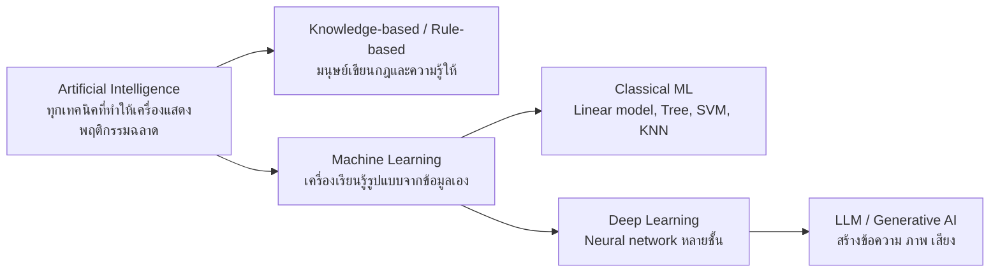
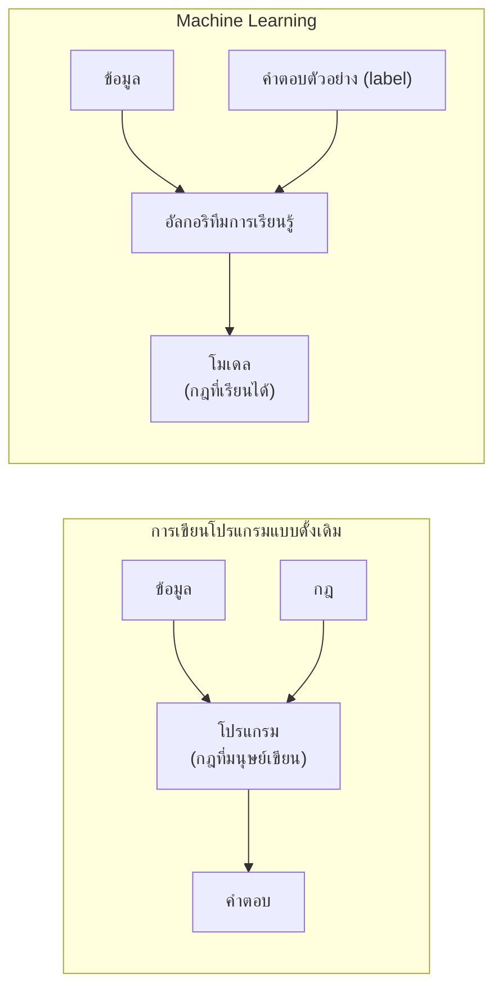
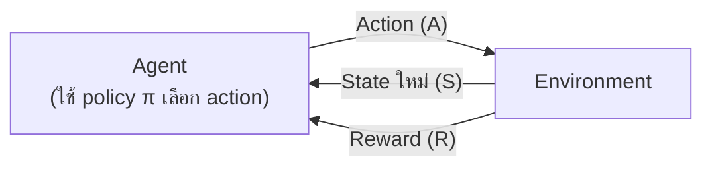
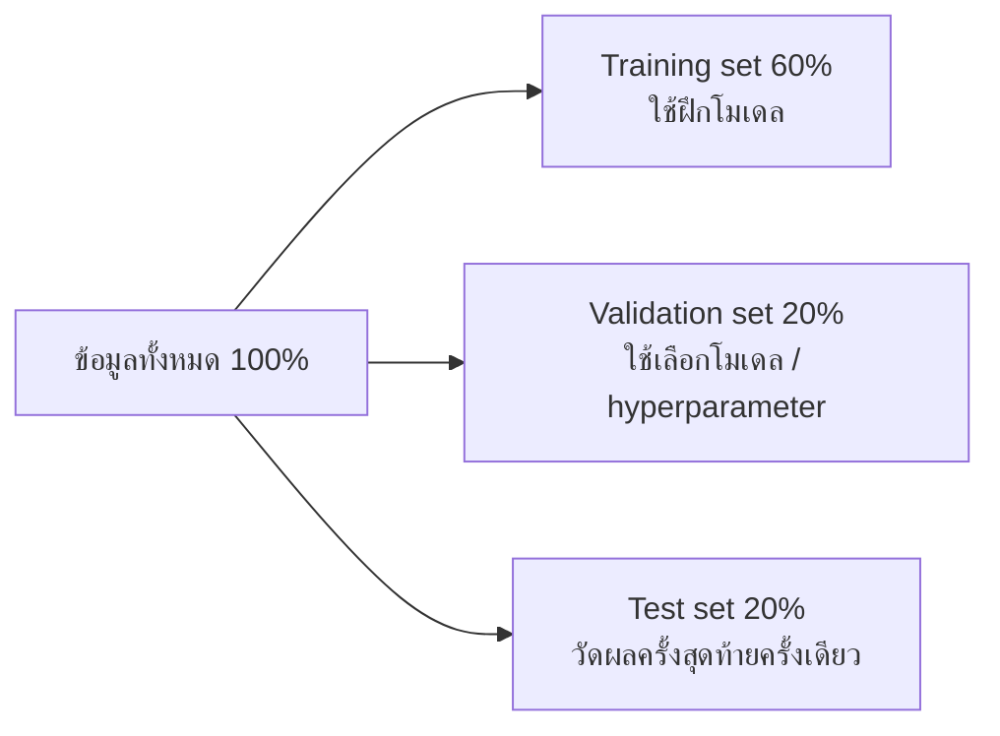
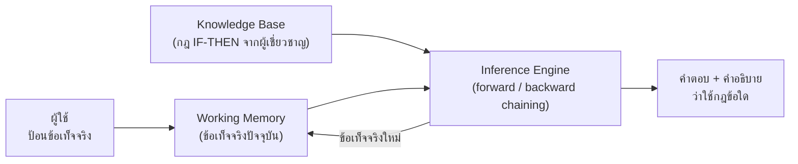

## วัตถุประสงค์การเรียนรู้

- อธิบายตำแหน่งของ Machine Learning ในภาพรวมของ AI และนิยาม "การเรียนรู้จากข้อมูล" ด้วยกรอบ Task–Performance–Experience (T/P/E) ได้ (LLO1-1)
- จำแนกประเภทของระบบ ML ตามรูปแบบการกำกับดูแล ได้แก่ Supervised, Unsupervised, Semi-supervised, Self-supervised และ Reinforcement Learning พร้อมยกตัวอย่างการประยุกต์ใช้ได้ (LLO1-2)
- เปรียบเทียบ Batch กับ Online learning และ Instance-based กับ Model-based learning ได้ (LLO1-2)
- อธิบายความท้าทายหลักของ ML (ข้อมูลไม่พอ/ไม่เป็นตัวแทน/คุณภาพต่ำ, feature ไม่เกี่ยวข้อง, overfitting/underfitting) และหลักการแบ่ง train/validation/test และ cross-validation ได้ (LLO1-2)
- อธิบายการแทนความรู้ด้วยกฎและตรรกะ ระบบฐานความรู้ และการอนุมานแบบ forward chaining และเลือกได้ว่าเมื่อใดควรใช้ระบบกฎหรือโมเดลที่เรียนรู้จากข้อมูล (LLO1-3)

## 1. Machine Learning อยู่ตรงไหนในโลกของ AI

### 1.1 AI → ML → DL (ทบทวนสั้น ๆ)

ในหน่วยบทนำของรายวิชาเราได้เห็นแล้วว่า **ปัญญาประดิษฐ์ (Artificial Intelligence, AI)** เป็นร่มใหญ่ที่ครอบคลุมทุกเทคนิคที่ทำให้คอมพิวเตอร์ "แสดงพฤติกรรมที่ฉลาด" ไม่ว่าจะเป็นการค้นหา (search) การวางแผน การให้เหตุผลด้วยตรรกะ หรือการเรียนรู้



| ระดับ | แนวคิดหลัก | ตัวอย่าง |
|---|---|---|
| AI | ทำให้เครื่องตัดสินใจหรือแก้ปัญหาได้อย่าง "ฉลาด" | ระบบผู้เชี่ยวชาญ, เกมหมากรุก, ระบบนำทาง |
| Machine Learning | เรียนรู้รูปแบบ (pattern) จากข้อมูลแทนการเขียนกฎเอง | ตัวกรองอีเมลขยะ, ทำนายราคาบ้าน |
| Deep Learning | ML ที่ใช้ neural network หลายชั้น เรียน feature เองจากข้อมูลดิบ | จดจำใบหน้า, แปลภาษา |
| LLM / GenAI | Deep learning ขนาดใหญ่มากที่ฝึกด้วยข้อความมหาศาล และ "สร้าง" เนื้อหาใหม่ได้ | ChatGPT, Claude, Gemini |

บทนี้เน้นที่ชั้น **Machine Learning** ซึ่งเป็นพื้นฐานของทุกอย่างที่อยู่ข้างใต้ และปิดท้ายด้วยการเปรียบเทียบกับ **ระบบฐานความรู้ (knowledge-based system)** ซึ่งเป็น AI อีกสายหนึ่งที่ไม่ได้เรียนจากข้อมูล

### 1.2 การเขียนโปรแกรมแบบดั้งเดิม vs Machine Learning

ลองนึกถึงการเขียนตัวกรองอีเมลขยะ (spam filter) แบบดั้งเดิม เราต้องสังเกตเองว่าอีเมลขยะมักมีคำว่า "ฟรี", "โอนด่วน", "4U" แล้วเขียนกฎ IF-THEN ยาวเหยียด เมื่อผู้ส่งสแปมเปลี่ยนคำไปเรื่อย ๆ เราก็ต้องตามแก้กฎไม่จบ

แนวทาง ML กลับด้านกัน: เราป้อน **ตัวอย่างอีเมล + คำตอบ (spam / ham)** ให้อัลกอริทึม แล้วให้มัน "หากฎเอง" ออกมาเป็นโมเดล



ML เหมาะเป็นพิเศษเมื่อ

- ปัญหาต้องใช้กฎจำนวนมากหรือต้องปรับกฎบ่อย (เช่น สแปมที่เปลี่ยนรูปแบบตลอด)
- ปัญหาซับซ้อนจนไม่มีใครเขียนกฎได้ (เช่น การรู้จำเสียงพูด การจดจำภาพ)
- สภาพแวดล้อมเปลี่ยนไปเรื่อย ๆ ระบบต้องปรับตัวตามข้อมูลใหม่
- ต้องการ "ค้นพบ" ความรู้ที่ซ่อนอยู่ในข้อมูลจำนวนมาก (data mining)

### 1.3 นิยามการเรียนรู้: Task, Performance, Experience

Tom Mitchell (1997) ให้นิยามเชิงวิศวกรรมที่ใช้กันแพร่หลายว่า โปรแกรมคอมพิวเตอร์ **เรียนรู้** จากประสบการณ์ $E$ สำหรับงาน $T$ ตามตัววัดผล $P$ ถ้าประสิทธิภาพในงาน $T$ (วัดด้วย $P$) **ดีขึ้นเมื่อได้รับประสบการณ์ $E$ มากขึ้น**

| องค์ประกอบ | ความหมาย | ตัวอย่าง: ตัวกรองสแปม | ตัวอย่าง: ทำนายเบาหวาน |
|---|---|---|---|
| Task ($T$) | งานที่ต้องทำ | ตัดสินว่าอีเมลใหม่เป็น spam หรือไม่ | ทำนายว่าผู้ป่วยเป็นเบาหวานหรือไม่ |
| Performance ($P$) | ตัววัดว่าทำได้ดีแค่ไหน | สัดส่วนอีเมลที่จัดถูก (accuracy) | accuracy, recall |
| Experience ($E$) | ข้อมูลที่ใช้เรียน | อีเมลเก่าที่ผู้ใช้กด "รายงานสแปม" | ประวัติผู้ป่วย 768 ราย พร้อมผลวินิจฉัย |

> [!NOTE]
> ข้อมูลที่ใช้ฝึกเรียกว่า **training set** แต่ละแถวเรียกว่า **instance** หรือ **sample** ส่วนที่ทำหน้าที่เรียนรู้และทำนายเรียกว่า **model** — ถ้าเราแค่ดาวน์โหลดข้อมูลมาเก็บไว้เฉย ๆ โดยไม่มีอะไรทำงาน $T$ ได้ดีขึ้น นั่นยังไม่ใช่ machine learning

## 2. ประเภทของ ML ตามรูปแบบการกำกับดูแล (Supervision)

เกณฑ์แรกที่ใช้แบ่งระบบ ML คือ "ระหว่างฝึก ระบบได้รับ **คำตอบ (label)** มากน้อยแค่ไหน และในรูปแบบใด"

### 2.1 Supervised Learning (การเรียนรู้แบบมีผู้สอน)

**นิยาม:** เรียนรู้จากข้อมูลที่มีฉลากคำตอบ (labeled data) คือทุกตัวอย่างมีทั้ง feature $X$ และคำตอบ $y$ เพื่อสร้างโมเดล $\hat{y} = f(X)$ ที่ทำนายคำตอบของข้อมูลใหม่ได้ แบ่งเป็น 2 งานหลักตามชนิดของ $y$


| หัวข้อ | Regression (การถดถอย) | Classification (การจำแนกประเภท) |
|---|---|---|
| ผลลัพธ์ (output) | ตัวเลขต่อเนื่อง เช่น 1.5, 100.5, 5000 | หมวดหมู่ เช่น ใช่/ไม่ใช่, หมา/แมว, เลข 0–9 |
| เป้าหมายของโมเดล | หาเส้นแนวโน้ม (best-fit line) ที่ใกล้จุดข้อมูลมากที่สุด | หาเส้นแบ่งเขต (decision boundary) แยกกลุ่ม |
| คำถามทางธุรกิจ | "เท่าไหร่?" | "แบบไหน? / ใช่หรือไม่?" |
| ตัววัดผลหลัก | MAE, MSE, RMSE, $R^2$ | Accuracy, Precision, Recall, F1-score |
| อัลกอริทึมที่นิยม | Linear Regression, Ridge/Lasso, SVR | Logistic Regression, Decision Tree, SVM, Naive Bayes |

**ตัวอย่างการประยุกต์ใช้**

- **Classification:** การแยกประเภทภาพ (image classification), การรู้จำตัวเลขเขียนมือ (MNIST — ดู [บทที่ 3](/module/03)), การวิเคราะห์ลูกค้าที่จะยกเลิกบริการ (customer retention / churn), การตรวจจับการปลอมแปลงตัวตน (identity fraud detection), การวินิจฉัยโรค (diagnostics)
- **Regression:** การทำนายความนิยมของโฆษณา, การทำนายราคาบ้าน (California Housing — ดู [บทที่ 4](/module/04)), การพยากรณ์อากาศ, การพยากรณ์ตลาด, การประเมินอายุขัย, การทำนายการเติบโตของประชากร

> [!TIP]
> วิธีจำง่าย ๆ: ดูที่ **ชนิดของคำตอบ** ไม่ใช่ชนิดของ input — ทำนาย "อุณหภูมิพรุ่งนี้ (°C)" เป็น regression แต่ทำนาย "พรุ่งนี้ฝนตกหรือไม่" เป็น classification แม้จะใช้ข้อมูลอากาศชุดเดียวกัน บางอัลกอริทึมทำได้ทั้งสองแบบ เช่น Logistic Regression ให้ผลเป็น **ความน่าจะเป็น** (ตัวเลข) แต่เราใช้มันเพื่อ **จำแนกประเภท**

### 2.2 Unsupervised Learning (การเรียนรู้แบบไม่มีผู้สอน)

**นิยาม:** เรียนรู้จากข้อมูลที่ **ไม่มีฉลากคำตอบ** มีแต่ $X$ ให้อัลกอริทึมค้นหาโครงสร้าง รูปแบบ หรือความสัมพันธ์ที่ซ่อนอยู่ด้วยตัวเอง งานหลักได้แก่

| งาน | ทำอะไร | ตัวอย่างการประยุกต์ใช้ |
|---|---|---|
| Clustering (การจัดกลุ่ม) | รวมข้อมูลที่คล้ายกันไว้กลุ่มเดียวกัน | แบ่งกลุ่มลูกค้า (customer segmentation), การตลาดแบบเจาะจง (targeted marketing), ระบบแนะนำสินค้า (recommender systems), จัดกลุ่มภาพตัวเลข MNIST |
| Dimensionality Reduction (การลดมิติ) | ลดจำนวนตัวแปรโดยรักษาข้อมูลสำคัญไว้ | การแสดงผลข้อมูลขนาดใหญ่ (big data visualisation), การบีบอัดอย่างมีความหมาย, การค้นพบโครงสร้างข้อมูล, การสกัด feature |
| Anomaly / Novelty Detection | หาข้อมูลที่ "ผิดปกติ" ต่างจากส่วนใหญ่ | ตรวจจับธุรกรรมบัตรเครดิตผิดปกติ, ตรวจหาชิ้นงานเสียในโรงงาน |
| Association Rule Learning | หาความสัมพันธ์ระหว่างสิ่งของ | ลูกค้าร้านสะดวกซื้อที่ซื้อบะหมี่กึ่งสำเร็จรูปมักซื้อไข่ไก่ด้วย (market basket analysis) |

ความต่างของ supervised กับ unsupervised เห็นได้ชัดจาก API ของ scikit-learn — supervised ส่ง `fit(X, y)` ส่วน unsupervised ส่งแค่ `fit(X)`

```python
from sklearn.datasets import load_iris
from sklearn.linear_model import LogisticRegression
from sklearn.cluster import KMeans

X, y = load_iris(return_X_y=True)   # X = feature 4 ตัว, y = ชนิดดอกไม้ (label)

# Supervised: ส่งทั้ง X และ y ให้โมเดล
clf = LogisticRegression(max_iter=1000).fit(X, y)
print("Supervised   ทำนาย 3 ดอกแรก:", clf.predict(X[:3]))

# Unsupervised: ส่งแค่ X — โมเดลต้องหากลุ่มเอง
km = KMeans(n_clusters=3, n_init=10, random_state=42).fit(X)
print("Unsupervised กลุ่มของ 3 ดอกแรก:", km.labels_[:3])
```

```output
Supervised   ทำนาย 3 ดอกแรก: [0 0 0]
Unsupervised กลุ่มของ 3 ดอกแรก: [1 1 1]
```

**การตีความ:** โมเดล supervised ตอบเป็น "ชื่อคลาสจริง" (0 = setosa) เพราะได้เรียนจาก label ส่วน KMeans ตอบว่าอยู่ "กลุ่มที่ 1" — หมายเลขกลุ่มไม่มีความหมายในตัวเอง มันรู้แค่ว่าสามดอกนี้คล้ายกัน มนุษย์ต้องตีความเองว่ากลุ่มนั้นคืออะไร

### 2.3 Semi-supervised Learning (การเรียนรู้แบบกึ่งมีผู้สอน)

ในโลกจริง การติด label มีราคาแพง (ต้องใช้ผู้เชี่ยวชาญ เวลา และเงิน) เรามักมีข้อมูลจำนวนมากแต่ติด label ได้เพียงส่วนน้อย **Semi-supervised learning** ใช้ทั้งข้อมูลที่มี label เล็กน้อยและไม่มี label จำนวนมากร่วมกัน ตัวอย่างคลาสสิกคือแอปอัลบั้มรูปที่จัดกลุ่มใบหน้าเองอัตโนมัติ (unsupervised) แล้วให้ผู้ใช้บอกชื่อแค่คนละรูป ระบบก็ติดชื่อให้ทุกรูปในกลุ่มนั้นได้

ตัวอย่างด้านล่างจำลองสถานการณ์ที่มีภาพตัวเลขเขียนมือ 1,257 ภาพ แต่ติด label ได้แค่ราว 5%

```python
import numpy as np
from sklearn.datasets import load_digits
from sklearn.semi_supervised import LabelSpreading
from sklearn.linear_model import LogisticRegression
from sklearn.model_selection import train_test_split

X, y = load_digits(return_X_y=True)        # ภาพตัวเลข 8x8 จำนวน 1,797 ภาพ
X_train, X_test, y_train, y_test = train_test_split(X, y, test_size=0.3, random_state=42)

rng = np.random.RandomState(42)
has_label = rng.rand(len(y_train)) < 0.05  # สมมติว่ามีคนติด label ให้แค่ ~5%
y_partial = np.where(has_label, y_train, -1)   # -1 = ไม่มี label
print("มี label:", has_label.sum(), "จาก", len(y_train), "ภาพ")

# (ก) Supervised ที่ใช้เฉพาะภาพที่มี label
sup = LogisticRegression(max_iter=5000).fit(X_train[has_label], y_train[has_label])
print(f"Supervised (เฉพาะที่มี label): {sup.score(X_test, y_test):.3f}")

# (ข) Semi-supervised: ใช้ทั้งภาพที่มีและไม่มี label
semi = LabelSpreading(kernel="knn", n_neighbors=10).fit(X_train, y_partial)
print(f"Semi-supervised (LabelSpreading): {semi.score(X_test, y_test):.3f}")
```

```output
มี label: 68 จาก 1257 ภาพ
Supervised (เฉพาะที่มี label): 0.891
Semi-supervised (LabelSpreading): 0.957
```

**การตีความ:** ด้วย label เพียง 68 ภาพ LabelSpreading "กระจาย" label ไปยังภาพที่คล้ายกัน (เพื่อนบ้านใกล้ที่สุด) ทำให้ใช้ประโยชน์จากภาพอีก ~1,190 ภาพที่ไม่มี label ได้ ความแม่นยำบน test set จึงสูงกว่าการใช้เฉพาะข้อมูลที่มี label (0.957 เทียบกับ 0.891)

### 2.4 Self-supervised Learning (การเรียนรู้แบบกำกับตนเอง)

**Self-supervised learning** สร้าง label จากตัวข้อมูลเองโดยอัตโนมัติ แล้วฝึกด้วยวิธีแบบ supervised เช่น

- ซ่อนคำบางคำในประโยคแล้วให้โมเดลทายคำที่หายไป หรือให้ทาย **คำถัดไป** — นี่คือวิธีฝึก LLM อย่าง GPT ด้วยข้อความมหาศาลบนอินเทอร์เน็ตโดยไม่ต้องมีคนติด label เลย
- ปิดบางส่วนของภาพแล้วให้โมเดลวาดส่วนที่หายไปกลับคืนมา

โมเดลที่ได้มักถูกนำไป **ปรับแต่ง (fine-tune)** ต่อกับงานที่มี label น้อย ๆ ซึ่งเรียกว่า transfer learning (จะพบอีกครั้งในบท Deep Learning และ NLP)

### 2.5 Reinforcement Learning (การเรียนรู้แบบเสริมกำลัง)

**นิยาม:** เรียนรู้ผ่านการลองผิดลองถูก (trial and error) ในสภาพแวดล้อมที่กำหนด โดย **agent** สังเกตสถานะ เลือกการกระทำ แล้วได้รับ **รางวัล (reward)** หรือ **บทลงโทษ (penalty)** เพื่อปรับ **นโยบาย (policy)** ให้ได้รางวัลรวมสูงสุดในระยะยาว — ไม่มีใครบอกคำตอบที่ถูกในแต่ละขั้น มีแค่สัญญาณรางวัล



| องค์ประกอบ | ความหมาย |
|---|---|
| Agent | ตัวกระทำ หรือโปรแกรมที่ทำหน้าที่ตัดสินใจ |
| Environment | สภาพแวดล้อมที่ agent อาศัยอยู่และโต้ตอบด้วย |
| State ($S$) | สถานะปัจจุบันของ environment |
| Action ($A$) | การกระทำที่ agent เลือกทำในสถานะนั้น |
| Reward ($R$) | รางวัลหรือผลตอบแทนหลังทำ action (ติดลบ = บทลงโทษ) |
| Policy ($\pi$) | กลยุทธ์ที่ agent ใช้เลือก action ในแต่ละ state |

**ตัวอย่างการประยุกต์ใช้:** การตัดสินใจแบบเรียลไทม์ (เช่น ยานยนต์ไร้คนขับ), AI ในเกม (หมากรุก, AlphaGo ที่ชนะ Lee Sedol นักหมากล้อมระดับโลกในปี 2016), การเรียนรู้ทักษะใหม่ของหุ่นยนต์, การจัดการงานอัตโนมัติ, การนำทางหุ่นยนต์ (รายละเอียดในบท Reinforcement Learning)

ตัวอย่างเล็กที่สุดของ RL คือ **multi-armed bandit**: เว็บไซต์มีโฆษณา 3 แบบ ไม่รู้ว่าแบบไหนถูกคลิกบ่อยสุด agent ต้องชั่งน้ำหนักระหว่าง **explore** (ลองตัวเลือกอื่น) และ **exploit** (เลือกตัวที่ดีที่สุดเท่าที่รู้)

```python
import numpy as np

rng = np.random.default_rng(1)
true_ctr = np.array([0.02, 0.05, 0.03])   # โอกาสถูกคลิกจริงของโฆษณา 3 แบบ (agent ไม่รู้)
Q = np.zeros(3)                           # ค่าที่ agent "เชื่อว่า" แต่ละ action จะได้
N = np.zeros(3)                           # จำนวนครั้งที่เลือกแต่ละ action
epsilon, total_reward = 0.1, 0

for t in range(10_000):
    if rng.random() < epsilon:            # explore: ลองสุ่ม
        a = rng.integers(3)
    else:                                 # exploit: เลือกตัวที่ดีที่สุดเท่าที่รู้
        a = np.argmax(Q)
    r = int(rng.random() < true_ctr[a])   # reward = 1 ถ้าผู้ใช้คลิก
    N[a] += 1
    Q[a] += (r - Q[a]) / N[a]             # ปรับค่าประมาณจากประสบการณ์
    total_reward += r

print("ค่าประมาณ Q:", Q.round(3))
print("จำนวนครั้งที่เลือก:", N.astype(int))
print("คลิกรวม:", total_reward)
```

```output
ค่าประมาณ Q: [0.021 0.055 0.022]
จำนวนครั้งที่เลือก: [1005 8679  316]
คลิกรวม: 504
```

**การตีความ:** agent ไม่เคยได้รับบอกว่าโฆษณาแบบที่ 2 ดีที่สุด แต่ค้นพบเองจากรางวัลที่สะสม และเลือกแบบที่ 2 ถึง 8,679 ครั้งจาก 10,000 ครั้ง นี่คือหัวใจของ RL: **เรียนจากผลของการกระทำ** ไม่ใช่จากคำตอบที่มีคนเตรียมไว้

### 2.6 สรุปเปรียบเทียบ

| ประเภท | ข้อมูลฝึก | สัญญาณที่ใช้เรียน | ผลลัพธ์ตัวอย่าง |
|---|---|---|---|
| Supervised | $X$ + $y$ ครบทุกแถว | คำตอบที่ถูกต้อง | คลาส หรือค่าตัวเลข |
| Unsupervised | $X$ อย่างเดียว | โครงสร้าง/ความคล้ายในข้อมูล | กลุ่ม, มิติที่ลดลง, ค่าความผิดปกติ |
| Semi-supervised | $X$ จำนวนมาก + $y$ บางส่วน | คำตอบบางส่วน + โครงสร้างข้อมูล | คลาสของข้อมูลที่ไม่มี label |
| Self-supervised | $X$ อย่างเดียว แต่สร้าง $y$ จาก $X$ เอง | ส่วนของข้อมูลที่ถูกซ่อน | โมเดลพื้นฐาน (pretrained model) |
| Reinforcement | ประสบการณ์จากการโต้ตอบ | reward/penalty | policy การตัดสินใจ |

## 3. Batch Learning vs Online Learning

เกณฑ์ที่สองคือ "ระบบเรียนรู้เพิ่มจากข้อมูลที่ไหลเข้ามาใหม่ได้หรือไม่"

- **Batch learning (offline learning):** ฝึกด้วยข้อมูลทั้งหมดที่มีในรวดเดียว แล้วนำโมเดลไปใช้งานโดยไม่เรียนเพิ่ม ถ้ามีข้อมูลใหม่ต้องฝึกใหม่ทั้งหมด (ข้อมูลเก่า + ใหม่) ใช้เวลาและทรัพยากรมาก นอกจากนี้ประสิทธิภาพของโมเดลมักค่อย ๆ ลดลงเมื่อโลกเปลี่ยนไป เรียกว่า **model rot / data drift** จึงต้องฝึกใหม่เป็นระยะ
- **Online learning (incremental learning):** ทยอยฝึกทีละตัวอย่างหรือทีละกลุ่มเล็ก (mini-batch) โมเดลปรับตัวได้ทันทีและไม่ต้องเก็บข้อมูลเก่าไว้ทั้งหมด เหมาะกับข้อมูลที่ไหลเข้าต่อเนื่อง (ราคาหุ้น, ข้อมูลเซนเซอร์) หรือข้อมูลที่ใหญ่เกินหน่วยความจำ (**out-of-core learning**)

พารามิเตอร์สำคัญของ online learning คือ **learning rate**: ถ้าสูง ระบบปรับตัวเร็วแต่ลืมของเก่าเร็วและไวต่อ noise ถ้าต่ำ ระบบนิ่งแต่ปรับตัวช้า ความเสี่ยงคือถ้าข้อมูลขยะไหลเข้ามา (เช่น เซนเซอร์เสีย) ประสิทธิภาพจะตกลงทันที จึงต้องมีระบบเฝ้าระวัง

ใน scikit-learn โมเดลที่รองรับ online learning มีเมธอด `partial_fit()`

```python
import numpy as np
from sklearn.linear_model import SGDRegressor

rng = np.random.default_rng(0)
model = SGDRegressor(learning_rate="constant", eta0=0.05, random_state=0)

# จำลองข้อมูลที่ไหลเข้ามาเป็นชุดเล็ก ๆ (mini-batch) วันละ 50 แถว
for day in range(1, 11):
    X_batch = rng.random((50, 1))                     # feature (สเกล 0–1)
    y_batch = 3 + 4 * X_batch[:, 0] + rng.normal(0, 0.1, 50)
    model.partial_fit(X_batch, y_batch)               # เรียนต่อจากของเดิม ไม่เริ่มใหม่
    print(f"วันที่ {day}: intercept={model.intercept_[0]:.2f}, coef={model.coef_[0]:.2f}")
```

```output
วันที่ 1: intercept=3.64, coef=2.53
วันที่ 2: intercept=3.63, coef=2.83
วันที่ 3: intercept=3.56, coef=3.01
วันที่ 4: intercept=3.52, coef=3.19
วันที่ 5: intercept=3.42, coef=3.26
วันที่ 6: intercept=3.40, coef=3.38
วันที่ 7: intercept=3.29, coef=3.44
วันที่ 8: intercept=3.27, coef=3.55
วันที่ 9: intercept=3.18, coef=3.59
วันที่ 10: intercept=3.13, coef=3.64
```

**การตีความ:** ความสัมพันธ์จริงคือ $y = 3 + 4x$ แต่ละวันโมเดลเห็นข้อมูลใหม่เพียง 50 แถว และค่อย ๆ ขยับพารามิเตอร์เข้าใกล้ค่าจริง (3 และ 4) โดยไม่ต้องย้อนกลับไปใช้ข้อมูลของวันก่อน ๆ

## 4. Instance-based vs Model-based Learning

เกณฑ์ที่สามคือ "ระบบ **สรุปทั่วไป (generalize)** ไปยังข้อมูลใหม่ได้อย่างไร"

- **Instance-based learning:** เรียนรู้โดย "ท่องจำ" ตัวอย่างทั้งหมด (learn by heart) แล้วเมื่อเจอข้อมูลใหม่ก็วัด **ความคล้าย (similarity)** กับตัวอย่างที่จำไว้ เช่น k-Nearest Neighbors (KNN) ที่ดูเพื่อนบ้าน $k$ ตัวที่ใกล้ที่สุด
- **Model-based learning:** สร้าง **โมเดล** (เช่น สมการ) ที่อธิบายความสัมพันธ์ในข้อมูล แล้วใช้โมเดลนั้นทำนาย ขั้นตอนคือ เลือกรูปแบบโมเดล → กำหนด **cost function** (วัดว่าโมเดลแย่แค่ไหน) → ให้อัลกอริทึมหาพารามิเตอร์ที่ทำให้ cost ต่ำสุด (การ **train**) → ใช้โมเดลทำนาย (**inference**)

ตัวอย่าง: ข้อมูลจำลองพื้นที่บ้าน (ตร.ม.) กับราคา (แสนบาท)

```python
import numpy as np
from sklearn.linear_model import LinearRegression
from sklearn.neighbors import KNeighborsRegressor

# ข้อมูลจำลอง: พื้นที่บ้าน (ตร.ม.) กับราคา (แสนบาท)
rng = np.random.default_rng(42)
X = 50 + 150 * rng.random((100, 1))                 # 50–200 ตร.ม.
y = 5 + 0.15 * X[:, 0] + rng.normal(0, 3, 100)      # ราคา + noise

X_new = np.array([[120], [250]])                    # บ้าน 120 และ 250 ตร.ม.

# Model-based: เรียนรู้พารามิเตอร์ของสมการเส้นตรง
lin = LinearRegression().fit(X, y)
print(f"Linear model : y = {lin.intercept_:.2f} + {lin.coef_[0]:.4f}·x")
print("  ทำนาย:", lin.predict(X_new).round(2))

# Instance-based: จำข้อมูลไว้ แล้วเฉลี่ยราคาของบ้าน 3 หลังที่ใกล้ที่สุด
knn = KNeighborsRegressor(n_neighbors=3).fit(X, y)
print("KNN (k=3)    ทำนาย:", knn.predict(X_new).round(2))
```

```output
Linear model : y = 4.77 + 0.1515·x
  ทำนาย: [22.95 42.65]
KNN (k=3)    ทำนาย: [23.34 33.14]
```

**การตีความ:**

- บ้าน 120 ตร.ม. อยู่ในช่วงข้อมูลที่เคยเห็น ทั้งสองวิธีทำนายใกล้กัน (≈ 23 แสนบาท)
- บ้าน 250 ตร.ม. อยู่ **นอกช่วง** ข้อมูลฝึก (50–200) โมเดลเส้นตรงต่อเส้นออกไปได้ (extrapolate) จึงทำนาย 42.65 ส่วน KNN ทำได้แค่เฉลี่ยราคาบ้านหลังใหญ่สุดที่เคยเห็น จึงติดอยู่ที่ราว 33 — สะท้อนว่า instance-based ไม่ได้ "เข้าใจ" แนวโน้ม แค่เทียบความคล้าย
- โมเดลเส้นตรงเก็บแค่ 2 พารามิเตอร์ ($\theta_0 = 4.77$, $\theta_1 = 0.1515$) ส่วน KNN ต้องเก็บข้อมูลทั้ง 100 แถวไว้ใช้ตอนทำนาย

## 5. ความท้าทายหลักของ Machine Learning

งานหลักของเราคือ "เลือกอัลกอริทึม แล้วฝึกด้วยข้อมูล" สิ่งที่ผิดพลาดได้จึงมี 2 ฝั่ง: **ข้อมูลไม่ดี (bad data)** และ **โมเดลไม่ดี (bad model)**

### 5.1 ปัญหาฝั่งข้อมูล

| ปัญหา | ความหมาย | ตัวอย่าง / วิธีรับมือ |
|---|---|---|
| ข้อมูลน้อยเกินไป (insufficient quantity) | อัลกอริทึมส่วนใหญ่ต้องการตัวอย่างหลักพันถึงหลักล้าน | งานวิจัยพบว่าเมื่อมีข้อมูลมากพอ อัลกอริทึมที่ต่างกันมากให้ผลใกล้กัน — "ข้อมูลสำคัญกว่าอัลกอริทึม" แต่ข้อมูลหามาได้ยากและแพง |
| ข้อมูลไม่เป็นตัวแทน (nonrepresentative) | ข้อมูลฝึกไม่ครอบคลุมกรณีที่ต้องใช้งานจริง | **sampling noise** (ตัวอย่างน้อยเลยเพี้ยนโดยบังเอิญ) และ **sampling bias** (วิธีเก็บข้อมูลลำเอียง) เช่น ทำโพลเลือกตั้งจากผู้ใช้โซเชียลกลุ่มเดียว |
| ข้อมูลคุณภาพต่ำ (poor quality) | มี error, outlier, noise, ค่าหาย | ข้อมูลเบาหวานที่มี `Glucose = 0` หรือ `BMI = 0` (เป็นไปไม่ได้ทางการแพทย์ = ค่าหายแฝง) ต้องทำความสะอาด — ดู [บทที่ 2](/module/02) |
| feature ไม่เกี่ยวข้อง (irrelevant features) | "Garbage in, garbage out" | ใช้ **feature engineering**: feature selection (เลือก), feature extraction (รวม/แปลง), สร้าง feature ใหม่จากข้อมูลเพิ่ม |

### 5.2 ปัญหาฝั่งโมเดล: Overfitting และ Underfitting

- **Overfitting:** โมเดลซับซ้อนเกินไปเมื่อเทียบกับปริมาณและคุณภาพของข้อมูล จึง "ท่องจำ" แม้แต่ noise ของข้อมูลฝึก ทำได้ดีมากบน training set แต่ทำนายข้อมูลใหม่แย่ (เหมือนนักศึกษาที่จำข้อสอบเก่าได้ทุกข้อ แต่ทำข้อสอบใหม่ไม่ได้)
- **Underfitting:** โมเดลเรียบง่ายเกินไป จับรูปแบบของข้อมูลไม่ได้ แย่ทั้งบน training set และข้อมูลใหม่

ตัวอย่าง: ข้อมูลจริงมาจากฟังก์ชัน sine บวก noise แล้วลอง fit ด้วย polynomial degree 1, 3 และ 15

```python
import numpy as np
from sklearn.pipeline import make_pipeline
from sklearn.preprocessing import PolynomialFeatures, StandardScaler
from sklearn.linear_model import LinearRegression
from sklearn.model_selection import train_test_split
from sklearn.metrics import mean_squared_error

rng = np.random.default_rng(42)
X = np.sort(rng.uniform(0, 1, 40)).reshape(-1, 1)
y = np.sin(2 * np.pi * X[:, 0]) + rng.normal(0, 0.2, 40)   # ความจริง = sine + noise

X_train, X_val, y_train, y_val = train_test_split(X, y, test_size=0.5, random_state=0)

print("degree | train MSE | val MSE")
for degree in [1, 3, 15]:
    model = make_pipeline(PolynomialFeatures(degree), StandardScaler(), LinearRegression())
    model.fit(X_train, y_train)
    mse_tr = mean_squared_error(y_train, model.predict(X_train))
    mse_va = mean_squared_error(y_val, model.predict(X_val))
    print(f"{degree:6d} | {mse_tr:9.3f} | {mse_va:8.3f}")
```

```output
degree | train MSE | val MSE
     1 |     0.185 |    0.231
     3 |     0.018 |    0.026
    15 |     0.007 |    3.953
```

**การตีความ:**

| degree | train MSE | val MSE | วินิจฉัย |
|---|---|---|---|
| 1 (เส้นตรง) | สูง | สูง | **Underfitting** — เส้นตรงจับรูปคลื่นไม่ได้ |
| 3 | ต่ำ | ต่ำ (ใกล้ train) | **พอดี (good fit)** |
| 15 | ต่ำที่สุด | สูงมาก (3.953) | **Overfitting** — เส้นโค้งไปมาผ่านทุกจุดฝึก แต่ทำนายจุดใหม่ผิดมาก |

สัญญาณสำคัญของ overfitting คือ **ช่องว่างระหว่าง error บน train กับ validation ที่กว้างมาก** ส่วน underfitting คือ error สูงทั้งคู่

| ปัญหา | วิธีแก้ |
|---|---|
| Overfitting | ลดความซับซ้อนของโมเดล (degree ต่ำลง, ลด `max_depth`), ใช้ **regularization** (จำกัดพารามิเตอร์ เช่น Ridge/Lasso), หาข้อมูลฝึกเพิ่ม, ลด noise ในข้อมูล |
| Underfitting | เลือกโมเดลที่ทรงพลังขึ้น, เพิ่ม/สร้าง feature ที่ดีขึ้น, ลด regularization |

> [!NOTE]
> **Parameter** คือค่าที่โมเดลเรียนรู้เองระหว่าง train (เช่น $\theta_0, \theta_1$) ส่วน **hyperparameter** คือค่าของ "อัลกอริทึมการเรียนรู้" ที่เรากำหนดก่อนฝึกและคงที่ระหว่างฝึก (เช่น degree, `max_depth`, `k` ของ KNN, ความแรงของ regularization) การเลือก hyperparameter ที่ดีคือหัวข้อของส่วนถัดไป

## 6. การทดสอบและการตรวจสอบความถูกต้อง (Testing and Validating)

### 6.1 Training set และ Test set

วิธีเดียวที่จะรู้ว่าโมเดลสรุปทั่วไปไปยังข้อมูลใหม่ได้ดีแค่ไหนคือ **ทดลองกับข้อมูลใหม่จริง ๆ** ในทางปฏิบัติเราแบ่งข้อมูลเป็น

- **Training set** (ส่วนใหญ่ เช่น 80%) — ใช้ฝึก
- **Test set** (เช่น 20%) — เก็บไว้ทดสอบ **ขั้นสุดท้าย** ครั้งเดียว ห้ามแตะระหว่างพัฒนา

error บน test set เรียกว่า **generalization error** (หรือ out-of-sample error) เป็นค่าประมาณว่าโมเดลจะพลาดแค่ไหนกับข้อมูลที่ไม่เคยเห็น

### 6.2 Data Snooping และ Validation Set

สมมติเราลอง hyperparameter 100 ค่า แล้วเลือกค่าที่ได้ test accuracy สูงสุด ปัญหาคือเราได้ **ปรับโมเดลให้เข้ากับ test set นั้น** ไปแล้ว ค่าที่รายงานจึงดีเกินจริง (optimistic) เมื่อใช้งานจริงประสิทธิภาพจะตกลง ปรากฏการณ์นี้เรียกว่า **data snooping bias**

**วิธีแก้:** แบ่งข้อมูลอีกส่วนหนึ่งเป็น **validation set** (บางตำราเรียก development / dev set) ไว้ใช้เลือกโมเดลและ hyperparameter (holdout validation)



```python
from sklearn.datasets import load_breast_cancer
from sklearn.model_selection import train_test_split
from sklearn.tree import DecisionTreeClassifier

X, y = load_breast_cancer(return_X_y=True)          # 569 ตัวอย่าง, 30 feature

# แบ่ง 2 ครั้ง: 60% train / 20% validation / 20% test
X_temp, X_test, y_temp, y_test = train_test_split(
    X, y, test_size=0.2, stratify=y, random_state=42)
X_train, X_val, y_train, y_val = train_test_split(
    X_temp, y_temp, test_size=0.25, stratify=y_temp, random_state=42)  # 0.25 x 0.8 = 0.2
print("train/val/test =", len(X_train), len(X_val), len(X_test))

# ใช้ validation set เลือก hyperparameter max_depth
for depth in [1, 3, 5, None]:
    tree = DecisionTreeClassifier(max_depth=depth, random_state=42).fit(X_train, y_train)
    print(f"max_depth={str(depth):4s}  train={tree.score(X_train, y_train):.3f}"
          f"  val={tree.score(X_val, y_val):.3f}")
```

```output
train/val/test = 341 114 114
max_depth=1     train=0.927  val=0.895
max_depth=3     train=0.974  val=0.939
max_depth=5     train=0.997  val=0.956
max_depth=None  train=1.000  val=0.956
```

`max_depth=5` กับ `None` (ไม่จำกัดความลึก) ได้ validation เท่ากัน เราเลือก **โมเดลที่ง่ายกว่า** (`max_depth=5`) จากนั้นฝึกใหม่ด้วย train + validation รวมกัน แล้ววัดบน test set เพียงครั้งเดียว

```python
# เลือก max_depth=5 แล้วฝึกใหม่บน train+validation จากนั้นวัดบน test เพียงครั้งเดียว
final_tree = DecisionTreeClassifier(max_depth=5, random_state=42).fit(X_temp, y_temp)
print(f"Test accuracy = {final_tree.score(X_test, y_test):.3f}")
```

```output
Test accuracy = 0.921
```

### 6.3 Cross-Validation

ข้อเสียของ holdout validation คือ ถ้า validation set เล็ก ผลจะแกว่งตามโชค และถ้าใหญ่ training set ก็เหลือน้อย **k-fold cross-validation** แก้ปัญหานี้โดยแบ่งข้อมูล (ที่ไม่รวม test set) เป็น $k$ ส่วนเท่า ๆ กัน แล้ววน $k$ รอบ แต่ละรอบใช้ 1 ส่วนเป็น validation และอีก $k-1$ ส่วนเป็น training จากนั้นเฉลี่ยคะแนนทั้ง $k$ รอบ

$$ \text{CV score} = \frac{1}{k}\sum_{i=1}^{k} \text{score}_i $$

```python
from sklearn.model_selection import cross_val_score

for depth in [1, 3, 5, None]:
    tree = DecisionTreeClassifier(max_depth=depth, random_state=42)
    scores = cross_val_score(tree, X_temp, y_temp, cv=5, scoring="accuracy")
    print(f"max_depth={str(depth):4s}  fold scores={scores.round(3)}"
          f"  mean={scores.mean():.3f} ± {scores.std():.3f}")
```

```output
max_depth=1     fold scores=[0.912 0.912 0.868 0.879 0.912]  mean=0.897 ± 0.019
max_depth=3     fold scores=[0.934 0.923 0.901 0.901 0.967]  mean=0.925 ± 0.024
max_depth=5     fold scores=[0.945 0.945 0.901 0.912 0.956]  mean=0.932 ± 0.021
max_depth=None  fold scores=[0.912 0.901 0.901 0.89  0.945]  mean=0.910 ± 0.019
```

**การตีความ:** จาก holdout validation (ข้อ 6.2) `max_depth=None` ดูดีเท่ากับ 5 แต่ cross-validation ซึ่งใช้ข้อมูลทุกส่วนผลัดกันเป็น validation เผยว่าต้นไม้ที่ไม่จำกัดความลึกได้ค่าเฉลี่ยต่ำกว่า (0.910 vs 0.932) — มันกำลัง overfit ค่า ± (ส่วนเบี่ยงเบนมาตรฐาน) ยังบอกความ "นิ่ง" ของโมเดลด้วย ข้อแลกเปลี่ยนคือต้องฝึก $k$ ครั้ง ใช้เวลามากขึ้น

### 6.4 Data Mismatch และ No Free Lunch

- **Data mismatch:** บางครั้งข้อมูลฝึกหาง่ายแต่ไม่เหมือนข้อมูลใช้งานจริง เช่น ฝึกแอปจำแนกดอกไม้ด้วยภาพจากเว็บ แต่ใช้งานจริงกับภาพถ่ายมือถือ หลักการคือ validation set และ test set **ต้องเป็นตัวแทนของข้อมูลใช้งานจริง** เท่านั้น (อาจกันข้อมูลฝึกส่วนหนึ่งเป็น train-dev set เพื่อแยกว่าปัญหาเกิดจาก overfitting หรือ data mismatch)
- **No Free Lunch theorem:** ถ้าไม่ตั้งสมมติฐานใด ๆ เกี่ยวกับข้อมูลเลย ไม่มีโมเดลใดดีกว่าโมเดลอื่นเสมอไปทุกปัญหา เราจึงต้องตั้งสมมติฐานที่สมเหตุสมผล แล้วลองเปรียบเทียบโมเดลที่เป็นไปได้จำนวนหนึ่งด้วย validation/cross-validation

## 7. ระบบฐานความรู้และระบบกฎ (Knowledge-based & Rule-based Systems)

ก่อนยุค ML จะเฟื่องฟู AI สายหลักคือ **symbolic AI** ที่ให้มนุษย์ "เขียนความรู้" ลงในระบบอย่างชัดแจ้ง แล้วให้เครื่อง **อนุมาน (inference)** หาข้อสรุป แนวคิดนี้ยังใช้กันจริงในปัจจุบัน และช่วยให้เข้าใจว่า ML ต่างจากมันอย่างไร

### 7.1 การแทนความรู้ (Knowledge Representation)

**การแทนความรู้** คือการเลือกรูปแบบที่เครื่องประมวลผลได้เพื่อเก็บข้อเท็จจริงและความสัมพันธ์ของโลก รูปแบบที่พบบ่อย

| รูปแบบ | ลักษณะ | ตัวอย่าง |
|---|---|---|
| กฎ (production rules) | IF เงื่อนไข THEN ข้อสรุป/การกระทำ | IF มีไข้ AND ไอ THEN สงสัยติดเชื้อ |
| ตรรกศาสตร์เชิงประพจน์ (propositional logic) | ประพจน์ที่เป็นจริง/เท็จ เชื่อมด้วย $\land, \lor, \lnot, \Rightarrow$ | $Fever \land Cough \Rightarrow Infection$ |
| ตรรกศาสตร์อันดับหนึ่ง (first-order logic) | มีวัตถุ ความสัมพันธ์ และตัวบ่งปริมาณ $\forall, \exists$ | $\forall x\; Human(x) \Rightarrow Mortal(x)$ |
| Semantic network / Ontology | กราฟของแนวคิดและความสัมพันธ์ (is-a, part-of) | แมว —is-a→ สัตว์เลี้ยงลูกด้วยนม |
| Frame | โครงสร้างข้อมูลแบบ slot–value ของวัตถุ | Frame "รถยนต์": ล้อ=4, เครื่องยนต์=... |

### 7.2 ตรรกศาสตร์เชิงประพจน์และกฎ IF-THEN

ในตรรกศาสตร์เชิงประพจน์ ประโยค $P \Rightarrow Q$ (ถ้า $P$ แล้ว $Q$) มีตารางค่าความจริงดังนี้

| $P$ | $Q$ | $P \Rightarrow Q$ |
|---|---|---|
| T | T | T |
| T | F | **F** |
| F | T | T |
| F | F | T |

สังเกตว่า $P \Rightarrow Q$ เป็นเท็จกรณีเดียวคือ "เหตุจริงแต่ผลเท็จ" กฎอนุมานพื้นฐานคือ **Modus Ponens**: ถ้ารู้ว่า $P \Rightarrow Q$ และรู้ว่า $P$ เป็นจริง สรุปได้ว่า $Q$ เป็นจริง

$$ \frac{P \Rightarrow Q, \quad P}{Q} $$

กฎที่ใช้ในระบบผู้เชี่ยวชาญส่วนใหญ่อยู่ในรูป **Horn clause / definite clause** คือ "เงื่อนไขหลายข้อเชื่อมด้วย AND แล้วได้ข้อสรุปเดียว" เช่น $A \land B \Rightarrow C$ ซึ่งทำให้อนุมานได้อย่างมีประสิทธิภาพ

### 7.3 โครงสร้างของระบบฐานความรู้



- **Knowledge base (KB):** เก็บกฎและข้อเท็จจริงที่ได้จากผู้เชี่ยวชาญ (กระบวนการนี้เรียกว่า knowledge engineering)
- **Inference engine:** กลไกที่นำกฎมาใช้กับข้อเท็จจริงเพื่อหาข้อสรุปใหม่ แยกจาก KB ทำให้เปลี่ยนความรู้ได้โดยไม่ต้องแก้โปรแกรม
- **Explanation facility:** อธิบายได้ว่าได้ข้อสรุปมาจากกฎข้อใด — จุดแข็งที่สำคัญมากในงานการแพทย์และกฎหมาย

ตัวอย่างระบบผู้เชี่ยวชาญยุคแรกที่มีชื่อเสียงคือ **MYCIN** (ทศวรรษ 1970) ที่ใช้กฎราว 450 ข้อวินิจฉัยการติดเชื้อในเลือด และ **DENDRAL** ที่วิเคราะห์โครงสร้างโมเลกุลทางเคมี

### 7.4 Forward Chaining vs Backward Chaining

- **Forward chaining (data-driven):** เริ่มจากข้อเท็จจริงที่รู้ → หากฎที่เงื่อนไขเป็นจริงครบ → เพิ่มข้อสรุปเป็นข้อเท็จจริงใหม่ → วนซ้ำจนไม่มีอะไรใหม่ เหมาะกับงานเฝ้าระวัง/ตอบสนองต่อเหตุการณ์
- **Backward chaining (goal-driven):** เริ่มจาก "เป้าหมายที่อยากพิสูจน์" แล้วย้อนหาว่าต้องมีเงื่อนไขอะไรเป็นจริงบ้าง เหมาะกับงานวินิจฉัยที่มีสมมติฐานชัดเจน (เป็นหลักการของภาษา Prolog)

ตัวอย่าง forward chaining ขนาดเล็กใน Python — ใช้ `set` แทน working memory และใช้ `<=` ตรวจว่าเงื่อนไขทุกข้อเป็นสมาชิกของ facts หรือไม่

```python
# ฐานความรู้ (Knowledge Base): กฎ IF (เงื่อนไขทุกข้อเป็นจริง) THEN (สรุปข้อเท็จจริงใหม่)
rules = [
    ({"มีไข้", "ไอ"},                    "สงสัยติดเชื้อทางเดินหายใจ"),
    ({"สงสัยติดเชื้อทางเดินหายใจ", "หายใจลำบาก"}, "ควรพบแพทย์ด่วน"),
    ({"มีไข้", "ผื่นแดง"},                "สงสัยไข้เลือดออก"),
    ({"สงสัยไข้เลือดออก"},               "ควรตรวจเลือด"),
]

def forward_chaining(facts, rules):
    facts = set(facts)                 # Working memory
    fired = True
    while fired:                       # วนจนไม่มีกฎใดสรุปข้อเท็จจริงใหม่ได้อีก
        fired = False
        for conditions, conclusion in rules:
            if conditions <= facts and conclusion not in facts:   # ทุกเงื่อนไขอยู่ใน facts
                facts.add(conclusion)
                print(f"  ใช้กฎ: IF {' AND '.join(sorted(conditions))} THEN {conclusion}")
                fired = True
    return facts

print("ผู้ป่วย A:")
result = forward_chaining({"มีไข้", "ไอ", "หายใจลำบาก"}, rules)
print("ข้อสรุปสุดท้าย:", "ควรพบแพทย์ด่วน" in result)
```

```output
ผู้ป่วย A:
  ใช้กฎ: IF มีไข้ AND ไอ THEN สงสัยติดเชื้อทางเดินหายใจ
  ใช้กฎ: IF สงสัยติดเชื้อทางเดินหายใจ AND หายใจลำบาก THEN ควรพบแพทย์ด่วน
ข้อสรุปสุดท้าย: True
```

**การตีความ:** ระบบ "ต่อโซ่" ข้อสรุป — กฎข้อแรกสร้างข้อเท็จจริงใหม่ ("สงสัยติดเชื้อ...") ที่ทำให้กฎข้อสองทำงานได้ ทุกขั้นอธิบายได้ว่าใช้กฎใด แต่ระบบนี้ **ไม่เรียนรู้อะไรเลย** ถ้าเจอโรคใหม่ที่ไม่มีกฎรองรับ มนุษย์ต้องเขียนกฎเพิ่มเอง

### 7.5 เมื่อใดควรใช้ระบบกฎ เมื่อใดควรใช้ ML

| ประเด็น | Rule-based / Knowledge-based | Machine Learning |
|---|---|---|
| แหล่งความรู้ | ผู้เชี่ยวชาญเขียนกฎ | เรียนรู้จากข้อมูลตัวอย่าง |
| ต้องการข้อมูลฝึก | ไม่ต้อง (หรือน้อยมาก) | ต้องการมาก และต้องมีคุณภาพ |
| การอธิบายเหตุผล | ชัดเจน ตรวจสอบได้ทุกขั้น | บางโมเดลอธิบายยาก (black box) |
| ความยืดหยุ่น | แก้กฎด้วยมือ ขยายยาก (knowledge acquisition bottleneck) | ฝึกใหม่ด้วยข้อมูลใหม่ได้ |
| ความไม่แน่นอน / noise | รับมือได้ไม่ดี (กฎแข็งทื่อ) | รับมือได้ดีกว่า ให้ผลเป็นความน่าจะเป็นได้ |
| เหมาะกับ | กฎหมาย ระเบียบ การคำนวณภาษี ตรวจสอบสิทธิ์ ระบบที่ต้องรับรองความถูกต้อง | รูปแบบซับซ้อน เช่น ภาพ เสียง ภาษา พฤติกรรมลูกค้า |

> [!TIP]
> ระบบจริงจำนวนมากเป็นแบบ **hybrid**: ใช้ ML ทำนายความเสี่ยง แล้วครอบด้วยกฎทางธุรกิจหรือกฎความปลอดภัย (เช่น "ถ้ายอดโอนเกิน 50,000 บาทและโมเดลให้ความเสี่ยง > 0.8 ให้ระงับธุรกรรม") นอกจากนี้ โมเดล **Decision Tree** ที่เรียนจากข้อมูลก็สามารถแปลงเป็นกฎ IF-THEN ที่มนุษย์อ่านได้ — เราจะเปรียบเทียบกฎที่มนุษย์เขียนกับกฎที่ต้นไม้เรียนได้ในใบงานบทนี้

## สรุป

- **Machine Learning** คือการให้คอมพิวเตอร์ปรับปรุงประสิทธิภาพในงาน $T$ (วัดด้วย $P$) จากประสบการณ์ $E$ แทนการให้มนุษย์เขียนกฎทั้งหมดเอง
- แบ่งตามการกำกับดูแลได้เป็น **Supervised** (classification = หมวดหมู่, regression = ตัวเลขต่อเนื่อง), **Unsupervised** (clustering, dimensionality reduction, anomaly detection), **Semi-supervised**, **Self-supervised** และ **Reinforcement Learning** (agent เรียนจาก reward)
- **Batch** ฝึกรวดเดียว / **Online** ฝึกต่อเนื่องด้วย `partial_fit()` — **Instance-based** เทียบความคล้ายกับตัวอย่างที่จำไว้ / **Model-based** สร้างสมการแล้วใช้ทำนาย
- ความท้าทายหลักมาจาก **ข้อมูลไม่ดี** (น้อย ไม่เป็นตัวแทน คุณภาพต่ำ feature ไม่เกี่ยวข้อง) และ **โมเดลไม่ดี** (overfitting/underfitting)
- ใช้ **train / validation / test** หรือ **cross-validation** เพื่อเลือกโมเดล และแตะ test set ครั้งเดียวตอนท้ายเพื่อเลี่ยง **data snooping bias**
- **ระบบฐานความรู้** แทนความรู้ด้วยกฎ/ตรรกะ แล้วใช้ inference engine (forward/backward chaining) อนุมาน อธิบายได้ดีแต่ไม่เรียนรู้เอง ระบบจริงมักผสมทั้งสองแนวทาง

## คำศัพท์สำคัญ

| ศัพท์ | ความหมาย |
|---|---|
| Feature | คุณลักษณะของข้อมูลที่ใช้เป็น input ของโมเดล |
| Label / Target | คำตอบที่ต้องการให้โมเดลทำนาย (ใช้ใน supervised learning) |
| Instance / Sample | ข้อมูล 1 ตัวอย่าง (1 แถว) |
| Model | ระบบที่ผ่านการฝึกจากข้อมูลแล้ว พร้อมใช้ทำนาย |
| Classification | ทำนายหมวดหมู่ (ค่าไม่ต่อเนื่อง) |
| Regression | ทำนายค่าตัวเลขต่อเนื่อง |
| Clustering | จัดกลุ่มข้อมูลที่คล้ายกันโดยไม่มี label |
| Semi-supervised | เรียนรู้จากข้อมูลที่มี label บางส่วน |
| Self-supervised | สร้าง label จากตัวข้อมูลเอง เช่น ทายคำถัดไป |
| Reinforcement Learning | agent เรียนรู้ policy จาก reward ที่ได้จากการกระทำ |
| Online learning | ฝึกต่อเนื่องทีละส่วนเมื่อมีข้อมูลใหม่ |
| Instance-based | ทำนายโดยเทียบความคล้ายกับตัวอย่างที่จำไว้ (เช่น KNN) |
| Model-based | สร้างโมเดล (เช่น สมการ) แล้วใช้ทำนาย |
| Overfitting | จำข้อมูลฝึกเกินไป ทำนายข้อมูลใหม่แย่ |
| Underfitting | โมเดลง่ายเกินไป จับรูปแบบไม่ได้ |
| Hyperparameter | ค่าของอัลกอริทึมที่กำหนดก่อนฝึก (เช่น `max_depth`) |
| Validation set | ข้อมูลที่กันไว้เลือกโมเดล/hyperparameter |
| Cross-validation | สลับส่วนข้อมูลมาเป็น validation แล้วเฉลี่ยผล |
| Data snooping bias | ผลประเมินดีเกินจริงเพราะใช้ test set ช่วยเลือกโมเดล |
| Knowledge base | ที่เก็บกฎและข้อเท็จจริงของระบบผู้เชี่ยวชาญ |
| Inference engine | กลไกที่นำกฎมาอนุมานหาข้อสรุปใหม่ |
| Forward chaining | อนุมานจากข้อเท็จจริงไปหาข้อสรุป (data-driven) |
| Backward chaining | อนุมานย้อนจากเป้าหมายไปหาเงื่อนไข (goal-driven) |

## คำถามทบทวนท้ายบท

**1.** ระบบแนะนำวิดีโอที่บันทึกว่าผู้ใช้ "ดูจนจบ" หรือ "กดข้าม" แล้วนำมาฝึกโมเดลใหม่ทุกคืน จงระบุ $T$, $P$, $E$ และบอกว่าเป็น batch หรือ online learning

<details><summary>เฉลย</summary>

$T$ = แนะนำวิดีโอที่ผู้ใช้น่าจะดูจนจบ, $P$ = สัดส่วนวิดีโอที่แนะนำแล้วผู้ใช้ดูจนจบ (หรือ click-through rate), $E$ = ประวัติการดู/การกดข้ามของผู้ใช้ การนำข้อมูลมาฝึกใหม่ทั้งหมดทุกคืนเป็น **batch learning** ที่ฝึกซ้ำเป็นรอบ ๆ (ถ้าปรับโมเดลทันทีทุกครั้งที่มีการดู จึงจะเป็น online learning)

</details>

**2.** จงระบุประเภทการเรียนรู้ของปัญหาต่อไปนี้: (ก) แบ่งกลุ่มนักศึกษาตามพฤติกรรมการใช้ระบบ e-learning (ข) ทำนายเกรดเฉลี่ยภาคเรียนหน้า (ค) สอนโดรนให้บินหลบสิ่งกีดขวาง

<details><summary>เฉลย</summary>

(ก) Unsupervised — clustering (ไม่มีกลุ่มที่กำหนดไว้ก่อน) (ข) Supervised — regression (เกรดเฉลี่ยเป็นตัวเลขต่อเนื่อง) (ค) Reinforcement Learning (โดรนเป็น agent ได้ reward เมื่อบินไปถึงเป้าหมาย ถูกลงโทษเมื่อชน)

</details>

**3.** โมเดลหนึ่งได้ accuracy บน training set 99% แต่บน validation set 68% เกิดปัญหาอะไร และควรแก้อย่างไร 3 วิธี

<details><summary>เฉลย</summary>

เกิด **overfitting** (ช่องว่างระหว่าง train กับ validation กว้างมาก) วิธีแก้: ลดความซับซ้อนของโมเดล (เช่น ลด `max_depth`), ใช้ regularization, หาข้อมูลฝึกเพิ่ม หรือลด noise/feature ที่ไม่เกี่ยวข้อง

</details>

**4.** ทำไมจึงไม่ควรใช้ test set ในการเลือก hyperparameter และ cross-validation ช่วยอะไร

<details><summary>เฉลย</summary>

เพราะจะเกิด **data snooping bias** — hyperparameter ถูกเลือกให้เหมาะกับ test set นั้นโดยเฉพาะ ค่าที่รายงานจึงดีเกินจริง ควรใช้ validation set หรือ cross-validation แทน โดย k-fold cross-validation ให้ข้อมูลทุกส่วนผลัดกันเป็น validation ได้ค่าประมาณที่เสถียรกว่า holdout ครั้งเดียว และบอกความแปรปรวน (±) ของผลได้ด้วย

</details>

**5.** กำหนดกฎ R1: $A \land B \Rightarrow C$, R2: $C \Rightarrow D$, R3: $D \land E \Rightarrow F$ และข้อเท็จจริงเริ่มต้น $\{A, B, E\}$ จงทำ forward chaining และบอกว่าพิสูจน์ $F$ ได้หรือไม่

<details><summary>เฉลย</summary>

รอบที่ 1: R1 ทำงาน (มี $A, B$) ได้ $C$ → R2 ทำงานได้ $D$ → R3 ทำงาน (มี $D, E$) ได้ $F$ ข้อเท็จจริงสุดท้ายคือ $\{A, B, C, D, E, F\}$ จึง **พิสูจน์ $F$ ได้** โดยใช้ Modus Ponens ต่อกัน 3 ครั้ง

</details>

**6.** โรงพยาบาลต้องการระบบคำนวณสิทธิ์การเบิกค่ารักษาตามระเบียบกรมบัญชีกลาง และระบบคัดกรองภาพเอกซเรย์ปอด ควรใช้ระบบกฎหรือ ML สำหรับแต่ละงาน เพราะอะไร

<details><summary>เฉลย</summary>

การคำนวณสิทธิ์เบิกค่ารักษา → **ระบบกฎ** เพราะระเบียบเขียนเป็นเงื่อนไขชัดเจน ต้องถูกต้องตามกฎหมาย 100% และต้องอธิบาย/ตรวจสอบได้ ส่วนการคัดกรองภาพเอกซเรย์ → **ML (deep learning)** เพราะรูปแบบในภาพซับซ้อนเกินกว่าจะเขียนกฎได้ และมีภาพที่แพทย์วินิจฉัยแล้วให้เรียนรู้ (ควรใช้ร่วมกับการตรวจสอบโดยแพทย์)

</details>

## อ่านเพิ่มเติม

- Géron, A. *Hands-On Machine Learning with Scikit-Learn, Keras, and TensorFlow* (3rd ed.) — Chapter 1: The Machine Learning Landscape
- Russell, S. & Norvig, P. *Artificial Intelligence: A Modern Approach* (4th ed.) — Chapter 7: Logical Agents (propositional logic, forward/backward chaining) และ Chapter 19: Learning from Examples
- Mitchell, T. *Machine Learning* (1997) — Chapter 1: Introduction (นิยาม T/P/E)
- scikit-learn User Guide: [Cross-validation: evaluating estimator performance](https://scikit-learn.org/stable/modules/cross_validation.html)
- scikit-learn User Guide: [Semi-supervised learning](https://scikit-learn.org/stable/modules/semi_supervised.html)
- scikit-learn User Guide: [Incremental learning / `partial_fit`](https://scikit-learn.org/stable/computing/scaling_strategies.html)
- บทถัดไป: [บทที่ 2 ML Pipeline และการเตรียมข้อมูล](/module/02)
