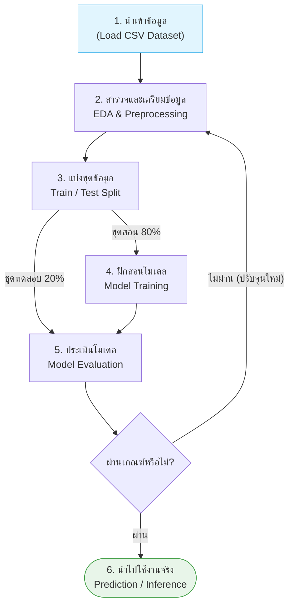
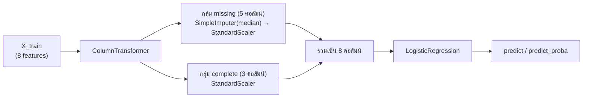

## วัตถุประสงค์การเรียนรู้

- อธิบายขั้นตอนของ ML Pipeline ทั้ง 6 ขั้น ตั้งแต่การนำเข้าข้อมูลจนถึงการนำโมเดลไปทำนายข้อมูลใหม่ได้ (LLO2-1)
- สำรวจข้อมูล (EDA) ด้วย pandas ตรวจหาค่าว่าง ค่าว่างแฝง (เช่น 0 ที่แทนค่าที่ไม่ได้วัด) และค่าผิดปกติ แล้วเลือกวิธีทำความสะอาดที่เหมาะสมได้ (LLO2-1)
- แบ่งข้อมูล train/test แบบ stratified และปรับขนาดข้อมูล (scaling) โดยไม่เกิด data leakage ได้ (LLO2-1)
- เลือก feature ด้วย correlation, `SelectKBest` และความรู้เชิงโดเมน และรวมทุกขั้นตอนไว้ใน scikit-learn `Pipeline` ได้ (LLO2-1)
- ระบุได้ว่าโจทย์เป็นงาน classification, regression หรือ clustering และเลือกอัลกอริทึมตั้งต้น (baseline) ที่เหมาะสมได้ (LLO2-2)

## 1. ML Pipeline: จากไฟล์ CSV สู่โมเดลที่ใช้งานได้

ในบทที่แล้ว ([บทที่ 1](/module/01)) เราเห็นภาพรวมว่า Machine Learning คือการให้คอมพิวเตอร์ "เรียนรู้จากข้อมูล" แต่ในทางปฏิบัติ งานส่วนใหญ่ของนักพัฒนา ML **ไม่ใช่การเลือกอัลกอริทึม** แต่คือการเตรียมข้อมูลให้พร้อม เพราะ "Garbage in, garbage out" — ข้อมูลไม่ดี ต่อให้ใช้โมเดลเก่งแค่ไหนก็ได้ผลไม่ดี

การทำ Classification จากข้อมูลตาราง (tabular data) เช่นไฟล์ CSV มีขั้นตอนมาตรฐานที่เรียกว่า **ML Pipeline** ในบทนี้เราจะใช้ "โจทย์ทำนายความเสี่ยงโรคเบาหวาน" เป็นตัวอย่างตลอดทั้งบท




| ขั้นตอน | สิ่งที่ทำ (โจทย์เบาหวาน) | เครื่องมือหลัก |
|---|---|---|
| 1. นำเข้าข้อมูล | โหลดไฟล์ CSV ที่มี features เช่น `Age`, `BMI`, `BloodPressure`, `Glucose` และ target `Outcome` (0 = ไม่เป็น, 1 = เสี่ยงเป็น) | `pd.read_csv` |
| 2. EDA & Preprocessing | ตรวจค่าว่าง ค่าผิดปกติ (เช่น ความดันเป็น 0) เติมค่า เลือก feature ปรับสเกล | pandas, `SimpleImputer`, `StandardScaler` |
| 3. Train/Test Split | กันข้อมูลส่วนหนึ่งไว้ "สอบ" ห้ามให้โมเดลเห็นตอนเรียน | `train_test_split` |
| 4. Model Training | ให้โมเดลหาความสัมพันธ์ระหว่างน้ำตาล อายุ ฯลฯ กับโรคเบาหวาน | `LogisticRegression`, `RandomForestClassifier`, `SVC` |
| 5. Evaluation | วัดผลบน test set ด้วย accuracy, recall, confusion matrix | `sklearn.metrics` |
| 6. Prediction | ป้อนข้อมูลคนไข้รายใหม่ ได้คำตอบ 0 หรือ 1 เพื่อช่วยแพทย์ตัดสินใจ | `model.predict` |

> [!NOTE]
> ลูกศร "ไม่ผ่าน → กลับไปขั้นที่ 2" สำคัญมาก: ML เป็นกระบวนการ **วนซ้ำ (iterative)** เราแทบไม่เคยได้โมเดลที่ดีในรอบแรก มักต้องกลับไปทำความสะอาดข้อมูลเพิ่ม เลือก feature ใหม่ หรือเปลี่ยนอัลกอริทึม

### 1.1 ก่อนเริ่ม: โจทย์ของเราเป็นงานประเภทไหน?

ก่อนจะเปิดไฟล์ข้อมูล ต้องตอบให้ได้ก่อนว่า **สิ่งที่ต้องการทำนายคืออะไร** เพราะจะเป็นตัวกำหนดประเภทงานและอัลกอริทึมที่เลือกใช้

| ประเภทงาน | Target (y) | ตัวอย่างโจทย์ | อัลกอริทึมตั้งต้น (baseline) |
|---|---|---|---|
| **Classification** | หมวดหมู่ (discrete) | เป็นเบาหวานหรือไม่ (0/1), อีเมลเป็น spam หรือไม่, รูปเป็นเลขอะไร (0–9) | `LogisticRegression`, `KNeighborsClassifier`, `DecisionTreeClassifier` |
| **Regression** | ตัวเลขต่อเนื่อง | ราคาบ้าน, ระดับน้ำตาลในเลือด, ยอดขายเดือนหน้า | `LinearRegression`, `Ridge`, `RandomForestRegressor` |
| **Clustering** | ไม่มี target (unsupervised) | แบ่งกลุ่มลูกค้า, จัดกลุ่มผู้ป่วยตามลักษณะร่วม | `KMeans`, `DBSCAN` |

ตัวอย่างการตีโจทย์จากชุดข้อมูลเบาหวานชุดเดียวกัน:

- "คนไข้รายนี้เสี่ยงเป็นเบาหวานหรือไม่" → target คือ `Outcome` (0/1) → **binary classification** ← โจทย์หลักของบทนี้
- "ทำนายค่าระดับน้ำตาล `Glucose` จากอายุและ BMI" → target เป็นตัวเลข → **regression** (ดู [บทที่ 4](/module/04))
- "แบ่งคนไข้เป็นกลุ่มตามลักษณะทางสุขภาพ โดยไม่ใช้ `Outcome`" → ไม่มี label → **clustering**

> [!TIP]
> หลักการเลือกอัลกอริทึมเบื้องต้น: เริ่มจาก **โมเดลง่ายที่เป็น baseline** ก่อนเสมอ (เช่น Logistic Regression สำหรับ classification) เพราะเร็ว ตีความได้ และให้ "เส้นฐาน" ไว้เทียบ ถ้าโมเดลซับซ้อนกว่า (Random Forest, SVM) ทำได้ไม่ดีกว่า baseline อย่างมีนัยสำคัญ ก็ไม่คุ้มที่จะใช้ รายละเอียดอัลกอริทึมแต่ละตัวอยู่ใน [บทที่ 3](/module/03) และ [บทที่ 5](/module/05)

## 2. การนำเข้าข้อมูล (Data Acquisition)

แหล่งข้อมูลที่พบบ่อยในงาน ML ระดับรายวิชา:

| แหล่ง | ลักษณะ | วิธีโหลด |
|---|---|---|
| ไฟล์ CSV / Excel | ข้อมูลที่เก็บเองหรือได้จากหน่วยงาน | `pd.read_csv("file.csv")`, `pd.read_excel(...)` |
| `sklearn.datasets` | ชุดข้อมูลมาตรฐานสำหรับฝึก มากับไลบรารีหรือดาวน์โหลดจาก OpenML | `load_breast_cancer()`, `fetch_california_housing()`, `fetch_openml("mnist_784")` |
| Kaggle | ชุดข้อมูลและการแข่งขันจำนวนมาก (ต้องมีบัญชี) | ดาวน์โหลดจากเว็บ หรือ Kaggle API |
| UCI Machine Learning Repository | คลังข้อมูลวิชาการเก่าแก่ เช่น Iris, Heart Disease, Adult | ดาวน์โหลดไฟล์จากเว็บ หรือแพ็กเกจ `ucimlrepo` |
| ฐานข้อมูล / API | ข้อมูลจริงในองค์กร | SQL (`pd.read_sql`), REST API (`requests`) |

ในบทนี้ใช้ 2 ไฟล์ (ดาวน์โหลดได้จากหน้ารายวิชา):

- `diabetes_binary_classification.csv` — ข้อมูลตัวอย่างขนาดเล็ก 15 แถว 4 features (`Age`, `BMI`, `BloodPressure`, `Glucose`) ใช้ดูภาพรวมและคำนวณด้วยมือ
- `pima_indians_diabetes_real.csv` — ข้อมูลจริง **Pima Indians Diabetes** (เผยแพร่ครั้งแรกโดย National Institute of Diabetes and Digestive and Kidney Diseases ของสหรัฐฯ และมีใน UCI/Kaggle) 768 แถว 8 features จากผู้หญิงเชื้อสาย Pima อายุ 21 ปีขึ้นไป

ใน Google Colab ให้อัปโหลดไฟล์ก่อนด้วย

```bash
# ใน Colab: from google.colab import files; files.upload()  แล้วเลือกไฟล์ CSV
# หรือใช้ Kaggle API (ต้องตั้งค่า kaggle.json ก่อน)
kaggle datasets download -d uciml/pima-indians-diabetes-database
```

```python
import numpy as np
import pandas as pd
import matplotlib.pyplot as plt

pd.set_option("display.width", 120)
pd.set_option("display.max_columns", 20)

small = pd.read_csv("diabetes_binary_classification.csv")
print(small.shape)
print(small.head())
```

```output
(15, 5)
   Age   BMI  BloodPressure  Glucose  Outcome
0   25  23.5             80      105        0
1   45  28.4             90      140        1
2   32  25.1             85      110        0
3   50  30.2             95      160        1
4   28  22.0             78       95        0
```

```python
df = pd.read_csv("pima_indians_diabetes_real.csv")
print(df.shape)
print(df.head())
```

```output
(768, 9)
   Pregnancies  Glucose  BloodPressure  SkinThickness  Insulin   BMI  DiabetesPedigreeFunction  Age  Outcome
0            6      148             72             35        0  33.6                     0.627   50        1
1            1       85             66             29        0  26.6                     0.351   31        0
2            8      183             64              0        0  23.3                     0.672   32        1
3            1       89             66             23       94  28.1                     0.167   21        0
4            0      137             40             35      168  43.1                     2.288   33        1
```

ความหมายของแต่ละคอลัมน์ใน Pima: `Pregnancies` (จำนวนครั้งที่ตั้งครรภ์), `Glucose` (ระดับน้ำตาลหลังดื่มกลูโคส 2 ชม., mg/dL), `BloodPressure` (ความดัน diastolic, mmHg), `SkinThickness` (ความหนาไขมันใต้ผิวหนังที่ต้นแขน, mm), `Insulin` (อินซูลินในเลือด 2 ชม., μU/mL), `BMI` (kg/m²), `DiabetesPedigreeFunction` (คะแนนความเสี่ยงจากประวัติครอบครัว), `Age` (ปี) และ `Outcome` (1 = เป็นเบาหวาน)

ชุดข้อมูลมาตรฐานใน `sklearn.datasets` โหลดเป็น DataFrame ได้ทันทีด้วย `as_frame=True`:

```python
from sklearn.datasets import load_breast_cancer, fetch_california_housing

cancer = load_breast_cancer(as_frame=True)
print("Breast Cancer      :", cancer.frame.shape)
housing = fetch_california_housing(as_frame=True)
print("California Housing :", housing.frame.shape)
```

```output
Breast Cancer      : (569, 31)
California Housing : (20640, 9)
```

## 3. สำรวจข้อมูล (Exploratory Data Analysis, EDA)

EDA คือการ "ทำความรู้จัก" ข้อมูลก่อนสร้างโมเดล คำถามที่ต้องตอบให้ได้คือ มีกี่แถว กี่คอลัมน์ ชนิดข้อมูลอะไร มีค่าว่างไหม ค่าแต่ละคอลัมน์กระจายอย่างไร มีค่าแปลก ๆ ไหม และคลาสสมดุลหรือไม่

### 3.1 โครงสร้างและสถิติเบื้องต้น

```python
df.info()
```

```output
<class 'pandas.DataFrame'>
RangeIndex: 768 entries, 0 to 767
Data columns (total 9 columns):
 #   Column                    Non-Null Count  Dtype  
---  ------                    --------------  -----  
 0   Pregnancies               768 non-null    int64  
 1   Glucose                   768 non-null    int64  
 2   BloodPressure             768 non-null    int64  
 3   SkinThickness             768 non-null    int64  
 4   Insulin                   768 non-null    int64  
 5   BMI                       768 non-null    float64
 6   DiabetesPedigreeFunction  768 non-null    float64
 7   Age                       768 non-null    int64  
 8   Outcome                   768 non-null    int64  
dtypes: float64(2), int64(7)
memory usage: 54.1 KB
```

`info()` บอกว่ามี 768 แถว ทุกคอลัมน์ "non-null" ครบ และเป็นตัวเลขทั้งหมด (int64/float64) — ดูเผิน ๆ เหมือนข้อมูลสะอาด แต่ต้องดูสถิติต่อ (หมายเหตุ: pandas 2.x ใน Colab จะแสดงบรรทัดแรกเป็น `<class 'pandas.core.frame.DataFrame'>`)

```python
print(df.describe().T.round(2))
```

```output
                          count    mean     std    min    25%     50%     75%     max
Pregnancies               768.0    3.85    3.37   0.00   1.00    3.00    6.00   17.00
Glucose                   768.0  120.89   31.97   0.00  99.00  117.00  140.25  199.00
BloodPressure             768.0   69.11   19.36   0.00  62.00   72.00   80.00  122.00
SkinThickness             768.0   20.54   15.95   0.00   0.00   23.00   32.00   99.00
Insulin                   768.0   79.80  115.24   0.00   0.00   30.50  127.25  846.00
BMI                       768.0   31.99    7.88   0.00  27.30   32.00   36.60   67.10
DiabetesPedigreeFunction  768.0    0.47    0.33   0.08   0.24    0.37    0.63    2.42
Age                       768.0   33.24   11.76  21.00  24.00   29.00   41.00   81.00
Outcome                   768.0    0.35    0.48   0.00   0.00    0.00    1.00    1.00
```

> [!WARNING]
> สังเกตคอลัมน์ `min`: `Glucose`, `BloodPressure`, `SkinThickness`, `Insulin` และ `BMI` มีค่าต่ำสุดเป็น **0** — คนที่ยังมีชีวิตอยู่ไม่สามารถมีระดับน้ำตาล 0, ความดัน 0 หรือ BMI 0 ได้! นี่คือสัญญาณของ **ค่าว่างแฝง (disguised missing values)** ซึ่งเราจะจัดการในหัวข้อที่ 4

### 3.2 การกระจายของคลาส (Class Balance)

```python
print(df["Outcome"].value_counts())
print(df["Outcome"].value_counts(normalize=True).round(3))
```

```output
Outcome
0    500
1    268
Name: count, dtype: int64
Outcome
0    0.651
1    0.349
Name: proportion, dtype: float64
```

มีผู้ไม่เป็นเบาหวาน 65.1% และเป็น 34.9% — ข้อมูล **ไม่สมดุล (imbalanced)** เล็กน้อย ข้อสังเกตนี้มีผล 2 อย่าง: (1) ตอนแบ่ง train/test ควรใช้ `stratify` และ (2) โมเดลที่ "ทายว่าไม่เป็นทุกคน" จะได้ accuracy ถึง ~65% ทั้งที่ไม่มีประโยชน์เลย

### 3.3 ค่าว่าง ฮิสโตแกรม และ Correlation

```python
print("จำนวนค่าว่าง (NaN) ทั้งตาราง:", df.isna().sum().sum())
```

```output
จำนวนค่าว่าง (NaN) ทั้งตาราง: 0
```

`isna()` บอกว่าไม่มีค่าว่างเลย — แต่เรารู้แล้วว่าค่าว่างซ่อนอยู่ในรูปของเลข 0 นี่คือเหตุผลที่ **ห้ามเชื่อ `isna()` อย่างเดียว** ต้องดู `describe()` และกราฟประกอบเสมอ

```python
df.hist(figsize=(12, 8), bins=20, edgecolor="black")
plt.tight_layout()
plt.show()
```

ในฮิสโตแกรมจะเห็นแท่งสูงผิดปกติที่ค่า 0 ของ `Insulin` และ `SkinThickness` แยกห่างจากกลุ่มข้อมูลหลัก ส่วน `Age`, `Pregnancies`, `Insulin` และ `DiabetesPedigreeFunction` เบ้ขวา (right-skewed)

Correlation (Pearson's $r$) วัดความสัมพันธ์เชิงเส้นระหว่างสองตัวแปร มีค่าระหว่าง $-1$ ถึง $1$

$$ r_{xy} = \frac{\sum_{i}(x_i-\bar{x})(y_i-\bar{y})}{\sqrt{\sum_{i}(x_i-\bar{x})^2}\sqrt{\sum_{i}(y_i-\bar{y})^2}} $$

```python
print(df.corr()["Outcome"].drop("Outcome").sort_values(ascending=False).round(3))
```

```output
Glucose                     0.467
BMI                         0.293
Age                         0.238
Pregnancies                 0.222
DiabetesPedigreeFunction    0.174
Insulin                     0.131
SkinThickness               0.075
BloodPressure               0.065
Name: Outcome, dtype: float64
```

`Glucose` สัมพันธ์กับ `Outcome` สูงสุด (0.467) สอดคล้องกับความรู้ทางการแพทย์ ส่วน `Insulin`, `SkinThickness`, `BloodPressure` ต่ำมาก — แต่ค่าเหล่านี้ยัง **ถูกบิดเบือนโดยเลข 0 ปลอม** อยู่ เราจะคำนวณใหม่หลังทำความสะอาด

## 4. การทำความสะอาดข้อมูล (Data Cleaning)

### 4.1 ตรวจหาค่าว่างแฝง (Disguised Missing Values)

ค่าว่างแฝงคือค่าที่ "ไม่ได้วัด" แต่ถูกบันทึกเป็นตัวเลขบางค่า เช่น `0`, `-1`, `999` ต้องใช้ **ความรู้เชิงโดเมน** ตัดสินว่าค่าไหนเป็นไปไม่ได้ ใน Pima คอลัมน์ `Pregnancies = 0` เป็นค่าที่เป็นไปได้จริง (ไม่เคยตั้งครรภ์) แต่ 5 คอลัมน์ทางสรีรวิทยาเป็น 0 ไม่ได้

```python
zero_cols = ["Glucose", "BloodPressure", "SkinThickness", "Insulin", "BMI"]
n_zero = (df[zero_cols] == 0).sum()
summary = pd.DataFrame({"n_zero": n_zero, "percent": (n_zero / len(df) * 100).round(1)})
print(summary)
```

```output
               n_zero  percent
Glucose             5      0.7
BloodPressure      35      4.6
SkinThickness     227     29.6
Insulin           374     48.7
BMI                11      1.4
```

`Insulin` หายไปเกือบครึ่ง (48.7%) และ `SkinThickness` เกือบ 30% ขั้นแรกให้แปลงเลข 0 เหล่านี้เป็น `NaN` เพื่อให้ pandas และ scikit-learn รู้ว่าเป็นค่าว่างจริง

```python
df_clean = df.copy()
df_clean[zero_cols] = df_clean[zero_cols].replace(0, np.nan)
print(df_clean.isna().sum().to_dict())
```

```output
{'Pregnancies': 0, 'Glucose': 5, 'BloodPressure': 35, 'SkinThickness': 227, 'Insulin': 374, 'BMI': 11, 'DiabetesPedigreeFunction': 0, 'Age': 0, 'Outcome': 0}
```

### 4.2 ลบทิ้ง (Drop) หรือเติมค่า (Impute)?

ทางเลือกที่ 1 — ลบแถวที่มีค่าว่าง:

```python
df_drop = df_clean.dropna()
print("ก่อนลบ:", df_clean.shape, " หลังลบ:", df_drop.shape)
print("สัดส่วนข้อมูลที่หายไป: {:.1%}".format(1 - len(df_drop) / len(df_clean)))
```

```output
ก่อนลบ: (768, 9)  หลังลบ: (392, 9)
สัดส่วนข้อมูลที่หายไป: 49.0%
```

เสียข้อมูลไปเกือบครึ่ง! และแถวที่เหลืออาจไม่เป็นตัวแทนของประชากร (เช่น คนที่ได้ตรวจอินซูลินอาจเป็นกลุ่มที่แพทย์สงสัยอยู่แล้ว) — นี่คือ **sampling bias** ที่กล่าวถึงใน [บทที่ 1](/module/01)

ทางเลือกที่ 2 — เติมค่าด้วยสถิติ (imputation) โดยใช้ **median** เพราะทนต่อ outlier และข้อมูลเบ้ได้ดีกว่า mean

```python
from sklearn.impute import SimpleImputer

imputer = SimpleImputer(strategy="median")
X_demo = imputer.fit_transform(df_clean[zero_cols])
print(pd.Series(imputer.statistics_, index=zero_cols, name="median"))
print("ค่าว่างหลังเติม:", int(np.isnan(X_demo).sum()))
```

```output
Glucose          117.0
BloodPressure     72.0
SkinThickness     29.0
Insulin          125.0
BMI               32.3
Name: median, dtype: float64
ค่าว่างหลังเติม: 0
```

| วิธี | ข้อดี | ข้อเสีย | ใช้เมื่อ |
|---|---|---|---|
| ลบแถว `dropna()` | ง่าย ไม่สร้างข้อมูลปลอม | เสียข้อมูล อาจเกิด bias | ค่าว่างน้อยมาก (< 5%) และหายแบบสุ่ม |
| ลบคอลัมน์ `drop(columns=...)` | ตัดปัญหาทั้งคอลัมน์ | เสีย feature ที่อาจสำคัญ | คอลัมน์หายเกินครึ่งและไม่สำคัญ |
| เติม mean / median `SimpleImputer` | เก็บข้อมูลไว้ครบ | ลดความแปรปรวน ค่าที่เติมไม่ใช่ค่าจริง | ทั่วไป — median เมื่อข้อมูลเบ้ |
| เติมค่าที่พบบ่อย `strategy="most_frequent"` | ใช้กับข้อมูลหมวดหมู่ได้ | อาจทำให้คลาสนั้นมากเกินจริง | คอลัมน์ categorical |
| `KNNImputer` / `IterativeImputer` | ใช้ความสัมพันธ์กับคอลัมน์อื่น | ช้ากว่า ซับซ้อนกว่า | ต้องการความแม่นยำมากขึ้น |

> [!WARNING]
> โค้ดข้างบนเป็นการ **สาธิต** โดย fit กับข้อมูลทั้งหมด ในการสร้างโมเดลจริง median ต้องคำนวณจาก **train set เท่านั้น** แล้วนำไปเติมทั้ง train และ test (หัวข้อที่ 7) ไม่เช่นนั้นจะเกิด data leakage

### 4.3 ค่าผิดปกติ (Outliers) ด้วยวิธี IQR

Outlier คือค่าที่อยู่ห่างจากกลุ่มข้อมูลส่วนใหญ่มาก วิธีมาตรฐานที่ไม่ขึ้นกับการแจกแจงคือ **IQR rule** (หลักเดียวกับ whisker ของ box plot):

$$ IQR = Q_3 - Q_1, \qquad \text{lower} = Q_1 - 1.5 \times IQR, \qquad \text{upper} = Q_3 + 1.5 \times IQR $$

ค่าที่น้อยกว่า lower หรือมากกว่า upper ถือเป็น outlier

```python
def iqr_outliers(s):
    q1, q3 = s.quantile(0.25), s.quantile(0.75)
    iqr = q3 - q1
    low, high = q1 - 1.5 * iqr, q3 + 1.5 * iqr
    return low, high, int(((s < low) | (s > high)).sum())

rows = []
for col in df_clean.columns.drop("Outcome"):
    low, high, n = iqr_outliers(df_clean[col].dropna())
    rows.append((col, round(low, 2), round(high, 2), n))
print(pd.DataFrame(rows, columns=["feature", "lower", "upper", "n_outliers"]).to_string(index=False))
```

```output
                 feature  lower  upper  n_outliers
             Pregnancies  -6.50  13.50           4
                 Glucose  36.00 204.00           0
           BloodPressure  40.00 104.00          14
           SkinThickness   1.00  57.00           3
                 Insulin -94.38 360.62          24
                     BMI  13.85  50.25           8
DiabetesPedigreeFunction  -0.33   1.20          29
                     Age  -1.50  66.50           9
```

พบ outlier ไม่มาก แต่ **ไม่ควรลบทิ้งอัตโนมัติ** ต้องถามว่าเป็นค่าที่ผิดพลาด (บันทึกผิด เครื่องวัดเสีย) หรือเป็นค่าที่สุดโต่งแต่จริง เช่น `Insulin` 846 หรือ `Age` 81 ปี เป็นไปได้ทางการแพทย์ และอาจเป็นคนไข้กลุ่มที่สำคัญที่สุด ทางเลือกอื่นนอกจากลบ ได้แก่ ตัดค่าให้อยู่ในขอบ (clipping/capping), แปลง log เพื่อลดความเบ้ หรือใช้โมเดลที่ทนต่อ outlier เช่น tree-based

## 5. แบ่งข้อมูล Train/Test (Train/Test Split)

กฎเหล็กของ ML คือ **ห้ามนำข้อมูลทั้งหมดไปสอนโมเดลรวดเดียว** ต้องแบ่งส่วนหนึ่งไว้ "สอบ" เหมือนข้อสอบที่นักศึกษาไม่เคยเห็นมาก่อน เพื่อวัดความสามารถในการ **generalize** กับข้อมูลใหม่ ไม่ใช่วัดการท่องจำ (overfitting)

- **Training set (เช่น 80%)** — ให้โมเดลเรียนรู้ว่าน้ำตาล อายุ ฯลฯ สัมพันธ์กับโรคเบาหวานอย่างไร และใช้คำนวณทุกอย่างที่ "เรียนจากข้อมูล" (median, mean, std, การเลือก feature)
- **Test set (เช่น 20%)** — เก็บไว้ทดสอบ **ครั้งสุดท้าย** ห้ามแตะระหว่างพัฒนา ถ้าใช้ test set ปรับจูนโมเดลไปเรื่อย ๆ จะเกิด **data snooping bias** ทำให้ผลประเมินดีเกินจริง
- **Validation set / Cross-validation** — ถ้าต้องเปรียบเทียบหรือจูนโมเดล ให้แบ่ง validation ออกจาก train อีกชั้น หรือใช้ cross-validation (หัวข้อที่ 8)

```python
from sklearn.model_selection import train_test_split

X = df_clean.drop(columns="Outcome")
y = df_clean["Outcome"]

X_train, X_test, y_train, y_test = train_test_split(
    X, y, test_size=0.2, stratify=y, random_state=42
)
print("Train:", X_train.shape, " Test:", X_test.shape)
print("สัดส่วนคลาส 1 — ทั้งหมด: {:.3f} | train: {:.3f} | test: {:.3f}".format(
    y.mean(), y_train.mean(), y_test.mean()))
```

```output
Train: (614, 8)  Test: (154, 8)
สัดส่วนคลาส 1 — ทั้งหมด: 0.349 | train: 0.349 | test: 0.351
```

พารามิเตอร์สำคัญของ `train_test_split`:

| พารามิเตอร์ | ความหมาย |
|---|---|
| `test_size=0.2` | สัดส่วน test 20% → 768 × 0.2 = 153.6 ปัดขึ้นเป็น 154 แถว |
| `stratify=y` | รักษาสัดส่วนคลาสใน train และ test ให้เท่ากับข้อมูลทั้งหมด (~34.9%) |
| `random_state=42` | กำหนด seed ให้การสุ่มเหมือนเดิมทุกครั้ง → ผลลัพธ์ทำซ้ำได้ (reproducible) |

ถ้าไม่ใช้ `stratify` สัดส่วนคลาสใน test จะแกว่งตามการสุ่ม ซึ่งยิ่งรุนแรงเมื่อข้อมูลน้อยหรือคลาสไม่สมดุลมาก:

```python
for seed in [0, 1, 2]:
    _, _, _, y_te = train_test_split(X, y, test_size=0.2, random_state=seed)
    print(f"ไม่ stratify (seed={seed}) สัดส่วนคลาส 1 ใน test = {y_te.mean():.3f}")
```

```output
ไม่ stratify (seed=0) สัดส่วนคลาส 1 ใน test = 0.305
ไม่ stratify (seed=1) สัดส่วนคลาส 1 ใน test = 0.357
ไม่ stratify (seed=2) สัดส่วนคลาส 1 ใน test = 0.292
```

> [!TIP]
> สังเกตว่าเราแบ่งข้อมูล **ก่อน** เติมค่าว่าง เลือก feature และปรับสเกล หลักจำง่าย ๆ คือ "**split ก่อน แล้วค่อย fit**" — ทุกอย่างที่ต้อง `fit` กับข้อมูล ต้อง fit กับ train set เท่านั้น

## 6. การเลือกและแปลง Feature (Feature Selection & Encoding)

### 6.1 ทำไมต้องเลือก feature

Feature ที่ไม่เกี่ยวข้องหรือซ้ำซ้อนทำให้โมเดลซับซ้อนเกินจำเป็น เสี่ยง overfitting ฝึกช้า และตีความยาก วิธีเลือก feature เบื้องต้นมี 3 แนวทาง

1. **ความรู้เชิงโดเมน (domain knowledge)** — ปรึกษาผู้เชี่ยวชาญ เช่น แพทย์ยืนยันว่าระดับน้ำตาลและ BMI เป็นปัจจัยเสี่ยงหลักของเบาหวานชนิดที่ 2 และพิจารณาว่า feature ใดเก็บได้จริงตอนใช้งาน (เช่น การตรวจอินซูลินมีค่าใช้จ่ายสูง)
2. **Correlation** — ดูความสัมพันธ์ของแต่ละ feature กับ target และระหว่าง feature ด้วยกันเอง (ถ้าสอง feature สัมพันธ์กันสูงมาก อาจเก็บไว้ตัวเดียว)
3. **วิธีทางสถิติ (filter methods)** — เช่น `SelectKBest` ให้คะแนนแต่ละ feature แล้วเลือก k ตัวที่ดีที่สุด

### 6.2 Correlation หลังทำความสะอาด (บน train set)

```python
train_df = X_train.assign(Outcome=y_train)
print(train_df.corr()["Outcome"].drop("Outcome").sort_values(ascending=False).round(3))
```

```output
Glucose                     0.515
Insulin                     0.351
BMI                         0.331
SkinThickness               0.280
Age                         0.241
Pregnancies                 0.208
BloodPressure               0.188
DiabetesPedigreeFunction    0.165
Name: Outcome, dtype: float64
```

เปรียบเทียบกับหัวข้อ 3.3: correlation ของ `Insulin` เพิ่มจาก 0.131 เป็น 0.351 และ `SkinThickness` จาก 0.075 เป็น 0.280 เมื่อเอาเลข 0 ปลอมออก (pandas คำนวณ correlation โดยข้ามคู่ที่เป็น NaN) — แสดงให้เห็นว่า **ข้อมูลสกปรกบิดเบือนผลวิเคราะห์ได้มาก** ถ้าเลือก feature จากข้อมูลดิบ เราอาจตัด `Insulin` ทิ้งไปอย่างผิด ๆ

### 6.3 SelectKBest

`SelectKBest(f_classif, k)` คำนวณ ANOVA F-statistic ของแต่ละ feature (feature ที่ค่าเฉลี่ยต่างกันมากระหว่างคลาสจะได้คะแนนสูง) แล้วเลือก k ตัวที่คะแนนสูงสุด เนื่องจาก `SelectKBest` รับค่าว่างไม่ได้ จึงต่อ `SimpleImputer` ไว้ข้างหน้าด้วย `make_pipeline` และ fit กับ train set เท่านั้น

```python
from sklearn.pipeline import make_pipeline
from sklearn.feature_selection import SelectKBest, f_classif

selector = make_pipeline(SimpleImputer(strategy="median"), SelectKBest(f_classif, k=4))
selector.fit(X_train, y_train)
skb = selector.named_steps["selectkbest"]
scores = pd.Series(skb.scores_, index=X_train.columns).sort_values(ascending=False)
print(scores.round(1))
print("เลือก:", list(X_train.columns[skb.get_support()]))
```

```output
Glucose                     217.8
BMI                          74.2
Insulin                      39.4
Age                          37.6
SkinThickness                35.5
Pregnancies                  27.7
BloodPressure                21.3
DiabetesPedigreeFunction     17.2
dtype: float64
เลือก: ['Glucose', 'Insulin', 'BMI', 'Age']
```

ผลสอดคล้องกับ correlation: `Glucose` โดดเด่นที่สุด ตามด้วย `BMI` อย่างไรก็ตาม `Insulin` ถูกเลือกแม้จะหายไปเกือบครึ่ง (ค่าที่เติมด้วย median) — นี่คือจุดที่ต้องใช้วิจารณญาณร่วมกับความรู้เชิงโดเมน ไม่ใช่เชื่อตัวเลขอย่างเดียว ในบทนี้เราจะใช้ทั้ง 8 features เป็น baseline ก่อน

### 6.4 การแปลงข้อมูลหมวดหมู่ (Encoding Categorical Features)

โมเดลส่วนใหญ่ใน scikit-learn รับเฉพาะตัวเลข ถ้ามีคอลัมน์ข้อความ เช่น ภูมิภาค หรือ สูบบุหรี่ (yes/no) ต้องแปลงเป็นตัวเลขก่อน วิธีมาตรฐานสำหรับหมวดหมู่ที่ไม่มีลำดับคือ **One-Hot Encoding** — สร้างคอลัมน์ 0/1 หนึ่งคอลัมน์ต่อหนึ่งหมวด

```python
from sklearn.preprocessing import OneHotEncoder

toy = pd.DataFrame({"Region": ["อีสาน", "เหนือ", "กลาง", "อีสาน"],
                    "Smoker": ["yes", "no", "no", "yes"]})
ohe = OneHotEncoder(sparse_output=False, handle_unknown="ignore")
encoded = ohe.fit_transform(toy)
print(pd.DataFrame(encoded, columns=ohe.get_feature_names_out()).astype(int))
```

```output
   Region_กลาง  Region_อีสาน  Region_เหนือ  Smoker_no  Smoker_yes
0            0             1             0          0           1
1            0             0             1          1           0
2            1             0             0          1           0
3            0             1             0          0           1
```

> [!NOTE]
> ทำไมไม่แทน อีสาน=0, เหนือ=1, กลาง=2 ไปเลย? เพราะโมเดลจะตีความว่า "กลาง > เหนือ > อีสาน" และ "กลาง − เหนือ = เหนือ − อีสาน" ซึ่งไม่มีความหมาย การแทนด้วยลำดับเลข (`OrdinalEncoder`) ใช้ได้เฉพาะหมวดหมู่ที่มีลำดับจริง เช่น ระดับการศึกษา ส่วน `handle_unknown="ignore"` ป้องกัน error เมื่อ test set มีหมวดที่ไม่เคยเห็นใน train

## 7. การปรับขนาดข้อมูล (Feature Scaling) และ Data Leakage

### 7.1 ทำไมต้อง scale

ค่า `Glucose` อยู่หลักร้อย (เช่น 100–200) แต่ `BMI` อยู่หลักสิบ (20–40) และ `DiabetesPedigreeFunction` น้อยกว่า 1 อัลกอริทึมที่ใช้ **ระยะทาง** หรือ **gradient descent** จะให้น้ำหนักกับ feature ที่มีค่าใหญ่มากเกินไป เราจึงแปลงทุกคอลัมน์ให้อยู่ในระดับใกล้เคียงกัน

**Standardization (Z-score)** — `StandardScaler` ทำให้แต่ละคอลัมน์มี mean = 0 และ std = 1

$$ z = \frac{x - \mu}{\sigma} $$

**Min-Max Scaling (Normalization)** — `MinMaxScaler` บีบค่าให้อยู่ในช่วง [0, 1]

$$ x' = \frac{x - x_{min}}{x_{max} - x_{min}} $$

ลองกับคอลัมน์ `Glucose` ของข้อมูลชุดเล็ก 15 แถว:

```python
from sklearn.preprocessing import StandardScaler, MinMaxScaler

g = small[["Glucose"]]
print("mean =", round(g["Glucose"].mean(), 2),
      " std(ddof=0) =", round(g["Glucose"].std(ddof=0), 2),
      " min =", g["Glucose"].min(), " max =", g["Glucose"].max())

demo = pd.DataFrame({
    "Glucose": g["Glucose"],
    "Standard": StandardScaler().fit_transform(g).ravel().round(3),
    "MinMax": MinMaxScaler().fit_transform(g).ravel().round(3),
})
print(demo.head(5))
```

```output
mean = 127.07  std(ddof=0) = 28.26  min = 90  max = 180
   Glucose  Standard  MinMax
0      105    -0.781   0.167
1      140     0.458   0.556
2      110    -0.604   0.222
3      160     1.165   0.778
4       95    -1.135   0.056
```

ตรวจด้วยมือแถวแรก ($x = 105$): $z = (105 - 127.07)/28.26 \approx -0.781$ และ $x' = (105 - 90)/(180 - 90) = 15/90 \approx 0.167$ ตรงกับผลของ scikit-learn

> [!NOTE]
> `StandardScaler` ใช้ส่วนเบี่ยงเบนมาตรฐานแบบประชากร (หารด้วย $n$, `ddof=0`) ขณะที่ `df.std()` ของ pandas หารด้วย $n-1$ (`ddof=1`) โดยค่าเริ่มต้น จึงได้ตัวเลขต่างกันเล็กน้อย

| | StandardScaler | MinMaxScaler |
|---|---|---|
| ผลลัพธ์ | mean 0, std 1 (ไม่มีขอบเขตตายตัว) | อยู่ในช่วง [0, 1] |
| ผลของ outlier | ได้รับผลน้อยกว่า | outlier ตัวเดียวดึง min/max ทำให้ค่าอื่นถูกบีบรวมกัน |
| เหมาะกับ | โมเดลเชิงเส้น, SVM, PCA, กรณีทั่วไป | ข้อมูลที่ต้องการช่วงชัดเจน เช่น ค่าพิกเซลภาพ, input ของ neural network |

**อัลกอริทึมไหนต้อง scale?**

| ต้อง scale (ไวต่อสเกล) | ไม่จำเป็น |
|---|---|
| KNN, K-Means (ใช้ระยะทาง) | Decision Tree |
| SVM (ใช้ระยะทาง/margin) | Random Forest, Gradient Boosting |
| Logistic/Linear Regression ที่มี regularization หรือฝึกด้วย gradient descent | Naive Bayes |
| Neural Network, PCA | |

### 7.2 Data Leakage: ข้อผิดพลาดที่พบบ่อยที่สุด

**Data leakage** คือการที่ข้อมูลจาก test set (หรือข้อมูลที่จะไม่มีในตอนใช้งานจริง) "รั่ว" เข้าไปในขั้นตอนฝึกโมเดล ทำให้ผลประเมินดีเกินจริง และโมเดลทำงานแย่กว่าที่คาดเมื่อใช้งานจริง

เปรียบเทียบง่าย ๆ: ถ้าอาจารย์คำนวณ "เกณฑ์การตัดเกรด" จากคะแนนข้อสอบปลายภาคที่นักศึกษายังไม่ได้สอบ ก็เท่ากับนักศึกษารู้ข้อมูลของข้อสอบล่วงหน้าแล้ว

```python
# ผิด: fit scaler กับข้อมูลทั้งหมดก่อนแบ่ง -> mean/std ของ test รั่วเข้าไปในการฝึก
# scaler = StandardScaler().fit(X_all)
# X_all_scaled = scaler.transform(X_all)
# X_train, X_test = train_test_split(X_all_scaled, ...)

# ถูก: แบ่งก่อน แล้ว fit กับ train เท่านั้น จากนั้นใช้ค่าเดิม transform test
imp = SimpleImputer(strategy="median").fit(X_train)
X_train_imp = imp.transform(X_train)
X_test_imp = imp.transform(X_test)

scaler = StandardScaler()
X_train_s = scaler.fit_transform(X_train_imp)
X_test_s = scaler.transform(X_test_imp)

print("train mean ≈", X_train_s.mean(axis=0).round(2))
print("test  mean ≈", X_test_s.mean(axis=0).round(2))
```

```output
train mean ≈ [-0. -0.  0. -0. -0.  0. -0. -0.]
test  mean ≈ [ 0.04 -0.    0.1   0.04  0.19  0.01 -0.08 -0.05]
```

ค่าเฉลี่ยของ train หลัง scale เป็น 0 พอดี (เพราะ fit จาก train) แต่ test **ไม่เป็น 0 พอดี** — นี่คือสิ่งที่ถูกต้อง! เพราะในโลกจริงข้อมูลคนไข้รายใหม่จะไม่ได้มี mean ตรงกับข้อมูลฝึกเป๊ะ การที่ test ถูกแปลงด้วย $\mu$ และ $\sigma$ จาก train จึงจำลองสถานการณ์ใช้งานจริงได้ถูกต้อง

| เมธอด | ใช้กับ | ทำอะไร |
|---|---|---|
| `fit(X_train)` | train เท่านั้น | เรียนรู้ค่าสถิติ (median, $\mu$, $\sigma$, min, max) |
| `transform(X)` | train, test, ข้อมูลใหม่ | แปลงข้อมูลด้วยค่าที่เรียนไว้ |
| `fit_transform(X_train)` | train เท่านั้น | fit + transform ในคำสั่งเดียว |

> [!WARNING]
> Leakage ไม่ได้เกิดแค่กับ scaler แต่เกิดกับ **ทุกขั้นที่เรียนจากข้อมูล** ได้แก่ การเติมค่าว่าง (median), การเลือก feature (`SelectKBest`), การ encode และการทำ oversampling ห้ามเรียก `fit` หรือ `fit_transform` กับ test set เด็ดขาด รูปแบบ leakage อีกแบบคือการใช้ feature ที่ "รู้ผลล่วงหน้า" เช่น ใช้ "จำนวนครั้งที่จ่ายยาเบาหวาน" มาทำนายว่าเป็นเบาหวานหรือไม่

## 8. รวมทุกขั้นด้วย Pipeline และสร้างโมเดล Baseline

### 8.1 Pipeline และ ColumnTransformer

การเขียน `fit`/`transform` ทีละขั้นเองทั้งยาวและเสี่ยงลืม scikit-learn จึงมี

- **`Pipeline`** — ต่อขั้นตอนเรียงกัน เรียก `fit` ครั้งเดียว ทุกขั้นจะ fit กับข้อมูลที่ส่งเข้ามา (train) โดยอัตโนมัติ และ `predict` จะ transform ข้อมูลใหม่ด้วยค่าที่เรียนไว้ → **ป้องกัน leakage โดยโครงสร้าง**
- **`ColumnTransformer`** — ใช้การเตรียมข้อมูลต่างกันกับคอลัมน์แต่ละกลุ่ม เช่น คอลัมน์ตัวเลขให้ impute + scale ส่วนคอลัมน์หมวดหมู่ให้ one-hot encode



```python
from sklearn.compose import ColumnTransformer
from sklearn.pipeline import Pipeline
from sklearn.linear_model import LogisticRegression

other_cols = ["Pregnancies", "DiabetesPedigreeFunction", "Age"]

preprocess = ColumnTransformer([
    ("missing", Pipeline([("impute", SimpleImputer(strategy="median")),
                          ("scale", StandardScaler())]), zero_cols),
    ("complete", StandardScaler(), other_cols),
])

clf = Pipeline([
    ("prep", preprocess),
    ("model", LogisticRegression(max_iter=1000)),
])
clf.fit(X_train, y_train)

coef = pd.Series(clf.named_steps["model"].coef_[0],
                 index=clf.named_steps["prep"].get_feature_names_out())
print(coef.sort_values(ascending=False).round(3))
```

```output
missing__Glucose                      1.183
missing__BMI                          0.689
complete__Pregnancies                 0.377
complete__DiabetesPedigreeFunction    0.233
complete__Age                         0.148
missing__SkinThickness                0.028
missing__BloodPressure               -0.044
missing__Insulin                     -0.066
dtype: float64
```

เนื่องจากทุก feature ถูก standardize แล้ว ขนาดของสัมประสิทธิ์ (coefficient) จึงพอเปรียบเทียบกันได้คร่าว ๆ: `Glucose` มีน้ำหนักบวกมากที่สุด แปลว่าน้ำตาลยิ่งสูง ความน่าจะเป็นที่จะเป็นเบาหวานยิ่งสูง ซึ่งสมเหตุสมผลทางการแพทย์

### 8.2 ประเมินผลเบื้องต้น: Accuracy vs Recall

ในโจทย์ทางการแพทย์ การทายผิดว่า "ปกติ" ทั้งที่จริง "ป่วย" (**False Negative**) อันตรายต่อคนไข้มาก เพราะคนไข้จะไม่ได้รับการรักษา จึงต้องดู **Recall** (สัดส่วนของผู้ป่วยจริงที่โมเดลจับได้) ควบคู่กับ Accuracy เสมอ

$$ \text{Accuracy} = \frac{\text{จำนวนที่ทายถูก}}{\text{จำนวนทั้งหมด}}, \qquad \text{Recall} = \frac{TP}{TP + FN} $$

เพื่อให้รู้ว่าโมเดลดีจริงหรือไม่ ให้เทียบกับ **dummy baseline** ที่ทายคลาสที่พบบ่อยที่สุดเสมอ

```python
from sklearn.metrics import accuracy_score, recall_score
from sklearn.dummy import DummyClassifier

y_pred = clf.predict(X_test)
print(f"LogisticRegression  accuracy = {accuracy_score(y_test, y_pred):.3f}  recall = {recall_score(y_test, y_pred):.3f}")

dummy = DummyClassifier(strategy="most_frequent").fit(X_train, y_train)
y_dummy = dummy.predict(X_test)
print(f"Dummy (ทายว่า 0 หมด) accuracy = {accuracy_score(y_test, y_dummy):.3f}  recall = {recall_score(y_test, y_dummy):.3f}")
```

```output
LogisticRegression  accuracy = 0.708  recall = 0.500
Dummy (ทายว่า 0 หมด) accuracy = 0.649  recall = 0.000
```

การตีความ:

- Dummy ได้ accuracy ~65% ทั้งที่ **ไม่จับผู้ป่วยได้เลยสักคน** (recall = 0) — accuracy อย่างเดียวจึงหลอกเราได้เมื่อคลาสไม่สมดุล
- Logistic Regression ดีกว่า dummy แต่ recall เพียง 0.5 แปลว่า **ผู้ป่วยจริงครึ่งหนึ่งถูกทายว่าปกติ** ยังไม่เหมาะจะใช้คัดกรองโรค

ก่อนจะสรุป ควรตรวจว่าผลไม่ได้ขึ้นกับการสุ่มแบ่งข้อมูลครั้งเดียว ด้วย **5-fold cross-validation** บน train set (test set ยังไม่ถูกแตะ) — `Pipeline` ทำให้ทุก fold เติมค่าและ scale จากส่วนที่ใช้ฝึกของ fold นั้นเท่านั้น

```python
from sklearn.model_selection import cross_val_score

cv_recall = cross_val_score(clf, X_train, y_train, cv=5, scoring="recall")
print("recall แต่ละ fold:", cv_recall.round(3))
print(f"ค่าเฉลี่ย = {cv_recall.mean():.3f} ± {cv_recall.std():.3f}")
```

```output
recall แต่ละ fold: [0.651 0.581 0.558 0.488 0.643]
ค่าเฉลี่ย = 0.584 ± 0.060
```

วิธีง่าย ๆ ที่ช่วยเพิ่ม recall คือให้โมเดลถ่วงน้ำหนักคลาสส่วนน้อยมากขึ้นด้วย `class_weight="balanced"` (ใช้ `clone` เพื่อสร้าง pipeline ใหม่ที่ยังไม่ถูก fit)

```python
from sklearn.base import clone

clf_bal = clone(clf).set_params(model__class_weight="balanced")
clf_bal.fit(X_train, y_train)
y_pred_bal = clf_bal.predict(X_test)
print(f"balanced  accuracy = {accuracy_score(y_test, y_pred_bal):.3f}  recall = {recall_score(y_test, y_pred_bal):.3f}")
```

```output
balanced  accuracy = 0.734  recall = 0.704
```

Recall เพิ่มขึ้นชัดเจน (จับผู้ป่วยได้มากขึ้น) แลกกับการทายว่า "เสี่ยง" ให้คนปกติบ้าง (False Positive เพิ่ม) ซึ่งในงานคัดกรองโรคมักยอมรับได้ เพราะแพทย์จะตรวจยืนยันอีกครั้ง การวิเคราะห์ confusion matrix, precision, F1 และการเลือก threshold จะเรียนเชิงลึกใน [บทที่ 3](/module/03)

> [!NOTE]
> ในการทดลองจริง การเปรียบเทียบ "ปกติ vs balanced" แล้วเลือกตัวที่ดีกว่า ควรทำด้วย cross-validation บน train set ไม่ใช่ดูจาก test set (ไม่เช่นนั้นจะเกิด data snooping) ในที่นี้แสดงผลบน test เพื่อการสาธิตเท่านั้น

### 8.3 ทำนายคนไข้รายใหม่ (Prediction / Inference)

เมื่อโมเดลผ่านการประเมิน ก็นำข้อมูลคนไข้รายใหม่เข้าโมเดลได้ทันที ข้อดีของ `Pipeline` คือข้อมูลดิบจะผ่านการเติมค่าและ scale ด้วยค่าจาก train set โดยอัตโนมัติ — แม้คนไข้ไม่ได้ตรวจอินซูลิน (ใส่ `np.nan`) ก็ยังทำนายได้

```python
new_patients = pd.DataFrame({
    "Pregnancies": [1, 4],
    "Glucose": [110, 165],
    "BloodPressure": [80, 85],
    "SkinThickness": [np.nan, 35],
    "Insulin": [np.nan, np.nan],
    "BMI": [25.0, 35.5],
    "DiabetesPedigreeFunction": [0.30, 0.65],
    "Age": [35, 50],
})
print("ผลทำนาย:", clf.predict(new_patients))
print("ความน่าจะเป็นเป็นเบาหวาน:", clf.predict_proba(new_patients)[:, 1].round(3))
```

```output
ผลทำนาย: [0 1]
ความน่าจะเป็นเป็นเบาหวาน: [0.074 0.814]
```

คนไข้รายแรก (อายุ 35, BMI 25, ความดัน 80, น้ำตาล 110) ถูกทำนายว่า **ปกติ (0)** ด้วยความน่าจะเป็นเป็นเบาหวานต่ำ ส่วนรายที่สอง (น้ำตาล 165, BMI 35.5, อายุ 50) ถูกทำนายว่า **เสี่ยง (1)** ผลนี้เป็นเพียง "เครื่องมือช่วยแพทย์ตัดสินใจ" ไม่ใช่การวินิจฉัยแทนแพทย์

> [!WARNING]
> ข้อมูลใหม่ต้องมี **ชื่อคอลัมน์และหน่วยเหมือนข้อมูลฝึก** ทุกประการ และควรระวังว่าโมเดลนี้เรียนจากผู้หญิงเชื้อสาย Pima อายุ 21 ปีขึ้นไป การนำไปใช้กับประชากรกลุ่มอื่น (เช่น ผู้ชายไทย) อาจไม่แม่นยำ — เป็นปัญหาข้อมูลไม่เป็นตัวแทน (nonrepresentative data)

## สรุป

- ML Pipeline มี 6 ขั้น: นำเข้าข้อมูล → EDA & Preprocessing → Train/Test Split → Training → Evaluation → Prediction และเป็นกระบวนการวนซ้ำ
- เริ่มจากตีโจทย์ให้ได้ว่าเป็น classification (target เป็นหมวดหมู่), regression (target เป็นตัวเลข) หรือ clustering (ไม่มี target) แล้วเริ่มจากโมเดล baseline ที่เรียบง่าย
- EDA ด้วย `info()`, `describe()`, `value_counts()`, `isna()`, ฮิสโตแกรม และ correlation — **`isna()` = 0 ไม่ได้แปลว่าไม่มีค่าว่าง** ต้องใช้ความรู้เชิงโดเมนตรวจค่าว่างแฝง เช่น เลข 0 ใน Glucose/BMI
- จัดการค่าว่างด้วยการลบ (เสียข้อมูล เสี่ยง bias) หรือเติมค่า (`SimpleImputer(strategy="median")`) ตรวจ outlier ด้วย IQR แต่อย่าลบทิ้งโดยไม่พิจารณา
- แบ่งข้อมูลด้วย `train_test_split(..., stratify=y, random_state=42)` **ก่อน** fit ขั้นตอนใด ๆ
- Scaling: `StandardScaler` ($z=(x-\mu)/\sigma$) หรือ `MinMaxScaler` ($[0,1]$) จำเป็นกับโมเดลที่ใช้ระยะทาง/gradient แต่ไม่จำเป็นกับ tree-based
- **Data leakage**: fit ทุก transformer กับ train เท่านั้น แล้ว transform test — ใช้ `Pipeline` + `ColumnTransformer` เพื่อป้องกันโดยอัตโนมัติ
- ประเมินเทียบกับ dummy baseline และในงานการแพทย์ต้องดู recall ไม่ใช่ accuracy อย่างเดียว

## คำศัพท์สำคัญ

| ศัพท์ | ความหมาย |
|---|---|
| ML Pipeline | ลำดับขั้นตอนการพัฒนาโมเดลตั้งแต่ข้อมูลดิบจนถึงการทำนาย |
| EDA (Exploratory Data Analysis) | การสำรวจข้อมูลด้วยสถิติและกราฟเพื่อทำความเข้าใจก่อนสร้างโมเดล |
| Disguised missing value | ค่าว่างที่ถูกบันทึกเป็นตัวเลข เช่น 0 หรือ 999 ทำให้ `isna()` ตรวจไม่พบ |
| Imputation | การเติมค่าว่างด้วยค่าประมาณ เช่น median ของคอลัมน์ |
| Outlier / IQR | ค่าผิดปกติ / ช่วงระหว่างควอร์ไทล์ $Q_3 - Q_1$ ใช้กำหนดขอบ $Q_1 - 1.5IQR$ ถึง $Q_3 + 1.5IQR$ |
| Feature selection | การเลือกเฉพาะ feature ที่มีประโยชน์ต่อการทำนาย |
| One-Hot Encoding | การแปลงหมวดหมู่เป็นคอลัมน์ 0/1 หนึ่งคอลัมน์ต่อหนึ่งหมวด |
| Standardization | การแปลงให้ mean = 0, std = 1 ด้วย $z=(x-\mu)/\sigma$ |
| Min-Max Scaling | การแปลงให้อยู่ในช่วง [0, 1] ด้วย $(x-x_{min})/(x_{max}-x_{min})$ |
| Stratified split | การแบ่งข้อมูลที่รักษาสัดส่วนคลาสใน train และ test ให้เท่ากับข้อมูลทั้งหมด |
| `random_state` | seed ของการสุ่ม ทำให้ผลลัพธ์ทำซ้ำได้ |
| Data leakage | ข้อมูลจาก test set หรือข้อมูลอนาคตรั่วเข้าสู่การฝึก ทำให้ผลประเมินดีเกินจริง |
| Data snooping bias | ผลประเมินเกินจริงจากการใช้ test set ช่วยปรับจูนโมเดล |
| Pipeline / ColumnTransformer | เครื่องมือ scikit-learn สำหรับต่อขั้นตอน / แยกการเตรียมข้อมูลตามกลุ่มคอลัมน์ |
| Baseline | โมเดลอ้างอิงอย่างง่ายไว้เปรียบเทียบ เช่น `DummyClassifier`, Logistic Regression |
| Recall | สัดส่วนของผู้ป่วยจริงที่โมเดลทำนายถูก $TP/(TP+FN)$ |

## คำถามทบทวนท้ายบท

**1.** คอลัมน์ `BloodPressure` ของ Pima ไม่มีค่า NaN เลย แต่มีค่า 0 อยู่ 35 แถว ควรจัดการอย่างไร และทำไม `df.isna().sum()` จึงไม่ช่วย

<details><summary>เฉลย</summary>

ความดัน diastolic เป็น 0 ไม่ได้ในคนที่มีชีวิต ค่า 0 จึงเป็น **ค่าว่างแฝง** ที่ถูกบันทึกแทนค่าที่ไม่ได้วัด `isna()` นับเฉพาะ NaN จึงมองไม่เห็น วิธีจัดการคือแปลง 0 เป็น `np.nan` ด้วย `replace(0, np.nan)` แล้วเติมค่าด้วย `SimpleImputer(strategy="median")` ที่ fit กับ train set (มีเพียง 4.6% จึงอาจลบแถวได้ แต่การเติมค่าจะเก็บข้อมูลไว้ได้มากกว่า)

</details>

**2.** คอลัมน์ `Age` ของ Pima มี $Q_1 = 24$ และ $Q_3 = 41$ (จาก `describe()`) จงหาขอบบนของ outlier ตามกฎ IQR คนไข้อายุ 70 ปีเป็น outlier หรือไม่ และควรลบทิ้งหรือไม่

<details><summary>เฉลย</summary>

$IQR = 41 - 24 = 17$, ขอบบน $= 41 + 1.5 \times 17 = 66.5$ ปี ดังนั้นอายุ 70 เป็น outlier ตามกฎ IQR แต่ **ไม่ควรลบ** เพราะเป็นค่าที่เป็นไปได้จริง และผู้สูงอายุเป็นกลุ่มเสี่ยงเบาหวานที่สำคัญ การลบจะทำให้โมเดลไม่รู้จักคนกลุ่มนี้

</details>

**3.** นักศึกษาคนหนึ่งเขียนโค้ด `X_scaled = StandardScaler().fit_transform(X)` แล้วจึง `train_test_split(X_scaled, y)` ผิดหลักการอย่างไร จะแก้อย่างไร

<details><summary>เฉลย</summary>

เกิด **data leakage** เพราะ $\mu$ และ $\sigma$ ถูกคำนวณจากข้อมูลทั้งหมดรวม test set ทำให้ข้อมูลของ test รั่วเข้าไปในการเตรียมข้อมูลฝึก วิธีแก้คือแบ่งข้อมูลก่อน แล้ว `scaler.fit_transform(X_train)` และ `scaler.transform(X_test)` หรือดีที่สุดคือใส่ scaler ไว้ใน `Pipeline` ร่วมกับโมเดล แล้วเรียก `pipe.fit(X_train, y_train)`

</details>

**4.** ทำไมต้องใช้ `stratify=y` ใน `train_test_split` กับข้อมูล Pima และ `random_state` มีไว้ทำอะไร

<details><summary>เฉลย</summary>

ข้อมูลมีคลาส 1 เพียง ~35% ถ้าสุ่มแบ่งเฉย ๆ สัดส่วนคลาสใน test อาจแกว่ง (เช่น 29%–36% ในตัวอย่าง) ทำให้ผลประเมินไม่น่าเชื่อถือ `stratify=y` รักษาสัดส่วนให้เท่ากับข้อมูลทั้งหมด ส่วน `random_state` กำหนด seed ของการสุ่มให้ได้การแบ่งเดิมทุกครั้ง ทำให้ผลการทดลองทำซ้ำและตรวจสอบได้

</details>

**5.** ระบุประเภทงาน (classification / regression / clustering) ของโจทย์ต่อไปนี้: (ก) ทำนายระดับ HbA1c ของคนไข้ (ข) จัดกลุ่มคนไข้ตามพฤติกรรมการกินโดยไม่มี label (ค) ทำนายว่าคนไข้จะกลับมานอนโรงพยาบาลภายใน 30 วันหรือไม่

<details><summary>เฉลย</summary>

(ก) regression — target เป็นตัวเลขต่อเนื่อง (ข) clustering — ไม่มี target (ค) binary classification — target เป็น ใช่/ไม่ใช่

</details>

**6.** โมเดลหนึ่งได้ accuracy 65% บน test set ของ Pima แต่ recall = 0 หมายความว่าอย่างไร และทำไมจึงเป็นปัญหาในงานการแพทย์

<details><summary>เฉลย</summary>

โมเดลทายว่า "ไม่เป็นเบาหวาน" ทุกคน (เหมือน `DummyClassifier`) จึงได้ accuracy เท่ากับสัดส่วนคลาส 0 (~65%) แต่จับผู้ป่วยจริงไม่ได้เลย เป็น False Negative ทั้งหมด ซึ่งอันตรายเพราะผู้ป่วยจะไม่ได้รับการรักษา จึงต้องดู recall ควบคู่และเทียบกับ dummy baseline เสมอ

</details>

## อ่านเพิ่มเติม

- Géron, A. *Hands-On Machine Learning with Scikit-Learn, Keras & TensorFlow* (3rd ed.), Chapter 2: End-to-End Machine Learning Project — หัวข้อ Create a Test Set, Prepare the Data, Feature Scaling, Transformation Pipelines
- scikit-learn User Guide: [Preprocessing data](https://scikit-learn.org/stable/modules/preprocessing.html), [Imputation of missing values](https://scikit-learn.org/stable/modules/impute.html), [Feature selection](https://scikit-learn.org/stable/modules/feature_selection.html)
- scikit-learn User Guide: [Pipelines and composite estimators](https://scikit-learn.org/stable/modules/compose.html) และ [Common pitfalls — Data leakage](https://scikit-learn.org/stable/common_pitfalls.html)
- pandas: [10 minutes to pandas](https://pandas.pydata.org/docs/user_guide/10min.html)
- ชุดข้อมูล: [Pima Indians Diabetes Database (Kaggle)](https://www.kaggle.com/datasets/uciml/pima-indians-diabetes-database)
