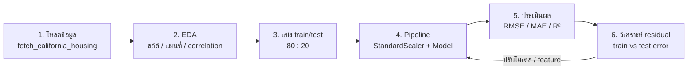

## วัตถุประสงค์การเรียนรู้

- อธิบายแนวคิดของ Linear Regression ทั้งแบบตัวแปรเดียวและหลายตัวแปร รวมถึง cost function แบบ MSE ได้ (LLO2-2)
- เปรียบเทียบการหาพารามิเตอร์ด้วย Normal Equation กับ Gradient Descent และอธิบายผลของ learning rate ได้ (LLO2-2)
- เลือกใช้ Regularization (Ridge / Lasso / Elastic Net), SVR หรือ tree-based regressor ให้เหมาะกับลักษณะข้อมูลได้ (LLO2-2)
- ทำ Normalization / Standardization ภายใน `Pipeline` และสร้าง regression model ด้วย scikit-learn ได้ (LLO2-3)
- คำนวณและตีความ MAE, MSE, RMSE, R² รวมถึงวิเคราะห์ residual และตรวจจับ overfitting จาก train/test error ได้ (LLO2-3)

## 1. Regression คืออะไร — ทบทวนเทียบกับ Classification

ใน [บทที่ 3](/module/03) เราทำนาย "หมวดหมู่" (เช่น เลข 0–9, เป็นเบาหวานหรือไม่) ซึ่งเป็นงาน **Classification** บทนี้เปลี่ยนมาทำนาย **ตัวเลขต่อเนื่อง (continuous value)** เช่น ราคาบ้าน อุณหภูมิ ยอดขาย ซึ่งเรียกว่างาน **Regression (การถดถอย)** ทั้งสองแบบเป็น Supervised Learning เหมือนกัน คือเรียนรู้จากข้อมูลที่มีคำตอบ (label) อยู่แล้ว

| หัวข้อ | Regression (การถดถอย) | Classification (การจำแนกประเภท) |
|---|---|---|
| ลักษณะผลลัพธ์ | ตัวเลขต่อเนื่อง เช่น 1.5, 100.5, 5000 | หมวดหมู่ เช่น ใช่/ไม่ใช่, หมา/แมว |
| เป้าหมายของโมเดล | หาเส้น/ระนาบที่ "ใกล้" จุดข้อมูลมากที่สุด (best-fit line) | หาเส้นแบ่งเขต (decision boundary) แยกกลุ่ม |
| ตัวอย่างปัญหา | ทำนายราคาบ้าน, ยอดขาย, ค่าไฟฟ้า | ตรวจจับสแปม, วินิจฉัยโรค |
| Metric หลัก | MAE, MSE, RMSE, R² | Accuracy, Precision, Recall, F1 |
| อัลกอริทึมที่นิยม | Linear Regression, Ridge/Lasso, SVR, Random Forest, Gradient Boosting | Logistic Regression, Decision Tree, SVM, Naive Bayes |

> [!TIP]
> วิธีจำง่าย ๆ — ถ้าคำถามทางธุรกิจคือ **"เท่าไหร่?"** ให้คิดถึง Regression ถ้าคือ **"แบบไหน / กลุ่มไหน?"** ให้คิดถึง Classification
> ระวังชื่อหลอก: **Logistic Regression** แม้ชื่อมีคำว่า Regression แต่ใช้ทำ Classification

## 2. Linear Regression และ Cost Function

### 2.1 Simple Linear Regression (ตัวแปรต้นตัวเดียว)

เป้าหมายคือสร้างสมการที่อธิบายความสัมพันธ์ระหว่างตัวแปรต้น $x$ (feature) กับตัวแปรตาม $y$ (target)

$$ y = \beta_0 + \beta_1 x + \varepsilon $$

- $y$ คือ ตัวแปรตามที่ต้องการทำนาย เช่น ราคาบ้าน
- $x$ คือ ตัวแปรต้น เช่น พื้นที่บ้าน
- $\beta_0$ คือ จุดตัดแกน y (**intercept**) และ $\beta_1$ คือ ความชัน (**slope / weight**)
- $\varepsilon$ คือ ความคลาดเคลื่อน (**error term**) ส่วนที่สมการเส้นตรงอธิบายไม่ได้ เช่น ทำเล สภาพบ้าน

โมเดลที่เรียนรู้แล้วจะทำนายด้วย $\hat{y} = \hat{\beta}_0 + \hat{\beta}_1 x$ (หมวก ^ แปลว่า "ค่าประมาณ")

ตัวอย่าง: สร้างข้อมูลจำลองที่รู้ "คำตอบจริง" อยู่แล้ว คือ ราคา = 5 + 0.15 × พื้นที่ + noise แล้วดูว่าโมเดลประมาณค่า $\beta_0, \beta_1$ ได้ใกล้แค่ไหน

```python
import numpy as np
from sklearn.linear_model import LinearRegression

# ข้อมูลจำลอง: พื้นที่บ้าน (ตร.ม.) กับราคาบ้าน (แสนบาท)
rng = np.random.default_rng(42)
X = 50 + 150 * rng.random((100, 1))           # พื้นที่ 50–200 ตร.ม.
y = 5 + 0.15 * X[:, 0] + rng.normal(0, 3, 100)  # ราคาจริง = 5 + 0.15·พื้นที่ + noise

model = LinearRegression()
model.fit(X, y)
print(f"intercept (β0) = {model.intercept_:.3f}")
print(f"slope     (β1) = {model.coef_[0]:.4f}")
print("ทำนายบ้าน 120 ตร.ม. =", model.predict([[120]]).round(2))
```

```output
intercept (β0) = 4.769
slope     (β1) = 0.1515
ทำนายบ้าน 120 ตร.ม. = [22.95]
```

**การตีความ:** $\hat{\beta}_1 = 0.1515$ แปลว่า พื้นที่เพิ่มขึ้น 1 ตร.ม. ราคาเพิ่มขึ้นประมาณ 0.15 แสนบาท (≈ 15,000 บาท) ใกล้กับค่าจริง 0.15 ที่เราใช้สร้างข้อมูล ส่วน intercept 4.769 ใกล้ 5 — ความต่างเล็กน้อยเกิดจาก noise

### 2.2 Multiple Linear Regression (หลายตัวแปร)

เมื่อมี feature $n$ ตัว เส้นตรงจะกลายเป็น **hyperplane** ในหลายมิติ (ตำรา Géron ใช้สัญลักษณ์ $\theta$ แทน $\beta$)

$$ \hat{y} = \theta_0 + \theta_1 x_1 + \theta_2 x_2 + \dots + \theta_n x_n = \boldsymbol{\theta}^T \mathbf{x} $$

โดยเติม $x_0 = 1$ ไว้หน้าเวกเตอร์ $\mathbf{x}$ เพื่อให้ $\theta_0$ (bias) อยู่ในรูปผลคูณเวกเตอร์ได้ ตัวอย่างเช่น ราคาบ้าน = $\theta_0$ + $\theta_1$·รายได้ + $\theta_2$·อายุบ้าน + $\theta_3$·ละติจูด + …

### 2.3 Cost Function: Mean Squared Error (MSE)

"เส้นที่ดีที่สุด" คือเส้นที่ทำให้ผลรวมความคลาดเคลื่อนน้อยที่สุด เราวัดด้วย **MSE** ของชุด training ขนาด $m$ ตัวอย่าง

$$ \text{MSE}(\boldsymbol{\theta}) = \frac{1}{m}\sum_{i=1}^{m}\left(\boldsymbol{\theta}^T\mathbf{x}^{(i)} - y^{(i)}\right)^2 $$

ทำไมต้องยกกำลังสอง?
- ทำให้ error บวกและลบไม่หักล้างกัน
- ลงโทษ error ใหญ่หนักกว่า error เล็ก (พลาด 4 หน่วย = ถูกลงโทษ 16 เท่าของพลาด 1 หน่วย)
- เป็นฟังก์ชัน convex ของ $\theta$ (รูปชาม) มีจุดต่ำสุดเพียงจุดเดียว และหาอนุพันธ์ได้ง่าย

> [!NOTE]
> การ "ฝึก" Linear Regression คือการหาค่า $\boldsymbol{\theta}$ ที่ทำให้ MSE ต่ำที่สุด ซึ่งทำได้ 2 แนวทาง: แก้สมการตรง ๆ (Normal Equation) หรือค่อย ๆ เดินลงเขา (Gradient Descent)

## 3. การฝึกโมเดล: Normal Equation และ Gradient Descent

### 3.1 Normal Equation (Closed-form solution)

เมื่อหาอนุพันธ์ของ MSE เทียบกับ $\boldsymbol{\theta}$ แล้วตั้งให้เท่ากับศูนย์ จะได้คำตอบในรูปปิด

$$ \hat{\boldsymbol{\theta}} = \left(\mathbf{X}^T\mathbf{X}\right)^{-1}\mathbf{X}^T\mathbf{y} $$

```python
import numpy as np
from sklearn.linear_model import LinearRegression

rng = np.random.default_rng(42)
X = 50 + 150 * rng.random((100, 1))
y = 5 + 0.15 * X[:, 0] + rng.normal(0, 3, 100)

# Normal Equation: θ = (XᵀX)⁻¹ Xᵀy
X_b = np.c_[np.ones((len(X), 1)), X]          # เติมคอลัมน์ x0 = 1 สำหรับ θ0
theta = np.linalg.inv(X_b.T @ X_b) @ X_b.T @ y
print("Normal Equation  :", theta.round(4))

# วิธีที่เสถียรกว่าในทางตัวเลข: pseudo-inverse / lstsq
theta_pinv = np.linalg.pinv(X_b) @ y
print("Pseudo-inverse   :", theta_pinv.round(4))

lin = LinearRegression().fit(X, y)
print("LinearRegression :", np.r_[lin.intercept_, lin.coef_].round(4))
```

```output
Normal Equation  : [4.7695 0.1515]
Pseudo-inverse   : [4.7695 0.1515]
LinearRegression : [4.7695 0.1515]
```

ทั้งสามวิธีได้คำตอบตรงกัน — `LinearRegression` ของ scikit-learn ใช้วิธี least squares ผ่าน SVD/pseudo-inverse ซึ่งยังใช้ได้แม้ $\mathbf{X}^T\mathbf{X}$ จะ inverse ไม่ได้ (เช่น มี feature ซ้ำซ้อนกัน)

**ข้อดี/ข้อจำกัด:** ได้คำตอบในครั้งเดียว ไม่ต้องเลือก learning rate แต่การ inverse เมทริกซ์ขนาด $n \times n$ มีความซับซ้อนประมาณ $O(n^{2.4})$ ถึง $O(n^3)$ ตามจำนวน feature $n$ จึงช้ามากเมื่อ feature เยอะ (หลักหมื่นขึ้นไป) และต้องโหลดข้อมูลทั้งหมดเข้าหน่วยความจำ

### 3.2 Gradient Descent (GD)

แนวคิด: นึกภาพคนหลงทางบนภูเขาในหมอกหนา มองไม่เห็นหุบเขา แต่รู้สึกได้ว่าพื้นใต้เท้าเอียงไปทางไหน จึงก้าว **สวนทางกับความชัน** ไปเรื่อย ๆ จนถึงจุดต่ำสุด

gradient ของ MSE คือ

$$ \nabla_{\boldsymbol{\theta}}\,\text{MSE}(\boldsymbol{\theta}) = \frac{2}{m}\mathbf{X}^T\left(\mathbf{X}\boldsymbol{\theta} - \mathbf{y}\right) $$

และกฎการปรับค่า (update rule) ในแต่ละรอบคือ

$$ \boldsymbol{\theta}^{(\text{next})} = \boldsymbol{\theta} - \eta\,\nabla_{\boldsymbol{\theta}}\,\text{MSE}(\boldsymbol{\theta}) $$

โดย $\eta$ (eta) คือ **learning rate** หรือขนาดก้าวเดิน — ถ้าเล็กไปจะเดินช้า ถ้าใหญ่ไปจะกระโดดข้ามจุดต่ำสุดจนแกว่งและ **diverge** (ค่าระเบิด) ลองดูผลของ $\eta$ ต่าง ๆ เมื่อรัน 50 epochs

```python
import numpy as np

rng = np.random.default_rng(42)
X = 50 + 150 * rng.random((100, 1))
y = 5 + 0.15 * X[:, 0] + rng.normal(0, 3, 100)

# standardize x ก่อน เพื่อให้ GD ลู่เข้าเร็ว (ดูหัวข้อ 5)
x_s = (X - X.mean()) / X.std()
X_b = np.c_[np.ones((len(x_s), 1)), x_s]
m = len(X_b)

def batch_gd(eta, n_epochs=50):
    theta = np.zeros(2)                       # เริ่มจาก θ = [0, 0]
    for epoch in range(n_epochs):
        gradients = 2 / m * X_b.T @ (X_b @ theta - y)   # ∇MSE(θ)
        theta = theta - eta * gradients                  # ก้าวสวนความชัน
    mse = np.mean((X_b @ theta - y) ** 2)
    return theta, mse

for eta in [0.01, 0.1, 0.5, 1.05]:
    theta, mse = batch_gd(eta)
    print(f"eta={eta:<5} θ={theta.round(3)}  MSE หลัง 50 epochs = {mse:,.3f}")

theta_best = np.linalg.lstsq(X_b, y, rcond=None)[0]
print("คำตอบจาก Normal Equation:", theta_best.round(3),
      " MSE =", round(np.mean((X_b @ theta_best - y) ** 2), 3))
```

```output
eta=0.01  θ=[14.884  3.935]  MSE หลัง 50 epochs = 86.382
eta=0.1   θ=[23.409  6.188]  MSE หลัง 50 epochs = 8.630
eta=0.5   θ=[23.409  6.188]  MSE หลัง 50 epochs = 8.630
eta=1.05  θ=[-2724.612  -720.246]  MSE หลัง 50 epochs = 8,079,333.625
คำตอบจาก Normal Equation: [23.409  6.188]  MSE = 8.63
```

**การตีความ:**
- $\eta = 0.01$ เล็กเกินไป — ผ่านไป 50 รอบยังเดินไม่ถึงก้นชาม (MSE ยังสูงถึง 86)
- $\eta = 0.1$ และ $0.5$ พอดี — ลู่เข้าสู่คำตอบเดียวกับ Normal Equation
- $\eta = 1.05$ ใหญ่เกินไป — ค่า $\theta$ แกว่งและขยายขึ้นเรื่อย ๆ จน MSE ระเบิดเป็นล้าน
- สังเกตว่า $\theta_1 = 6.188$ ในที่นี้คือความชันต่อ "1 ส่วนเบี่ยงเบนมาตรฐาน" ของพื้นที่ (เพราะเรา standardize x) ถ้าหารด้วย std ของพื้นที่จะได้ประมาณ 0.1515 เท่ากับหัวข้อ 3.1

### 3.3 Batch, Stochastic และ Mini-batch GD

| แบบ | ข้อมูลที่ใช้คำนวณ gradient ต่อ 1 ก้าว | ลักษณะ |
|---|---|---|
| Batch GD | ข้อมูล train **ทั้งหมด** | เส้นทางนิ่ง แม่น แต่ช้าเมื่อข้อมูลใหญ่ |
| Stochastic GD (SGD) | **สุ่มทีละ 1 ตัวอย่าง** | เร็วมาก ใช้กับข้อมูลใหญ่ได้ แต่แกว่งไปมารอบจุดต่ำสุด (มักลด $\eta$ ลงเรื่อย ๆ ด้วย learning schedule) |
| Mini-batch GD | **สุ่มกลุ่มเล็ก** เช่น 32–256 ตัวอย่าง | ประนีประนอมระหว่างสองแบบ ใช้ GPU คำนวณเมทริกซ์ได้ดี — เป็นแบบที่ใช้ฝึก Neural Network ใน [บทที่ 6](/module/06) |

ใน scikit-learn ใช้ `SGDRegressor` ได้ทันที เช่น `make_pipeline(StandardScaler(), SGDRegressor(eta0=0.01, penalty=None))` — ควร scale ข้อมูลก่อนเสมอ (ทดลองในใบงาน)

| เกณฑ์ | Normal Equation | Gradient Descent |
|---|---|---|
| ต้องเลือก learning rate | ไม่ต้อง | ต้อง |
| จำนวนรอบ | ครั้งเดียว | หลายรอบ (epochs) |
| feature จำนวนมาก | ช้า ($O(n^{2.4})$–$O(n^3)$) | ทำได้ดี |
| ข้อมูลใหญ่เกินหน่วยความจำ | ไม่ได้ | ได้ (SGD / mini-batch) |
| ต้อง scale feature | ไม่จำเป็น | **จำเป็น** — ไม่เช่นนั้นชามจะยืดเป็นรูปรี ลู่เข้าช้ามาก |

## 4. Polynomial Regression และ Regularization

### 4.1 Polynomial Regression

ถ้าข้อมูลมีรูปโค้ง เราสามารถเติม feature ยกกำลัง เช่น $x^2, x^3$ แล้วใช้ Linear Regression ตามเดิม (ยังเป็น "linear" ในพารามิเตอร์ $\theta$) ด้วย `PolynomialFeatures`

$$ \hat{y} = \theta_0 + \theta_1 x + \theta_2 x^2 + \dots + \theta_d x^d $$

```python
import numpy as np
from sklearn.model_selection import train_test_split
from sklearn.pipeline import make_pipeline
from sklearn.preprocessing import PolynomialFeatures, StandardScaler
from sklearn.linear_model import LinearRegression
from sklearn.metrics import mean_squared_error

# ข้อมูลรูปพาราโบลา: y = 0.5x² + x + 2 + noise
rng = np.random.default_rng(42)
X = 6 * rng.random((40, 1)) - 3
y = 0.5 * X[:, 0] ** 2 + X[:, 0] + 2 + rng.normal(0, 1, 40)
X_train, X_test, y_train, y_test = train_test_split(X, y, test_size=0.5, random_state=42)

for degree in [1, 2, 15]:
    model = make_pipeline(PolynomialFeatures(degree=degree, include_bias=False),
                          StandardScaler(), LinearRegression())
    model.fit(X_train, y_train)
    tr = mean_squared_error(y_train, model.predict(X_train))
    te = mean_squared_error(y_test, model.predict(X_test))
    print(f"degree={degree:>2}  train MSE={tr:6.3f}  test MSE={te:8.3f}")
```

```output
degree= 1  train MSE= 2.141  test MSE=   2.953
degree= 2  train MSE= 0.401  test MSE=   0.678
degree=15  train MSE= 0.139  test MSE=110827.074
```

- degree 1 (เส้นตรง) → error สูงทั้ง train และ test = **underfitting** (โมเดลง่ายเกินไป)
- degree 2 → ตรงกับรูปแบบจริงของข้อมูล ทั้ง train/test ต่ำ
- degree 15 → train MSE ต่ำสุดแต่ test MSE พุ่งเป็นแสน = **overfitting** (เส้นโค้งไปตาม noise ของข้อมูล train 20 จุด และสวิงรุนแรงในช่วงที่ไม่มีข้อมูล)

### 4.2 Regularization: Ridge, Lasso, Elastic Net

วิธีลด overfitting ของโมเดลเชิงเส้นคือ **จำกัดขนาดของน้ำหนัก** โดยบวก penalty เข้าไปใน cost function ($\alpha$ คือความแรงของการ regularize; ไม่ regularize $\theta_0$)

| วิธี | Cost function | ผลต่อค่าสัมประสิทธิ์ |
|---|---|---|
| **Ridge** (L2) | $J(\boldsymbol{\theta}) = \text{MSE}(\boldsymbol{\theta}) + \alpha\sum_{i=1}^{n}\theta_i^2$ | หดทุกตัวเข้าหา 0 แต่ไม่เป็น 0 พอดี |
| **Lasso** (L1) | $J(\boldsymbol{\theta}) = \text{MSE}(\boldsymbol{\theta}) + \alpha\sum_{i=1}^{n}\lvert\theta_i\rvert$ | ดันบางตัวให้เป็น **0 พอดี** = เลือก feature อัตโนมัติ (sparse model) |
| **Elastic Net** | $J(\boldsymbol{\theta}) = \text{MSE}(\boldsymbol{\theta}) + r\alpha\sum\lvert\theta_i\rvert + \frac{1-r}{2}\alpha\sum\theta_i^2$ | ผสมทั้งสอง ($r$ = `l1_ratio`) เหมาะเมื่อ feature สัมพันธ์กันสูง |

> [!NOTE]
> scikit-learn แต่ละคลาสคูณค่าคงที่หน้าเทอมต่าง ๆ ต่างกันเล็กน้อย (เช่น `Ridge` ใช้ผลรวมกำลังสองแทนค่าเฉลี่ย) ค่า `alpha` ที่เหมาะสมจึงควรหาด้วย cross-validation (`RidgeCV`, `LassoCV`, `GridSearchCV`) ไม่ใช่เดา และ **ต้อง scale feature ก่อน** เพราะ penalty คิดจากขนาดของ $\theta$ ซึ่งขึ้นกับหน่วยของ feature

ลองดูผลกับข้อมูล California Housing (รายละเอียดข้อมูลอยู่หัวข้อ 7)

```python
import pandas as pd
from sklearn.datasets import fetch_california_housing
from sklearn.model_selection import train_test_split
from sklearn.pipeline import make_pipeline
from sklearn.preprocessing import StandardScaler
from sklearn.linear_model import LinearRegression, Ridge, Lasso, ElasticNet
from sklearn.metrics import root_mean_squared_error

X, y = fetch_california_housing(return_X_y=True, as_frame=True)
X_train, X_test, y_train, y_test = train_test_split(X, y, test_size=0.2, random_state=42)

regs = {
    "Linear": LinearRegression(),
    "Ridge(10)": Ridge(alpha=10),
    "Lasso(0.1)": Lasso(alpha=0.1),
    "ElasticNet(0.1)": ElasticNet(alpha=0.1, l1_ratio=0.5),
}
coefs, scores = {}, {}
for name, reg in regs.items():
    pipe = make_pipeline(StandardScaler(), reg).fit(X_train, y_train)
    coefs[name] = pipe[-1].coef_
    scores[name] = root_mean_squared_error(y_test, pipe.predict(X_test))

table = pd.DataFrame(coefs, index=X.columns).round(3)
print(table)
print("test RMSE:", {k: round(v, 3) for k, v in scores.items()})
```

```output
            Linear  Ridge(10)  Lasso(0.1)  ElasticNet(0.1)
MedInc       0.854      0.854       0.711            0.714
HouseAge     0.123      0.123       0.106            0.137
AveRooms    -0.294     -0.292      -0.000           -0.000
AveBedrms    0.339      0.337       0.000            0.000
Population  -0.002     -0.002      -0.000            0.000
AveOccup    -0.041     -0.041      -0.000           -0.000
Latitude    -0.897     -0.889      -0.011           -0.176
Longitude   -0.870     -0.862      -0.000           -0.133
test RMSE: {'Linear': 0.746, 'Ridge(10)': 0.745, 'Lasso(0.1)': 0.824, 'ElasticNet(0.1)': 0.797}
```

**การตีความ:**
- Ridge(10) หดค่าสัมประสิทธิ์ลงเพียงเล็กน้อย เพราะข้อมูลมี 16,512 แถวแต่มีแค่ 8 feature โมเดลเชิงเส้นจึงแทบไม่ overfit อยู่แล้ว
- Lasso(0.1) ดันค่าสัมประสิทธิ์ 5 จาก 8 ตัวให้เป็นศูนย์พอดี (เหลือ `MedInc`, `HouseAge` และ `Latitude` เพียงเล็กน้อย) — ได้โมเดลอธิบายง่าย แต่ RMSE แย่ลงจาก 0.746 เป็น 0.824 เพราะทิ้งข้อมูลพิกัดที่สำคัญ = regularize **แรงเกินไปจน underfit**
- ข้อสรุป: Regularization ไม่ได้ "ทำให้ดีขึ้นเสมอ" ต้องปรับ $\alpha$ ให้สมดุลระหว่าง bias กับ variance

## 5. Support Vector Regression (SVR) และ Feature Scaling

### 5.1 แนวคิด SVR: ท่อ ε (epsilon-insensitive tube)

SVM ฝั่ง classification พยายามสร้าง "ถนน" ที่กว้างที่สุดเพื่อ **แยก** สองคลาสออกจากกัน แต่ SVR กลับด้านเป้าหมาย คือพยายามให้ **จุดข้อมูลอยู่ในท่อกว้าง $\varepsilon$ รอบเส้นทำนายให้ได้มากที่สุด** โดย

- จุดที่อยู่ **ในท่อ** ($|y - \hat{y}| \le \varepsilon$) ไม่ถูกลงโทษเลย → โมเดลจึง "ไม่ไวต่อ ε" (ε-insensitive)
- จุดที่อยู่ **นอกท่อ** ถูกลงโทษตามระยะที่เกินออกไป จุดเหล่านี้คือ **support vectors**

$$ \min_{\mathbf{w},b}\;\frac{1}{2}\lVert\mathbf{w}\rVert^2 + C\sum_{i=1}^{m}\max\left(0,\;\lvert y_i - \hat{y}_i\rvert - \varepsilon\right) $$

| Hyperparameter | ผล |
|---|---|
| `epsilon` | ท่อกว้างขึ้น → ยอมความคลาดเคลื่อนได้มากขึ้น support vectors น้อยลง โมเดลเรียบขึ้น |
| `C` | มาก → ลงโทษจุดนอกท่อหนัก พยายามตามข้อมูลทุกจุด (เสี่ยง overfit); น้อย → เรียบขึ้น |
| `kernel` | `"linear"` ได้เส้นตรง, `"rbf"` / `"poly"` จับความสัมพันธ์ไม่เชิงเส้นได้ด้วย kernel trick |

> [!WARNING]
> `SVR` แบบ kernel มีความซับซ้อนในการฝึกระหว่าง $O(m^2)$ ถึง $O(m^3)$ ตามจำนวนแถว $m$ — กับข้อมูลหลักหมื่นแถวจะช้ามาก วิธีแก้: ใช้ `LinearSVR` (เชิงเส้น ฝึกเร็วกว่ามาก) หรือสุ่มข้อมูลบางส่วนมาฝึก (subsample) ตามที่ทำในหัวข้อ 7

### 5.2 Normalization vs Standardization

feature ในโลกจริงมีหน่วยต่างกันมาก เช่น California Housing: `MedInc` อยู่ช่วง 0.5–15 แต่ `Population` อยู่ช่วง 3–35,682 อัลกอริทึมที่ใช้ **ระยะทาง** หรือ **gradient** จะถูก feature ที่ตัวเลขใหญ่ครอบงำ

| วิธี | สูตร | ช่วงผลลัพธ์ | scikit-learn | หมายเหตุ |
|---|---|---|---|---|
| Normalization (Min-Max) | $x' = \dfrac{x - x_{\min}}{x_{\max} - x_{\min}}$ | [0, 1] | `MinMaxScaler` | ไวต่อ outlier (ค่า max ผิดปกติค่าเดียวทำให้ข้อมูลอื่นเบียดกัน) |
| Standardization (Z-score) | $z = \dfrac{x - \mu}{\sigma}$ | ไม่จำกัด (mean 0, std 1) | `StandardScaler` | ทนต่อ outlier กว่า เป็นค่าเริ่มต้นที่นิยม |

```python
import numpy as np
from sklearn.preprocessing import MinMaxScaler, StandardScaler

area = np.array([[50], [80], [120], [200]])   # พื้นที่บ้าน (ตร.ม.)

print("Min-Max   :", MinMaxScaler().fit_transform(area).ravel().round(3))
print("Standard  :", StandardScaler().fit_transform(area).ravel().round(3))
print("mean =", area.mean(), " std =", area.std().round(3))
```

```output
Min-Max   : [0.    0.2   0.467 1.   ]
Standard  : [-1.11  -0.577  0.133  1.554]
mean = 112.5  std = 56.292
```

ตรวจด้วยมือ: Min-Max ของ 80 = (80 − 50)/(200 − 50) = 30/150 = 0.2 และ z-score ของ 200 = (200 − 112.5)/56.292 ≈ 1.554 ✓

**โมเดลไหนต้อง scale?**

| ต้อง scale | ไม่จำเป็น |
|---|---|
| Gradient Descent / `SGDRegressor`, Ridge / Lasso / Elastic Net, SVR / `LinearSVR`, KNN, Neural Network | `LinearRegression` (Normal Equation ให้ผลทำนายเท่าเดิม), Decision Tree, Random Forest, Gradient Boosting (แบ่งด้วย threshold จึงไม่สนหน่วย) |

### 5.3 ใช้ Pipeline เพื่อกัน Data Leakage

ตัว scaler ต้อง `fit` (คำนวณ $\mu, \sigma$ หรือ min/max) **จากข้อมูล train เท่านั้น** แล้วนำค่าเดียวกันไป `transform` ข้อมูล test ถ้า fit กับข้อมูลทั้งหมดก่อนแบ่ง เท่ากับโมเดลได้ "แอบดู" ข้อมูล test (**data leakage**) ทำให้ผลประเมินดีเกินจริง วิธีที่ปลอดภัยที่สุดคือรวม scaler กับโมเดลใน `Pipeline`

```python
from sklearn.pipeline import make_pipeline
from sklearn.preprocessing import StandardScaler
from sklearn.svm import SVR

svr = make_pipeline(StandardScaler(), SVR(kernel="rbf", C=10, epsilon=0.1))
# svr.fit(X_train, y_train)  → scaler.fit_transform(X_train) แล้วค่อยฝึก SVR
# svr.predict(X_test)        → scaler.transform(X_test) ด้วย μ, σ ของ train แล้วค่อยทำนาย
```

## 6. Metrics สำหรับ Regression: MAE, MSE, RMSE, R²

### 6.1 นิยามและสูตร

ให้ $e_i = y_i - \hat{y}_i$ คือ **residual** (ค่าจริงลบค่าทำนาย) ของตัวอย่างที่ $i$ จาก $n$ ตัวอย่าง

| Metric | สูตร | หน่วย | การตีความ |
|---|---|---|---|
| MAE | $\dfrac{1}{n}\sum\lvert y_i - \hat{y}_i\rvert$ | เดียวกับ $y$ | ทายพลาดเฉลี่ยกี่หน่วย ทนต่อ outlier |
| MSE | $\dfrac{1}{n}\sum(y_i - \hat{y}_i)^2$ | $y^2$ | ลงโทษ error ใหญ่หนัก ใช้เป็น loss ตอนฝึก แต่อ่านค่ายาก (หน่วยยกกำลังสอง) |
| RMSE | $\sqrt{\text{MSE}}$ | เดียวกับ $y$ | "ขนาดความคลาดเคลื่อนโดยทั่วไป" ไวต่อ error ใหญ่มากกว่า MAE |
| R² | $1 - \dfrac{\sum(y_i - \hat{y}_i)^2}{\sum(y_i - \bar{y})^2} = 1 - \dfrac{SS_{res}}{SS_{tot}}$ | ไม่มีหน่วย | สัดส่วนความแปรปรวนของ $y$ ที่โมเดลอธิบายได้ |

- MAE, MSE, RMSE: **ยิ่งน้อยยิ่งดี** (0 = ทายถูกเป๊ะ) และ RMSE ≥ MAE เสมอ
- R²: **ยิ่งใกล้ 1 ยิ่งดี** — R² = 0 เท่ากับทายด้วยค่าเฉลี่ย $\bar{y}$ ทุกตัว และ **R² ติดลบได้** ถ้าโมเดลแย่กว่าการทายค่าเฉลี่ย

### 6.2 ตัวอย่างคำนวณด้วยมือ

ราคาบ้านจริง 5 หลัง (แสนบาท) กับค่าที่โมเดลทำนาย

| บ้าน | $y$ | $\hat{y}$ | $e = y-\hat{y}$ | $\lvert e\rvert$ | $e^2$ | $(y-\bar{y})^2$ |
|---|---|---|---|---|---|---|
| 1 | 20 | 22 | −2 | 2 | 4 | 100 |
| 2 | 25 | 24 | 1 | 1 | 1 | 25 |
| 3 | 30 | 33 | −3 | 3 | 9 | 0 |
| 4 | 35 | 33 | 2 | 2 | 4 | 25 |
| 5 | 40 | 38 | 2 | 2 | 4 | 100 |
| **รวม** | $\bar{y}=30$ | | | **10** | **22** | **250** |

- MAE = 10 / 5 = **2.0** แสนบาท
- MSE = 22 / 5 = **4.4** (แสนบาท)²
- RMSE = $\sqrt{4.4}$ ≈ **2.098** แสนบาท
- R² = 1 − 22/250 = 1 − 0.088 = **0.912** → โมเดลอธิบายความแปรปรวนของราคาได้ 91.2%

ตรวจด้วย scikit-learn

```python
import numpy as np
from sklearn.metrics import mean_absolute_error, mean_squared_error, root_mean_squared_error, r2_score

y_true = np.array([20, 25, 30, 35, 40])   # ราคาจริง (แสนบาท)
y_pred = np.array([22, 24, 33, 33, 38])   # ราคาที่โมเดลทำนาย

print("MAE  =", mean_absolute_error(y_true, y_pred))
print("MSE  =", mean_squared_error(y_true, y_pred))
print("RMSE =", round(root_mean_squared_error(y_true, y_pred), 4))
print("R²   =", round(r2_score(y_true, y_pred), 4))
```

```output
MAE  = 2.0
MSE  = 4.4
RMSE = 2.0976
R²   = 0.912
```

> [!NOTE]
> `root_mean_squared_error` มีตั้งแต่ scikit-learn 1.4 — โค้ดเก่าที่เขียน `mean_squared_error(..., squared=False)` ใช้ไม่ได้แล้วในเวอร์ชันปัจจุบัน ถ้าไม่อยากพึ่งฟังก์ชันนี้ให้ใช้ `np.sqrt(mean_squared_error(...))`

### 6.3 RMSE vs MAE เมื่อมี outlier

เพิ่มบ้านหลังที่ 6 ราคาจริง 50 แต่โมเดลทายได้ 40 (พลาด 10 แสน)

```python
import numpy as np
from sklearn.metrics import mean_absolute_error, root_mean_squared_error

y_true = np.array([20, 25, 30, 35, 40, 50])
y_pred = np.array([22, 24, 33, 33, 38, 40])   # บ้านหลังที่ 6 ทายพลาด 10 แสน

print("MAE  =", round(mean_absolute_error(y_true, y_pred), 4))
print("RMSE =", round(root_mean_squared_error(y_true, y_pred), 4))
```

```output
MAE  = 3.3333
RMSE = 4.5092
```

MAE เพิ่มจาก 2.0 → 3.33 (1.7 เท่า) แต่ RMSE เพิ่มจาก 2.10 → 4.51 (2.1 เท่า) เพราะ error ถูกยกกำลังสองก่อนเฉลี่ย ดังนั้น
- ถ้า RMSE **สูงกว่า** MAE มาก แสดงว่ามีบางตัวอย่างที่ทายพลาดหนัก
- เลือก **RMSE** เมื่อความผิดพลาดใหญ่ ๆ สร้างความเสียหายมาก (เช่น ประเมินราคาที่ดินผิดหลักล้าน) เลือก **MAE** เมื่อต้องการ metric ที่อธิบายง่ายและไม่ให้ outlier ครอบงำ

### 6.4 หลักการตีความผล

1. **ดูหน่วยเสมอ** — RMSE = 0.746 ของ California Housing มีหน่วยเป็น \$100,000 จึงแปลว่าพลาดโดยทั่วไปประมาณ \$74,600 ต่อเขต
2. **เทียบกับ baseline** — โมเดลที่ทายค่าเฉลี่ยทุกครั้งมี RMSE ≈ std ของ $y$ (≈ 1.15 สำหรับข้อมูลชุดนี้) โมเดลที่ดีต้องต่ำกว่านี้ชัดเจน
3. **เทียบกับขนาดของ $y$** — พลาด \$74,600 สำหรับบ้านราคาเฉลี่ยประมาณ \$207,000 ถือว่ามาก (ราว 36%)
4. **R² สูงไม่ได้แปลว่าโมเดลถูกต้อง** — ต้องดู residual plot ประกอบ (หัวข้อ 8)
5. **เปรียบเทียบบน test set** — error บน train บอกแค่ว่าจำข้อมูลได้ดีแค่ไหน

## 7. กรณีศึกษา: ทำนายราคาบ้าน California Housing



### 7.1 รู้จักข้อมูล (EDA)

ชุดข้อมูล **California Housing** มาจากสำมะโนประชากรรัฐแคลิฟอร์เนีย ปี 1990 มี **20,640 แถว** — 1 แถวแทน 1 เขต (block group) ซึ่งมีประชากรประมาณ 600–3,000 คน

| Feature | ความหมาย |
|---|---|
| `MedInc` | รายได้มัธยฐานของครัวเรือนในเขต (หน่วย \$10,000) |
| `HouseAge` | อายุบ้านมัธยฐาน (ปี) |
| `AveRooms` | จำนวนห้องเฉลี่ยต่อครัวเรือน |
| `AveBedrms` | จำนวนห้องนอนเฉลี่ยต่อครัวเรือน |
| `Population` | จำนวนประชากรในเขต |
| `AveOccup` | จำนวนผู้อาศัยเฉลี่ยต่อครัวเรือน |
| `Latitude`, `Longitude` | พิกัดละติจูด / ลองจิจูดของเขต |
| **`MedHouseVal`** (target) | ราคาบ้านมัธยฐาน (หน่วย **\$100,000**) |

```python
import pandas as pd
from sklearn.datasets import fetch_california_housing

housing = fetch_california_housing(as_frame=True)
df = housing.frame                       # 8 features + MedHouseVal
print(df.shape)
print(df.describe().T[["mean", "std", "min", "max"]].round(2))
print("จำนวนเขตที่ราคาชนเพดาน (≥ 5.0):", (df["MedHouseVal"] >= 5.0).sum())
```

```output
(20640, 9)
                mean      std     min       max
MedInc          3.87     1.90    0.50     15.00
HouseAge       28.64    12.59    1.00     52.00
AveRooms        5.43     2.47    0.85    141.91
AveBedrms       1.10     0.47    0.33     34.07
Population   1425.48  1132.46    3.00  35682.00
AveOccup        3.07    10.39    0.69   1243.33
Latitude       35.63     2.14   32.54     41.95
Longitude    -119.57     2.00 -124.35   -114.31
MedHouseVal     2.07     1.15    0.15      5.00
จำนวนเขตที่ราคาชนเพดาน (≥ 5.0): 992
```

สิ่งที่ควรสังเกต:
- สเกลของ feature ต่างกันมาก (`Population` หลักหมื่น vs `MedInc` หลักหน่วย) → โมเดลที่ไวต่อสเกลต้องใช้ `StandardScaler`
- `AveRooms` สูงสุด 141.9 และ `AveOccup` สูงสุด 1,243 ผิดปกติมาก (เช่น เขตที่เป็นหอพัก/รีสอร์ต) = **outlier** ที่จะมีผลกับโมเดลเชิงเส้น
- ราคาสูงสุดคือ 5.0 พอดี มี 992 เขตชนเพดาน


แผนที่แสดงว่า **ทำเล** (การรวมกันของละติจูด–ลองจิจูด) สำคัญมาก ราคาสูงอยู่ริมชายฝั่ง ความสัมพันธ์แบบนี้ไม่ใช่เส้นตรง — สมการเชิงเส้น "ราคาเปลี่ยนตามละติจูดคงที่" จับรูปแบบนี้ได้ไม่ดี


Histogram ของราคาเบ้ขวา (right-skewed) และมี **จุดยอดผิดปกติที่ราคา 5.0** เพราะระบบเก็บข้อมูลจำกัดเพดาน (capped) ไว้ที่ \$500,000 — บ้านที่จริง ๆ ราคา \$800,000 ก็ถูกบันทึกเป็น \$500,000 โมเดลจึงเรียนรู้ได้ไม่ถูกต้องในช่วงราคาสูง (จะเห็นผลชัดในหัวข้อ 8)


- `MedInc` สัมพันธ์เชิงบวกกับราคาสูงสุด (0.69; คำนวณได้ด้วย `df.corr()["MedHouseVal"]`) — ย่านที่คนรายได้สูง บ้านก็แพง
- `AveRooms` กับ `AveBedrms` สัมพันธ์กันสูง (0.85) = **multicollinearity** ทำให้ค่าสัมประสิทธิ์เชิงเส้นของสองตัวนี้ตีความยาก
- `Latitude`/`Longitude` มี correlation กับราคาต่ำ แต่แผนที่บอกว่าสำคัญมาก → **correlation วัดได้เฉพาะความสัมพันธ์เชิงเส้น** ค่าต่ำไม่ได้แปลว่าไม่สำคัญ

### 7.2 เปรียบเทียบ Regressor หลายแบบ

```python
import pandas as pd
from sklearn.datasets import fetch_california_housing
from sklearn.model_selection import train_test_split
from sklearn.pipeline import make_pipeline
from sklearn.preprocessing import StandardScaler
from sklearn.linear_model import LinearRegression, Ridge
from sklearn.svm import SVR, LinearSVR
from sklearn.ensemble import RandomForestRegressor, HistGradientBoostingRegressor
from sklearn.metrics import mean_absolute_error, root_mean_squared_error, r2_score

housing = fetch_california_housing(as_frame=True)
X, y = housing.data, housing.target
X_train, X_test, y_train, y_test = train_test_split(X, y, test_size=0.2, random_state=42)

models = {
    "LinearRegression": make_pipeline(StandardScaler(), LinearRegression()),
    "Ridge(alpha=1)":   make_pipeline(StandardScaler(), Ridge(alpha=1.0)),
    "LinearSVR":        make_pipeline(StandardScaler(),
                                      LinearSVR(epsilon=0.0, C=1.0, max_iter=10_000, random_state=42)),
    "SVR-RBF (5k)":     make_pipeline(StandardScaler(), SVR(kernel="rbf", C=10, epsilon=0.1)),
    "RandomForest":     RandomForestRegressor(n_estimators=100, random_state=42, n_jobs=-1),
    "HistGBoosting":    HistGradientBoostingRegressor(random_state=42),
}

rows = []
for name, model in models.items():
    Xt, yt = X_train, y_train
    if name.startswith("SVR"):          # SVR แบบ kernel ช้ามากเมื่อข้อมูลเยอะ → สุ่ม train มา 5,000 แถว
        Xt = X_train.sample(5000, random_state=42)
        yt = y_train.loc[Xt.index]
    model.fit(Xt, yt)
    y_pred = model.predict(X_test)
    rows.append({
        "model": name,
        "train_RMSE": root_mean_squared_error(yt, model.predict(Xt)),
        "test_RMSE": root_mean_squared_error(y_test, y_pred),
        "test_MAE": mean_absolute_error(y_test, y_pred),
        "test_R2": r2_score(y_test, y_pred),
    })

results = pd.DataFrame(rows).set_index("model").round(3)
results["RMSE_$"] = (results["test_RMSE"] * 100_000).round(-2).astype(int)
print(results)
```

```output
                  train_RMSE  test_RMSE  test_MAE  test_R2  RMSE_$
model                                                             
LinearRegression       0.720      0.746     0.533    0.576   74600
Ridge(alpha=1)         0.720      0.746     0.533    0.576   74600
LinearSVR              0.980      0.766     0.512    0.552   76600
SVR-RBF (5k)           0.553      0.601     0.403    0.724   60100
RandomForest           0.188      0.506     0.328    0.805   50600
HistGBoosting          0.401      0.465     0.311    0.835   46500
```

**การตีความตาราง (ทุกโมเดลประเมินบน test set ชุดเดียวกัน 4,128 แถว):**

| ประเด็น | สิ่งที่เห็น |
|---|---|
| โมเดลเชิงเส้น | `LinearRegression` และ `Ridge` ได้ RMSE ≈ 0.746 (≈ \$74,600) R² ≈ 0.58 — เส้นตรงจับรูปแบบทำเลที่ไม่เป็นเชิงเส้นไม่ได้ |
| LinearSVR | MAE ต่ำกว่า LinearRegression เล็กน้อย (0.512 vs 0.533) เพราะ loss แบบ ε-insensitive ใกล้เคียงการลด absolute error แต่ RMSE สูงกว่า และ **train RMSE (0.980) สูงกว่า test** ผิดปกติ — เกิดจากเขต outlier ใน train (เช่น `AveOccup` = 1,243) ที่โมเดลเชิงเส้นทำนายเพี้ยนไปหลายสิบหน่วย |
| SVR (RBF) | ฝึกแค่ 5,000 แถวก็ดีกว่าโมเดลเชิงเส้นชัดเจน (R² ≈ 0.72) เพราะ kernel จับความสัมพันธ์ไม่เชิงเส้นได้ |
| Tree ensembles | `RandomForest` ≈ \$50,600 และ `HistGradientBoosting` ≈ \$46,500 ดีที่สุด เพราะต้นไม้แบ่งพื้นที่ละติจูด/ลองจิจูดเป็นโซน ๆ ได้ |
| Overfitting | `RandomForest` มี train RMSE 0.188 แต่ test 0.506 (ห่างกันมาก) = จำข้อมูล train ได้เกือบหมด แต่ยังทำ test ได้ดีเพราะการเฉลี่ยหลายต้นช่วยลด variance |

> [!NOTE]
> ในโน้ตเดิมเคยประมาณว่า Linear Regression ได้ RMSE ≈ \$72,000 และโมเดลต้นไม้ต่ำกว่า \$50,000 — เมื่อรันจริงกับ scikit-learn 1.9 (split `random_state=42`) ได้ Linear ≈ **\$74,600**, Random Forest ≈ **\$50,600** และ HistGradientBoosting ≈ **\$46,500** ตัวเลขจะเปลี่ยนไปเล็กน้อยตามการสุ่มแบ่งข้อมูล จึงควรรายงานผลจากการรันจริงเสมอ (และถ้าจะให้เชื่อถือได้มากขึ้นควรใช้ cross-validation ซึ่งจะเรียนใน [บทที่ 5](/module/05))

### 7.3 ตีความค่าสัมประสิทธิ์ของ Linear Regression

ถ้าฝึกโดย **ไม่** scale ค่าสัมประสิทธิ์จะอยู่ในหน่วยเดิมของ feature ทำให้อ่านเป็นภาษาธุรกิจได้

```python
import pandas as pd
from sklearn.datasets import fetch_california_housing
from sklearn.model_selection import train_test_split
from sklearn.linear_model import LinearRegression

X, y = fetch_california_housing(return_X_y=True, as_frame=True)
X_train, X_test, y_train, y_test = train_test_split(X, y, test_size=0.2, random_state=42)

lin_raw = LinearRegression().fit(X_train, y_train)      # ไม่ scale → ค่าสัมประสิทธิ์อยู่ในหน่วยเดิม
coef = pd.Series(lin_raw.coef_, index=X.columns)
print(coef.round(4))
print("intercept =", round(lin_raw.intercept_, 3))
print(f"MedInc +1 หน่วย ($10k) → ราคาเพิ่ม ≈ ${coef['MedInc'] * 100_000:,.0f}")
```

```output
MedInc        0.4487
HouseAge      0.0097
AveRooms     -0.1233
AveBedrms     0.7831
Population   -0.0000
AveOccup     -0.0035
Latitude     -0.4198
Longitude    -0.4337
dtype: float64
intercept = -37.023
MedInc +1 หน่วย ($10k) → ราคาเพิ่ม ≈ $44,867
```

- รายได้มัธยฐานเพิ่ม \$10,000 → ราคาบ้านเพิ่มประมาณ \$44,867 **เมื่อ feature อื่นคงที่**
- `Latitude` และ `Longitude` ติดลบ → ยิ่งขึ้นเหนือหรือเข้าแผ่นดิน (ห่างทะเล) ราคายิ่งลด
- `AveRooms` ติดลบแต่ `AveBedrms` บวก ฟังดูขัดสามัญสำนึก — เป็นผลของ multicollinearity (สองตัวนี้สัมพันธ์กัน 0.85) จึง **ไม่ควรตีความค่าสัมประสิทธิ์แยกทีละตัวเมื่อ feature สัมพันธ์กันสูง**
- ห้ามเทียบ "ความสำคัญ" จากขนาดค่าสัมประสิทธิ์ที่ไม่ได้ scale (`Population` ≈ 0 เพราะหน่วยเป็นคน ซึ่งตัวเลขใหญ่มาก) ถ้าจะเทียบความสำคัญให้ใช้ค่าสัมประสิทธิ์หลัง `StandardScaler` (ตารางในหัวข้อ 4.2) ซึ่ง `MedInc`, `Latitude`, `Longitude` มีขนาดใหญ่ที่สุด

## 8. Residual Analysis และ Train vs Test Error

### 8.1 Residual plot

**Residual plot** คือกราฟระหว่างค่าทำนาย $\hat{y}$ (แกน x) กับ residual $e = y - \hat{y}$ (แกน y) โมเดลที่ดีควรมี residual กระจายแบบสุ่มรอบเส้น 0 อย่างสม่ำเสมอ ถ้าเห็น **รูปแบบ** (เส้นเอียง โค้ง หรือกรวย) แปลว่ายังมีโครงสร้างในข้อมูลที่โมเดลจับไม่ได้

```python
import numpy as np
import pandas as pd
import matplotlib.pyplot as plt
from sklearn.datasets import fetch_california_housing
from sklearn.model_selection import train_test_split
from sklearn.pipeline import make_pipeline
from sklearn.preprocessing import StandardScaler
from sklearn.linear_model import LinearRegression
from sklearn.ensemble import HistGradientBoostingRegressor

X, y = fetch_california_housing(return_X_y=True, as_frame=True)
X_train, X_test, y_train, y_test = train_test_split(X, y, test_size=0.2, random_state=42)

lin = make_pipeline(StandardScaler(), LinearRegression()).fit(X_train, y_train)
hgb = HistGradientBoostingRegressor(random_state=42).fit(X_train, y_train)

fig, axes = plt.subplots(1, 2, figsize=(11, 4), sharey=True)
for ax, (name, model) in zip(axes, [("Linear", lin), ("HistGB", hgb)]):
    y_pred = model.predict(X_test)
    residual = y_test - y_pred                       # e = y − ŷ
    ax.scatter(y_pred, residual, s=4, alpha=0.3)
    ax.axhline(0, color="red")
    ax.set(title=f"Residual plot: {name}", xlabel="predicted (×$100k)", ylabel="residual")

    bins = pd.cut(y_test, [0, 1, 2, 3, 4, 4.9, 5.1])
    print(f"\n{name}: mean residual แยกตามช่วงราคาจริง")
    print(residual.groupby(bins, observed=True).mean().round(3))
plt.tight_layout()
plt.show()
```

```output
Linear: mean residual แยกตามช่วงราคาจริง
MedHouseVal
(0.0, 1.0]   -0.310
(1.0, 2.0]   -0.284
(2.0, 3.0]    0.044
(3.0, 4.0]    0.670
(4.0, 4.9]    1.219
(4.9, 5.1]    1.169
Name: MedHouseVal, dtype: float64

HistGB: mean residual แยกตามช่วงราคาจริง
MedHouseVal
(0.0, 1.0]   -0.185
(1.0, 2.0]   -0.097
(2.0, 3.0]    0.006
(3.0, 4.0]    0.160
(4.0, 4.9]    0.526
(4.9, 5.1]    0.611
Name: MedHouseVal, dtype: float64
```

**สิ่งที่เห็นจากกราฟและตาราง:**
- **บ้านราคาถูกถูกทายแพงเกินจริง ส่วนบ้านราคาแพงถูกทายต่ำเกินจริง** — mean residual ติดลบในช่วงราคาต่ำและบวกมากในช่วงราคาสูง (Linear พลาดเฉลี่ย +1.2 = \$120,000 สำหรับบ้านราคา 4–5) แปลว่าโมเดล "ดึงทุกอย่างเข้าหาค่ากลาง" HistGB มีปัญหานี้น้อยกว่ามาก
- ในกราฟจะเห็น **เส้นทแยงลง** ชัดเจน เกิดจาก 992 เขตที่ราคาถูก cap ไว้ที่ 5.0 (residual = 5.0 − $\hat{y}$ จึงเรียงเป็นเส้นตรงความชัน −1)
- โมเดลเชิงเส้นทำนายบางเขต **ติดลบ** (ต่ำสุด −1.01) และบางเขตสูงถึง 11.5 (\$1.15 ล้าน) ทั้งที่ราคาจริงไม่เกิน 5.0 — เพราะสมการเส้นตรงไม่มีขอบเขต และถูกดึงโดย outlier ของ feature
- แนวทางแก้: ตัดหรือแยกจัดการแถวที่ถูก cap, แปลง target ด้วย log, เพิ่ม feature (เช่น ระยะห่างจากชายฝั่ง) หรือใช้โมเดลไม่เชิงเส้น

### 8.2 ใช้ Train vs Test Error ตรวจ Overfitting / Underfitting

```python
from sklearn.datasets import fetch_california_housing
from sklearn.model_selection import train_test_split
from sklearn.tree import DecisionTreeRegressor
from sklearn.metrics import root_mean_squared_error

X, y = fetch_california_housing(return_X_y=True, as_frame=True)
X_train, X_test, y_train, y_test = train_test_split(X, y, test_size=0.2, random_state=42)

for depth in [2, 5, 8, 12, None]:
    tree = DecisionTreeRegressor(max_depth=depth, random_state=42).fit(X_train, y_train)
    tr = root_mean_squared_error(y_train, tree.predict(X_train))
    te = root_mean_squared_error(y_test, tree.predict(X_test))
    print(f"max_depth={str(depth):>4}  train RMSE={tr:.3f}  test RMSE={te:.3f}  gap={te - tr:.3f}")
```

```output
max_depth=   2  train RMSE=0.856  test RMSE=0.868  gap=0.013
max_depth=   5  train RMSE=0.696  test RMSE=0.724  gap=0.028
max_depth=   8  train RMSE=0.566  test RMSE=0.650  gap=0.083
max_depth=  12  train RMSE=0.367  test RMSE=0.656  gap=0.289
max_depth=None  train RMSE=0.000  test RMSE=0.703  gap=0.703
```

| รูปแบบ | train error | test error | วินิจฉัย | แนวทางแก้ |
|---|---|---|---|---|
| ทั้งคู่สูง ใกล้กัน | สูง | สูง | **Underfitting** (high bias) เช่น depth=2 | ใช้โมเดลซับซ้อนขึ้น เพิ่ม feature ลด regularization |
| ทั้งคู่ต่ำ ใกล้กัน | ต่ำ | ต่ำ | เหมาะสม เช่น depth≈8 | — |
| train ต่ำมาก test สูง | ต่ำ | สูง | **Overfitting** (high variance) เช่น depth=None (train RMSE = 0 คือจำข้อมูลได้หมด) | ลดความซับซ้อน เพิ่ม regularization เพิ่มข้อมูล ใช้ ensemble |

ต้นไม้ไม่จำกัดความลึกจำข้อมูล train ได้ 100% (RMSE = 0) แต่ test RMSE แย่กว่า depth=8 — นี่คือ **bias–variance trade-off**: เมื่อความซับซ้อนเพิ่ม train error ลดลงเรื่อย ๆ แต่ test error ลดลงแล้วกลับเพิ่มขึ้น

> [!WARNING]
> ห้ามใช้ test set ในการเลือก hyperparameter (เช่น เลือก max_depth จากตารางข้างบนแล้วรายงาน test RMSE นั้นเป็นผลสุดท้าย) เพราะจะได้ผลดีเกินจริง ที่ถูกต้องคือเลือกด้วย validation set หรือ cross-validation แล้วใช้ test set ประเมินครั้งเดียวตอนท้าย (รายละเอียดใน [บทที่ 5](/module/05))

## สรุป

- **Regression** ทำนายค่าต่อเนื่อง Linear Regression หาค่า $\boldsymbol{\theta}$ ที่ทำให้ **MSE** ต่ำสุด ด้วย **Normal Equation** $(\mathbf{X}^T\mathbf{X})^{-1}\mathbf{X}^T\mathbf{y}$ (ครั้งเดียว ช้าเมื่อ feature เยอะ) หรือ **Gradient Descent** $\theta \leftarrow \theta - \eta\nabla\text{MSE}$ (ต้องเลือก learning rate และ scale ข้อมูล)
- **Polynomial features** ทำให้โมเดลเชิงเส้นจับเส้นโค้งได้ แต่ degree สูงเสี่ยง overfitting → แก้ด้วย **Ridge (L2)** ที่หดน้ำหนัก, **Lasso (L1)** ที่ตัด feature เป็นศูนย์ หรือ **Elastic Net** ที่ผสมทั้งสอง
- **SVR** พยายามให้จุดอยู่ในท่อกว้าง ε ไวต่อสเกลมากและช้ากับข้อมูลใหญ่ (ใช้ `LinearSVR` หรือ subsample)
- **Standardization** $z=(x-\mu)/\sigma$ และ **Min-Max** $(x-x_{\min})/(x_{\max}-x_{\min})$ ต้อง fit จาก train เท่านั้น → ใช้ `Pipeline`
- **MAE** (ทน outlier), **MSE** (ใช้ฝึก), **RMSE** (หน่วยเดียวกับ $y$ ไวต่อ error ใหญ่), **R²** (สัดส่วนความแปรปรวนที่อธิบายได้ ติดลบได้)
- California Housing: Linear ≈ \$74,600, Random Forest ≈ \$50,600, HistGradientBoosting ≈ \$46,500 — ตรวจ residual พบว่าทุกโมเดลทายบ้านแพงต่ำเกินจริง โดยเฉพาะเขตที่ราคาถูก cap ที่ \$500,000
- เทียบ **train vs test error** เพื่อวินิจฉัย underfitting / overfitting

## คำศัพท์สำคัญ

| ศัพท์ | ความหมาย |
|---|---|
| Regression | การทำนายค่าตัวเลขต่อเนื่อง |
| Intercept / Bias ($\theta_0$, $\beta_0$) | ค่าทำนายเมื่อทุก feature เป็นศูนย์ (จุดตัดแกน y) |
| Coefficient / Weight ($\theta_i$) | ค่าที่ $\hat{y}$ เปลี่ยนเมื่อ feature $x_i$ เพิ่ม 1 หน่วย (feature อื่นคงที่) |
| Cost function | ฟังก์ชันวัดความผิดพลาดที่ต้องการทำให้ต่ำสุดตอนฝึก เช่น MSE |
| Normal Equation | สูตรหาค่า $\theta$ ที่ดีที่สุดแบบปิด $(\mathbf{X}^T\mathbf{X})^{-1}\mathbf{X}^T\mathbf{y}$ |
| Gradient Descent | การปรับพารามิเตอร์ทีละก้าวสวนทิศทางของ gradient |
| Learning rate ($\eta$) | ขนาดก้าวของ Gradient Descent |
| Epoch | การวนใช้ข้อมูล train ครบ 1 รอบ |
| Polynomial Regression | Linear Regression บน feature ที่ยกกำลังเพิ่ม |
| Regularization | การเพิ่ม penalty ใน cost function เพื่อจำกัดความซับซ้อนของโมเดล |
| Ridge / Lasso / Elastic Net | Regularization แบบ L2 / L1 / ผสม L1+L2 |
| SVR | Support Vector Regression — ให้จุดอยู่ในท่อกว้าง ε รอบเส้นทำนาย |
| Standardization / Normalization | ปรับสเกลเป็น mean 0, std 1 / ปรับให้อยู่ในช่วง [0, 1] |
| Data leakage | การที่ข้อมูล test รั่วไหลเข้าไปในขั้นฝึก ทำให้ผลประเมินดีเกินจริง |
| Residual | ค่าจริงลบค่าทำนาย $y-\hat{y}$ |
| MAE / MSE / RMSE | ความคลาดเคลื่อนสัมบูรณ์เฉลี่ย / กำลังสองเฉลี่ย / รากที่สองของ MSE |
| R² (coefficient of determination) | สัดส่วนความแปรปรวนของ $y$ ที่โมเดลอธิบายได้ |
| Multicollinearity | การที่ feature สัมพันธ์กันเองสูง ทำให้ค่าสัมประสิทธิ์ไม่เสถียร ตีความยาก |
| Underfitting / Overfitting | โมเดลง่ายเกินไป (error สูงทั้ง train/test) / ซับซ้อนเกินไป (train ต่ำแต่ test สูง) |

## คำถามทบทวนท้ายบท

**1.** ทำไม Gradient Descent ต้อง scale feature ก่อน แต่ `LinearRegression` (Normal Equation) ไม่จำเป็นต้อง scale?

<details><summary>เฉลย</summary>

ถ้า feature มีสเกลต่างกันมาก พื้นผิวของ cost function จะเป็นชามรูปรียาว gradient ในทิศของ feature ที่สเกลเล็กจะเล็กมาก GD ต้องใช้ learning rate เล็ก (เพื่อไม่ให้ระเบิดในทิศที่ชัน) และเดินช้ามากในทิศที่ลาด ส่วน Normal Equation คำนวณคำตอบที่ดีที่สุดโดยตรงจากพีชคณิตเมทริกซ์ การ scale ทำให้ค่าสัมประสิทธิ์เปลี่ยนหน่วยแต่ค่าทำนายเหมือนเดิม จึงไม่จำเป็น (แต่ scale ก็ไม่เสียหาย)

</details>

**2.** โมเดลหนึ่งให้ MAE = 0.33 และ RMSE = 0.51 อีกโมเดลให้ MAE = 0.35 และ RMSE = 0.40 สรุปอะไรได้บ้าง?

<details><summary>เฉลย</summary>

โมเดลแรกมี RMSE สูงกว่า MAE มาก (อัตราส่วน ≈ 1.55) แสดงว่ามีบางตัวอย่างที่ทายพลาดหนัก (error กระจายไม่สม่ำเสมอ) โมเดลที่สองพลาดโดยเฉลี่ยมากกว่าเล็กน้อย แต่สม่ำเสมอกว่า ถ้างานนั้นความผิดพลาดใหญ่ ๆ สร้างความเสียหายมาก ควรเลือกโมเดลที่สอง (RMSE ต่ำกว่า)

</details>

**3.** จากตาราง Ridge/Lasso ในหัวข้อ 4.2 ทำไม Lasso(alpha=0.1) จึงมี test RMSE แย่กว่า Linear Regression ทั้งที่ Regularization ใช้ลด overfitting?

<details><summary>เฉลย</summary>

Linear Regression บนข้อมูลนี้ไม่ได้ overfit อยู่แล้ว (train RMSE 0.720 ใกล้ test 0.746) ปัญหาคือ underfit การเพิ่ม L1 penalty ที่แรงเกินไปทำให้ค่าสัมประสิทธิ์ของ `Latitude`/`Longitude` และอีกหลายตัวถูกดันเป็นศูนย์ โมเดลจึงสูญเสียข้อมูลสำคัญเรื่องทำเลและ bias สูงขึ้นอีก ต้องลด alpha หรือหาค่าที่เหมาะสมด้วย `LassoCV`

</details>

**4.** ราคาจริง $y$ = [3, 5, 7] โมเดลทำนาย $\hat{y}$ = [4, 5, 6] จงหา MAE, MSE, RMSE และ R²

<details><summary>เฉลย</summary>

error = [−1, 0, 1] → MAE = 2/3 ≈ 0.667, MSE = (1+0+1)/3 ≈ 0.667, RMSE = √0.667 ≈ 0.816
$\bar{y}$ = 5 → $SS_{tot}$ = 4 + 0 + 4 = 8, $SS_{res}$ = 2 → R² = 1 − 2/8 = **0.75**

</details>

**5.** Random Forest ได้ train RMSE = 0.188 แต่ test RMSE = 0.506 ส่วน HistGradientBoosting ได้ 0.401 / 0.465 โมเดลใดมีอาการ overfitting ชัดกว่า และควรเลือกโมเดลใด?

<details><summary>เฉลย</summary>

Random Forest มีช่องว่างระหว่าง train กับ test มากกว่า (0.318 vs 0.064) จึง overfit ชัดกว่า HistGradientBoosting มี test RMSE ต่ำกว่าด้วย จึงควรเลือก HistGradientBoosting — การตัดสินใจต้องดูที่ test (หรือ cross-validation) error เป็นหลัก ส่วน gap ใช้วินิจฉัยว่าควรปรับโมเดลไปทางใด

</details>

**6.** นักศึกษาคนหนึ่งเรียก `StandardScaler().fit_transform(X)` กับข้อมูลทั้งหมดก่อน `train_test_split` ผิดอย่างไร และควรแก้อย่างไร?

<details><summary>เฉลย</summary>

เป็น data leakage เพราะค่า mean และ std ที่ใช้ scale ถูกคำนวณจากข้อมูล test ด้วย โมเดลจึงได้ข้อมูลจาก test ทางอ้อม ทำให้ผลประเมินดีเกินจริง ควรแบ่ง train/test ก่อน แล้วใช้ `make_pipeline(StandardScaler(), model)` ซึ่งจะ fit scaler จาก train เท่านั้นและ transform test ด้วยค่าเดียวกันโดยอัตโนมัติ

</details>

## อ่านเพิ่มเติม

- Géron, A. *Hands-On Machine Learning with Scikit-Learn, Keras & TensorFlow* (3rd ed.) — บทที่ 2 (End-to-End ML Project: California Housing — ฉบับในตำรามี feature ต่างจาก `fetch_california_housing` เล็กน้อย), บทที่ 4 (Training Models: Normal Equation, GD, Polynomial, Ridge/Lasso/Elastic Net), บทที่ 5 (SVM / SVR)
- scikit-learn User Guide: [Linear Models](https://scikit-learn.org/stable/modules/linear_model.html), [Support Vector Regression](https://scikit-learn.org/stable/modules/svm.html#regression), [Preprocessing data](https://scikit-learn.org/stable/modules/preprocessing.html), [Regression metrics](https://scikit-learn.org/stable/modules/model_evaluation.html#regression-metrics)
- scikit-learn: [California Housing dataset](https://scikit-learn.org/stable/datasets/real_world.html#california-housing-dataset), [Pipeline](https://scikit-learn.org/stable/modules/compose.html#pipeline)
- ทบทวน train/test split และ data preprocessing ใน [บทที่ 2](/module/02) และ metric ฝั่ง classification ใน [บทที่ 3](/module/03)
