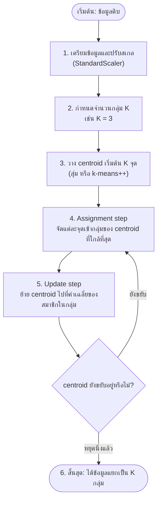
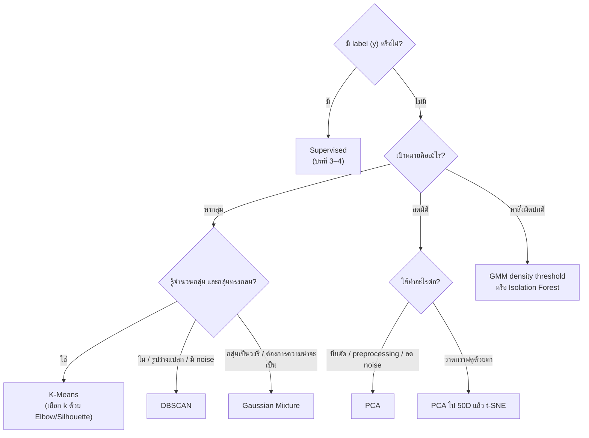

## วัตถุประสงค์การเรียนรู้

เมื่อจบบทนี้ นักศึกษาควรสามารถ

- อธิบายความแตกต่างระหว่าง Supervised และ Unsupervised Learning และยกตัวอย่างงาน clustering, dimensionality reduction และ anomaly detection ได้ (LLO2-2)
- อธิบายและคำนวณขั้นตอนของ K-Means ด้วยมือ รวมถึงค่า inertia และ silhouette coefficient ได้ (LLO2-2)
- อธิบายว่าทำไม feature scaling สำคัญกับอัลกอริทึมที่อิงระยะทาง และเลือกใช้ K-Means หรือ DBSCAN ให้เหมาะกับรูปร่างของข้อมูลได้ (LLO2-2)
- ใช้ PCA ลดมิติ เลือกจำนวน component จาก explained variance และใช้ t-SNE เพื่อ visualization ได้อย่างถูกวิธี (LLO2-3)
- พัฒนาและประเมิน pipeline แบบไม่มีผู้สอนด้วย scikit-learn (K-Means, DBSCAN, PCA, GaussianMixture, IsolationForest) และเลือกเทคนิคให้เหมาะกับโจทย์จริงได้ (LLO2-2, LLO2-3)

## 1. Unsupervised Learning คืออะไร

ใน [บทที่ 3](/module/03) และ [บทที่ 4](/module/04) เราสอนโมเดลด้วยข้อมูลที่ **มีเฉลย (label)** เช่น รูปนี้คือเลข 5 หรือบ้านหลังนี้ราคาเท่าไร แต่ในโลกจริง ข้อมูลส่วนใหญ่ **ไม่มีเฉลย** เพราะการติดป้ายต้องใช้คนและเวลามาก

**Unsupervised Learning (การเรียนรู้แบบไม่มีผู้สอน)** คือการให้อัลกอริทึมค้นหา *โครงสร้าง รูปแบบ หรือความสัมพันธ์ที่ซ่อนอยู่* ในข้อมูลด้วยตัวเอง โดยไม่มี target ให้เทียบ

| ประเด็น | Supervised Learning | Unsupervised Learning |
|---|---|---|
| ข้อมูลที่ใช้ฝึก | $X$ และ $y$ (มี label) | $X$ อย่างเดียว |
| เป้าหมาย | ทำนาย $y$ ของข้อมูลใหม่ | ค้นหาโครงสร้าง กลุ่ม หรือสิ่งผิดปกติ |
| การประเมินผล | เทียบกับเฉลยได้ตรง ๆ (accuracy, RMSE) | ยากกว่า ใช้ตัววัดภายใน (inertia, silhouette) หรือความเห็นผู้เชี่ยวชาญ |
| ตัวอย่างอัลกอริทึม | Linear/Logistic Regression, SVM, Random Forest | K-Means, DBSCAN, PCA, t-SNE, Gaussian Mixture |

งาน Unsupervised ที่เราจะเรียนในบทนี้แบ่งเป็น 3 กลุ่มหลัก

1. **Clustering (การจัดกลุ่ม)** — รวมข้อมูลที่คล้ายกันไว้ด้วยกัน เช่น แบ่งกลุ่มลูกค้า (customer segmentation), targeted marketing, ระบบแนะนำสินค้า, แบ่งภาพ (image segmentation)
2. **Dimensionality Reduction (การลดมิติ)** — ลดจำนวน feature โดยรักษาสาระสำคัญไว้ เช่น บีบอัดข้อมูลอย่างมีความหมาย, ค้นพบโครงสร้างข้อมูล, วาดข้อมูลมิติสูงให้เห็นเป็นภาพ 2D/3D, สกัด feature ก่อนส่งให้โมเดลอื่น
3. **Anomaly Detection / Density Estimation (ตรวจจับความผิดปกติ)** — เรียนรู้ว่าข้อมูล "ปกติ" หน้าตาเป็นอย่างไร แล้วชี้จุดที่ไม่เข้าพวก เช่น ธุรกรรมโกง เครื่องจักรเสีย

> [!NOTE]
> Unsupervised ไม่ได้แปลว่า "ไม่ต้องคิด" — ผู้ใช้ยังต้องเลือกจำนวนกลุ่ม เลือก feature เลือกวิธีวัดระยะ และ **ตีความ** ผลลัพธ์เองว่ากลุ่มที่ได้มีความหมายทางธุรกิจหรือไม่

## 2. K-Means Clustering

### 2.1 แนวคิดและฟังก์ชันเป้าหมาย

**K-Means** เป็นอัลกอริทึม clustering ที่เข้าใจง่ายและนิยมที่สุด ตัวอักษร **K** คือ **จำนวนกลุ่ม** ที่ผู้ใช้ต้องกำหนดล่วงหน้า แต่ละกลุ่มมีจุดศูนย์กลางเรียกว่า **centroid** ($\mu_j$) และข้อมูลแต่ละจุดจะอยู่ในกลุ่มของ centroid ที่ใกล้ที่สุด

K-Means พยายามหา centroid ที่ทำให้ผลรวมระยะทางยกกำลังสองจากทุกจุดไปยัง centroid ของกลุ่มตัวเองมีค่าน้อยที่สุด ค่านี้เรียกว่า **inertia** (หรือ within-cluster sum of squares, WCSS)

$$ \text{inertia} = \sum_{i=1}^{m} \left\lVert \mathbf{x}^{(i)} - \boldsymbol{\mu}_{c^{(i)}} \right\rVert^2 $$

โดย $m$ คือจำนวนข้อมูล และ $c^{(i)}$ คือหมายเลขกลุ่มของจุดที่ $i$ — inertia ยิ่งต่ำแปลว่าสมาชิกในกลุ่มยิ่งเกาะกันแน่น

### 2.2 ขั้นตอนการทำงาน



1. **เตรียมข้อมูลและปรับสเกล** — K-Means ใช้ **ระยะทาง Euclidean** เป็นหัวใจ ถ้า feature หนึ่งเป็นเงินเดือน (หลักหมื่น) อีก feature เป็นอายุ (หลักสิบ) เงินเดือนจะครอบงำระยะทางทั้งหมด จึงต้อง scale ก่อนเสมอ (ดูหัวข้อ 4)
2. **กำหนด K** — ผู้ใช้กำหนดเอง ถ้าไม่รู้ว่าควรเป็นเท่าไร ใช้ Elbow method หรือ Silhouette score ช่วย (หัวข้อ 3)
3. **วาง centroid เริ่มต้น** — สุ่มจุดขึ้นมา K จุด
4. **Assignment step** — วัดระยะจากทุกจุดไปยัง centroid ทั้ง K จุด แล้วจัดจุดนั้นเข้ากลุ่มที่ใกล้ที่สุด
5. **Update step** — คำนวณค่าเฉลี่ย (mean) ของสมาชิกแต่ละกลุ่ม แล้วย้าย centroid ไปที่จุดนั้น
6. **วนซ้ำ** ข้อ 4–5 เพราะเมื่อ centroid ขยับ บางจุดอาจต้องย้ายกลุ่ม จนกว่า centroid จะไม่ขยับ (หรือขยับน้อยมาก) ซึ่งรับประกันได้ว่าจะลู่เข้าในจำนวนรอบจำกัด เพราะทุกขั้นตอนทำให้ inertia ลดลงหรือเท่าเดิม

### 2.3 ตัวอย่างคำนวณด้วยมือ

ข้อมูล 6 จุด: A(1,1), B(2,1), C(4,3), D(5,4), E(1,2), F(4,4) กำหนด K = 2 และสมมติว่าสุ่มได้ centroid เริ่มต้นไม่ดีนัก คือ $\mu_1$ = A(1,1) และ $\mu_2$ = B(2,1)

**รอบที่ 1 — Assignment** (ระยะ Euclidean $d = \sqrt{(x_1-x_2)^2+(y_1-y_2)^2}$)

| จุด | ระยะถึง $\mu_1$(1,1) | ระยะถึง $\mu_2$(2,1) | กลุ่ม |
|---|---|---|---|
| A(1,1) | 0.00 | 1.00 | 1 |
| B(2,1) | 1.00 | 0.00 | 2 |
| C(4,3) | 3.61 | 2.83 | 2 |
| D(5,4) | 5.00 | 4.24 | 2 |
| E(1,2) | 1.00 | 1.41 | 1 |
| F(4,4) | 4.24 | 3.61 | 2 |

**รอบที่ 1 — Update:** $\mu_1$ = mean(A, E) = (1, 1.5) และ $\mu_2$ = mean(B, C, D, F) = (3.75, 3)

**รอบที่ 2 — Assignment:** B(2,1) ห่างจาก $\mu_1$ = 1.12 แต่ห่างจาก $\mu_2$ = 2.66 → **B ย้ายไปกลุ่ม 1** ส่วนจุดอื่นอยู่กลุ่มเดิม

**รอบที่ 2 — Update:** $\mu_1$ = mean(A, B, E) = (1.333, 1.333) และ $\mu_2$ = mean(C, D, F) = (4.333, 3.667)

**รอบที่ 3:** ไม่มีจุดใดย้ายกลุ่ม centroid ไม่ขยับ → หยุด ตรวจคำตอบด้วย scikit-learn โดยกำหนด centroid เริ่มต้นแบบเดียวกัน

```python
import numpy as np
from sklearn.cluster import KMeans
from sklearn.metrics import silhouette_samples, silhouette_score

X = np.array([[1, 1], [2, 1], [4, 3], [5, 4], [1, 2], [4, 4]], dtype=float)
init_C = np.array([[1, 1], [2, 1]], dtype=float)    # centroid เริ่มต้นเหมือนตัวอย่างคำนวณมือ
km = KMeans(n_clusters=2, init=init_C, n_init=1).fit(X)
print("labels   :", km.labels_)
print("centroids:", km.cluster_centers_.round(3).tolist())
print("inertia  :", round(km.inertia_, 3), "| iterations:", km.n_iter_)
print("silhouette รายจุด:", silhouette_samples(X, km.labels_).round(3))
print("silhouette เฉลี่ย:", round(silhouette_score(X, km.labels_), 3))
```

```output
labels   : [0 0 1 1 0 1]
centroids: [[1.333, 1.333], [4.333, 3.667]]
inertia  : 2.667 | iterations: 3
silhouette รายจุด: [0.767 0.661 0.623 0.736 0.678 0.738]
silhouette เฉลี่ย: 0.7
```

ตรวจ inertia ด้วยมือ: กลุ่ม 1 มี A, B, E ห่างจาก (4/3, 4/3) ยกกำลังสองเท่ากับ 2/9 + 5/9 + 5/9 = 4/3 และกลุ่ม 2 สมมาตรกันได้ 4/3 เช่นกัน รวมเป็น 8/3 ≈ 2.667 ตรงกับ `km.inertia_` (scikit-learn นับ label เริ่มจาก 0 จึงแสดงเป็นกลุ่ม 0 และ 1)

### 2.4 K-Means ด้วย scikit-learn

```python
import numpy as np
from sklearn.datasets import make_blobs
from sklearn.cluster import KMeans

X, y_true = make_blobs(n_samples=500, centers=4, cluster_std=0.8, random_state=42)
kmeans = KMeans(n_clusters=4, n_init=10, random_state=42)
y_pred = kmeans.fit_predict(X)

print("cluster centers:\n", kmeans.cluster_centers_.round(2))
print("inertia:", round(kmeans.inertia_, 2))
print("iterations:", kmeans.n_iter_)
print("จำนวนสมาชิกแต่ละกลุ่ม:", np.bincount(y_pred))

X_new = np.array([[0, 2], [-6, -6], [-3, 8]])
print("กลุ่มของจุดใหม่:", kmeans.predict(X_new))
print("ระยะถึงแต่ละ centroid:\n", kmeans.transform(X_new).round(2))
```

```output
cluster centers:
 [[ 4.71  1.93]
 [-8.71  7.43]
 [-6.98 -6.9 ]
 [-2.58  9.08]]
inertia: 607.29
iterations: 2
จำนวนสมาชิกแต่ละกลุ่ม: [125 125 125 125]
กลุ่มของจุดใหม่: [0 2 3]
ระยะถึงแต่ละ centroid:
 [[ 4.71 10.27 11.31  7.53]
 [13.32 13.7   1.33 15.46]
 [ 9.81  5.74 15.42  1.15]]
```

**การตีความ:** K-Means มี `predict()` จึงจัดกลุ่มข้อมูลใหม่ได้ทันที (hard clustering — จุดหนึ่งอยู่ได้กลุ่มเดียว) ส่วน `transform()` คืนระยะถึงทุก centroid ซึ่งนำไปใช้เป็น feature ใหม่ได้ (soft information) เช่น จุด (-3, 8) อยู่ห่าง centroid ที่ 3 เพียง 1.15 จึงถูกจัดเข้ากลุ่ม 3

### 2.5 การวาง centroid เริ่มต้น: k-means++ และ n_init

K-Means ลู่เข้าเสมอ แต่ **อาจติดอยู่ที่คำตอบที่ไม่ดีที่สุด (local optimum)** ถ้าสุ่มจุดเริ่มต้นไม่ดี scikit-learn แก้ปัญหานี้ด้วย 2 กลไก

- **k-means++** (ค่า default ของ `init`) — เลือก centroid แรกแบบสุ่ม จากนั้นเลือก centroid ถัดไปโดยให้จุดที่ *อยู่ไกลจาก centroid ที่มีอยู่* มีโอกาสถูกเลือกมากกว่า (ความน่าจะเป็นแปรผันตาม $D(\mathbf{x})^2$) ทำให้ centroid เริ่มต้นกระจายตัวดี
- **`n_init`** — รัน K-Means หลายครั้งด้วยจุดเริ่มต้นต่างกัน แล้วเก็บผลที่ **inertia ต่ำสุด**

ตัวอย่างเช่น เมื่อรัน K-Means (k = 10) บนชุดข้อมูล `load_digits` 20 ครั้งแบบ `n_init=1` การวางจุดเริ่มต้นแบบ `init="random"` ให้ inertia แกว่งตั้งแต่ 1,165,278 ถึง 1,240,658 ส่วน k-means++ แกว่งน้อยกว่า (1,165,194 ถึง 1,218,629) และ `n_init=10` ได้ค่าต่ำที่สุดคือ 1,165,189 ในงานจริงจึงควรกำหนดทั้ง `n_init` และ `random_state` เพื่อให้ได้ผลดีและทำซ้ำได้

## 3. การเลือกจำนวนกลุ่ม k: Elbow และ Silhouette

### 3.1 Elbow method

inertia **ลดลงเสมอเมื่อ k เพิ่มขึ้น** (ถ้า k เท่ากับจำนวนจุด inertia = 0) จึงใช้ inertia ต่ำสุดเลือก k ตรง ๆ ไม่ได้ วิธี Elbow คือพล็อต inertia เทียบกับ k แล้วหา "ข้อศอก" — จุดที่หลังจากนั้นการเพิ่ม k ช่วยลด inertia ได้น้อยลงมาก

### 3.2 Silhouette coefficient

Silhouette วัดว่าแต่ละจุด "อยู่ถูกกลุ่ม" แค่ไหน สำหรับจุดที่ $i$

$$ s(i) = \frac{b(i) - a(i)}{\max\{a(i),\, b(i)\}} $$

- $a(i)$ = ระยะเฉลี่ยจากจุด $i$ ไปยังจุดอื่น **ในกลุ่มเดียวกัน** (ยิ่งน้อยยิ่งเกาะแน่น)
- $b(i)$ = ระยะเฉลี่ยจากจุด $i$ ไปยังจุดใน **กลุ่มที่ใกล้ที่สุดถัดไป**
- $s(i)$ อยู่ในช่วง $[-1, 1]$: ใกล้ +1 = อยู่ถูกกลุ่มและห่างกลุ่มอื่น, ใกล้ 0 = อยู่ตรงขอบระหว่างกลุ่ม, ติดลบ = น่าจะอยู่ผิดกลุ่ม

**ตัวอย่าง:** จากหัวข้อ 2.3 จุด A(1,1) อยู่กลุ่มเดียวกับ B(2,1) และ E(1,2) ได้ $a = (1 + 1)/2 = 1$ ส่วนกลุ่มอื่นคือ C, D, F ได้ $b = (3.606 + 5 + 4.243)/3 = 4.283$ ดังนั้น $s = (4.283 - 1)/4.283 = 0.767$ ตรงกับค่าแรกที่ `silhouette_samples` คำนวณได้ และ **silhouette score** ของทั้งชุดข้อมูลคือค่าเฉลี่ยของ $s(i)$ ทุกจุด

```python
from sklearn.datasets import make_blobs
from sklearn.cluster import KMeans
from sklearn.metrics import silhouette_score

X, y_true = make_blobs(n_samples=500, centers=4, cluster_std=0.8, random_state=42)
print(" k   inertia  silhouette")
for k in range(2, 9):
    km = KMeans(n_clusters=k, n_init=10, random_state=42).fit(X)
    sil = silhouette_score(X, km.labels_)
    print(f"{k:2d} {km.inertia_:9.1f}  {sil:.3f}")
```

```output
 k   inertia  silhouette
 2   15385.9  0.607
 3    3125.0  0.782
 4     607.3  0.834
 5     547.8  0.700
 6     492.4  0.564
 7     435.9  0.451
 8     380.5  0.349
```

**การตีความ:** inertia ลดฮวบจาก k = 2 → 3 → 4 แล้วหลังจากนั้นลดลงเพียงเล็กน้อย (607 → 548 → 492) — ข้อศอกอยู่ที่ **k = 4** และ silhouette ก็สูงสุดที่ k = 4 (0.834) ทั้งสองวิธีจึงสอดคล้องกับข้อมูลที่สร้างมาจริง 4 กลุ่ม ในการพล็อตใช้ `plt.plot(range(2, 9), inertias, "o-")` ได้

> [!TIP]
> Elbow บางครั้งมองหาข้อศอกไม่ชัด ให้ใช้ silhouette ประกอบ และอย่าลืมว่า k ที่ดีที่สุดทางสถิติอาจไม่ใช่ k ที่ดีที่สุดทางธุรกิจ เช่น ฝ่ายการตลาดอาจรับมือได้แค่ 3–5 กลุ่มลูกค้า

## 4. Feature Scaling: ทำไมต้อง scale ก่อนวัดระยะ

ระยะ Euclidean รวมผลต่างของทุก feature ยกกำลังสอง ถ้า feature หนึ่งมีหน่วยใหญ่ (รายได้ หลักหมื่นบาท) ผลต่างของมันจะ **กลบ** feature ที่มีหน่วยเล็ก (อายุ หลักสิบปี) จนแทบไม่มีผล ตัวอย่างต่อไปนี้สร้างลูกค้าสมมติ 3 กลุ่ม ได้แก่ นักศึกษา วัยทำงาน และวัยเกษียณ ซึ่งแยกกันชัดเจนด้วยอายุ แต่รายได้ของนักศึกษากับผู้เกษียณใกล้กัน

```python
import numpy as np
import pandas as pd
from sklearn.cluster import KMeans
from sklearn.preprocessing import StandardScaler
from sklearn.pipeline import make_pipeline
from sklearn.metrics import adjusted_rand_score

# ลูกค้าสมมติ 3 กลุ่ม: นักศึกษา / วัยทำงาน / วัยเกษียณ (กลุ่มละ 100 คน)
rng = np.random.default_rng(42)
n = 100
age    = np.concatenate([rng.normal(22, 3, n), rng.normal(40, 3, n), rng.normal(65, 3, n)])
income = np.concatenate([rng.normal(15000, 4000, n), rng.normal(35000, 4000, n),
                         rng.normal(20000, 4000, n)])
segment = np.repeat([0, 1, 2], n)       # กลุ่มจริง (ใช้ตรวจสอบเท่านั้น ไม่ได้ป้อนให้โมเดล)
df = pd.DataFrame({"age": age.round(), "income": income.round(-2)})
print(df.describe().loc[["mean", "std", "min", "max"]].round(1))

km_raw = KMeans(n_clusters=3, n_init=10, random_state=42)
labels_raw = km_raw.fit_predict(df)

km_scaled = make_pipeline(StandardScaler(), KMeans(n_clusters=3, n_init=10, random_state=42))
labels_scaled = km_scaled.fit_predict(df)

print("\nARI ไม่ scale :", round(adjusted_rand_score(segment, labels_raw), 3))
print("ARI scale แล้ว:", round(adjusted_rand_score(segment, labels_scaled), 3))
print("\nค่าเฉลี่ยแต่ละ cluster (ไม่ scale):")
print(df.groupby(labels_raw).mean().round(0))
print("\nค่าเฉลี่ยแต่ละ cluster (scale แล้ว):")
print(df.groupby(labels_scaled).mean().round(0))
```

```output
       age   income
mean  42.2  23288.3
std   17.9   9282.2
min   16.0   5800.0
max   74.0  45400.0

ARI ไม่ scale : 0.501
ARI scale แล้ว: 1.0

ค่าเฉลี่ยแต่ละ cluster (ไม่ scale):
    age   income
0  51.0  21444.0
1  40.0  35264.0
2  35.0  13923.0

ค่าเฉลี่ยแต่ละ cluster (scale แล้ว):
    age   income
0  40.0  34822.0
1  65.0  19636.0
2  22.0  15407.0
```

**การตีความ**

- **ไม่ scale:** K-Means แบ่งกลุ่มตาม *รายได้* เกือบอย่างเดียว (กลุ่ม 2 รายได้ต่ำ อายุเฉลี่ย 35 ซึ่งเป็นนักศึกษาปนผู้เกษียณ) เพราะ std ของรายได้ (9,282) ใหญ่กว่าอายุ (17.9) หลายร้อยเท่า
- **scale แล้ว:** ทุก feature มี mean 0, std 1 อายุจึงมีน้ำหนักเท่ากับรายได้ ได้ 3 กลุ่มตรงกับความจริงทุกจุด (อายุเฉลี่ย 22, 40, 65)
- **Adjusted Rand Index (ARI)** วัดความสอดคล้องระหว่างการแบ่งกลุ่มสองแบบ โดยไม่สนว่าเลขกลุ่มชื่ออะไร ได้ 1 = ตรงกันทั้งหมด, ประมาณ 0 = ไม่ต่างจากการสุ่ม เราใช้ได้เฉพาะตอน *ทดลอง* ที่บังเอิญมีเฉลย — ในงานจริงที่ไม่มี label ต้องใช้ silhouette หรือการตีความแทน

> [!WARNING]
> อัลกอริทึมที่อิงระยะทางหรือ variance — K-Means, DBSCAN, KNN, PCA, SVM — **ต้อง scale feature ก่อนเสมอ** ใช้ `StandardScaler` (mean 0, std 1) หรือ `MinMaxScaler` (ช่วง 0–1) และควรใส่ใน `Pipeline` เพื่อให้ข้อมูลใหม่ถูก scale ด้วยค่าเดียวกัน (รายละเอียดเรื่อง scaler อยู่ใน [บทที่ 2](/module/02))

## 5. ข้อจำกัดของ K-Means และ DBSCAN

### 5.1 K-Means ไม่ได้เก่งทุกรูปทรง

K-Means แบ่งพื้นที่ตามระยะถึง centroid ที่ใกล้ที่สุด ขอบเขตระหว่างกลุ่มจึงเป็นเส้นตรง (Voronoi cell) ทำให้

- ทำงานดีเมื่อกลุ่มมีรูปร่าง **ทรงกลม (spherical)** ขนาดและความหนาแน่นใกล้เคียงกัน
- ทำงานไม่ดีเมื่อกลุ่มเป็นรูปโค้ง ยาว วงรีเอียง หรือมีความหนาแน่นต่างกันมาก
- ต้องกำหนด k ล่วงหน้า และทุกจุดถูกบังคับให้อยู่ในกลุ่มใดกลุ่มหนึ่ง (ไม่มีแนวคิด noise/outlier)

### 5.2 DBSCAN: จัดกลุ่มตามความหนาแน่น

**DBSCAN** (Density-Based Spatial Clustering of Applications with Noise) มองว่า cluster คือ *พื้นที่ที่มีความหนาแน่นสูงต่อเนื่องกัน* มีพารามิเตอร์ 2 ตัว

- `eps` ($\varepsilon$) — รัศมีของละแวกใกล้เคียง
- `min_samples` — จำนวนจุดขั้นต่ำในรัศมี eps (นับรวมตัวเอง) ที่จะทำให้จุดนั้นเป็น core

จุดแต่ละจุดจะถูกจัดเป็น 3 ประเภท

| ประเภท | นิยาม |
|---|---|
| **Core instance** | มีเพื่อนบ้านในรัศมี eps อย่างน้อย `min_samples` จุด |
| **Border instance** | ไม่ใช่ core แต่อยู่ในรัศมี eps ของ core บางจุด จึงถูกรวมเข้ากลุ่มของ core นั้น |
| **Noise / anomaly** | ไม่ใช่ core และไม่อยู่ใกล้ core ใดเลย ได้ label เป็น `-1` |

core ที่อยู่ในละแวกกันจะถูกเชื่อมต่อเป็นกลุ่มเดียวกันเป็นทอด ๆ จึงไล่ตามรูปร่างโค้งได้ และ **ไม่ต้องกำหนดจำนวนกลุ่ม**

```python
import numpy as np
from sklearn.datasets import make_moons
from sklearn.cluster import KMeans, DBSCAN
from sklearn.metrics import adjusted_rand_score

X, y = make_moons(n_samples=1000, noise=0.05, random_state=42)

km = KMeans(n_clusters=2, n_init=10, random_state=42).fit(X)
db = DBSCAN(eps=0.2, min_samples=5).fit(X)

print("K-Means ARI:", round(adjusted_rand_score(y, km.labels_), 3))
print("DBSCAN  ARI:", round(adjusted_rand_score(y, db.labels_), 3))
print("DBSCAN labels ที่พบ:", np.unique(db.labels_))
print("จำนวน core instances:", len(db.core_sample_indices_))
print("จำนวน noise (-1):", (db.labels_ == -1).sum())

for eps in [0.05, 0.1, 0.2, 0.5]:
    lab = DBSCAN(eps=eps, min_samples=5).fit_predict(X)
    n_clusters = len(set(lab)) - (1 if -1 in lab else 0)
    print(f"eps={eps:<4}: clusters={n_clusters:2d}, noise={(lab == -1).sum():4d}")
```

```output
K-Means ARI: 0.239
DBSCAN  ARI: 1.0
DBSCAN labels ที่พบ: [0 1]
จำนวน core instances: 1000
จำนวน noise (-1): 0
eps=0.05: clusters= 7, noise=  77
eps=0.1 : clusters= 2, noise=   1
eps=0.2 : clusters= 2, noise=   0
eps=0.5 : clusters= 1, noise=   0
```

**การตีความ**

- ข้อมูล make_moons เป็นรูปพระจันทร์เสี้ยวสองอันเกี่ยวกัน K-Means ตัดเป็นเส้นตรงกลางจึงได้ ARI แค่ 0.239 ส่วน DBSCAN ไล่ตามความหนาแน่นได้ ARI = 1.0
- DBSCAN **ไวต่อ eps มาก**: eps เล็กเกินไป (0.05) กลุ่มแตกเป็น 7 กลุ่มและมี noise 77 จุด, eps ใหญ่เกินไป (0.5) สองกลุ่มถูกเชื่อมเป็นกลุ่มเดียว
- DBSCAN ต้อง scale ข้อมูลก่อนเช่นกัน เพราะ eps เป็นระยะทาง และมันไม่มีเมธอด `predict()` สำหรับข้อมูลใหม่ (ใช้ `fit_predict()` เท่านั้น — ถ้าต้องจัดกลุ่มจุดใหม่ ให้ฝึก classifier เช่น KNN จาก core instances)
- DBSCAN ทำงานไม่ดีเมื่อแต่ละกลุ่มมีความหนาแน่นต่างกันมาก เพราะใช้ eps เดียวทั้งชุดข้อมูล

## 6. Dimensionality Reduction (การลดมิติ)

### 6.1 ทำไมต้องลดมิติ: Curse of Dimensionality

ข้อมูลจริงมักมี feature หลายร้อยถึงหลายล้าน เช่น ภาพ MNIST ขนาด 28×28 มี 784 feature การมีมิติสูงก่อปัญหาที่เรียกว่า **คำสาปของมิติ (curse of dimensionality)**

- ข้อมูลกระจัดกระจาย (sparse) จุดส่วนใหญ่อยู่ห่างกันมาก ต้องใช้ข้อมูลจำนวนมหาศาลจึงจะครอบคลุมพื้นที่ โมเดลจึง **overfit** ง่าย
- ระยะทาง "ใกล้" กับ "ไกล" เริ่มไม่ต่างกัน ทำให้อัลกอริทึมที่อิงระยะทาง เช่น K-Means และ KNN ทำงานแย่ลง
- ฝึกช้า ใช้หน่วยความจำมาก และมนุษย์มองเห็นได้แค่ 2–3 มิติ

```python
import numpy as np
from sklearn.metrics import pairwise_distances

rng = np.random.default_rng(42)
print("   d   ระยะเฉลี่ย  (ใกล้สุด/ไกลสุด)")
for d in [2, 10, 100, 1000]:
    X = rng.random((500, d))                      # 500 จุดสุ่มใน hypercube [0,1]^d
    D = pairwise_distances(X)[np.triu_indices(500, k=1)]
    print(f"{d:4d}   {D.mean():8.2f}      {D.min() / D.max():.2f}")
```

```output
   d   ระยะเฉลี่ย  (ใกล้สุด/ไกลสุด)
   2       0.53      0.00
  10       1.26      0.11
 100       4.07      0.58
1000      12.90      0.85
```

เมื่อมิติเพิ่มเป็น 1,000 อัตราส่วนระยะ "คู่ที่ใกล้ที่สุด / คู่ที่ไกลที่สุด" ขึ้นไปถึง 0.85 หมายความว่าทุกจุดอยู่ห่างกันพอ ๆ กันหมด แนวคิด "เพื่อนบ้านที่ใกล้ที่สุด" จึงแทบไม่มีความหมาย

### 6.2 สองแนวทางหลัก: Projection และ Manifold Learning

1. **Projection** — ในข้อมูลจริง จุดมักไม่ได้กระจายเต็มทุกมิติ แต่อยู่ใกล้ subspace มิติต่ำกว่า เราจึงหาระนาบ (hyperplane) ที่เหมาะสมแล้ว *ฉาย* ข้อมูลลงไป เหมือนมองเงาของวัตถุบนผนัง — ตัวอย่างคือ **PCA**
2. **Manifold Learning** — บางครั้งข้อมูลอยู่บนพื้นผิวที่บิดม้วน เช่น Swiss roll (ม้วนแยมโรล) การฉายตรง ๆ จะทำให้ชั้นต่าง ๆ ทับกัน ต้อง *คลี่* ม้วนออกมาเป็นระนาบแทน — ตัวอย่างคือ **LLE (Locally Linear Embedding)** ซึ่งเรียนรู้ว่าแต่ละจุดสร้างจากเพื่อนบ้านใกล้เคียงอย่างไร แล้วหาตำแหน่งในมิติต่ำที่รักษาความสัมพันธ์นั้นไว้ และ **t-SNE**

### 6.3 Principal Component Analysis (PCA)

PCA หาแกนใหม่ที่เรียกว่า **principal component (PC)** ทีละแกน

- PC1 คือทิศทางที่ข้อมูลมี **variance มากที่สุด** (การฉายลงแกนนี้รักษาข้อมูลไว้ได้มากที่สุด และทำให้ระยะยกกำลังสองเฉลี่ยระหว่างจุดเดิมกับจุดที่ฉายต่ำที่สุด)
- PC2 **ตั้งฉาก** กับ PC1 และเก็บ variance ที่เหลือได้มากที่สุด, PC3 ตั้งฉากกับทั้งสองแกน และไล่ไปเรื่อย ๆ
- scikit-learn หา PC ด้วย Singular Value Decomposition (SVD) และ **center ข้อมูล (ลบ mean) ให้อัตโนมัติ** แต่ไม่ scale ให้ ถ้า feature มีหน่วยต่างกันต้อง scale เอง

ค่า **explained variance ratio** บอกว่าแต่ละ PC เก็บ variance ไว้กี่เปอร์เซ็นต์ของทั้งหมด ใช้เลือกจำนวนมิติได้ เช่น เลือกให้ variance สะสมถึง 95%

```python
import numpy as np
from sklearn.datasets import fetch_openml
from sklearn.decomposition import PCA

mnist = fetch_openml("mnist_784", version=1, as_frame=False)
X, y = mnist.data / 255.0, mnist.target.astype(int)

rng = np.random.default_rng(42)
idx = rng.choice(len(X), 10_000, replace=False)   # สุ่ม 10,000 ภาพเพื่อให้รันเร็ว
X_sub, y_sub = X[idx], y[idx]
print("X_sub:", X_sub.shape)

pca = PCA()                      # เก็บทุก component ก่อน เพื่อดูสัดส่วน variance
pca.fit(X_sub)
ratio = pca.explained_variance_ratio_
cumsum = np.cumsum(ratio)
print("5 PC แรกอธิบาย variance:", ratio[:5].round(3))
for d in [2, 3, 10, 20, 50, 100]:
    print(f"d={d:3d} -> variance สะสม {cumsum[d-1]:.3f}")
print("ต้องใช้กี่มิติจึงได้ 95%:", np.argmax(cumsum >= 0.95) + 1)

pca95 = PCA(n_components=0.95)
X_reduced = pca95.fit_transform(X_sub)
print("PCA(0.95):", X_sub.shape, "->", X_reduced.shape)
```

```output
X_sub: (10000, 784)
5 PC แรกอธิบาย variance: [0.1   0.071 0.061 0.053 0.049]
d=  2 -> variance สะสม 0.171
d=  3 -> variance สะสม 0.232
d= 10 -> variance สะสม 0.490
d= 20 -> variance สะสม 0.646
d= 50 -> variance สะสม 0.827
d=100 -> variance สะสม 0.916
ต้องใช้กี่มิติจึงได้ 95%: 151
PCA(0.95): (10000, 784) -> (10000, 151)
```

**การตีความ:** แค่ 151 มิติ (ประมาณ 19% ของ 784) ก็เก็บ variance ไว้ได้ 95% เพราะพิกเซลขอบภาพแทบเป็นสีดำตลอดและพิกเซลข้างเคียงมีค่าสัมพันธ์กันสูง การกำหนด `n_components` เป็นทศนิยม 0–1 (เช่น `0.95`) ให้ PCA เลือกจำนวนมิติให้อัตโนมัติ ส่วนการพล็อต `cumsum` เทียบกับจำนวนมิติก็จะเห็น "ข้อศอก" คล้าย Elbow method

> [!NOTE]
> โค้ดในหัวข้อ 6–7 ใช้ MNIST เพียง **10,000 ภาพ** (สุ่มจาก 70,000) เพื่อให้รันใน Colab ได้ในเวลาไม่นาน ตัวเลขที่ได้จึงต่างจากการใช้ข้อมูลเต็มชุดเล็กน้อย การโหลด `fetch_openml` ครั้งแรกใช้เวลาประมาณ 1 นาที

### 6.4 Reconstruction: แปลงกลับด้วย inverse_transform

PCA เป็นการแปลงเชิงเส้น จึง **แปลงกลับ** จากมิติต่ำไปมิติเดิมได้ด้วย `inverse_transform()` แต่ข้อมูลที่ถูกทิ้งไปจะไม่กลับมา (lossy compression) ความต่างระหว่างภาพเดิมกับภาพที่สร้างกลับเรียกว่า **reconstruction error**

```python
for d in [2, 3, 10, 100]:
    pca = PCA(n_components=d, random_state=42)
    X_low = pca.fit_transform(X_sub)              # 784 -> d มิติ
    X_rec = pca.inverse_transform(X_low)          # d -> 784 มิติ (ภาพที่สร้างกลับ)
    mse = np.mean((X_sub - X_rec) ** 2)
    print(f"PCA {d:3d}D: shape หลังลด {X_low.shape}, reconstruction MSE = {mse:.4f}")
# วาดภาพ: plt.imshow(X_rec[0].reshape(28, 28), cmap="gray")
```

```output
PCA   2D: shape หลังลด (10000, 2), reconstruction MSE = 0.0559
PCA   3D: shape หลังลด (10000, 3), reconstruction MSE = 0.0518
PCA  10D: shape หลังลด (10000, 10), reconstruction MSE = 0.0344
PCA 100D: shape หลังลด (10000, 100), reconstruction MSE = 0.0056
```


**วิเคราะห์จากภาพ**

- **PCA 100D** — ภาพที่แปลงกลับแทบเหมือนต้นฉบับ แค่เบลอขึ้นเล็กน้อย ตัวเลข 100 ตัวแทน 784 พิกเซลได้ดีมาก
- **PCA 10D** — เบลอชัดเจน แต่คนยังพอแยกได้ว่าเป็นเลขอะไร
- **PCA 3D** — ข้อมูลหายไปมาก ภาพกลายเป็นเงาราง ๆ คล้ายตัวเลขหลายตัวซ้อนกัน
- **PCA 2D** — เหลือแค่ 2 ตัวเลข เก็บรายละเอียดไม่ได้ ภาพที่สร้างกลับเกือบทุกภาพดูคล้าย "ภาพเฉลี่ย" ของตัวเลข (สังเกตว่าเลข 2 และ 4 กลับมาหน้าตาคล้ายเลข 9)

### 6.5 t-SNE: ลดมิติเพื่อการมองเห็น

**t-SNE (t-Distributed Stochastic Neighbor Embedding)** เป็นวิธี manifold learning แบบไม่เชิงเส้น เป้าหมายคือ *รักษาความสัมพันธ์ระยะใกล้ (local structure)* — จุดที่คล้ายกันในมิติสูงต้องอยู่ใกล้กันในภาพ 2D และจุดที่ต่างกันถูกผลักออกห่าง จึงได้ภาพที่กลุ่มแยกกันสวยงาม แต่มีข้อจำกัดสำคัญ

- ใช้สำหรับ **visualization** เป็นหลัก ระยะห่างระหว่างกลุ่มและขนาดกลุ่มบนภาพ **ตีความเชิงปริมาณไม่ได้**
- **ไม่มี `transform()`** สำหรับข้อมูลใหม่ (มีแต่ `fit_transform()`) และไม่มี `inverse_transform()` จึงแปลงภาพกลับไม่ได้ และนำไปใช้เป็นขั้นตอน preprocessing ใน pipeline การทำนายไม่ได้
- **ช้า** เมื่อข้อมูลมาก และผลขึ้นกับ `perplexity` (ประมาณจำนวนเพื่อนบ้านที่พิจารณา ค่า default 30 นิยมลองในช่วง 5–50) และ `random_state`

**กฎเหล็กของ Data Scientist:** ถ้าข้อมูลมีมิติสูงมาก ให้ใช้ **PCA ลดลงเหลือ 30–50 มิติก่อน** เพื่อตัด noise และเร่งความเร็ว แล้วจึงส่งต่อให้ t-SNE ลดเหลือ 2 มิติสำหรับวาดกราฟ

| คุณสมบัติ | PCA | t-SNE |
|---|---|---|
| จุดประสงค์หลัก | รักษา variance ของข้อมูลโดยรวมให้มากที่สุด | รักษาความสัมพันธ์ระยะใกล้ ให้จุดที่คล้ายกันอยู่ใกล้กัน |
| การใช้งานหลัก | ลดมิติก่อนเทรนโมเดล บีบอัด ลด noise (feature extraction) | วาดกราฟ 2D/3D ให้มนุษย์ดู (visualization) |
| คณิตศาสตร์ | Linear (เชิงเส้น) | Non-linear ซับซ้อนสูง |
| ความเร็ว | เร็วมาก รองรับข้อมูลหลักล้านแถว | ช้า แม้ข้อมูลหลักหมื่นก็ใช้เวลาหลายนาที |
| ข้อมูลใหม่ (`transform`) | ทำได้ | ทำไม่ได้ ต้อง fit ใหม่ทั้งชุด |
| แปลงกลับ (reconstruction) | ทำได้ (`inverse_transform`) | ทำไม่ได้ |
| ระยะห่างบนกราฟ | มีความหมายเชิงปริมาณ | บอกได้แค่ "คล้าย" หรือ "ไม่คล้าย" |
| พารามิเตอร์ | จำนวนมิติ (`n_components`) เป็นหลัก | `perplexity` ต้องลองผิดลองถูก |

## 7. กรณีศึกษา: Unsupervised Learning กับ MNIST

**โจทย์:** มีภาพตัวเลขลายมือ 10,000 ภาพ (784 พิกเซล) โดย *ไม่บอกเฉลย* ให้คอมพิวเตอร์ (1) ลดมิติเพื่อดูโครงสร้าง และ (2) จัดกลุ่มตัวเลขที่หน้าตาคล้ายกันเข้าด้วยกันเอง

### 7.1 ขั้นที่ 1: ลดมิติเพื่อมองเห็นโครงสร้าง

ลด 784 มิติด้วย PCA ก่อน แล้วส่งต่อให้ t-SNE ลดเหลือ 2 และ 3 มิติ ในภาพด้านล่างเรา *แอบ* ใช้เฉลย (ตัวเลขจริง) ระบายสีจุด เพื่อให้มนุษย์ตรวจสอบได้ว่าการลดมิติแยกข้อมูลได้ดีเพียงใด — โมเดลไม่ได้ใช้สีนี้ในการเรียนรู้


จะเห็นว่าตัวเลขเดียวกันเกาะกลุ่มกันเองชัดเจน เช่น เลข 0, 1, 2 และ 6 เป็นเกาะแยกออกมา ขณะที่ 4, 7, 9 อยู่ติดกัน และ 3, 5, 8 อยู่ใกล้กันตรงกลาง

### 7.2 ขั้นที่ 2: จัดกลุ่มด้วย K-Means แล้วประเมินกับเฉลย

เราสั่ง K-Means ว่า "แบ่งข้อมูลเป็น 10 กลุ่ม" (K = 10) โดยโมเดลไม่รู้ว่าแต่ละภาพคือเลขอะไร จากนั้นใช้ ARI เทียบกลุ่มที่ได้กับตัวเลขจริง เปรียบเทียบ 3 แนวทาง

```python
import time
from sklearn.manifold import TSNE
from sklearn.cluster import KMeans
from sklearn.metrics import adjusted_rand_score

# (ก) K-Means บนพิกเซลดิบ 784 มิติ
lab_raw = KMeans(n_clusters=10, n_init=10, random_state=42).fit_predict(X_sub)
print(f"784D (raw)      ARI = {adjusted_rand_score(y_sub, lab_raw):.3f}")

# (ข) PCA -> K-Means
for d in [10, 20, 50]:
    X_pca = PCA(n_components=d, random_state=42).fit_transform(X_sub)
    lab = KMeans(n_clusters=10, n_init=10, random_state=42).fit_predict(X_pca)
    print(f"PCA {d:2d}D        ARI = {adjusted_rand_score(y_sub, lab):.3f}")

# (ค) PCA 50D -> t-SNE 2D -> K-Means
t0 = time.time()
X_pca50 = PCA(n_components=50, random_state=42).fit_transform(X_sub)
X_tsne = TSNE(n_components=2, perplexity=30, random_state=42).fit_transform(X_pca50)
lab_tsne = KMeans(n_clusters=10, n_init=10, random_state=42).fit_predict(X_tsne)
print(f"PCA50->t-SNE 2D ARI = {adjusted_rand_score(y_sub, lab_tsne):.3f}  (t-SNE ใช้เวลา {time.time()-t0:.0f} วินาที)")
```

```output
784D (raw)      ARI = 0.353
PCA 10D        ARI = 0.334
PCA 20D        ARI = 0.349
PCA 50D        ARI = 0.361
PCA50->t-SNE 2D ARI = 0.738  (t-SNE ใช้เวลา 44 วินาที)
```

**การตีความ**

- K-Means บน PCA 20–50 มิติให้ ARI ใกล้เคียงกับการใช้ 784 มิติเต็ม (0.35–0.36) แต่ **ใช้ข้อมูลน้อยกว่าหลายสิบเท่าและเร็วกว่ามาก** — PCA ตัดสิ่งที่ไม่จำเป็นออกโดยแทบไม่เสียคุณภาพการจัดกลุ่ม
- การจัดกลุ่มบนพิกัด t-SNE 2D ได้ ARI สูงถึง 0.738 เพราะ t-SNE ดึงจุดที่คล้ายกันให้แน่นและผลักกลุ่มที่ต่างกันออก K-Means จึงตีกรอบได้ง่าย **แต่** แลกกับเวลาที่นานกว่ามาก และใช้กับภาพใหม่ไม่ได้ (ต้องรัน t-SNE ใหม่ทั้งชุด) — เหมาะกับงานสำรวจข้อมูล ไม่ใช่ระบบที่ต้องทำนายข้อมูลใหม่
- เวลาของ t-SNE ขึ้นกับเครื่อง (รันซ้ำบนเครื่องเดียวกันยังได้ 44–130 วินาที) ใน Colab อาจใช้ 1–3 นาที


เมื่อเทียบกับภาพที่ระบายสีด้วยเฉลย จะเห็นว่า K-Means จัดกลุ่มได้ใกล้เคียงความจริงมาก แต่สับสนในตัวเลขที่เขียนคล้ายกัน เช่น 4 กับ 9 หรือ 3 กับ 8

### 7.3 ดูภาพในแต่ละกลุ่ม: PCA 20D เทียบกับ t-SNE

วิธีตรวจคุณภาพ cluster ที่ได้ผลดีมากคือ *เปิดดูตัวอย่างสมาชิกของแต่ละกลุ่ม* ภาพแรกเป็นผลของ PCA 20 มิติ → K-Means 10 กลุ่ม (แสดง 10 ภาพแรกของแต่ละกลุ่ม)


- บางกลุ่มบริสุทธิ์สูง เช่น กลุ่มเลข 6, เลข 2 และเลข 0 แต่เลข 0 ถูก **แยกเป็นสองกลุ่ม** (0 ตัวอ้วนกับ 0 ตัวผอม) และเลข 1 ก็แตกเป็นสองกลุ่มตามความเอียง
- บางกลุ่ม **ปนกัน** เช่น 4–7–9 (เส้นด้านบนคล้ายกัน) และ 3–5–8 (มีส่วนโค้งคล้ายกัน)
- นี่ยืนยันว่าโมเดลจัดกลุ่มตาม **รูปร่างของเส้น** ไม่ใช่ตาม "ความหมาย" ของตัวเลข — K-Means ไม่รู้ว่ามีตัวเลขอยู่ 10 ชนิด มันแค่หา 10 กลุ่มที่ inertia ต่ำที่สุด

จากนั้นลองตามกฎเหล็ก: PCA 50 มิติ → t-SNE 2 มิติ → K-Means 10 กลุ่ม


กลุ่มของ t-SNE บริสุทธิ์กว่าชัดเจน — เลข 2, 5, 6, 7, 8 และ 0 แยกเป็นกลุ่มของตัวเองได้เกือบสมบูรณ์ เหลือความสับสนหลักที่ 4 กับ 9 ซึ่งสอดคล้องกับค่า ARI ในหัวข้อ 7.2

> [!TIP]
> การลดมิติก่อน clustering ช่วยบรรเทา curse of dimensionality ทำให้ K-Means เร็วขึ้น และมักไม่เสียคุณภาพ ส่วน t-SNE เหมาะใช้ "ส่องดู" ข้อมูล หรือจัดกลุ่มเพื่อสำรวจข้อมูลครั้งเดียว ไม่ใช่ใส่ในระบบ production

## 8. Anomaly Detection (การตรวจจับความผิดปกติ)

### 8.1 แนวคิด

**Anomaly detection** คือการเรียนรู้ว่าข้อมูล "ปกติ" มีลักษณะอย่างไร แล้วตรวจหาจุดที่แตกต่างไปจากนั้นมาก เช่น ธุรกรรมบัตรเครดิตที่น่าสงสัย ชิ้นงานบกพร่องในสายการผลิต ค่าเซนเซอร์ผิดปกติของเครื่องจักร หรือการเข้าถึงระบบที่ผิดรูปแบบ งานเหล่านี้มักมีตัวอย่างผิดปกติน้อยมากหรือไม่มีเลย จึงเหมาะกับแนวทางแบบไม่มีผู้สอน

### 8.2 Gaussian Mixture Model (GMM) + density threshold

**GMM** สมมติว่าข้อมูลถูกสร้างจาก *ส่วนผสม (mixture)* ของการแจกแจงแบบ Gaussian หลายตัว แต่ละ Gaussian คือหนึ่ง cluster ที่มีรูปทรง **วงรี (ellipsoid)** ซึ่งมีขนาด ความหนาแน่น และทิศทางการหมุนต่างกันได้ จึงยืดหยุ่นกว่า K-Means มาก

- ฝึกด้วยอัลกอริทึม **Expectation–Maximization (EM)** ซึ่งคล้าย K-Means: **E-step** คำนวณความน่าจะเป็นที่แต่ละจุดเป็นของแต่ละ cluster (soft assignment) และ **M-step** ปรับ mean, covariance และน้ำหนัก (weight) ของแต่ละ Gaussian ใหม่ วนจนลู่เข้า
- GMM เป็น **density estimation** — `score_samples(X)` คืนค่า log ของความหนาแน่นความน่าจะเป็น ณ จุดนั้น จุดที่อยู่ในบริเวณความหนาแน่นต่ำคือผู้ต้องสงสัยว่าผิดปกติ
- เลือก **threshold** จากสัดส่วนความผิดปกติที่คาดไว้ เช่น ตัด 4% ล่างสุด

**Isolation Forest** เป็นอีกวิธีที่นิยม แนวคิดคือสร้างต้นไม้แบบสุ่มที่ตัดแบ่งข้อมูลด้วย feature และค่าตัดที่สุ่มเลือก จุดผิดปกติซึ่งอยู่โดดเดี่ยวจะถูก "แยกออก (isolate)" ได้ด้วยจำนวนการตัดน้อยครั้ง (อยู่ตื้นในต้นไม้) วิธีนี้ไม่ต้องสมมติรูปแบบการแจกแจง ทำงานเร็ว และรองรับข้อมูลมิติสูงได้ดี

```python
import numpy as np
from sklearn.datasets import make_blobs
from sklearn.mixture import GaussianMixture
from sklearn.ensemble import IsolationForest
from sklearn.metrics import precision_score, recall_score

# ข้อมูลปกติ 480 จุด + ความผิดปกติที่ฉีดเข้าไป 20 จุด (กระจายแบบ uniform)
X_normal, _ = make_blobs(n_samples=480, centers=3, cluster_std=1.0, random_state=42)
rng = np.random.default_rng(0)
X_out = rng.uniform(low=-15, high=15, size=(20, 2))
X = np.vstack([X_normal, X_out])
is_anomaly = np.r_[np.zeros(480, dtype=int), np.ones(20, dtype=int)]   # เฉลย (ใช้ตรวจสอบเท่านั้น)

# --- วิธีที่ 1: GMM + density threshold ---
gm = GaussianMixture(n_components=3, n_init=10, random_state=42).fit(X)
densities = gm.score_samples(X)                  # log ของความหนาแน่น (ยิ่งต่ำยิ่งแปลก)
density_threshold = np.percentile(densities, 4)  # ตัดที่ 4% ล่างสุด
pred_gmm = (densities < density_threshold).astype(int)
print("GMM weights:", gm.weights_.round(3))
print(f"density threshold = {density_threshold:.2f}")
print("GMM   : flagged =", pred_gmm.sum(),
      "| precision =", round(precision_score(is_anomaly, pred_gmm), 2),
      "| recall =", round(recall_score(is_anomaly, pred_gmm), 2))

# --- วิธีที่ 2: Isolation Forest ---
iso = IsolationForest(contamination=0.04, random_state=42).fit(X)
pred_iso = (iso.predict(X) == -1).astype(int)   # predict คืน -1 = anomaly, 1 = ปกติ
print("iForest: flagged =", pred_iso.sum(),
      "| precision =", round(precision_score(is_anomaly, pred_iso), 2),
      "| recall =", round(recall_score(is_anomaly, pred_iso), 2))

# ตรวจจุดใหม่
X_new = np.array([[-2.5, 9.0], [12.0, -12.0]])
print("log-density จุดใหม่:", gm.score_samples(X_new).round(2))
print("ผิดปกติ (GMM)?", gm.score_samples(X_new) < density_threshold)
print("iForest predict:", iso.predict(X_new))
```

```output
GMM weights: [0.349 0.326 0.325]
density threshold = -6.60
GMM   : flagged = 20 | precision = 0.75 | recall = 0.75
iForest: flagged = 20 | precision = 0.85 | recall = 0.85
log-density จุดใหม่: [ -3.17 -24.11]
ผิดปกติ (GMM)? [False  True]
iForest predict: [ 1 -1]
```

**การตีความ**

- ทั้งสองวิธีตั้งให้ flag 4% (20 จุด) เท่ากับจำนวนความผิดปกติจริงพอดี precision กับ recall จึงเท่ากัน Isolation Forest จับได้ 17 จาก 20 จุด GMM จับได้ 15 จุด
- จุดผิดปกติบางจุดที่สุ่มได้ตก *ภายใน* กลุ่มข้อมูลปกติพอดี ไม่มีวิธีไหนแยกออกได้ — ข้อจำกัดนี้เป็นธรรมชาติของปัญหา ไม่ใช่ข้อบกพร่องของโมเดล
- จุด (-2.5, 9.0) อยู่กลางกลุ่ม ได้ log-density −3.17 สูงกว่า threshold จึงปกติ ส่วนจุด (12, −12) อยู่ห่างทุกกลุ่ม ได้ −24.11 จึงผิดปกติ
- **threshold คือการแลกเปลี่ยน precision–recall** (เหมือน [บทที่ 3](/module/03)): ลด threshold ลง → แจ้งเตือนน้อยลง false positive น้อยลงแต่พลาดของจริงมากขึ้น เช่น ระบบตรวจโกงที่ต้นทุนการพลาดสูงอาจยอมให้มี false alarm มากขึ้น

> [!NOTE]
> GMM ต้องกำหนด `n_components` (เลือกได้ด้วยเกณฑ์ BIC/AIC ผ่าน `gm.bic(X)`) และ `covariance_type` (`"full"` เป็นค่า default) — ถ้าข้อมูลฝึกมี outlier ปนเยอะ ให้ลองตัด outlier ออกแล้ว fit ใหม่ เพื่อให้โมเดลเรียนรู้ "ความปกติ" ได้แม่นยำขึ้น

## 9. การเลือกเทคนิคให้เหมาะกับปัญหา

ไม่มีอัลกอริทึมใดดีที่สุดทุกงาน คำถามที่ต้องถามก่อนเลือกคือ **"เป้าหมายคืออะไร มี label หรือไม่ และข้อมูลมีรูปร่างอย่างไร"**



| ปัญหา / สถานการณ์ | ลักษณะข้อมูลและเป้าหมาย | เทคนิคที่เหมาะสม | เหตุผล |
|---|---|---|---|
| แบ่งกลุ่มลูกค้า (customer segmentation) เพื่อทำโปรโมชัน | feature ตัวเลข (อายุ รายได้ ยอดซื้อ) ต้องการจำนวนกลุ่มที่ฝ่ายการตลาดใช้ได้ | StandardScaler + K-Means (Elbow/Silhouette) | เร็ว ตีความง่ายผ่าน centroid จัดลูกค้าใหม่ด้วย `predict()` ได้ |
| หาย่านที่มีอุบัติเหตุหนาแน่นจากพิกัด GPS | กลุ่มรูปร่างไม่แน่นอน มีจุดกระจัดกระจาย ไม่รู้จำนวนกลุ่ม | DBSCAN | ไม่ต้องกำหนด k ไล่ตามความหนาแน่น แยก noise ออกเอง |
| บีบอัดภาพหรือ sensor หลายร้อยช่องก่อนเทรนโมเดล | มิติสูง feature สัมพันธ์กัน ต้องใช้กับข้อมูลใหม่ | PCA (`n_components=0.95`) | ลดมิติเชิงเส้น รวดเร็ว มี `transform`/`inverse_transform` |
| นำเสนอภาพรวมข้อมูล gene expression หรือ embedding ให้ผู้บริหารดู | มิติสูงมาก ต้องการเห็นกลุ่มบนกราฟ 2D | PCA 50D → t-SNE 2D | t-SNE แยกกลุ่มให้เห็นชัด (ใช้เพื่อดูเท่านั้น) |
| ตรวจจับธุรกรรมโกง (fraud detection) | ธุรกรรมโกงมีน้อยมาก ส่วนใหญ่ไม่มี label | Isolation Forest หรือ GMM + threshold | เรียนรู้ความปกติแล้วชี้จุดที่ความหนาแน่นต่ำ |
| ตรวจจับเครื่องจักรผิดปกติจากเซนเซอร์ | มีหลายโหมดการทำงานปกติ (idle, running) | GMM (หนึ่ง component ต่อหนึ่งโหมด) + density threshold | จำลองแต่ละโหมดเป็นวงรี ใช้ log-density เป็นคะแนนความผิดปกติ |
| ลดจำนวนสีในภาพ (color quantization / image segmentation) | พิกเซลเป็นจุดในปริภูมิ RGB | K-Means (k = จำนวนสีที่ต้องการ) | centroid คือสีตัวแทนของแต่ละกลุ่ม |

## 10. ตัวอย่างโจทย์และวิธีทำ (แนวข้อสอบ)

โจทย์ K-Means แบบคำนวณมือ 1 รอบประกอบด้วย 2 ขั้นเสมอ: **(1) Assignment** วัดระยะทุกจุดถึงทุก centroid แล้วจัดเข้ากลุ่มที่ใกล้ที่สุด **(2) Update** ย้าย centroid ไปที่ค่าเฉลี่ยของสมาชิก ใช้ระยะทางยุคลิด

$$ d(\mathbf{x}, \mathbf{c}) = \sqrt{(x_1 - c_1)^2 + (x_2 - c_2)^2} $$

### โจทย์ 1: K-Means 4 จุด

กำหนดจุด $(2,2), (3,2), (6,5), (7,6)$ และ centroid เริ่มต้น $c_1 = (2,2)$, $c_2 = (7,6)$ จงจัดกลุ่มรอบแรกและคำนวณ centroid ใหม่

**วิธีทำ**

ขั้นที่ 1 — Assignment

| จุด | $d(\cdot, c_1)$ | $d(\cdot, c_2)$ | กลุ่ม |
|---|---|---|---|
| (2,2) | $\sqrt{0^2 + 0^2} = 0$ | $\sqrt{5^2 + 4^2} = \sqrt{41} = 6.4031$ | 1 |
| (3,2) | $\sqrt{1^2 + 0^2} = 1$ | $\sqrt{4^2 + 4^2} = \sqrt{32} = 5.6569$ | 1 |
| (6,5) | $\sqrt{4^2 + 3^2} = 5$ | $\sqrt{1^2 + 1^2} = \sqrt{2} = 1.4142$ | 2 |
| (7,6) | $\sqrt{5^2 + 4^2} = 6.4031$ | $0$ | 2 |

ขั้นที่ 2 — Update (ค่าเฉลี่ยของแต่ละแกน)

$$ c_1 = \left(\frac{2 + 3}{2}, \frac{2 + 2}{2}\right) = (2.5,\ 2) \qquad c_2 = \left(\frac{6 + 7}{2}, \frac{5 + 6}{2}\right) = (6.5,\ 5.5) $$

### โจทย์ 2: K-Means 5 จุด (centroid ไม่ใช่จุดข้อมูล)

กำหนดจุด $A(1,2), B(2,1), C(2,3), D(6,5), E(7,7)$ และ centroid เริ่มต้น $c_1 = (2,2)$, $c_2 = (6,6)$ จงจัดกลุ่มรอบแรกและคำนวณ centroid ใหม่

**วิธีทำ**

ขั้นที่ 1 — Assignment

| จุด | $d(\cdot, c_1)$ | $d(\cdot, c_2)$ | กลุ่ม |
|---|---|---|---|
| A(1,2) | $\sqrt{1 + 0} = 1$ | $\sqrt{25 + 16} = 6.4031$ | 1 |
| B(2,1) | $\sqrt{0 + 1} = 1$ | $\sqrt{16 + 25} = 6.4031$ | 1 |
| C(2,3) | $\sqrt{0 + 1} = 1$ | $\sqrt{16 + 9} = 5$ | 1 |
| D(6,5) | $\sqrt{16 + 9} = 5$ | $\sqrt{0 + 1} = 1$ | 2 |
| E(7,7) | $\sqrt{25 + 25} = 7.0711$ | $\sqrt{1 + 1} = 1.4142$ | 2 |

ขั้นที่ 2 — Update

$$ c_1 = \left(\frac{1 + 2 + 2}{3}, \frac{2 + 1 + 3}{3}\right) = (1.6667,\ 2) \qquad c_2 = \left(\frac{6 + 7}{2}, \frac{5 + 7}{2}\right) = (6.5,\ 6) $$

> [!TIP]
> เทคนิคประหยัดเวลาในห้องสอบ: การเปรียบเทียบว่าจุดใกล้ centroid ไหนกว่า เทียบ **ระยะยกกำลังสอง** (ไม่ต้องถอดรูท) ก็ได้คำตอบเดียวกัน แต่ถ้าโจทย์ให้แสดงระยะทาง ต้องถอดรูทและแสดงค่าด้วย

### ตรวจคำตอบด้วย Python

```python
import numpy as np

def kmeans_one_step(X, centroids):
    dist = np.linalg.norm(X[:, None, :] - centroids[None, :, :], axis=2)   # ระยะทุกจุดถึงทุก centroid
    labels = dist.argmin(axis=1)                                           # กลุ่มที่ใกล้ที่สุด
    new_c = np.array([X[labels == k].mean(axis=0) for k in range(len(centroids))])
    return dist, labels, new_c

for name, X, C in [
    ("โจทย์ 1", np.array([[2, 2], [3, 2], [6, 5], [7, 6]]), np.array([[2, 2], [7, 6]])),
    ("โจทย์ 2", np.array([[1, 2], [2, 1], [2, 3], [6, 5], [7, 7]]), np.array([[2, 2], [6, 6]])),
]:
    dist, labels, new_c = kmeans_one_step(X.astype(float), C.astype(float))
    print(name)
    print("  ระยะถึง c1, c2:\n", np.round(dist, 4))
    print("  กลุ่ม:", labels + 1)
    print("  centroid ใหม่:", np.round(new_c, 4).tolist())
```

```output
โจทย์ 1
  ระยะถึง c1, c2:
 [[0.     6.4031]
 [1.     5.6569]
 [5.     1.4142]
 [6.4031 0.    ]]
  กลุ่ม: [1 1 2 2]
  centroid ใหม่: [[2.5, 2.0], [6.5, 5.5]]
โจทย์ 2
  ระยะถึง c1, c2:
 [[1.     6.4031]
 [1.     6.4031]
 [1.     5.    ]
 [5.     1.    ]
 [7.0711 1.4142]]
  กลุ่ม: [1 1 1 2 2]
  centroid ใหม่: [[1.6667, 2.0], [6.5, 6.0]]
```

## สรุป

- **Unsupervised Learning** เรียนรู้จากข้อมูลที่ไม่มี label แบ่งเป็น clustering, dimensionality reduction และ anomaly detection/density estimation
- **K-Means** สลับระหว่าง assignment กับ update เพื่อลด **inertia** ต้องกำหนด k ล่วงหน้า ใช้ **k-means++** และ **`n_init`** ลดปัญหา local optimum เลือก k ด้วย **Elbow** และ **Silhouette** $s = (b-a)/\max(a,b)$
- อัลกอริทึมที่อิงระยะทาง **ต้อง scale feature ก่อน** มิฉะนั้น feature หน่วยใหญ่จะครอบงำผลลัพธ์
- K-Means เหมาะกับกลุ่มทรงกลม ส่วน **DBSCAN** (eps, min_samples, core/border/noise) จัดกลุ่มรูปร่างแปลกและแยก noise ได้โดยไม่ต้องกำหนด k
- **Curse of dimensionality** ทำให้ข้อมูลกระจัดกระจายและระยะทางไร้ความหมาย **PCA** ฉายลงแกนที่รักษา variance มากที่สุด เลือกมิติจาก `explained_variance_ratio_` และแปลงกลับได้ด้วย `inverse_transform`
- **t-SNE** ใช้เพื่อ visualization เท่านั้น ไม่มี `transform` สำหรับข้อมูลใหม่ ควรใช้ PCA ลดมิติก่อน
- **GMM** จำลองข้อมูลเป็นส่วนผสมของ Gaussian (ฝึกด้วย EM) ใช้ log-density + threshold ตรวจจับความผิดปกติ ส่วน **Isolation Forest** แยกจุดโดดเดี่ยวด้วยต้นไม้สุ่ม
- กรณีศึกษา MNIST แสดงว่า PCA ลดมิติได้มากโดยแทบไม่เสียคุณภาพ clustering และ PCA → t-SNE ช่วยให้เห็นและแยกกลุ่มได้ชัดขึ้น

## คำศัพท์สำคัญ

| ศัพท์ | ความหมาย |
|---|---|
| Centroid | จุดศูนย์กลาง (ค่าเฉลี่ย) ของแต่ละกลุ่มใน K-Means |
| Inertia (WCSS) | ผลรวมระยะทางยกกำลังสองจากแต่ละจุดถึง centroid ของกลุ่มตัวเอง |
| k-means++ | วิธีวาง centroid เริ่มต้นให้กระจายห่างกัน ลดโอกาสติด local optimum |
| Elbow method | เลือก k จากจุดหักศอกของกราฟ inertia เทียบกับ k |
| Silhouette coefficient | $(b-a)/\max(a,b)$ วัดว่าแต่ละจุดอยู่ถูกกลุ่มแค่ไหน มีค่า −1 ถึง 1 |
| Adjusted Rand Index (ARI) | วัดความสอดคล้องของการแบ่งกลุ่มสองแบบ 1 = ตรงกันทั้งหมด, ~0 = เหมือนสุ่ม |
| DBSCAN | การจัดกลุ่มตามความหนาแน่น ควบคุมด้วย eps และ min_samples |
| Core / Border / Noise | ประเภทของจุดใน DBSCAN — noise ได้ label −1 |
| Curse of dimensionality | ปัญหาที่เกิดเมื่อมิติสูง: ข้อมูลกระจัดกระจาย ระยะทางไร้ความหมาย overfit ง่าย |
| Principal Component | แกนใหม่ที่ตั้งฉากกันและเรียงตาม variance ที่เก็บได้จากมากไปน้อย |
| Explained variance ratio | สัดส่วน variance ที่แต่ละ principal component เก็บไว้ |
| Reconstruction error | ความต่างระหว่างข้อมูลเดิมกับข้อมูลที่แปลงกลับจากมิติต่ำ |
| t-SNE / Perplexity | การลดมิติแบบไม่เชิงเส้นเพื่อ visualization / พารามิเตอร์ประมาณจำนวนเพื่อนบ้านที่พิจารณา |
| GMM / EM | โมเดลส่วนผสมของ Gaussian หลายตัว ฝึกด้วย Expectation–Maximization (E-step สลับ M-step) |
| Isolation Forest | ตรวจจับความผิดปกติโดยวัดว่าจุดถูกแยกออกด้วยต้นไม้สุ่มได้ง่ายเพียงใด |

## คำถามทบทวนท้ายบท

**1.** ทำไมเราจึงเลือก k ของ K-Means จากค่า inertia ที่ต่ำที่สุดโดยตรงไม่ได้ และควรใช้วิธีใดแทน

<details><summary>เฉลย</summary>

เพราะ inertia ลดลงเสมอเมื่อ k เพิ่มขึ้น (ถ้า k เท่ากับจำนวนข้อมูล inertia = 0) การเลือก inertia ต่ำสุดจึงได้ k ใหญ่เกินจริงเสมอ ควรใช้ Elbow method (หาจุดที่ inertia เริ่มลดช้าลง) ร่วมกับ silhouette score (เลือก k ที่ให้ค่าเฉลี่ยสูงสุด) และพิจารณาความหมายทางธุรกิจประกอบ

</details>

**2.** จุด P มีระยะเฉลี่ยถึงสมาชิกในกลุ่มตัวเอง $a = 2$ และระยะเฉลี่ยถึงกลุ่มที่ใกล้ที่สุดถัดไป $b = 5$ จงคำนวณ silhouette ของ P และตีความ ถ้า $a = 5$ และ $b = 2$ จะเป็นอย่างไร

<details><summary>เฉลย</summary>

$s = (5-2)/\max(2,5) = 3/5 = 0.6$ แสดงว่า P อยู่ถูกกลุ่มค่อนข้างชัดเจน ถ้า $a = 5, b = 2$ จะได้ $s = (2-5)/5 = -0.6$ ค่าติดลบแปลว่า P อยู่ใกล้กลุ่มอื่นมากกว่ากลุ่มตัวเอง จึงน่าจะถูกจัดผิดกลุ่ม

</details>

**3.** จากตัวอย่างลูกค้า (อายุกับรายได้) ทำไม K-Means ที่ไม่ scale ข้อมูลจึงได้ ARI เพียง 0.501 แต่เมื่อ scale แล้วได้ 1.0

<details><summary>เฉลย</summary>

ระยะ Euclidean รวมผลต่างของทุก feature ยกกำลังสอง รายได้มี std ประมาณ 9,282 ขณะที่อายุมี std ประมาณ 18 ผลต่างของรายได้จึงครอบงำระยะทางเกือบทั้งหมด K-Means จึงแบ่งตามรายได้อย่างเดียว ทำให้นักศึกษากับผู้เกษียณที่รายได้ใกล้กันปนกัน เมื่อ StandardScaler ทำให้ทั้งสอง feature มี std = 1 อายุจึงมีน้ำหนักเท่ากัน และแยกกลุ่มได้ถูกต้อง

</details>

**4.** ข้อมูลพิกัดร้านกาแฟในเมืองมีกลุ่มรูปร่างยาวตามถนนหลายสาย และมีร้านกระจัดกระจายอยู่นอกเมือง ควรใช้ K-Means หรือ DBSCAN เพราะอะไร และต้องระวังอะไร

<details><summary>เฉลย</summary>

ควรใช้ DBSCAN เพราะกลุ่มไม่ใช่ทรงกลม จำนวนกลุ่มไม่ทราบล่วงหน้า และมีจุดกระจัดกระจายที่ควรเป็น noise (label −1) ซึ่ง K-Means บังคับให้ทุกจุดอยู่ในกลุ่มและตัดขอบเป็นเส้นตรง สิ่งที่ต้องระวังคือ DBSCAN ไวต่อค่า eps มาก (เล็กไปกลุ่มแตก ใหญ่ไปกลุ่มรวม) ต้องลองหลายค่า และถ้าความหนาแน่นแต่ละย่านต่างกันมาก eps ค่าเดียวอาจไม่พอ

</details>

**5.** ทำไมจึงใช้ t-SNE เป็นขั้นตอน preprocessing ก่อนส่งข้อมูลเข้า classifier ในระบบที่ต้องทำนายข้อมูลใหม่ทุกวันไม่ได้ และควรใช้อะไรแทน

<details><summary>เฉลย</summary>

t-SNE ไม่มีเมธอด `transform()` สำหรับข้อมูลใหม่ (มีแต่ `fit_transform()`) ไม่มีสมการแปลงที่เก็บไว้ใช้ซ้ำ ต้องรันใหม่ทั้งชุดทุกครั้ง ซึ่งช้าและได้พิกัดไม่เหมือนเดิม จึงใช้กับข้อมูลใหม่ไม่ได้ ควรใช้ PCA แทน เพราะ fit ครั้งเดียวแล้ว `transform()` ข้อมูลใหม่ได้ทันทีและสอดคล้องกัน

</details>

**6.** PCA บน MNIST 10,000 ภาพต้องใช้ 151 มิติจึงเก็บ variance ได้ 95% ถ้าลดเหลือ 2 มิติจะเก็บได้เพียง 17.1% ผลนี้บอกอะไรเกี่ยวกับการนำภาพที่ลดเหลือ 2 มิติไปสร้างกลับ

<details><summary>เฉลย</summary>

2 มิติเก็บ variance ไว้แค่ 17.1% ข้อมูลกว่า 80% ถูกทิ้งไป ภาพที่ `inverse_transform` กลับมาจึงเบลอมาก ดูไม่ออกว่าเป็นเลขอะไร (reconstruction MSE = 0.0559 เทียบกับ 0.0056 ที่ 100 มิติ) PCA 2 มิติจึงเหมาะแค่ดูภาพรวม ส่วนการบีบอัดที่ยังรักษารายละเอียดควรเลือกมิติจาก variance สะสม เช่น 95%

</details>

## อ่านเพิ่มเติม

- Géron, A. *Hands-On Machine Learning with Scikit-Learn, Keras, and TensorFlow* (3rd ed.) — Chapter 8: Dimensionality Reduction (curse of dimensionality, PCA, LLE) และ Chapter 9: Unsupervised Learning Techniques (K-Means, DBSCAN, Gaussian Mixtures, anomaly detection)
- scikit-learn User Guide — [Clustering](https://scikit-learn.org/stable/modules/clustering.html) (K-Means, DBSCAN, การประเมินผลด้วย silhouette และ ARI)
- scikit-learn User Guide — [Decomposing signals in components (PCA)](https://scikit-learn.org/stable/modules/decomposition.html) และ [Manifold learning (t-SNE, LLE)](https://scikit-learn.org/stable/modules/manifold.html)
- scikit-learn User Guide — [Gaussian mixture models](https://scikit-learn.org/stable/modules/mixture.html) และ [Novelty and Outlier Detection (Isolation Forest)](https://scikit-learn.org/stable/modules/outlier_detection.html)
- Wattenberg, M., Viégas, F., & Johnson, I. (2016). *How to Use t-SNE Effectively*. Distill — อธิบายผลของ perplexity และข้อควรระวังในการตีความภาพ t-SNE
