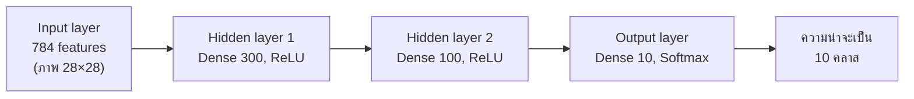
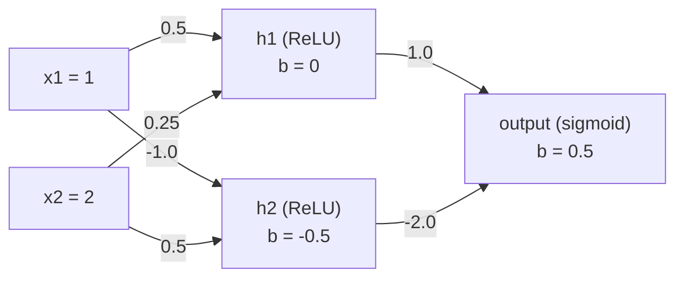
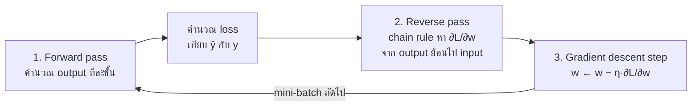
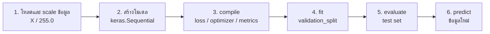
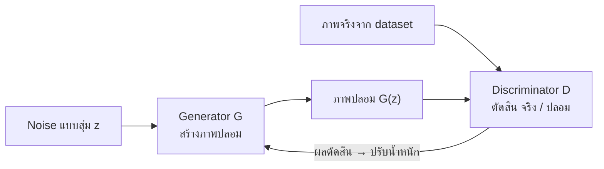

## วัตถุประสงค์การเรียนรู้

เมื่อจบบทนี้ นักศึกษาควรสามารถ (LLO3-1)

- อธิบายโครงสร้างของ artificial neuron, Perceptron และ Multi-Layer Perceptron (MLP) และเหตุผลที่ต้องมี hidden layer (ปัญหา XOR)
- คำนวณ forward pass ของเครือข่ายขนาดเล็กด้วยมือ และนับจำนวนพารามิเตอร์ของ Dense layer ได้ถูกต้อง
- เลือก activation function, loss function และ optimizer ให้เหมาะกับงาน regression, binary และ multiclass classification
- อธิบายหลักการของ backpropagation (chain rule) กับ gradient descent รวมถึงปัญหา vanishing/exploding gradients และวิธีแก้
- สร้าง ฝึก และประเมิน MLP ด้วย Keras ได้ตั้งแต่ `keras.Input` จนถึง `predict` และใช้ Dropout / Early stopping / BatchNorm ลด overfitting

## 1. จากเซลล์ประสาทชีวภาพสู่ Artificial Neuron

Artificial Neural Network (ANN) ได้แรงบันดาลใจจากเซลล์ประสาทในสมองของสัตว์ เซลล์ประสาทหนึ่งตัวรับสัญญาณจากเซลล์อื่นผ่าน dendrite รวมสัญญาณที่ตัวเซลล์ แล้ว "ยิง" สัญญาณต่อออกไปทาง axon เมื่อสัญญาณรวมแรงพอ แนวคิดนี้ถูกจำลองเป็นคณิตศาสตร์อย่างง่ายดังตาราง

| เซลล์ประสาทชีวภาพ | Artificial neuron |
|---|---|
| Dendrite (รับสัญญาณ) | input $x_1, x_2, \dots, x_n$ |
| Synapse (ความแรงของจุดเชื่อม) | weight $w_1, w_2, \dots, w_n$ |
| ตัวเซลล์ (รวมสัญญาณ) | weighted sum $z = \sum_i w_i x_i + b$ |
| เกณฑ์การยิงสัญญาณ | activation function $\varphi(z)$ |
| Axon (ส่งสัญญาณออก) | output $a = \varphi(z)$ |

$$ z = w_1x_1 + w_2x_2 + \dots + w_nx_n + b = \mathbf{w}^T\mathbf{x} + b, \qquad a = \varphi(z) $$

- **weight** บอกว่า input แต่ละตัวสำคัญแค่ไหน (ค่าบวก = กระตุ้น, ค่าลบ = ยับยั้ง)
- **bias** $b$ เลื่อนจุดตัดสินใจ ทำให้ neuron ให้ output ไม่เป็นศูนย์ได้แม้ input เป็นศูนย์ทั้งหมด (เหมือนจุดตัดแกน $y$ ของสมการเส้นตรง)
- **activation function** ใส่ความไม่เป็นเชิงเส้น (non-linearity) ให้ output

```python
import numpy as np

x = np.array([2.0, 3.0])      # input 2 ค่า
w = np.array([0.5, -0.4])     # weight ของแต่ละ input
b = 0.1                       # bias

z = np.dot(w, x) + b          # weighted sum
sigmoid = 1 / (1 + np.exp(-z))
relu = np.maximum(0, z)
print(f"z = {z:.2f}")
print(f"sigmoid(z) = {sigmoid:.4f}")
print(f"ReLU(z)    = {relu:.2f}")
```

```output
z = -0.10
sigmoid(z) = 0.4750
ReLU(z)    = 0.00
```

ตรวจด้วยมือ: $z = 0.5(2) + (-0.4)(3) + 0.1 = 1.0 - 1.2 + 0.1 = -0.1$ เมื่อ $z$ ติดลบ ReLU จะให้ 0 ส่วน sigmoid ให้ค่าต่ำกว่า 0.5 เล็กน้อย

## 2. Perceptron และปัญหา XOR

### 2.1 Perceptron และกฎการเรียนรู้

**Perceptron** (Rosenblatt, 1957) เป็นสถาปัตยกรรม ANN ที่ง่ายที่สุด ประกอบด้วย **TLU (Threshold Logic Unit)** ซึ่งคือ neuron ที่ใช้ step function เป็น activation

$$ \hat{y} = \text{step}(\mathbf{w}^T\mathbf{x} + b) = \begin{cases} 1 & \text{ถ้า } \mathbf{w}^T\mathbf{x} + b \ge 0 \\ 0 & \text{ถ้าไม่ใช่} \end{cases} $$

กฎการเรียนรู้ของ Perceptron (perceptron learning rule): ทุกครั้งที่ทำนายผิด ให้ขยับ weight ไปในทิศที่ลดความผิดพลาด

$$ w_i \leftarrow w_i + \eta\,(y - \hat{y})\,x_i, \qquad b \leftarrow b + \eta\,(y - \hat{y}) $$

โดย $\eta$ คือ learning rate ถ้าทำนายถูก ($y = \hat{y}$) weight จะไม่เปลี่ยน ลองสอน Perceptron ให้เรียนรู้ฟังก์ชัน AND

```python
import numpy as np

X = np.array([[0, 0], [0, 1], [1, 0], [1, 1]])
y_and = np.array([0, 0, 0, 1])

w = np.zeros(2); b = 0.0; eta = 0.1
step = lambda z: (z >= 0).astype(int)

for epoch in range(1, 11):
    errors = 0
    for xi, target in zip(X, y_and):
        y_hat = step(xi @ w + b)
        w += eta * (target - y_hat) * xi   # perceptron learning rule
        b += eta * (target - y_hat)
        errors += int(target != y_hat)
    if errors == 0:
        print(f"epoch {epoch}: ไม่มีข้อผิดพลาดแล้ว  w = {w}, b = {b:.1f}")
        break
    print(f"epoch {epoch}: errors = {errors}")

print("ทำนาย AND:", step(X @ w + b))
```

```output
epoch 1: errors = 2
epoch 2: errors = 3
epoch 3: errors = 3
epoch 4: ไม่มีข้อผิดพลาดแล้ว  w = [0.2 0.1], b = -0.2
ทำนาย AND: [0 0 0 1]
```

ผลลัพธ์คือเส้นตรง $0.2x_1 + 0.1x_2 - 0.2 = 0$ ที่แบ่งจุด (1,1) ออกจากอีกสามจุดได้ — Perceptron Convergence Theorem รับประกันว่าถ้าข้อมูล **แบ่งแยกได้ด้วยเส้นตรง (linearly separable)** กฎนี้จะหาคำตอบได้เสมอ

### 2.2 ปัญหา XOR: ทำไมต้องมี hidden layer

XOR ให้ค่า 1 เมื่อ input ต่างกัน: (0,1) และ (1,0) เป็นคลาส 1 ส่วน (0,0) และ (1,1) เป็นคลาส 0 ไม่มีเส้นตรงเส้นใดแบ่งสองกลุ่มนี้ได้ Minsky และ Papert (1969) ชี้จุดอ่อนนี้จนงานวิจัย neural network ซบเซาไปช่วงหนึ่ง ทางออกคือ **ซ้อน Perceptron หลายชั้น** กลายเป็น Multi-Layer Perceptron (MLP)

```python
import numpy as np
from sklearn.linear_model import Perceptron
from sklearn.neural_network import MLPClassifier

X = np.array([[0, 0], [0, 1], [1, 0], [1, 1]])
y_xor = np.array([0, 1, 1, 0])

per = Perceptron(max_iter=1000, random_state=42).fit(X, y_xor)
print("Perceptron ทำนาย XOR:", per.predict(X), " accuracy =", per.score(X, y_xor))

mlp = MLPClassifier(hidden_layer_sizes=(4,), activation="tanh",
                    solver="lbfgs", random_state=1, max_iter=1000).fit(X, y_xor)
print("MLP (1 hidden layer) ทำนาย XOR:", mlp.predict(X), " accuracy =", mlp.score(X, y_xor))
```

```output
Perceptron ทำนาย XOR: [0 0 0 0]  accuracy = 0.5
MLP (1 hidden layer) ทำนาย XOR: [0 1 1 0]  accuracy = 1.0
```

> [!NOTE]
> hidden layer ทำหน้าที่ "แปลงพิกัด" ของข้อมูลไปยังพื้นที่ใหม่ (เช่น neuron หนึ่งเรียนรู้ OR อีกตัวเรียนรู้ NAND) ซึ่งในพื้นที่ใหม่นั้นข้อมูลแบ่งด้วยเส้นตรงได้ แล้ว output layer จึงตัดสินใจได้ (XOR = OR AND NAND)

## 3. Multi-Layer Perceptron (MLP) และ Forward Pass

### 3.1 โครงสร้าง MLP

MLP ประกอบด้วย 3 ส่วน

1. **Input layer** — รับ feature (ไม่มีการคำนวณ ไม่มีพารามิเตอร์)
2. **Hidden layers** — อย่างน้อย 1 ชั้น แต่ละ neuron เชื่อมกับทุก neuron ของชั้นก่อนหน้า (fully connected / **Dense** layer)
3. **Output layer** — จำนวน neuron และ activation ขึ้นกับชนิดของงาน

เมื่อ MLP มี hidden layer หลายชั้น เราเรียกว่า **Deep Neural Network (DNN)** และศาสตร์ที่ศึกษาโมเดลลักษณะนี้คือ **Deep Learning** ข้อมูลไหลไปทางเดียวจาก input ถึง output จึงเรียกอีกชื่อว่า **feedforward neural network**



เมื่อเขียนแบบเวกเตอร์ ทั้งชั้นคำนวณพร้อมกันได้ด้วยการคูณเมทริกซ์ (ซึ่ง GPU ทำได้เร็วมาก)

$$ \mathbf{h} = \varphi(\mathbf{x}\,\mathbf{W} + \mathbf{b}) $$

โดย $\mathbf{W}$ มีขนาด (จำนวน input × จำนวน neuron) และ $\mathbf{b}$ มีขนาดเท่าจำนวน neuron

### 3.2 ตัวอย่างคำนวณ forward pass ด้วยมือ (เครือข่าย 2-2-1)

เครือข่ายนี้มี input 2 ตัว hidden 2 neuron (ReLU) และ output 1 neuron (sigmoid) สำหรับ binary classification



**ขั้นที่ 1 — hidden layer**

- $z_{h1} = 0.5(1) + 0.25(2) + 0 = 1.0 \Rightarrow h_1 = \text{ReLU}(1.0) = 1.0$
- $z_{h2} = -1.0(1) + 0.5(2) - 0.5 = -0.5 \Rightarrow h_2 = \text{ReLU}(-0.5) = 0$

**ขั้นที่ 2 — output layer**

- $z_o = 1.0(1.0) + (-2.0)(0) + 0.5 = 1.5 \Rightarrow \hat{y} = \sigma(1.5) = \frac{1}{1+e^{-1.5}} \approx 0.8176$

ถ้าคำตอบจริง $y = 1$ ค่า loss แบบ binary cross-entropy คือ $-\ln(0.8176) \approx 0.2014$ ตรวจด้วย NumPy

```python
import numpy as np

relu = lambda z: np.maximum(0, z)
sigmoid = lambda z: 1 / (1 + np.exp(-z))

x  = np.array([1.0, 2.0])                 # input 2 features
W1 = np.array([[0.5, -1.0],               # shape (2, 2) = (n_in, n_hidden)
               [0.25, 0.5]])
b1 = np.array([0.0, -0.5])
W2 = np.array([[1.0],                     # shape (2, 1) = (n_hidden, n_out)
               [-2.0]])
b2 = np.array([0.5])

z1 = x @ W1 + b1;  h = relu(z1)
z2 = h @ W2 + b2;  y_hat = sigmoid(z2)
print("z1 =", z1, " -> h =", h)
print("z2 =", z2, " -> y_hat =", y_hat.round(4))
print("BCE loss (y=1) =", round(float(-np.log(y_hat[0])), 4))
print("จำนวนพารามิเตอร์ =", W1.size + b1.size + W2.size + b2.size)
```

```output
z1 = [ 1.  -0.5]  -> h = [1. 0.]
z2 = [1.5]  -> y_hat = [0.8176]
BCE loss (y=1) = 0.2014
จำนวนพารามิเตอร์ = 9
```

### 3.3 การนับจำนวนพารามิเตอร์ของ Dense layer

Dense layer ที่รับ input $n_{in}$ ค่า และมี $n_{out}$ neuron มีพารามิเตอร์

$$ \text{params} = \underbrace{n_{in} \times n_{out}}_{\text{weights}} + \underbrace{n_{out}}_{\text{biases}} = (n_{in} + 1) \times n_{out} $$

เครือข่าย 2-2-1 ข้างบนจึงมี $(2 \times 2 + 2) + (2 \times 1 + 1) = 6 + 3 = 9$ พารามิเตอร์ ตรงกับที่ NumPy นับได้ ตัวอย่างเครือข่ายขนาดจริง

| สถาปัตยกรรม | ชั้น | การคำนวณ | พารามิเตอร์ |
|---|---|---|---|
| 784-300-100-10 (Fashion-MNIST) | Dense 784 → 300 | 784 × 300 + 300 | 235,500 |
| | Dense 300 → 100 | 300 × 100 + 100 | 30,100 |
| | Dense 100 → 10 | 100 × 10 + 10 | 1,010 |
| | **รวม** | | **266,610** |
| 8-30-1 (California housing) | Dense 8 → 30 / 30 → 1 | (8 × 30 + 30) + (30 × 1 + 1) | 270 + 31 = **301** |
| 20-64-32-1 | 3 ชั้น | 1,344 + 2,080 + 33 | **3,457** |

สังเกตว่าชั้นแรกที่รับภาพ 784 pixel กินพารามิเตอร์ถึง 88% ของทั้งโมเดล — เป็นเหตุผลหนึ่งที่งานภาพเปลี่ยนไปใช้ CNN ซึ่งแชร์ weight ([บทที่ 7](/module/07))

> [!TIP]
> layer ที่ **ไม่มีพารามิเตอร์**: `Input`, `Flatten`, `Dropout`, activation layer ส่วน `BatchNormalization` มี 4 ค่าต่อ feature ($\gamma, \beta$ ที่ฝึกได้ + moving mean, moving variance ที่ฝึกไม่ได้) ข้อสอบมักให้นับพารามิเตอร์จาก `model.summary()` — ให้ไล่ทีละชั้นด้วยสูตร $(n_{in}+1) \times n_{out}$

## 4. Activation Functions

ถ้าไม่มี activation ที่ไม่เป็นเชิงเส้น การซ้อน Dense layer กี่ชั้นก็ตามจะยุบรวมเป็นการแปลงเชิงเส้นชั้นเดียว เพราะ $(\mathbf{x}\mathbf{W}_1)\mathbf{W}_2 = \mathbf{x}(\mathbf{W}_1\mathbf{W}_2)$ — "ต่อให้มีร้อยชั้นก็มีค่าเท่ากับชั้นเดียว"

| Function | สูตร | ช่วงค่า | ใช้ที่ไหน |
|---|---|---|---|
| Sigmoid (logistic) | $\sigma(z) = \frac{1}{1+e^{-z}}$ | (0, 1) | output ของ binary classification / multilabel |
| Tanh | $\tanh(z) = \frac{e^z - e^{-z}}{e^z + e^{-z}}$ | (−1, 1) | hidden layer (RNN), ค่าเฉลี่ยใกล้ 0 |
| ReLU | $\max(0, z)$ | [0, ∞) | **ค่าเริ่มต้นของ hidden layer** เร็วและลด vanishing gradient |
| Leaky ReLU | $\max(\alpha z, z)$ เช่น $\alpha = 0.01$ | (−∞, ∞) | hidden layer เมื่อกลัวปัญหา dying ReLU |
| ELU / SELU / GELU | (รูปแบบเรียบของ ReLU) | > −1 / ... | hidden layer ของเครือข่ายลึก, GELU ใช้ใน Transformer |
| Softmax | $\frac{e^{z_k}}{\sum_j e^{z_j}}$ | (0, 1) รวม = 1 | output ของ multiclass classification |
| Linear (ไม่มี) | $z$ | (−∞, ∞) | output ของ regression |

```python
import numpy as np

z = np.array([-2.0, -1.0, 0.0, 1.0, 2.0])
sigmoid = 1 / (1 + np.exp(-z))
tanh = np.tanh(z)
relu = np.maximum(0, z)
leaky = np.where(z > 0, z, 0.01 * z)
np.set_printoptions(precision=3, suppress=True)
print("z        :", z)
print("sigmoid  :", sigmoid)
print("tanh     :", tanh)
print("ReLU     :", relu)
print("LeakyReLU:", leaky)

logits = np.array([2.0, 1.0, 0.1])
softmax = np.exp(logits) / np.exp(logits).sum()
print("softmax  :", softmax, " sum =", softmax.sum())
```

```output
z        : [-2. -1.  0.  1.  2.]
sigmoid  : [0.119 0.269 0.5   0.731 0.881]
tanh     : [-0.964 -0.762  0.     0.762  0.964]
ReLU     : [0. 0. 0. 1. 2.]
LeakyReLU: [-0.02 -0.01  0.    1.    2.  ]
softmax  : [0.659 0.242 0.099]  sum = 1.0
```

สังเกตว่า sigmoid และ tanh "อิ่มตัว (saturate)" เมื่อ $|z|$ ใหญ่ ความชันเข้าใกล้ 0 ส่วน ReLU มีความชัน 1 ตลอดฝั่งบวก ซึ่งเป็นเหตุผลหลักที่ ReLU ฝึกได้เร็วกว่าในเครือข่ายลึก (ดูหัวข้อ 6) ข้อเสียของ ReLU คือ neuron อาจ "ตาย" ถ้า $z$ ติดลบตลอด (dying ReLU) จึงมีตระกูล Leaky ReLU / ELU มาช่วย

## 5. Loss Functions และการเลือก Output Layer

Loss function วัดว่าโมเดลทำนายผิดไปมากแค่ไหน การฝึกคือการหาพารามิเตอร์ที่ทำให้ loss ต่ำที่สุด

**Mean Squared Error (MSE)** — regression

$$ \text{MSE} = \frac{1}{n}\sum_{i=1}^{n}(y_i - \hat{y}_i)^2 $$

**Binary cross-entropy (BCE)** — binary classification ($p_i$ = ความน่าจะเป็นของคลาส 1 จาก sigmoid)

$$ \text{BCE} = -\frac{1}{n}\sum_{i=1}^{n}\left[y_i\ln p_i + (1-y_i)\ln(1-p_i)\right] $$

**Categorical cross-entropy (CCE)** — multiclass ($K$ คลาส, $y_{ik}$ เป็น one-hot, $p_{ik}$ จาก softmax)

$$ \text{CCE} = -\frac{1}{n}\sum_{i=1}^{n}\sum_{k=1}^{K} y_{ik}\ln p_{ik} $$

**Sparse categorical cross-entropy** คือสูตรเดียวกับ CCE แต่รับ label เป็นเลขจำนวนเต็ม (เช่น `3`) แทน one-hot (`[0,0,0,1,0,...]`) ค่า loss ที่ได้เท่ากันทุกประการ

```python
import numpy as np

# Regression: MSE
y_true = np.array([3.0, 5.0, 2.0]); y_pred = np.array([2.5, 5.5, 3.0])
print("MSE =", np.mean((y_true - y_pred) ** 2))

# Binary classification: Binary cross-entropy
y = np.array([1, 0, 1]); p = np.array([0.9, 0.2, 0.6])
bce = -np.mean(y * np.log(p) + (1 - y) * np.log(1 - p))
print("BCE =", round(bce, 4))

# Multiclass: one-hot (categorical) vs integer label (sparse categorical)
probs = np.array([[0.7, 0.2, 0.1],
                  [0.1, 0.3, 0.6]])
y_onehot = np.array([[1, 0, 0],
                     [0, 0, 1]])
y_int = np.array([0, 2])
cce = -np.mean(np.sum(y_onehot * np.log(probs), axis=1))
scce = -np.mean(np.log(probs[np.arange(2), y_int]))
print("categorical CE        =", round(cce, 4))
print("sparse categorical CE =", round(scce, 4))
```

```output
MSE = 0.5
BCE = 0.2798
categorical CE        = 0.4338
sparse categorical CE = 0.4338
```

ตารางสรุปการออกแบบ output layer (ใช้บ่อยมากทั้งในใบงานและข้อสอบ)

| ชนิดงาน | จำนวน neuron ใน output | activation | loss ใน Keras |
|---|---|---|---|
| Regression (ทำนายราคาบ้าน) | 1 (หรือจำนวนค่าที่ทำนาย) | ไม่มี (linear) | `"mse"` / `"mae"` / `"huber"` |
| Binary classification (spam / ไม่ spam) | 1 | `sigmoid` | `"binary_crossentropy"` |
| Multiclass, label เป็นจำนวนเต็ม | K | `softmax` | `"sparse_categorical_crossentropy"` |
| Multiclass, label เป็น one-hot | K | `softmax` | `"categorical_crossentropy"` |
| Multilabel (หลายป้ายพร้อมกัน) | K | `sigmoid` | `"binary_crossentropy"` |

## 6. Backpropagation, Gradient Descent และ Optimizers

### 6.1 Backpropagation 3 ขั้นตอน

Backpropagation (Rumelhart, Hinton & Williams, 1986) คืออัลกอริทึมหัวใจที่ใช้สอน MLP โดยย้อนกลับไปปรับค่า weight ทีละชั้น



1. **Forward pass** — ส่ง mini-batch เข้าโมเดล คำนวณ output ทุกชั้น (เก็บค่ากลางไว้) แล้ววัด loss
2. **Reverse pass** — วัดว่าแต่ละ weight มีส่วนทำให้เกิด error เท่าไร ด้วย **chain rule** ย้อนจาก output layer ไปหา input layer
3. **Gradient descent step** — ปรับทุก weight ไปในทิศตรงข้ามกับ gradient

$$ \frac{\partial L}{\partial w} = \frac{\partial L}{\partial \hat{y}} \cdot \frac{\partial \hat{y}}{\partial z} \cdot \frac{\partial z}{\partial w}, \qquad w \leftarrow w - \eta \frac{\partial L}{\partial w} $$

สำหรับ neuron sigmoid คู่กับ BCE ผลคูณ chain rule ลดรูปได้สวยงามเป็น $\frac{\partial L}{\partial z} = \hat{y} - y$ ดังนั้น $\frac{\partial L}{\partial w_i} = (\hat{y} - y)x_i$ ลองคำนวณ 1 step และตรวจกับ numerical gradient

```python
import numpy as np

sigmoid = lambda z: 1 / (1 + np.exp(-z))
bce = lambda y, p: -(y * np.log(p) + (1 - y) * np.log(1 - p))

x = np.array([1.0, 2.0]); y = 1
w = np.array([0.5, -0.25]); b = 0.0; eta = 0.1

# forward
z = w @ x + b; p = sigmoid(z)
print(f"ก่อนปรับ: z = {z:.2f}, p = {p:.4f}, loss = {bce(y, p):.4f}")

# backward (chain rule): dL/dw = dL/dp * dp/dz * dz/dw = (p - y) * x
dz = p - y
dw = dz * x; db = dz
print("gradient dw =", dw, " db =", db)

# ตรวจด้วย numerical gradient
eps = 1e-6
num_dw = [(bce(y, sigmoid((w + eps * e) @ x + b)) - bce(y, sigmoid((w - eps * e) @ x + b))) / (2 * eps)
          for e in np.eye(2)]
print("numerical dw =", np.round(num_dw, 4))

# gradient descent step
w = w - eta * dw; b = b - eta * db
p_new = sigmoid(w @ x + b)
print(f"หลังปรับ: w = {w}, b = {b:.2f}, p = {p_new:.4f}, loss = {bce(y, p_new):.4f}")
```

```output
ก่อนปรับ: z = 0.00, p = 0.5000, loss = 0.6931
gradient dw = [-0.5 -1. ]  db = -0.5
numerical dw = [-0.5 -1. ]
หลังปรับ: w = [ 0.55 -0.15], b = 0.05, p = 0.5744, loss = 0.5544
```

หลังปรับเพียง 1 step ความน่าจะเป็นของคำตอบที่ถูกเพิ่มจาก 0.50 เป็น 0.57 และ loss ลดลงจาก 0.693 เป็น 0.554 การฝึกจริงคือการวน 3 ขั้นตอนนี้ซ้ำหลายพันครั้งบน mini-batch ต่าง ๆ — ใน MLP หลายชั้น gradient ของชั้นก่อนหน้าคำนวณจาก gradient ของชั้นถัดไปคูณกับอนุพันธ์ของ activation ($\delta^{(l)} = (\delta^{(l+1)}\mathbf{W}^{(l+1)T}) \odot \varphi'(\mathbf{z}^{(l)})$) จึงเรียกว่า "ย้อนกลับ"

> [!NOTE]
> ในทางปฏิบัติเราไม่ต้องเขียน backward เอง framework อย่าง TensorFlow/PyTorch ใช้ **autodiff (reverse-mode automatic differentiation)** คำนวณ gradient ให้อัตโนมัติ แต่การเข้าใจขั้นตอนนี้ช่วยให้ debug ปัญหาการฝึกได้ ศัพท์ที่ต้องรู้: **batch size** = จำนวนตัวอย่างต่อ 1 step, **epoch** = การวนครบข้อมูลฝึก 1 รอบ (จำนวน step ต่อ epoch = ⌈จำนวนตัวอย่าง / batch size⌉)

### 6.2 Optimizers

Gradient descent ธรรมดาเหมือนคนเดินลงเขาทีละก้าวเท่า ๆ กัน optimizer รุ่นใหม่ช่วยให้ลงเขาได้เร็วและเสถียรขึ้น

| Optimizer | แนวคิด | Keras |
|---|---|---|
| SGD | $w \leftarrow w - \eta\nabla L$ ก้าวคงที่ | `keras.optimizers.SGD(learning_rate=0.01)` |
| Momentum | จำ "ความเร็ว" ของก้าวก่อน ๆ เหมือนลูกโบว์ลิ่งกลิ้งลงเขา ยิ่งกลิ้งยิ่งเร็ว | `SGD(learning_rate=0.01, momentum=0.9)` |
| Nesterov (NAG) | เหมือน Momentum แต่วัด gradient ณ จุดที่ "มองไปข้างหน้า" 1 ก้าว จึงแม่นกว่า | `SGD(momentum=0.9, nesterov=True)` |
| AdaGrad | ลด learning rate ในแกนที่ชันมาก แต่สะสม gradient ตลอดจึงมักหยุดเร็วเกินไปใน DL | `keras.optimizers.Adagrad()` |
| RMSProp | แก้ AdaGrad โดยสนใจเฉพาะ gradient ช่วงหลัง (exponential moving average) | `keras.optimizers.RMSprop(learning_rate=0.001)` |
| Adam / Nadam | **ตัวยอดฮิต** รวม Momentum (ค่าเฉลี่ย gradient) + RMSProp (ค่าเฉลี่ย gradient²) | `keras.optimizers.Adam(learning_rate=0.001)` |
| AdamW | Adam + weight decay ที่แยกออกมา นิยมในโมเดลขนาดใหญ่ | `keras.optimizers.AdamW()` |

**Learning rate** คือ hyperparameter ที่สำคัญที่สุด — ถ้าเล็กเกินไปจะฝึกช้า ถ้าใหญ่เกินไป loss จะแกว่งหรือ diverge (กลายเป็น `nan`) Adam ที่ `learning_rate=1e-3` เป็นจุดเริ่มต้นที่ดีสำหรับ MLP ส่วนใหญ่

## 7. ปัญหาของการฝึก Deep Neural Network และวิธีแก้

### 7.1 Vanishing / Exploding Gradients

Backpropagation ส่ง gradient ย้อนกลับผ่านหลายชั้นโดย**คูณ**อนุพันธ์ของแต่ละชั้นต่อกัน ถ้าค่าที่คูณน้อยกว่า 1 ซ้ำ ๆ gradient จะ **หายไป (vanishing)** ชั้นล่าง ๆ แทบไม่ได้เรียนรู้ ถ้ามากกว่า 1 ซ้ำ ๆ จะ **ระเบิด (exploding)** จน weight กลายเป็น `nan` ตัวอย่างเช่นอนุพันธ์ของ sigmoid $\sigma'(z) = \sigma(z)(1-\sigma(z))$ มีค่าสูงสุดเพียง 0.25 (ที่ $z = 0$) ผ่าน 5 ชั้น gradient ถูกคูณด้วยไม่เกิน $0.25^5 \approx 9.8 \times 10^{-4}$ และผ่าน 10 ชั้นเหลือไม่เกิน $0.25^{10} \approx 9.5 \times 10^{-7}$ — ชั้นล่างแทบไม่ได้เรียนรู้ ปัญหานี้เป็นอุปสรรคสำคัญของการฝึกเครือข่ายลึกในยุคแรก ซึ่ง Glorot & Bengio (2010) วิเคราะห์ไว้และนำไปสู่ Glorot initialization

| วิธีแก้ | หลักการ | Keras |
|---|---|---|
| Weight initialization | ตั้งค่าเริ่มต้นให้ความแปรปรวนของสัญญาณคงที่ทั้งไปและกลับ: Glorot ($\sigma^2 = \frac{2}{fan_{in}+fan_{out}}$) สำหรับ sigmoid/tanh/softmax, He ($\sigma^2 = \frac{2}{fan_{in}}$) สำหรับ ReLU, LeCun สำหรับ SELU | `Dense(100, activation="relu", kernel_initializer="he_normal")` (ค่าเริ่มต้นของ Keras คือ `glorot_uniform`) |
| ใช้ ReLU และตระกูล | ไม่อิ่มตัวฝั่งบวก (Leaky ReLU, ELU, SELU, GELU) | `activation="relu"` |
| Batch Normalization | normalize output ของชั้นในแต่ละ mini-batch ให้ mean ≈ 0, std ≈ 1 แล้ว scale/shift ด้วย $\gamma, \beta$ ช่วยให้ฝึกเร็วและเสถียร | `keras.layers.BatchNormalization()` |
| Gradient clipping | จำกัดขนาด gradient ไม่ให้เกินค่าที่กำหนด แก้ exploding gradients (นิยมใน RNN) | `Adam(clipnorm=1.0)` |

### 7.2 Overfitting และ Regularization

DNN มีพารามิเตอร์นับแสนถึงล้าน จึง overfit ได้ง่าย (train accuracy สูงแต่ validation accuracy ตันหรือลดลง) เครื่องมือหลักคือ

- **Early stopping** — หยุดฝึกเมื่อ validation loss ไม่ดีขึ้นติดต่อกัน `patience` epoch และคืน weight ที่ดีที่สุด เป็นวิธีที่ง่ายและได้ผลที่สุด
- **Dropout** — ในแต่ละ step ของการฝึก "ปิด" neuron แบบสุ่ม (เช่น 20–50%) ทำให้ neuron ที่เหลือต้องพึ่งตัวเองมากขึ้น ไม่พึ่ง feature ใด feature หนึ่ง ทำงาน**เฉพาะตอนฝึก** ตอนทำนายใช้ neuron ครบทุกตัว
- **$\ell_1$ / $\ell_2$ regularization** — บวกโทษขนาดของ weight เข้าไปใน loss ($\ell_2$: $\lambda\sum w^2$) ให้ weight เล็กและโมเดลเรียบขึ้น
- **Max-norm regularization** — จำกัดให้ norm ของ weight ที่เข้าแต่ละ neuron ไม่เกิน $r$
- **Batch Normalization** — มีผล regularize เล็กน้อยเป็นผลพลอยได้

```python
import keras

model_reg = keras.Sequential([
    keras.Input(shape=(28, 28)),
    keras.layers.Flatten(),
    keras.layers.Dense(300, activation="relu", kernel_initializer="he_normal",
                       kernel_regularizer=keras.regularizers.l2(1e-4)),
    keras.layers.BatchNormalization(),
    keras.layers.Dropout(0.2),
    keras.layers.Dense(100, activation="relu", kernel_initializer="he_normal"),
    keras.layers.BatchNormalization(),
    keras.layers.Dropout(0.2),
    keras.layers.Dense(10, activation="softmax"),
])
early_stop = keras.callbacks.EarlyStopping(monitor="val_loss", patience=5,
                                           restore_best_weights=True)
```

นับพารามิเตอร์ของ `model_reg` ด้วยมือ: Dense ทั้งสามชั้นยังเท่าเดิม 235,500 + 30,100 + 1,010 = 266,610 ส่วน BatchNormalization มี 4 × 300 = 1,200 และ 4 × 100 = 400 รวมทั้งหมด **268,210** โดยเป็น non-trainable (moving mean/variance) 2 × 300 + 2 × 100 = **800** และ trainable **267,410** — Dropout ไม่มีพารามิเตอร์

## 8. Frameworks สำหรับ Deep Learning และ Workshop: MLP บน Fashion-MNIST

### 8.1 เลือกเครื่องมือ

| Framework | จุดเด่น | เหมาะกับ |
|---|---|---|
| **TensorFlow + Keras 3** | API ระดับสูง เขียนสั้น (`Sequential`, `fit`, `evaluate`), deploy ได้หลายแพลตฟอร์ม (TF Lite, TF Serving) Keras 3 รองรับหลาย backend (TensorFlow / JAX / PyTorch) | ผู้เริ่มต้น งาน production ทั่วไป — **ใช้ในรายวิชานี้** |
| **PyTorch** | เขียนแบบ Python ปกติ (define-by-run) ยืดหยุ่น debug ง่าย ต้องเขียน training loop เอง | งานวิจัย โมเดลใหม่ ๆ, Hugging Face |
| **JAX** | NumPy + autodiff + compile (XLA) เร็วมากบน TPU/GPU | งานวิจัยขนาดใหญ่ |
| **scikit-learn** `MLPClassifier` | ใช้ API เดียวกับโมเดล ML อื่น ไม่มี GPU | MLP ขนาดเล็ก ข้อมูลตาราง baseline |

ใน **Google Colab** มี TensorFlow/Keras ติดตั้งมาแล้ว เปิด GPU ได้ที่เมนู *Runtime → Change runtime type → T4 GPU* แล้วตรวจด้วย `tf.config.list_physical_devices("GPU")` (MLP บน Fashion-MNIST ฝึกบน CPU ได้ แต่ GPU เร็วกว่าหลายเท่า และจำเป็นมากในบทที่ 7 เรื่อง CNN)

### 8.2 ขั้นตอนการสร้างโมเดลด้วย Keras



Fashion-MNIST มีภาพเสื้อผ้าขาวดำขนาด 28×28 จำนวน 70,000 ภาพ (train 60,000 / test 10,000) 10 คลาส เป็นโจทย์ที่ยากกว่า MNIST ตัวเลขเขียนมือ

```python
import numpy as np
import pandas as pd
import matplotlib.pyplot as plt
import tensorflow as tf
import keras

print("GPU:", tf.config.list_physical_devices("GPU"))

# 1) โหลดและเตรียมข้อมูล
(X_train_full, y_train_full), (X_test, y_test) = keras.datasets.fashion_mnist.load_data()
X_train_full, X_test = X_train_full / 255.0, X_test / 255.0   # scale เป็น [0, 1]
class_names = ["T-shirt/top", "Trouser", "Pullover", "Dress", "Coat",
               "Sandal", "Shirt", "Sneaker", "Bag", "Ankle boot"]

# 2) สร้างโมเดล
keras.utils.set_random_seed(42)
model = keras.Sequential([
    keras.Input(shape=(28, 28)),                   # ภาพ 28x28
    keras.layers.Flatten(),                        # 28x28 -> 784
    keras.layers.Dense(300, activation="relu"),    # hidden layer 1
    keras.layers.Dense(100, activation="relu"),    # hidden layer 2
    keras.layers.Dense(10, activation="softmax"),  # output 10 คลาส
])
model.summary()
```

`model.summary()` จะแสดงตารางด้านล่าง (จำนวนพารามิเตอร์คำนวณได้แน่นอนจากสูตร จึงตรงทุกครั้ง)

```output
Model: "sequential"
┏━━━━━━━━━━━━━━━━━━━━━━━━━━━━━━━━━┳━━━━━━━━━━━━━━━━━━━━━━━━┳━━━━━━━━━━━━━━━┓
┃ Layer (type)                    ┃ Output Shape           ┃       Param # ┃
┡━━━━━━━━━━━━━━━━━━━━━━━━━━━━━━━━━╇━━━━━━━━━━━━━━━━━━━━━━━━╇━━━━━━━━━━━━━━━┩
│ flatten (Flatten)               │ (None, 784)            │             0 │
├─────────────────────────────────┼────────────────────────┼───────────────┤
│ dense (Dense)                   │ (None, 300)            │       235,500 │
├─────────────────────────────────┼────────────────────────┼───────────────┤
│ dense_1 (Dense)                 │ (None, 100)            │        30,100 │
├─────────────────────────────────┼────────────────────────┼───────────────┤
│ dense_2 (Dense)                 │ (None, 10)             │         1,010 │
└─────────────────────────────────┴────────────────────────┴───────────────┘
 Total params: 266,610 (1.02 MB)
 Trainable params: 266,610 (1.02 MB)
 Non-trainable params: 0 (0.00 B)
```

`None` ใน Output Shape คือขนาด batch ที่ยังไม่กำหนด ส่วน 1.02 MB มาจาก 266,610 พารามิเตอร์ × 4 ไบต์ (float32)

```python
# 3) compile: เลือก loss / optimizer / metrics
model.compile(loss="sparse_categorical_crossentropy",   # label เป็นจำนวนเต็ม 0-9
              optimizer=keras.optimizers.Adam(learning_rate=1e-3),
              metrics=["accuracy"])

# 4) fit: แบ่ง 10% ของ train เป็น validation อัตโนมัติ
early_stop = keras.callbacks.EarlyStopping(monitor="val_loss", patience=5,
                                           restore_best_weights=True)
history = model.fit(X_train_full, y_train_full, epochs=30, batch_size=32,
                    validation_split=0.1, callbacks=[early_stop])
```

ตัวอย่างผลลัพธ์ (ค่าที่ได้จะต่างกันเล็กน้อยในแต่ละครั้ง) — ข้อมูลฝึก 54,000 ภาพ ÷ batch 32 = 1,688 step ต่อ epoch

```output
Epoch 1/30
1688/1688 ━━━━━━━━━━━━━━━━━━━━ 6s - accuracy: ~0.78-0.82 - loss: ~0.50-0.60 - val_accuracy: ~0.84-0.86 - val_loss: ~0.38-0.42
...
Epoch 10/30
1688/1688 ━━━━━━━━━━━━━━━━━━━━ 5s - accuracy: ~0.90-0.92 - loss: ~0.22-0.26 - val_accuracy: ~0.88-0.90 - val_loss: ~0.30-0.34
...
(EarlyStopping มักหยุดราว epoch 12-20 เมื่อ val_loss เริ่มเพิ่มขึ้น)
```

```python
# วาด learning curves
pd.DataFrame(history.history).plot(figsize=(8, 5), grid=True,
                                   xlabel="Epoch", style=["r--", "r-", "b--", "b-"])
plt.title("Learning curves: MLP on Fashion-MNIST")
plt.show()

# 5) evaluate บน test set
test_loss, test_acc = model.evaluate(X_test, y_test, verbose=0)
print(f"test accuracy = {test_acc:.4f}")

# 6) predict ภาพใหม่ 3 ภาพแรกของ test set
y_proba = model.predict(X_test[:3], verbose=0)
print(y_proba.round(2))
y_pred = y_proba.argmax(axis=1)
print([class_names[i] for i in y_pred], "| คำตอบจริง:", [class_names[i] for i in y_test[:3]])
```

ตัวอย่างผลลัพธ์ (ค่าที่ได้จะต่างกันเล็กน้อยในแต่ละครั้ง)

```output
test accuracy ≈ 0.87-0.89
[[0.   0.   0.   0.   0.   0.01 0.   0.02 0.   0.97]
 [0.   0.   0.99 0.   0.01 0.   0.   0.   0.   0.  ]
 [0.   1.   0.   0.   0.   0.   0.   0.   0.   0.  ]]
['Ankle boot', 'Pullover', 'Trouser'] | คำตอบจริง: ['Ankle boot', 'Pullover', 'Trouser']
```

**การอ่าน learning curves**: ถ้า `loss` (train) ลดลงเรื่อย ๆ แต่ `val_loss` หยุดลดแล้วเริ่มเพิ่มขึ้น แปลว่าเริ่ม overfit — EarlyStopping ช่วยหยุดและคืน weight ณ epoch ที่ `val_loss` ต่ำที่สุด ช่องว่างระหว่าง train accuracy กับ val accuracy ที่กว้างขึ้นเป็นสัญญาณให้เพิ่ม Dropout หรือ $\ell_2$

### 8.3 เทียบกับ `MLPClassifier` ของ scikit-learn (รันบน CPU ได้)

scikit-learn มี MLP ที่ใช้ API เดียวกับบทก่อน ๆ เหมาะไว้เป็น baseline หรือเมื่อไม่มี GPU (โหลด Fashion-MNIST จาก OpenML ซึ่งเรียงลำดับเดียวกับ Keras: 60,000 ภาพแรกเป็น train)

```python
import time
import numpy as np
from sklearn.datasets import fetch_openml
from sklearn.neural_network import MLPClassifier

X, y = fetch_openml("Fashion-MNIST", version=1, return_X_y=True, as_frame=False)
X = X / 255.0                                  # scale pixel ให้อยู่ใน [0, 1]
X_train, X_test = X[:60000], X[60000:]
y_train, y_test = y[:60000], y[60000:]

mlp = MLPClassifier(hidden_layer_sizes=(300, 100), activation="relu",
                    solver="adam", learning_rate_init=1e-3, batch_size=200,
                    early_stopping=True, validation_fraction=0.1,
                    n_iter_no_change=5, max_iter=30, random_state=42)
t0 = time.time()
mlp.fit(X_train, y_train)
print(f"ฝึกเสร็จใน {mlp.n_iter_} epochs ({time.time() - t0:.0f} วินาที)")
print("best validation accuracy:", round(mlp.best_validation_score_, 4))
print("test accuracy:", round(mlp.score(X_test, y_test), 4))
n_params = sum(W.size for W in mlp.coefs_) + sum(b.size for b in mlp.intercepts_)
print("จำนวนพารามิเตอร์:", f"{n_params:,}")
```

```output
ConvergenceWarning: Stochastic Optimizer: Maximum iterations (30) reached and the optimization hasn't converged yet.
ฝึกเสร็จใน 30 epochs (136 วินาที)
best validation accuracy: 0.9018
test accuracy: 0.8931
จำนวนพารามิเตอร์: 266,610
```

โครงสร้าง 784-300-100-10 เดียวกันจึงมีพารามิเตอร์ 266,610 เท่ากับ Keras ทุกประการ และได้ test accuracy ใกล้เคียงกัน (ราว 0.89) `ConvergenceWarning` บอกว่าครบ `max_iter` ก่อนที่ early stopping จะหยุด — ไม่ใช่ error (เวลาฝึกขึ้นกับเครื่อง) ความต่างคือ Keras ใช้ GPU ได้ ปรับแต่ง layer (Dropout, BatchNorm, CNN ในบทถัดไป) ได้อิสระกว่ามาก

## 9. สถาปัตยกรรม Deep Learning ที่ควรรู้จัก

MLP ในบทนี้เป็นพื้นฐานของสถาปัตยกรรมที่ซับซ้อนกว่า ซึ่งต่างกันที่ "วิธีต่อ layer" ให้เหมาะกับชนิดข้อมูลหรืองาน (ภาพรวมทั้งหมดอยู่ใน [บทที่ 0](/module/00))

| สถาปัตยกรรม | แนวคิดหลัก | งานที่เหมาะ | เรียนต่อที่ |
|---|---|---|---|
| CNN | filter กวาดภาพ ใช้น้ำหนักร่วมกัน | จำแนกภาพ ตรวจจับวัตถุ | [บทที่ 7](/module/07) |
| RNN / LSTM | ส่ง hidden state ต่อเนื่องตามลำดับเวลา | ข้อมูลอนุกรมเวลา เสียง ข้อความ (ยุคก่อน Transformer) | [บทที่ 0](/module/00) |
| Autoencoder | Encoder บีบข้อมูลเป็นรหัสสั้น แล้ว Decoder สร้างกลับ | ลดมิติ ลบ noise ตรวจจับความผิดปกติ | [บทที่ 0](/module/00) |
| GAN | Generator กับ Discriminator แข่งกัน | สร้างภาพ/ข้อมูลสังเคราะห์ | หัวข้อ 9.1 |
| Transformer | Self-Attention + Encoder/Decoder | LLM แปลภาษา สรุปความ | [บทที่ 8](/module/08) |

### 9.1 Generative Adversarial Network (GAN)

**GAN** (Goodfellow et al., 2014) ประกอบด้วย neural network **2 ตัวที่แข่งขันกัน (adversarial)**



1. **Generator (ผู้ปลอมแปลง)** รับ noise แบบสุ่มแล้วสร้างข้อมูลปลอม เป้าหมายคือหลอก Discriminator ให้เชื่อว่าเป็นของจริง
2. **Discriminator (ผู้ตรวจสอบ)** เป็น binary classifier (output sigmoid) รับทั้งข้อมูลจริงและปลอม แล้วทายว่าเป็น "จริง" หรือ "ปลอม"
3. **ฝึกสลับกัน:** ฝึก D ให้แยกจริง/ปลอมเก่งขึ้น → ฝึก G ให้สร้างของปลอมที่ D แยกไม่ออก (ใช้ gradient ที่ย้อนผ่าน D) ทำซ้ำไปเรื่อย ๆ ทั้งคู่จึงเก่งขึ้นพร้อมกัน จุดสมดุลในอุดมคติคือ D ทายถูกได้เพียง 50% เพราะของปลอมเหมือนของจริงมาก

ตัวอย่างการใช้งาน: สร้างภาพใบหน้าที่ไม่มีอยู่จริง (StyleGAN), เพิ่มความละเอียดภาพ (super-resolution), สร้างข้อมูลสังเคราะห์เพื่อเพิ่มชุดข้อมูลฝึก, แปลงสไตล์ภาพ (เช่น ภาพถ่ายเป็นภาพวาด) ข้อควรระวังคือการฝึกไม่เสถียร (เช่น **mode collapse** ที่ Generator สร้างภาพซ้ำ ๆ แบบเดียว) และการนำไปสร้าง deepfake

## 10. ตัวอย่างโจทย์และวิธีทำ (แนวข้อสอบ)

### โจทย์ 1: วาดโครงข่ายและนับพารามิเตอร์

**1.1** โครงข่าย Feedforward ชั้นนำเข้า 5 โหนด ชั้นซ่อน 8 โหนด ชั้นผลลัพธ์ 2 โหนด

**1.2** โครงข่าย Feedforward ชั้นนำเข้า 3 โหนด ชั้นซ่อน 2 ชั้น (5 โหนด และ 4 โหนด) ชั้นผลลัพธ์ 2 โหนด

จงวาดโครงข่ายและคำนวณจำนวนค่าน้ำหนัก ค่าเอนเอียง และพารามิเตอร์ทั้งหมด

**หลักการ:** ชั้น Dense ที่เชื่อมจาก $n_{\text{in}}$ โหนดไป $n_{\text{out}}$ โหนด มี**ค่าน้ำหนัก** $n_{\text{in}} \times n_{\text{out}}$ ค่า (ทุกโหนดเชื่อมทุกโหนด) และ**ค่าเอนเอียง** $n_{\text{out}}$ ค่า (โหนดละ 1 ค่า ชั้นนำเข้าไม่มี bias)


**วิธีทำ 1.1** (5 → 8 → 2)


| ช่วงการเชื่อม | ค่าน้ำหนัก | ค่าเอนเอียง |
|---|---|---|
| นำเข้า → ซ่อน | $5 \times 8 = 40$ | 8 |
| ซ่อน → ผลลัพธ์ | $8 \times 2 = 16$ | 2 |
| **รวม** | **56** | **10** |

พารามิเตอร์ทั้งหมด $= 56 + 10 = 66$

**วิธีทำ 1.2** (3 → 5 → 4 → 2)


| ช่วงการเชื่อม | ค่าน้ำหนัก | ค่าเอนเอียง |
|---|---|---|
| นำเข้า → ซ่อน 1 | $3 \times 5 = 15$ | 5 |
| ซ่อน 1 → ซ่อน 2 | $5 \times 4 = 20$ | 4 |
| ซ่อน 2 → ผลลัพธ์ | $4 \times 2 = 8$ | 2 |
| **รวม** | **43** | **11** |

พารามิเตอร์ทั้งหมด $= 43 + 11 = 54$

> [!WARNING]
> ข้อผิดพลาดที่พบบ่อย: ลืมนับ bias หรือไปนับ bias ให้ชั้นนำเข้า — ตรวจด้วยสูตรลัด: แต่ละชั้น Dense มี $(n_{\text{in}} + 1) \times n_{\text{out}}$ พารามิเตอร์ เช่น 1.1: $(5+1)\times 8 + (8+1)\times 2 = 48 + 18 = 66$ ✓

### โจทย์ 2: ReLU และ Softmax

จงคำนวณ $\text{ReLU}(-5)$, $\text{ReLU}(1.5)$ และ Softmax ของ $[3, 1, 0]$ (ทศนิยม 3 ตำแหน่ง)


**วิธีทำ**

ReLU คือ $\max(0, x)$: $\text{ReLU}(-5) = \max(0, -5) = 0$ และ $\text{ReLU}(1.5) = \max(0, 1.5) = 1.5$

Softmax คือ $\text{softmax}(z_i) = \dfrac{e^{z_i}}{\sum_j e^{z_j}}$

ขั้นที่ 1 — ยกกำลัง $e$: $e^3 = 20.086$, $e^1 = 2.718$, $e^0 = 1$

ขั้นที่ 2 — รวม: $20.086 + 2.718 + 1 = 23.804$

ขั้นที่ 3 — หาร: $\left[\dfrac{20.086}{23.804}, \dfrac{2.718}{23.804}, \dfrac{1}{23.804}\right] = [0.844,\ 0.114,\ 0.042]$ (ผลรวม = 1)

### โจทย์ 3: Softmax และ Cross-Entropy Loss

จงคำนวณ Softmax ของ $[1, 3, 0]$ และค่า Cross-Entropy $= -\ln(p)$ เมื่อคลาสที่ถูกต้องคือคลาสที่ 2 (ค่า 3)

**วิธีทำ**

ขั้นที่ 1 — Softmax: ค่าเดียวกับโจทย์ 2 แต่สลับตำแหน่ง → $[0.114,\ 0.844,\ 0.042]$

ขั้นที่ 2 — Cross-Entropy ใช้ความน่าจะเป็นของ**คลาสที่ถูกต้อง**เท่านั้น ($p = 0.844$)

$$ L = -\ln(0.844) = 0.170 $$

ยิ่งโมเดลมั่นใจในคลาสที่ถูกมาก ($p \to 1$) loss ยิ่งเข้าใกล้ 0 แต่ถ้ามั่นใจในคลาสผิด เช่น $p = 0.042$ จะได้ $L = -\ln(0.042) = 3.17$ ซึ่งสูงมาก

### ตรวจคำตอบด้วย Python

```python
import numpy as np

def count_params(layers):
    weights = sum(a * b for a, b in zip(layers, layers[1:]))
    biases = sum(layers[1:])
    return weights, biases, weights + biases

for arch in ([5, 8, 2], [3, 5, 4, 2]):
    w, b, total = count_params(arch)
    print(f"{arch}: น้ำหนัก = {w}, เอนเอียง = {b}, รวม = {total}")

relu = lambda x: np.maximum(0, x)
softmax = lambda z: np.exp(z) / np.exp(z).sum()
print("ReLU(-5), ReLU(1.5) =", relu(np.array([-5, 1.5])))
print("softmax([3, 1, 0]) =", np.round(softmax(np.array([3, 1, 0])), 3))
p = softmax(np.array([1, 3, 0]))
print("softmax([1, 3, 0]) =", np.round(p, 3), f"| cross-entropy (คลาสที่ 2) = {-np.log(p[1]):.4f}")
```

```output
[5, 8, 2]: น้ำหนัก = 56, เอนเอียง = 10, รวม = 66
[3, 5, 4, 2]: น้ำหนัก = 43, เอนเอียง = 11, รวม = 54
ReLU(-5), ReLU(1.5) = [0.  1.5]
softmax([3, 1, 0]) = [0.844 0.114 0.042]
softmax([1, 3, 0]) = [0.114 0.844 0.042] | cross-entropy (คลาสที่ 2) = 0.1698
```

## สรุป

- **Artificial neuron** คำนวณ $z = \mathbf{w}^T\mathbf{x} + b$ แล้วผ่าน activation $\varphi(z)$; **Perceptron** ใช้ step function และเรียนรู้ได้เฉพาะข้อมูลที่แบ่งด้วยเส้นตรงได้ จึงแก้ XOR ไม่ได้
- **MLP** = input layer + hidden layer(s) + output layer; activation ที่ไม่เป็นเชิงเส้นทำให้การซ้อนชั้นมีความหมาย
- จำนวนพารามิเตอร์ของ Dense layer = $n_{in} \times n_{out} + n_{out}$; MLP 784-300-100-10 มี 266,610 พารามิเตอร์
- ออกแบบ output ตามงาน: regression → linear + MSE, binary → sigmoid + BCE, multiclass → softmax + (sparse) categorical cross-entropy
- **Backpropagation** = forward pass → reverse pass (chain rule) → gradient descent step; optimizer ยอดนิยมคือ Adam
- เครือข่ายลึกเจอ **vanishing/exploding gradients** แก้ด้วย He/Glorot initialization, ReLU, BatchNorm, gradient clipping และลด overfitting ด้วย early stopping, Dropout, $\ell_2$
- Keras workflow: `keras.Input` → `Dense` → `compile` → `fit(validation_split=...)` → `evaluate` → `predict` ซึ่งจะต่อยอดเป็น CNN ใน [บทที่ 7](/module/07)

## คำศัพท์สำคัญ

| ศัพท์ | ความหมาย |
|---|---|
| Artificial neuron | หน่วยคำนวณที่รวม input แบบถ่วงน้ำหนัก บวก bias แล้วผ่าน activation function |
| Perceptron / TLU | เครือข่ายชั้นเดียวที่ใช้ step function; TLU คือ neuron แบบมี threshold |
| Multi-Layer Perceptron (MLP) | เครือข่าย feedforward ที่มี hidden layer อย่างน้อย 1 ชั้น |
| Dense (fully connected) layer | ชั้นที่ทุก neuron เชื่อมกับทุก output ของชั้นก่อนหน้า |
| Activation function | ฟังก์ชันไม่เป็นเชิงเส้นที่ใส่หลัง weighted sum เช่น ReLU, sigmoid, softmax |
| Loss function | ฟังก์ชันวัดความผิดพลาดของการทำนาย เช่น MSE, cross-entropy |
| Backpropagation | อัลกอริทึมคำนวณ gradient ของ loss เทียบกับทุก weight ด้วย chain rule ย้อนจาก output |
| Optimizer | วิธีปรับ weight จาก gradient เช่น SGD, Momentum, RMSProp, Adam |
| Learning rate ($\eta$) | ขนาดก้าวของการปรับ weight ในแต่ละ step |
| Epoch / Batch size | การวนครบข้อมูลฝึก 1 รอบ / จำนวนตัวอย่างที่ใช้ต่อ 1 step |
| Vanishing / Exploding gradients | gradient เล็กลงจนเป็นศูนย์ / ใหญ่จนล้นเมื่อย้อนผ่านหลายชั้น |
| Batch Normalization | normalize output ของชั้นในแต่ละ mini-batch เพื่อให้ฝึกเร็วและเสถียร |
| Dropout | ปิด neuron แบบสุ่มระหว่างฝึก เพื่อลด overfitting |
| Early stopping | หยุดฝึกเมื่อ validation loss ไม่ดีขึ้นตามจำนวน epoch ที่กำหนด (patience) |

## คำถามทบทวนท้ายบท

**1.** ทำไม Perceptron ชั้นเดียวจึงแก้ปัญหา XOR ไม่ได้ และ MLP แก้ได้อย่างไร

<details><summary>เฉลย</summary>

Perceptron สร้าง decision boundary เป็นเส้นตรง (hyperplane) เพียงเส้นเดียว แต่จุดของ XOR — (0,1),(1,0) คลาส 1 และ (0,0),(1,1) คลาส 0 — ไม่สามารถแบ่งด้วยเส้นตรงได้ (not linearly separable) MLP มี hidden layer ที่แปลงข้อมูลไปยังพื้นที่ใหม่ เช่น neuron หนึ่งเรียน OR อีกตัวเรียน NAND แล้ว output layer นำมา AND กัน จึงได้ XOR

</details>

**2.** MLP รับ input 20 feature มี hidden layer 64 และ 32 neuron และ output 1 neuron มีพารามิเตอร์ทั้งหมดกี่ตัว

<details><summary>เฉลย</summary>

$(20 \times 64 + 64) + (64 \times 32 + 32) + (32 \times 1 + 1) = 1{,}344 + 2{,}080 + 33 = 3{,}457$ พารามิเตอร์

</details>

**3.** ต้องการทำนายว่าผู้ป่วยเป็นเบาหวานหรือไม่ (0/1) และอีกงานคือทำนายราคาบ้าน ควรออกแบบ output layer และ loss อย่างไร

<details><summary>เฉลย</summary>

- เบาหวาน (binary): `Dense(1, activation="sigmoid")` + `loss="binary_crossentropy"`
- ราคาบ้าน (regression): `Dense(1)` ไม่มี activation (linear) + `loss="mse"` (หรือ `"mae"` / `"huber"` ถ้ามี outlier)

</details>

**4.** อธิบายสาเหตุของ vanishing gradients และบอกวิธีแก้อย่างน้อย 3 วิธี

<details><summary>เฉลย</summary>

Backpropagation คูณอนุพันธ์ของแต่ละชั้นต่อกัน ถ้าใช้ sigmoid ซึ่งอนุพันธ์สูงสุดเพียง 0.25 (และใกล้ 0 เมื่ออิ่มตัว) gradient ที่ไปถึงชั้นล่างจะเล็กลงแบบ exponential เช่น $0.25^{10} \approx 10^{-6}$ ชั้นล่างจึงแทบไม่เรียนรู้ วิธีแก้: ใช้ ReLU/Leaky ReLU/ELU แทน sigmoid ใน hidden layer, ใช้ He initialization (หรือ Glorot), ใส่ Batch Normalization, และใช้ gradient clipping สำหรับกรณี exploding

</details>

**5.** จากกราฟ learning curves พบว่า train accuracy เพิ่มถึง 0.97 แต่ val accuracy ค้างที่ 0.89 และ val_loss เพิ่มขึ้นตั้งแต่ epoch 10 เกิดอะไรขึ้นและควรทำอย่างไร

<details><summary>เฉลย</summary>

โมเดลกำลัง overfit (จำข้อมูลฝึกแต่ไม่ generalize) ควรใช้ `EarlyStopping(monitor="val_loss", restore_best_weights=True)` เพื่อเก็บ weight ราว epoch 10, เพิ่ม `Dropout` (เช่น 0.2–0.5) หรือ $\ell_2$ regularization, หรือลดขนาดโมเดล / เพิ่มข้อมูลฝึก

</details>

**6.** Dropout ทำงานต่างกันอย่างไรระหว่างการฝึกกับการทำนาย

<details><summary>เฉลย</summary>

ระหว่างฝึก Dropout สุ่มปิด neuron ตามอัตรา `rate` ในแต่ละ step (และขยายค่าของ neuron ที่เหลือด้วย $1/(1-\text{rate})$ เพื่อรักษาค่าคาดหมาย) ตอน `evaluate`/`predict` Dropout ถูกปิด ใช้ neuron ครบทุกตัว จึงได้ผลลัพธ์ที่คงที่ ด้วยเหตุนี้ train accuracy ที่ Keras แสดงระหว่าง fit อาจต่ำกว่า val accuracy ได้เมื่อใช้ Dropout

</details>

## อ่านเพิ่มเติม

- Géron, A. *Hands-On Machine Learning with Scikit-Learn, Keras & TensorFlow* (3rd ed.) — Chapter 10 Introduction to Artificial Neural Networks with Keras และ Chapter 11 Training Deep Neural Networks
- Goodfellow, I., Bengio, Y., & Courville, A. *Deep Learning* — Chapter 6 Deep Feedforward Networks, Chapter 7 Regularization, Chapter 8 Optimization
- Russell, S. & Norvig, P. *Artificial Intelligence: A Modern Approach* (4th ed.) — Chapter 21 Deep Learning
- Keras documentation: [The Sequential model](https://keras.io/guides/sequential_model/), [Layer activations](https://keras.io/api/layers/activations/), [Optimizers](https://keras.io/api/optimizers/)
- scikit-learn: [Neural network models (supervised)](https://scikit-learn.org/stable/modules/neural_networks_supervised.html)
- บทถัดไป: [บทที่ 7 CNN และการจำแนกภาพ](/module/07)
