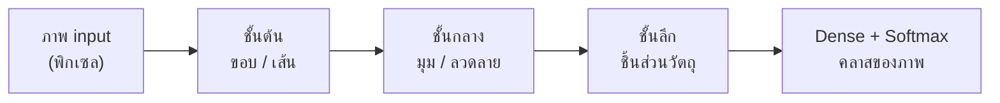
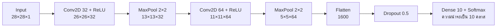
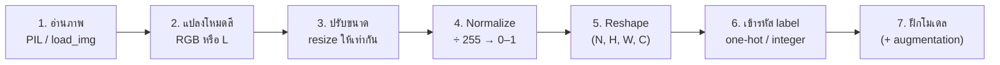
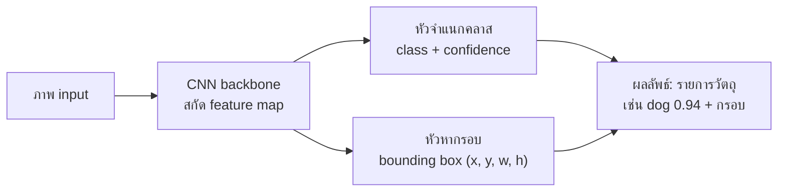

## วัตถุประสงค์การเรียนรู้

เมื่อจบบทนี้ นักศึกษาควรจะสามารถ

- อธิบายได้ว่าภาพดิจิทัลถูกเก็บเป็นอาเรย์ตัวเลขอย่างไร และทำไม Dense layer ธรรมดาจึงไม่เหมาะกับภาพขนาดใหญ่ (LLO3-1)
- อธิบายหลักการของ Convolution layer และ Pooling layer พร้อมคำนวณขนาด output และจำนวนพารามิเตอร์ของแต่ละชั้นได้ถูกต้อง (LLO3-1)
- เปรียบเทียบสถาปัตยกรรม CNN ที่สำคัญ (LeNet-5, AlexNet, VGG, GoogLeNet, ResNet, MobileNet) และบอกแนวคิดเด่นของแต่ละแบบได้ (LLO3-1)
- เตรียมข้อมูลภาพ ตั้งแต่อ่านภาพ ปรับขนาด normalize เพิ่มแกน channel และทำ one-hot encoding ได้ (LLO3-2)
- พัฒนาแบบจำลอง Image Classification ด้วย Keras ครบกระบวนการ สร้าง ฝึก ทำนาย และประเมินผลด้วย confusion matrix ได้ (LLO3-2)

> [!NOTE]
> บทนี้ต่อยอดจาก [บทที่ 6](/module/06) (MLP, activation, loss, optimizer) และใช้ชุดข้อมูล MNIST ชุดเดียวกับ [บทที่ 3](/module/03) เพื่อให้เห็นชัดว่า CNN ดีกว่า Logistic Regression, KNN และ MLP ตรงไหน

## 1. ภาพในสายตาคอมพิวเตอร์: ภาพคืออาเรย์ตัวเลข

### 1.1 Grayscale และ RGB

คอมพิวเตอร์ไม่ได้ "เห็น" ภาพแบบที่เราเห็น สิ่งที่มันได้รับคือ **ตารางตัวเลข** ของความสว่างแต่ละพิกเซล

| ชนิดภาพ | รูปร่าง (shape) | ความหมาย |
|---|---|---|
| Grayscale (ขาวดำ/เทา) | $H \times W$ หรือ $H \times W \times 1$ | 1 ค่าต่อพิกเซล: 0 = ดำ, 255 = ขาว |
| RGB (ภาพสี) | $H \times W \times 3$ | 3 ค่าต่อพิกเซล: แดง (R) เขียว (G) น้ำเงิน (B) แต่ละช่อง 0–255 |
| Batch ของภาพ (ที่ Keras ต้องการ) | $N \times H \times W \times C$ | $N$ ภาพ สูง $H$ กว้าง $W$ มี $C$ channel |

ค่าพิกเซลมักเก็บเป็นชนิด `uint8` (จำนวนเต็มไม่มีเครื่องหมาย 8 บิต) จึงมีค่าได้ 0–255 พอดี ลองดูภาพแรกของ MNIST ที่เคยใช้ใน [บทที่ 3](/module/03)


```python
import numpy as np
from sklearn.datasets import fetch_openml

mnist = fetch_openml("mnist_784", version=1, as_frame=False)
X, y = mnist.data, mnist.target.astype(int)

img = X[0].reshape(28, 28).astype(np.uint8)   # คลี่ 784 ค่า กลับเป็นภาพ 28×28
print("label:", y[0])
print("shape:", img.shape, "dtype:", img.dtype)
print("min/max:", img.min(), img.max())
print(img[6:14, 10:18])                    # ส่องดูพิกเซลบางส่วน
```

```output
label: 5
shape: (28, 28) dtype: uint8
min/max: 0 255
[[ 94 154 170 253 253 253 253 253]
 [253 253 253 253 253 253 253 251]
 [253 253 253 253 198 182 247 241]
 [107 253 253 205  11   0  43 154]
 [  1 154 253  90   0   0   0   0]
 [  0 139 253 190   2   0   0   0]
 [  0  11 190 253  70   0   0   0]
 [  0   0  35 241 225 160 108   1]]
```

จะเห็นว่า MNIST เป็น **พื้นดำ (0) ตัวเลขขาว (ใกล้ 255)** ตัวเลขชุดนี้คือส่วนบนของเลข 5 ข้อสังเกตนี้สำคัญมากตอนนำภาพลายมือของเราเอง (พื้นขาว หมึกดำ) มาทำนาย ซึ่งต้อง "กลับสี" ก่อน (หัวข้อ 6)

ภาพสีมีแกนที่สามเพิ่มเข้ามา และแปลงเป็นภาพเทาได้ด้วยผลรวมถ่วงน้ำหนัก (luminance) $L = 0.299R + 0.587G + 0.114B$

```python
import numpy as np
rgb = np.zeros((4, 6, 3), dtype=np.uint8)   # ภาพสี สูง 4 กว้าง 6 มี 3 ช่องสี
rgb[:, :3, 0] = 255                         # ครึ่งซ้ายเป็นสีแดง (R=255)
rgb[:, 3:, 2] = 255                         # ครึ่งขวาเป็นสีน้ำเงิน (B=255)
print("shape:", rgb.shape)
print("พิกเซล (0,0):", rgb[0, 0], " พิกเซล (0,5):", rgb[0, 5])

# แปลงเป็นภาพเทาด้วยสูตร luminance (แบบเดียวกับ PIL โหมด "L")
gray = rgb @ np.array([0.299, 0.587, 0.114])
print("gray shape:", gray.shape)
print(gray.round(1))
```

```output
shape: (4, 6, 3)
พิกเซล (0,0): [255   0   0]  พิกเซล (0,5): [  0   0 255]
gray shape: (4, 6)
[[76.2 76.2 76.2 29.1 29.1 29.1]
 [76.2 76.2 76.2 29.1 29.1 29.1]
 [76.2 76.2 76.2 29.1 29.1 29.1]
 [76.2 76.2 76.2 29.1 29.1 29.1]]
```

### 1.2 ทำไม Dense layer จึงไม่เหมาะกับภาพ

ใน [บทที่ 6](/module/06) เราใช้ MLP กับ MNIST โดย `Flatten` ภาพ 28×28 เป็นเวกเตอร์ 784 ค่า แล้วต่อ Dense layer ซึ่งทำงานได้กับภาพเล็ก แต่มีปัญหาใหญ่ 2 ข้อ

1. **พารามิเตอร์ระเบิด** — neuron ทุกตัวต่อกับทุกพิกเซล จำนวน weight จึงเท่ากับ (จำนวนพิกเซล × จำนวน neuron)
2. **ทิ้งโครงสร้างเชิงพื้นที่** — พอ flatten แล้ว พิกเซลที่อยู่ติดกันในแนวตั้งจะห่างกัน 28 ตำแหน่งในเวกเตอร์ โมเดลไม่รู้ว่าพิกเซลไหนอยู่ใกล้กัน และถ้าวัตถุเลื่อนตำแหน่งไปนิดเดียว input ก็เปลี่ยนไปทั้งชุด

```python
# จำนวนพารามิเตอร์ของ Dense layer ชั้นแรก = (จำนวน input × จำนวน neuron) + bias
for h, w, c in [(28, 28, 1), (100, 100, 1), (224, 224, 3)]:
    n_in = h * w * c
    params = n_in * 1000 + 1000
    print(f"ภาพ {h}x{w}x{c}: input {n_in:>7,} ค่า -> Dense(1000) ใช้ {params:>12,} พารามิเตอร์")
```

```output
ภาพ 28x28x1: input     784 ค่า -> Dense(1000) ใช้      785,000 พารามิเตอร์
ภาพ 100x100x1: input  10,000 ค่า -> Dense(1000) ใช้   10,001,000 พารามิเตอร์
ภาพ 224x224x3: input 150,528 ค่า -> Dense(1000) ใช้  150,529,000 พารามิเตอร์
```

ภาพถ่ายขนาดธรรมดา 224×224 สี ต้องใช้ถึง 150 ล้านพารามิเตอร์ **แค่ชั้นแรก** ทั้งเปลืองหน่วยความจำและ overfit ง่าย นี่คือเหตุผลที่เราต้องการสถาปัตยกรรมที่ออกแบบมาสำหรับภาพโดยเฉพาะ

## 2. แนวคิดหลักของ CNN

### 2.1 แรงบันดาลใจจาก Visual Cortex

งานวิจัยของ David Hubel และ Torsten Wiesel (ปลายทศวรรษ 1950 ได้รางวัลโนเบลปี 1981) ทดลองกับสมองส่วนการมองเห็นของแมว และพบว่า

- neuron แต่ละตัวตอบสนองต่อบริเวณเล็ก ๆ ของลานสายตาเท่านั้น เรียกว่า **local receptive field**
- neuron บางตัวตอบสนองเฉพาะเส้นในแนวใดแนวหนึ่ง (แนวตั้ง แนวนอน แนวเฉียง)
- neuron ชั้นสูงขึ้นไปรวมสัญญาณจากชั้นล่าง จึงตรวจจับรูปแบบที่ซับซ้อนขึ้นได้

แนวคิดนี้พัฒนามาเป็น Neocognitron (Fukushima, 1980) และ **LeNet-5** (LeCun และคณะ, 1998) ที่ใช้อ่านตัวเลขบนเช็คธนาคาร ซึ่งเป็นต้นแบบของ CNN ในปัจจุบัน

### 2.2 สองไอเดียที่ทำให้ CNN ประหยัดและเก่ง

| ไอเดีย | ความหมาย | ผลที่ได้ |
|---|---|---|
| **Partial connectivity** (local connection) | neuron แต่ละตัวมองเฉพาะหน้าต่างเล็ก ๆ เช่น 3×3 ไม่ใช่ทั้งภาพ | weight ต่อ neuron เหลือแค่ 9 ค่า (ต่อ channel) |
| **Weight sharing** | ใช้ filter ชุดเดียวกันกวาดไปทั่วทั้งภาพ | จำนวนพารามิเตอร์ไม่ขึ้นกับขนาดภาพ และตรวจจับ feature เดียวกันได้ทุกตำแหน่ง |

ผลรวมของสองไอเดียทำให้ CNN เรียนรู้ feature เป็น **ลำดับชั้น (hierarchy)** ชั้นแรก ๆ จับขอบและเส้น ชั้นกลางจับมุมและลวดลาย ชั้นลึกจับชิ้นส่วนของวัตถุ เช่น ตา ล้อ หรือหางของเลข 9



## 3. Convolutional Layer

### 3.1 การคำนวณ Convolution

Convolution คือการเลื่อน **filter (หรือ kernel)** ขนาดเล็กไปบนภาพ ที่แต่ละตำแหน่งให้นำค่าพิกเซลใต้ filter มาคูณกับ weight ของ filter ทีละตัวแล้วบวกรวม (บวก bias อีก 1 ค่า) ได้ผลลัพธ์ 1 ค่าใน **feature map**

$$
Z[i,j] = \sum_{u=0}^{k_h-1}\sum_{v=0}^{k_w-1} X[i\cdot s+u,\; j\cdot s+v]\; K[u,v] \; + \; b
$$

โดย $K$ คือ kernel ขนาด $k_h \times k_w$, $s$ คือ stride และ $b$ คือ bias

> [!NOTE]
> ในทางคณิตศาสตร์ สิ่งที่ CNN ทำจริง ๆ คือ **cross-correlation** (ไม่กลับด้าน kernel) แต่วงการ deep learning เรียกว่า convolution จนเป็นมาตรฐาน เพราะ weight ถูกเรียนรู้ขึ้นมาเอง จะกลับด้านหรือไม่ก็ให้ผลเทียบเท่ากัน

**ตัวอย่างคำนวณด้วยมือ** — ภาพ 5×5 กับ kernel ตรวจจับขอบแนวตั้ง 3×3 (stride 1, ไม่มี padding, bias = 0)

$$
X=\begin{bmatrix}3&0&1&2&7\\1&5&8&9&3\\2&7&2&5&1\\0&1&3&1&7\\4&2&1&6&2\end{bmatrix}
\qquad
K=\begin{bmatrix}1&0&-1\\1&0&-1\\1&0&-1\end{bmatrix}
$$

ตำแหน่งมุมซ้ายบน $Z[0,0]$ ใช้หน้าต่าง 3×3 แรก $\begin{bmatrix}3&0&1\\1&5&8\\2&7&2\end{bmatrix}$

- คอลัมน์ซ้ายคูณ 1: $3 + 1 + 2 = 6$
- คอลัมน์กลางคูณ 0: $0$
- คอลัมน์ขวาคูณ −1: $-(1 + 8 + 2) = -11$
- รวม $Z[0,0] = 6 + 0 - 11 = -5$

เลื่อนไปขวา 1 ช่อง $Z[0,1]$ ใช้หน้าต่าง $\begin{bmatrix}0&1&2\\5&8&9\\7&2&5\end{bmatrix}$ ได้ $(0+5+7) - (2+9+5) = 12 - 16 = -4$ ทำเช่นนี้จนครบ 3×3 ตำแหน่ง ตรวจด้วย NumPy

```python
import numpy as np

def conv2d(image, kernel, stride=1):
    """convolution แบบ valid (ไม่เติม padding) ตามนิยามที่ใช้ใน CNN"""
    kh, kw = kernel.shape
    out_h = (image.shape[0] - kh) // stride + 1
    out_w = (image.shape[1] - kw) // stride + 1
    out = np.zeros((out_h, out_w))
    for i in range(out_h):
        for j in range(out_w):
            patch = image[i*stride:i*stride+kh, j*stride:j*stride+kw]
            out[i, j] = np.sum(patch * kernel)   # คูณทีละตัวแล้วบวกรวม
    return out

image = np.array([[3, 0, 1, 2, 7],
                  [1, 5, 8, 9, 3],
                  [2, 7, 2, 5, 1],
                  [0, 1, 3, 1, 7],
                  [4, 2, 1, 6, 2]])
kernel = np.array([[1, 0, -1],
                   [1, 0, -1],
                   [1, 0, -1]])     # ตัวตรวจจับขอบแนวตั้ง (vertical edge)

print(conv2d(image, kernel))
```

```output
[[ -5.  -4.   0.]
 [-10.  -2.   2.]
 [  0.  -2.  -4.]]
```

ภาพ 5×5 ถูก convolve ด้วย kernel 3×3 ได้ feature map ขนาด 3×3 ภาพเล็กลงเพราะ filter วางได้แค่ 3 ตำแหน่งในแต่ละแนว

### 3.2 Filter คือตัวตรวจจับ Feature

ค่าใน feature map บอกว่า "บริเวณนั้นมีลักษณะคล้าย filter มากแค่ไหน" ลองใช้ภาพที่มีขอบแนวตั้งชัดเจน

```python
import numpy as np
from scipy.signal import correlate2d

# ภาพ 6×6: ครึ่งซ้ายสว่าง (10) ครึ่งขวามืด (0) -> มีขอบแนวตั้งตรงกลาง
edge_img = np.array([[10, 10, 10, 0, 0, 0]] * 6)
v_kernel = np.array([[1, 0, -1]] * 3)          # vertical edge
h_kernel = v_kernel.T                          # horizontal edge

print("vertical edge filter:\n", correlate2d(edge_img, v_kernel, mode="valid"))
print("horizontal edge filter:\n", correlate2d(edge_img, h_kernel, mode="valid"))
```

```output
vertical edge filter:
 [[ 0 30 30  0]
 [ 0 30 30  0]
 [ 0 30 30  0]
 [ 0 30 30  0]]
horizontal edge filter:
 [[0 0 0 0]
 [0 0 0 0]
 [0 0 0 0]
 [0 0 0 0]]
```

filter แนวตั้งให้ค่าสูง (30) ตรงแถบกลางที่เป็นขอบ ส่วน filter แนวนอนให้ 0 ทั้งหมดเพราะภาพไม่มีขอบแนวนอน ความต่างสำคัญจากการประมวลผลภาพแบบดั้งเดิมคือ **ใน CNN เราไม่ได้กำหนดค่าใน filter เอง** weight ทุกตัวถูกเรียนรู้ด้วย backpropagation เหมือน weight ใน MLP

### 3.3 Filters, Feature Maps และ Channel

ในทางปฏิบัติ Conv layer หนึ่งชั้นมี filter หลายตัว (เช่น 32 ตัว) แต่ละตัวเรียนรู้ feature ต่างกัน และให้ feature map ของตัวเอง

- **จำนวน feature map ของ output = จำนวน filters** เช่น `Conv2D(32, 3)` ให้ output ลึก 32
- ถ้า input มีหลาย channel (เช่น RGB = 3 หรือ feature map 32 แผ่นจากชั้นก่อน) **filter แต่ละตัวมีความลึกเท่ากับ $C_{in}$** คือเป็นก้อนขนาด $k_h \times k_w \times C_{in}$ และคำนวณผลรวมข้ามทุก channel ออกมาเป็นค่าเดียว
- หลัง convolution มักตามด้วย activation **ReLU** ($\max(0, z)$) เพื่อเพิ่มความไม่เป็นเชิงเส้น

| พารามิเตอร์ของ `keras.layers.Conv2D` | ความหมาย | ค่าที่ใช้บ่อย |
|---|---|---|
| `filters` | จำนวน filter = ความลึกของ output | 32, 64, 128 (มักเพิ่มเป็นเท่าตัวเมื่อลึกขึ้น) |
| `kernel_size` | ขนาดหน้าต่าง | 3 หรือ (3, 3); ชั้นแรกบางครั้งใช้ 5 หรือ 7 |
| `strides` | ระยะเลื่อน filter แต่ละก้าว | 1 (ค่าเริ่มต้น) หรือ 2 |
| `padding` | `"valid"` = ไม่เติม (ค่าเริ่มต้น), `"same"` = เติม 0 ให้ขนาดคงเดิม | `"same"` เมื่อต้องการรักษาขนาด |
| `activation` | ฟังก์ชันกระตุ้น | `"relu"` |

### 3.4 Stride และ Padding

- **Stride ($s$)** ระยะที่ filter เลื่อนแต่ละครั้ง stride 2 ทำให้ output เล็กลงประมาณครึ่งหนึ่งในแต่ละแนว
- **Padding ($p$)** เติมค่า 0 รอบขอบภาพ $p$ ชั้น เพื่อให้ filter วางทับขอบได้และ output ไม่หดลง สำหรับ kernel 3×3 ใช้ $p=1$ จะได้ขนาดเท่าเดิม (same)

ขนาด output (ใช้ได้ทั้ง Conv และ Pooling) สำหรับ input ขนาด $n$, kernel $k$, padding $p$, stride $s$

$$
O = \left\lfloor \frac{n + 2p - k}{s} \right\rfloor + 1
$$

```python
import numpy as np

def conv_output_size(n, k, s=1, p=0):
    """ขนาด output ของ Conv/Pool ตามสูตร floor((n + 2p - k) / s) + 1"""
    return (n + 2 * p - k) // s + 1

cases = [  # (คำอธิบาย, n, k, s, p)
    ("28x28, 3x3, s=1, p=0 (valid)", 28, 3, 1, 0),
    ("28x28, 3x3, s=1, p=1 (same)",  28, 3, 1, 1),
    ("28x28, 5x5, s=1, p=0",         28, 5, 1, 0),
    ("32x32, 5x5, s=2, p=0",         32, 5, 2, 0),
    ("224x224, 7x7, s=2, p=3",      224, 7, 2, 3),
    ("MaxPool 2x2, s=2 on 26x26",     26, 2, 2, 0),
    ("MaxPool 2x2, s=2 on 11x11",     11, 2, 2, 0),
]
for desc, n, k, s, p in cases:
    print(f"{desc:32s} -> {conv_output_size(n, k, s, p)}")

# padding แบบ same ด้วย np.pad: เติม 0 รอบภาพ 1 ชั้น
x = np.arange(1, 10).reshape(3, 3)
print(np.pad(x, pad_width=1))
```

```output
28x28, 3x3, s=1, p=0 (valid)     -> 26
28x28, 3x3, s=1, p=1 (same)      -> 28
28x28, 5x5, s=1, p=0             -> 24
32x32, 5x5, s=2, p=0             -> 14
224x224, 7x7, s=2, p=3           -> 112
MaxPool 2x2, s=2 on 26x26        -> 13
MaxPool 2x2, s=2 on 11x11        -> 5
[[0 0 0 0 0]
 [0 1 2 3 0]
 [0 4 5 6 0]
 [0 7 8 9 0]
 [0 0 0 0 0]]
```

ตัวอย่าง: $(32 + 0 - 5)/2 = 13.5$ ปัดลงเป็น 13 แล้วบวก 1 ได้ 14 และ pooling บน 11×11 ได้ $\lfloor 9/2 \rfloor + 1 = 5$ (แถว/คอลัมน์สุดท้ายที่เหลือเศษถูกทิ้ง)

> [!TIP]
> ใน Keras ไม่ต้องกำหนด $p$ เอง: `padding="valid"` คือ $p=0$ ส่วน `padding="same"` จะเติม 0 ให้ได้ output $= \lceil n/s \rceil$ เสมอ (stride 1 จึงได้ขนาดเท่า input)

### 3.5 จำนวนพารามิเตอร์ของ Conv2D

filter แต่ละตัวมี weight $k_h \times k_w \times C_{in}$ ค่า บวก bias 1 ค่า และมีทั้งหมด $F$ filters

$$
\text{params} = (k_h \cdot k_w \cdot C_{in} + 1) \cdot F
$$

| Layer | Input | คำนวณ | Params |
|---|---|---|---|
| `Conv2D(32, 3)` | 28×28×**1** | $(3\cdot3\cdot1 + 1)\cdot 32$ | 320 |
| `Conv2D(64, 3)` | 13×13×**32** | $(3\cdot3\cdot32 + 1)\cdot 64$ | 18,496 |
| `Conv2D(16, 5)` | 32×32×**3** | $(5\cdot5\cdot3 + 1)\cdot 16$ | 1,216 |
| `Conv2D(64, 7, padding="same")` | 28×28×**1** | $(7\cdot7\cdot1 + 1)\cdot 64$ | 3,200 |
| `Conv2D(128, 3)` | 14×14×**64** | $(3\cdot3\cdot64 + 1)\cdot 128$ | 73,856 |

> [!WARNING]
> จำนวนพารามิเตอร์ของ Conv2D **ไม่ขึ้นกับขนาดภาพ** ($H$, $W$) และ **ไม่ขึ้นกับ stride/padding** ขึ้นกับขนาด kernel จำนวน channel ขาเข้า และจำนวน filter เท่านั้น ข้อผิดพลาดที่พบบ่อยคือลืม $C_{in}$ หรือลืม $+1$ ของ bias

### 3.6 ตัวอย่างเต็ม: CNN ของ DeepMind ที่เล่นเกม Atari

ในงาน Deep Q-Network (DQN) ของ DeepMind (2015) agent เรียนรู้เล่นเกม Breakout จาก **ภาพหน้าจอเท่านั้น** ภาพ 1 เฟรมบอกทิศทางและความเร็วลูกบอลไม่ได้ จึงนำภาพขาวดำ 4 เฟรมล่าสุดมาซ้อนกันเป็น input ขนาด **84×84×4** (frame stacking) แล้วส่งเข้า CNN 3 ชั้น ได้แก่ 32 filters 8×8 stride 4 → 64 filters 4×4 stride 2 → 64 filters 3×3 stride 1 (ทั้งหมด padding valid) ตามด้วย Dense 512 และ output 4 ค่า (Q-value ของ 4 action) รายละเอียดของ RL จะได้เรียนใน [บทที่ 9](/module/09) ตอนนี้ฝึกคำนวณขนาดและพารามิเตอร์กันก่อน

```python
def conv_output_size(n, k, s=1, p=0):
    return (n + 2 * p - k) // s + 1

def conv_params(k_h, k_w, c_in, filters):
    """พารามิเตอร์ของ Conv2D = (k_h * k_w * c_in + 1) * filters  (+1 คือ bias ของแต่ละ filter)"""
    return (k_h * k_w * c_in + 1) * filters

# DeepMind Atari DQN: input 84x84x4 (ภาพขาวดำ 4 เฟรมซ้อนกัน)
n, c_in, total = 84, 4, 0
print(f"{'layer':22s}{'output':>14s}{'params':>12s}")
for filters, k, s in [(32, 8, 4), (64, 4, 2), (64, 3, 1)]:
    n = conv_output_size(n, k, s)
    p = conv_params(k, k, c_in, filters)
    total += p
    print(f"Conv2D {filters}@{k}x{k} s={s}".ljust(22) + f"{n}x{n}x{filters}".rjust(14) + f"{p:>12,}")
    c_in = filters
flat = n * n * c_in
print(f"{'Flatten':22s}{flat:>14,}{0:>12}")
for units in [512, 4]:
    p = flat * units + units
    total += p
    print(f"Dense({units})".ljust(22) + f"{units:>14}" + f"{p:>12,}")
    flat = units
print(f"{'Total params':22s}{'':>14s}{total:>12,}")
```

```output
layer                         output      params
Conv2D 32@8x8 s=4           20x20x32       8,224
Conv2D 64@4x4 s=2             9x9x64      32,832
Conv2D 64@3x3 s=1             7x7x64      36,928
Flatten                        3,136           0
Dense(512)                       512   1,606,144
Dense(4)                           4       2,052
Total params                           1,686,180
```

ตรวจทีละชั้นด้วยมือ

- Conv1: $\lfloor(84-8)/4\rfloor + 1 = 20$ และ $(8\cdot8\cdot4+1)\cdot32 = 257\cdot32 = 8{,}224$
- Conv2: $\lfloor(20-4)/2\rfloor + 1 = 9$ และ $(4\cdot4\cdot32+1)\cdot64 = 513\cdot64 = 32{,}832$
- Conv3: $\lfloor(9-3)/1\rfloor + 1 = 7$ และ $(3\cdot3\cdot64+1)\cdot64 = 577\cdot64 = 36{,}928$
- Flatten: $7 \cdot 7 \cdot 64 = 3{,}136$ → Dense(512): $3{,}136\cdot512 + 512 = 1{,}606{,}144$

ข้อสังเกต: Conv ทั้ง 3 ชั้นรวมกันใช้พารามิเตอร์ไม่ถึง 80,000 แต่ Dense ชั้นเดียวใช้ 1.6 ล้าน พารามิเตอร์ส่วนใหญ่ของ CNN แบบคลาสสิกจึงอยู่ที่ Dense layer ท้ายเครือข่าย

## 4. Pooling Layer

Pooling layer **ย่อขนาด (subsample)** feature map เพื่อ

- ลดปริมาณการคำนวณ หน่วยความจำ และจำนวนพารามิเตอร์ของชั้นถัดไป (ช่วยลด overfitting)
- ทำให้เกิด **translation invariance** เล็กน้อย: วัตถุเลื่อนไป 1–2 พิกเซล ค่าสูงสุดในหน้าต่างมักยังเท่าเดิม โมเดลจึงยังทายถูก

Pooling **ไม่มีพารามิเตอร์ให้เรียนรู้** แค่ใช้ฟังก์ชันรวมค่า (max หรือ mean) ในแต่ละหน้าต่าง และทำแยกทีละ channel (ความลึกไม่เปลี่ยน) ค่าที่ใช้บ่อยคือหน้าต่าง 2×2 stride 2 ซึ่งลดความกว้างและความสูงลงครึ่งหนึ่ง (พื้นที่เหลือ 1/4)

```python
import numpy as np

fmap = np.array([[1, 3, 2, 4],
                 [5, 6, 1, 2],
                 [7, 2, 9, 0],
                 [1, 8, 3, 4]])

# แบ่งเป็นบล็อก 2×2 ที่ไม่ซ้อนกัน: (2 แถวบล็อก, 2, 2 คอลัมน์บล็อก, 2)
blocks = fmap.reshape(2, 2, 2, 2)
print("Max pooling 2x2:\n", blocks.max(axis=(1, 3)))
print("Average pooling 2x2:\n", blocks.mean(axis=(1, 3)))
print("Global average pooling:", fmap.mean())
```

```output
Max pooling 2x2:
 [[6 4]
 [8 9]]
Average pooling 2x2:
 [[3.75 2.25]
 [4.5  4.  ]]
Global average pooling: 3.625
```

ตรวจด้วยมือ: บล็อกซ้ายบน $\{1,3,5,6\}$ → max = 6, เฉลี่ย = 15/4 = 3.75 ส่วนบล็อกขวาล่าง $\{9,0,3,4\}$ → max = 9, เฉลี่ย = 4

| ชนิด | Keras | การใช้งาน |
|---|---|---|
| Max pooling | `layers.MaxPooling2D(2)` | นิยมที่สุด เก็บ feature ที่เด่นที่สุดในหน้าต่าง |
| Average pooling | `layers.AveragePooling2D(2)` | เก็บค่าเฉลี่ย ข้อมูลหายน้อยกว่าแต่ feature ไม่คม |
| Global average pooling | `layers.GlobalAveragePooling2D()` | เฉลี่ยทั้งแผ่นเหลือ 1 ค่าต่อ channel ใช้แทน Flatten ในโมเดลสมัยใหม่ (GoogLeNet, ResNet, MobileNet) ลดพารามิเตอร์ Dense ได้มาก |

## 5. สถาปัตยกรรม CNN

### 5.1 โครงสร้างมาตรฐาน

CNN สำหรับจำแนกภาพแบ่งได้ 2 ส่วน คือ **feature extractor** (Conv + Pool ซ้อนกันหลายชุด) และ **classifier** (Dense + Softmax) เมื่อลึกขึ้น ภาพจะ "เล็กลงแต่หนาขึ้น" (H, W ลด แต่จำนวน filter เพิ่ม)



### 5.2 สร้าง CNN ด้วย Keras

```python
import keras
from keras import layers

model = keras.Sequential([
    keras.Input(shape=(28, 28, 1)),               # ภาพเทา 28×28 มี 1 channel
    layers.Conv2D(32, kernel_size=3, activation="relu"),
    layers.MaxPooling2D(pool_size=2),
    layers.Conv2D(64, kernel_size=3, activation="relu"),
    layers.MaxPooling2D(pool_size=2),
    layers.Flatten(),
    layers.Dropout(0.5),                          # ปิด neuron สุ่ม 50% ตอนฝึก ลด overfitting
    layers.Dense(10, activation="softmax"),       # 10 คลาส (เลข 0–9)
])
model.summary()
```

ผลจาก `model.summary()` (Keras 3) — ชื่อ layer อาจมีเลขต่อท้ายต่างไป แต่ shape และจำนวนพารามิเตอร์ต้องตรงตามนี้

```output
Model: "sequential"
┏━━━━━━━━━━━━━━━━━━━━━━━━━━━━━━━━━┳━━━━━━━━━━━━━━━━━━━━━━━━┳━━━━━━━━━━━━━━━┓
┃ Layer (type)                    ┃ Output Shape           ┃       Param # ┃
┡━━━━━━━━━━━━━━━━━━━━━━━━━━━━━━━━━╇━━━━━━━━━━━━━━━━━━━━━━━━╇━━━━━━━━━━━━━━━┩
│ conv2d (Conv2D)                 │ (None, 26, 26, 32)     │           320 │
├─────────────────────────────────┼────────────────────────┼───────────────┤
│ max_pooling2d (MaxPooling2D)    │ (None, 13, 13, 32)     │             0 │
├─────────────────────────────────┼────────────────────────┼───────────────┤
│ conv2d_1 (Conv2D)               │ (None, 11, 11, 64)     │        18,496 │
├─────────────────────────────────┼────────────────────────┼───────────────┤
│ max_pooling2d_1 (MaxPooling2D)  │ (None, 5, 5, 64)       │             0 │
├─────────────────────────────────┼────────────────────────┼───────────────┤
│ flatten (Flatten)               │ (None, 1600)           │             0 │
├─────────────────────────────────┼────────────────────────┼───────────────┤
│ dropout (Dropout)               │ (None, 1600)           │             0 │
├─────────────────────────────────┼────────────────────────┼───────────────┤
│ dense (Dense)                   │ (None, 10)             │        16,010 │
└─────────────────────────────────┴────────────────────────┴───────────────┘
 Total params: 34,826 (136.04 KB)
 Trainable params: 34,826 (136.04 KB)
 Non-trainable params: 0 (0.00 B)
```

ตีความ: `None` คือขนาด batch ที่ยังไม่กำหนด, Conv2D แรก $(3\cdot3\cdot1+1)\cdot32 = 320$, Conv2D ที่สอง $(3\cdot3\cdot32+1)\cdot64 = 18{,}496$, Dense $1600\cdot10 + 10 = 16{,}010$ รวม 34,826 พารามิเตอร์ (×4 ไบต์ต่อ float32 ≈ 136 KB) **น้อยกว่า MLP ขนาด 784→128→10 (101,770 พารามิเตอร์) ประมาณ 3 เท่า** แต่แม่นยำกว่า เพราะใช้ weight อย่างคุ้มค่าผ่าน weight sharing

### 5.3 สถาปัตยกรรม CNN ที่สำคัญ

ความก้าวหน้าของ CNN ถูกขับเคลื่อนด้วยการแข่งขัน **ImageNet (ILSVRC)** ซึ่งจำแนกภาพ 1,000 คลาส วัดด้วย top-5 error (คำตอบจริงไม่อยู่ใน 5 อันดับแรกที่โมเดลทาย)

| สถาปัตยกรรม | ปี | แนวคิดเด่น | ขนาดโดยประมาณ |
|---|---|---|---|
| **LeNet-5** (LeCun) | 1998 | ต้นแบบ Conv → Pool → Dense สำหรับอ่านตัวเลขลายมือ (MNIST/เช็คธนาคาร) | ~60K params |
| **AlexNet** (Krizhevsky, Sutskever, Hinton) | 2012 | ลึกและใหญ่กว่า LeNet มาก ใช้ ReLU, Dropout, data augmentation และฝึกบน GPU ชนะ ILSVRC 2012 ทิ้งห่างอันดับสอง จุดเริ่มต้นยุค deep learning | ~60M params |
| **VGGNet** | 2014 | เรียบง่าย ซ้อน Conv 3×3 หลายชั้นแล้ว pool (VGG-16/19) | ~138M params (VGG-16) |
| **GoogLeNet / Inception** | 2014 | **Inception module** ใช้ filter หลายขนาด (1×1, 3×3, 5×5) พร้อมกันแล้วต่อผลเข้าด้วยกัน ใช้ Conv 1×1 ลดความลึก ลึก 22 ชั้นแต่พารามิเตอร์น้อยกว่า AlexNet มาก | ~6M params |
| **ResNet** (He และคณะ) | 2015 | **Skip (residual) connection** บวก input เข้ากับ output ของบล็อกโดยตรง ($y = F(x) + x$) แก้ปัญหา vanishing gradient ทำให้ฝึกเครือข่ายลึก 152 ชั้นได้ ชนะ ILSVRC 2015 | ~25M params (ResNet-50) |
| **MobileNet / MobileNetV2** | 2017–2018 | depthwise separable convolution ลดการคำนวณ เหมาะกับมือถือ/อุปกรณ์ edge นิยมใช้ทำ transfer learning | ~3.5M params (V2) |

> [!NOTE]
> แนวโน้มที่เห็นได้ชัด: เครือข่าย **ลึกขึ้น** แต่ **พารามิเตอร์ไม่จำเป็นต้องมากขึ้น** ด้วยเทคนิคอย่าง Conv 1×1, global average pooling แทน Dense ขนาดใหญ่ และ skip connection

## 6. การอ่านภาพและเตรียมข้อมูล (Image Preprocessing)

### 6.1 ภาพรวม Pipeline



ทุกภาพต้องผ่าน pipeline **เดียวกัน** ทั้งตอนฝึกและตอนทำนาย ถ้าฝึกด้วยภาพ 0–1 แต่ทำนายด้วยภาพ 0–255 หรือฝึกด้วยพื้นดำแต่ทำนายด้วยพื้นขาว ผลจะผิดทันที

### 6.2 การอ่านภาพจากไฟล์

**วิธีที่ 1: PIL (Pillow)** — ยืดหยุ่นที่สุด เหมาะกับการทำนายภาพทีละภาพ เช่น ภาพลายมือที่นักศึกษาถ่ายเอง

```python
import numpy as np
from PIL import Image, ImageOps

img = Image.open("my_digit.png")                 # ภาพถ่าย/สแกนลายมือ (พื้นขาว หมึกดำ)
print("ต้นฉบับ:", img.size, img.mode)            # PIL รายงาน (กว้าง, สูง)

img = img.convert("L")                           # 1) แปลงเป็น grayscale (1 channel)
img = ImageOps.invert(img)                       # 2) กลับสี: MNIST เป็นพื้นดำ ตัวเลขขาว
img = img.resize((28, 28))                       # 3) ย่อให้เท่ากับขนาดที่โมเดลเรียนมา

x = np.array(img).astype("float32") / 255.0      # 4) normalize 0–1
x = x.reshape(1, 28, 28, 1)                      # 5) (batch, H, W, C)
print("พร้อมเข้าโมเดล:", x.shape, x.dtype, f"min={x.min():.2f} max={x.max():.2f}")
```

```output
ต้นฉบับ: (300, 400) RGB
พร้อมเข้าโมเดล: (1, 28, 28, 1) float32 min=0.00 max=1.00
```

> [!WARNING]
> PIL ใช้ขนาดแบบ **(กว้าง, สูง)** แต่ NumPy/Keras ใช้ **(สูง, กว้าง)** ภาพ 300×400 ข้างบนจึงกลายเป็นอาเรย์ shape `(400, 300, 3)` และแม้แต่ภาพเดียวก็ต้องเพิ่มแกน batch เป็น `(1, 28, 28, 1)` ก่อนเรียก `model.predict`

**วิธีที่ 2: `keras.utils.load_img`** — อ่าน แปลงโหมดสี และ resize ในคำสั่งเดียว

```python
import keras
img = keras.utils.load_img("my_digit.png", color_mode="grayscale", target_size=(28, 28))
arr = keras.utils.img_to_array(img)      # shape (28, 28, 1), dtype float32 ค่า 0–255
```

**วิธีที่ 3: `keras.utils.image_dataset_from_directory`** — สำหรับชุดข้อมูลภาพจำนวนมากที่จัดโฟลเดอร์ตามคลาส ชื่อโฟลเดอร์ย่อยจะกลายเป็น label ให้อัตโนมัติ

```text
flowers/
├── daisy/      (ภาพดอกเดซี่ .jpg)
├── rose/
└── tulip/
```

```python
train_ds, val_ds = keras.utils.image_dataset_from_directory(
    "flowers/",
    validation_split=0.2, subset="both", seed=42,
    image_size=(160, 160),          # resize ทุกภาพให้เท่ากัน
    batch_size=32,
    label_mode="int",               # "int" = sparse label, "categorical" = one-hot
)
print(train_ds.class_names)         # ['daisy', 'rose', 'tulip']
```

ผลที่ได้เป็น `tf.data.Dataset` ที่ให้ batch ของภาพ shape `(32, 160, 160, 3)` ค่า 0–255 ส่งเข้า `model.fit(train_ds, validation_data=val_ds)` ได้โดยตรง

### 6.3 Reshape และ Normalize

ข้อมูล MNIST จาก `fetch_openml` อยู่ในรูป (N, 784) ส่วนจาก `keras.datasets.mnist` อยู่ในรูป (N, 28, 28) ทั้งสองแบบต้องปรับเป็น **(N, 28, 28, 1)** เพราะ `Conv2D` ต้องการแกน channel เสมอ และหารด้วย 255 ให้อยู่ช่วง 0–1 ซึ่งช่วยให้ gradient descent ลู่เข้าเร็วและเสถียร (เหตุผลเดียวกับ feature scaling ใน [บทที่ 2](/module/02))

```python
import numpy as np
from sklearn.datasets import fetch_openml

mnist = fetch_openml("mnist_784", version=1, as_frame=False)
X, y = mnist.data.astype(np.uint8), mnist.target.astype(int)
X_train, y_train = X[:60000], y[:60000]     # 60,000 ภาพแรก = training set มาตรฐาน

# 1) reshape: (N, 784) -> (N, 28, 28, 1)  เพิ่มแกน channel ให้ Conv2D
X_train_cnn = X_train.reshape(-1, 28, 28, 1)
# 2) normalize: 0–255 -> 0–1
X_train_cnn = X_train_cnn.astype("float32") / 255.0
print("X shape:", X_train_cnn.shape, X_train_cnn.dtype,
      "min/max:", X_train_cnn.min(), X_train_cnn.max())

# 3) one-hot encoding (ผลเหมือน keras.utils.to_categorical(y, 10))
y_onehot = np.eye(10, dtype="float32")[y_train]
print("y_train[:3]  :", y_train[:3])
print("one-hot[:3]  :\n", y_onehot[:3])
print("y shape:", y_train.shape, "->", y_onehot.shape)
```

```output
X shape: (60000, 28, 28, 1) float32 min/max: 0.0 1.0
y_train[:3]  : [5 0 4]
one-hot[:3]  :
 [[0. 0. 0. 0. 0. 1. 0. 0. 0. 0.]
 [1. 0. 0. 0. 0. 0. 0. 0. 0. 0.]
 [0. 0. 0. 0. 1. 0. 0. 0. 0. 0.]]
y shape: (60000,) -> (60000, 10)
```

`reshape(-1, 28, 28, 1)` ให้ NumPy คำนวณมิติแรกเอง (-1 = "เท่าไรก็ได้ที่ลงตัว") จึงใช้ได้กับทั้ง train และ test

### 6.4 One-hot Encoding กับ Sparse Label: ต้องคู่กับ Loss ให้ถูก

**One-hot encoding** แปลง label จำนวนเต็มเป็นเวกเตอร์ที่มีเลข 1 เพียงตำแหน่งเดียว เช่น เลข 5 → `[0,0,0,0,0,1,0,0,0,0]` ทำให้ label มีรูปเดียวกับ output ของ softmax (10 ค่า) ใน Keras ใช้

```python
from keras.utils import to_categorical
y_train_oh = to_categorical(y_train, num_classes=10)   # (60000,) -> (60000, 10)
```

| รูปแบบ label | ตัวอย่าง | loss ที่ต้องใช้คู่กัน |
|---|---|---|
| Integer (sparse) | `5` shape `(N,)` | `"sparse_categorical_crossentropy"` |
| One-hot | `[0,0,0,0,0,1,0,0,0,0]` shape `(N, 10)` | `"categorical_crossentropy"` |
| Binary 0/1 (2 คลาส, output `Dense(1, "sigmoid")`) | `1` | `"binary_crossentropy"` |

ทั้งสองแบบแรกให้ผลการฝึก **เหมือนกันทางคณิตศาสตร์** (cross-entropy คิดเฉพาะความน่าจะเป็นของคลาสที่ถูก) ต่างกันแค่รูปแบบข้อมูล ถ้าใช้ผิดคู่ Keras จะแจ้ง error เรื่อง shape ไม่ตรงกัน แบบ sparse ประหยัดหน่วยความจำกว่าเมื่อมีคลาสจำนวนมาก ส่วน one-hot จำเป็นเมื่อใช้เทคนิคอย่าง label smoothing

### 6.5 Data Augmentation

เมื่อข้อมูลภาพมีน้อย เราสร้างภาพ "ใหม่" ระหว่างฝึกได้ด้วยการสุ่มหมุน เลื่อน ซูม หรือพลิกภาพ โมเดลจะได้เห็นความหลากหลายมากขึ้นและ overfit น้อยลง ใน Keras ใส่เป็น layer ต้นโมเดลได้เลย และ **ทำงานเฉพาะตอน `fit`** (ตอน `predict`/`evaluate` จะผ่านภาพไปตรง ๆ)

```python
data_augmentation = keras.Sequential([
    layers.RandomRotation(0.05),            # หมุนสุ่ม ±0.05 รอบ (±18 องศา)
    layers.RandomTranslation(0.1, 0.1),     # เลื่อนสุ่มไม่เกิน 10% ของความสูง/ความกว้าง
    layers.RandomZoom(0.1),                 # ซูมเข้า/ออกไม่เกิน 10%
])

model_aug = keras.Sequential([
    keras.Input(shape=(28, 28, 1)),
    data_augmentation,
    layers.Conv2D(32, 3, activation="relu"),
    # ... ชั้นที่เหลือเหมือนเดิม
])
```

> [!WARNING]
> เลือก augmentation ให้เข้ากับโจทย์: `RandomFlip("horizontal")` เหมาะกับภาพสัตว์หรือสิ่งของ แต่ **ห้ามใช้กับตัวเลขหรือตัวอักษร** เพราะเลขที่ถูกพลิกกลับด้านไม่ใช่เลขเดิมอีกต่อไป และการหมุนมากเกินไปอาจทำให้ 6 กลายเป็น 9

## 7. Workshop: CNN จำแนกตัวเลข MNIST ครบวงจร

ขั้นตอนนี้รันใน Google Colab (เลือก Runtime → Change runtime type → GPU จะเร็วขึ้นมาก)

### 7.1 โหลดและเตรียมข้อมูล

```python
import numpy as np
import matplotlib.pyplot as plt
import keras
from keras import layers

(X_train, y_train), (X_test, y_test) = keras.datasets.mnist.load_data()
print(X_train.shape, X_test.shape, X_train.dtype)      # (60000, 28, 28) (10000, 28, 28) uint8

X_train = X_train.reshape(-1, 28, 28, 1).astype("float32") / 255.0
X_test  = X_test.reshape(-1, 28, 28, 1).astype("float32") / 255.0
y_train_oh = keras.utils.to_categorical(y_train, 10)
y_test_oh  = keras.utils.to_categorical(y_test, 10)
```

> [!TIP]
> ถ้าอยากได้โจทย์ที่ยากขึ้น เปลี่ยนเป็น `keras.datasets.fashion_mnist` (เสื้อผ้า รองเท้า กระเป๋า 10 คลาส ขนาด 28×28 เท่ากัน) โค้ดที่เหลือใช้ได้ทั้งหมด accuracy ของ CNN จะอยู่ราว 0.90–0.92

### 7.2 Compile และ Fit

ใช้ `model` จากหัวข้อ 5.2 เนื่องจาก label เป็น one-hot จึงใช้ `categorical_crossentropy`

```python
model.compile(optimizer="adam",
              loss="categorical_crossentropy",
              metrics=["accuracy"])

history = model.fit(X_train, y_train_oh,
                    batch_size=128, epochs=10,
                    validation_split=0.1)        # กัน 10% ของ train ไว้ตรวจ overfitting

# กราฟ learning curve
fig, (ax1, ax2) = plt.subplots(1, 2, figsize=(11, 4))
ax1.plot(history.history["loss"], label="train")
ax1.plot(history.history["val_loss"], label="validation")
ax1.set_title("Loss"); ax1.set_xlabel("epoch"); ax1.legend()
ax2.plot(history.history["accuracy"], label="train")
ax2.plot(history.history["val_accuracy"], label="validation")
ax2.set_title("Accuracy"); ax2.set_xlabel("epoch"); ax2.legend()
plt.show()
```

ตัวอย่างผลลัพธ์ (ค่าที่ได้จะต่างกันเล็กน้อยในแต่ละครั้ง): แต่ละ epoch มี 422 steps (54,000 ภาพ ÷ batch 128 ปัดขึ้น) val_accuracy ของ epoch แรกมักอยู่ราว 0.97–0.98 และขึ้นไปถึงราว 0.99 ภายใน 10 epochs กราฟ train และ validation ควรอยู่ใกล้กัน ถ้า train accuracy สูงขึ้นเรื่อย ๆ แต่ val_loss เริ่มเพิ่ม แปลว่าเริ่ม overfit ให้เพิ่ม Dropout, ใช้ data augmentation หรือหยุดฝึกเร็วขึ้นด้วย `keras.callbacks.EarlyStopping`

### 7.3 ประเมินผลและเปรียบเทียบกับโมเดลอื่น

```python
test_loss, test_acc = model.evaluate(X_test, y_test_oh, verbose=0)
print(f"Test accuracy (CNN): {test_acc:.4f}")
```

ตัวอย่างผลลัพธ์ (ค่าที่ได้จะต่างกันเล็กน้อยในแต่ละครั้ง): test accuracy ประมาณ 0.98–0.99

เปรียบเทียบกับโมเดลจากบทก่อน ๆ บน MNIST ชุด train 60,000 / test 10,000 เดียวกัน (Logistic Regression และ KNN รันจริงด้วย scikit-learn หลังหาร 255)

```python
from sklearn.linear_model import LogisticRegression
from sklearn.neighbors import KNeighborsClassifier
from sklearn.metrics import accuracy_score

X_flat = mnist.data / 255.0                     # จาก fetch_openml หัวข้อ 6.3
y_all = mnist.target.astype(int)
Xtr, Xte, ytr, yte = X_flat[:60000], X_flat[60000:], y_all[:60000], y_all[60000:]

for name, clf in [("Logistic Regression", LogisticRegression(max_iter=200)),
                  ("KNN (k=3)", KNeighborsClassifier(n_neighbors=3, weights="distance"))]:
    clf.fit(Xtr, ytr)
    print(f"{name:20s} accuracy = {accuracy_score(yte, clf.predict(Xte)):.4f}")
```

```output
Logistic Regression  accuracy = 0.9261
KNN (k=3)            accuracy = 0.9717
```

| โมเดล | Test accuracy | หมายเหตุ |
|---|---|---|
| Logistic Regression | 0.9261 | เชิงเส้น จับลวดลายซับซ้อนไม่ได้ |
| KNN (k=3) | 0.9717 | แม่นพอสมควร แต่ทำนายช้ามาก (ต้องเทียบกับภาพ train ทุกภาพ) |
| MLP 784→128→10 ([บทที่ 6](/module/06)) | ≈ 0.97–0.98 (Keras) | 101,770 params ไม่รู้โครงสร้างเชิงพื้นที่ |
| CNN (หัวข้อ 5.2) | ≈ 0.98–0.99 (Keras) | 34,826 params ใช้ weight sharing |

### 7.4 ทำนาย, Confusion Matrix และภาพที่ทายผิด

`model.predict` คืน **ความน่าจะเป็น** ของทั้ง 10 คลาส (shape `(N, 10)` แต่ละแถวรวมกันได้ 1) ต้องใช้ `argmax` เพื่อเลือกคลาสที่ความน่าจะเป็นสูงสุด

```python
from sklearn.metrics import confusion_matrix, ConfusionMatrixDisplay, classification_report

y_prob = model.predict(X_test, verbose=0)      # (10000, 10)
y_pred = y_prob.argmax(axis=1)                 # (10000,) คลาสที่ทาย
print("ความน่าจะเป็นของภาพแรก:", y_prob[0].round(3))
print("ทาย:", y_pred[0], " เฉลย:", y_test[0])

cm = confusion_matrix(y_test, y_pred)
ConfusionMatrixDisplay(cm).plot(cmap="Blues", values_format="d")
plt.title("CNN on MNIST - confusion matrix")
plt.show()
print(classification_report(y_test, y_pred, digits=4))

# แสดงภาพที่ทายผิด 10 ภาพแรก
wrong = np.where(y_pred != y_test)[0]
print("จำนวนภาพที่ทายผิด:", len(wrong), "จาก", len(y_test))
fig, axes = plt.subplots(2, 5, figsize=(10, 4.5))
for ax, i in zip(axes.flat, wrong[:10]):
    ax.imshow(X_test[i].squeeze(), cmap="gray")
    ax.set_title(f"true {y_test[i]} / pred {y_pred[i]}\np={y_prob[i].max():.2f}")
    ax.axis("off")
plt.tight_layout(); plt.show()
```

การตีความ: ถ้า test accuracy ≈ 0.99 จะมีภาพทายผิดประมาณ 100 ภาพจาก 10,000 ภาพ ใน confusion matrix ค่านอกเส้นทแยงที่เด่นมักเป็นคู่ที่รูปทรงคล้ายกัน เช่น **4 ↔ 9**, **3 ↔ 5**, **7 ↔ 2** และ **5 ↔ 6** เมื่อดูภาพที่ทายผิดจริง ๆ จะพบว่าหลายภาพเขียนกำกวมจนคนก็ทายผิดได้ ซึ่งเป็นวิธีตรวจว่า error ของโมเดลสมเหตุสมผลหรือไม่

> [!TIP]
> ใน Colab ฟอนต์ของ matplotlib ไม่มีภาษาไทย จึงควรเขียนชื่อกราฟและ title ด้วยภาษาอังกฤษ (ไม่อย่างนั้นจะเห็นเป็นกล่องสี่เหลี่ยม)

## 8. Transfer Learning ด้วยโมเดลที่ฝึกไว้แล้ว

การฝึก CNN ขนาดใหญ่ตั้งแต่ศูนย์ต้องใช้ภาพหลักแสนถึงหลักล้านภาพ ถ้าเรามีภาพเพียงหลักร้อยถึงหลักพัน (เช่น ภาพโรคใบข้าว 3 ชนิด) วิธีที่ได้ผลดีกว่าคือ **transfer learning** นำ CNN ที่ฝึกบน ImageNet แล้ว (feature ชั้นต้น เช่น ขอบ ลวดลาย ใช้ได้กับภาพแทบทุกชนิด) มาเป็น feature extractor แล้วฝึกเฉพาะ classifier ชั้นบนสุดใหม่

```python
import keras
from keras import layers

num_classes = 3
base = keras.applications.MobileNetV2(input_shape=(160, 160, 3),
                                      include_top=False,       # ตัด classifier 1000 คลาสเดิมทิ้ง
                                      weights="imagenet")
base.trainable = False                                         # แช่แข็ง (freeze) weight ที่เรียนมาแล้ว

inputs = keras.Input(shape=(160, 160, 3))                      # ภาพจาก image_dataset_from_directory (0–255)
x = keras.applications.mobilenet_v2.preprocess_input(inputs)   # ปรับสเกลเป็น -1..1 ตามที่ MobileNetV2 เรียนมา
x = base(x, training=False)
x = layers.GlobalAveragePooling2D()(x)
x = layers.Dropout(0.2)(x)
outputs = layers.Dense(num_classes, activation="softmax")(x)
tl_model = keras.Model(inputs, outputs)

tl_model.compile(optimizer="adam", loss="sparse_categorical_crossentropy", metrics=["accuracy"])
# tl_model.fit(train_ds, validation_data=val_ds, epochs=5)
```

ขั้นตอนสำคัญ 3 ข้อ

1. `include_top=False` ใช้เฉพาะส่วน feature extractor
2. `base.trainable = False` ฝึกเฉพาะ Dense ที่เพิ่มเข้าไป จึงเร็วและไม่ overfit ง่าย
3. ใช้ `preprocess_input` ของโมเดลนั้น ๆ แทนการหาร 255 เอง (MobileNetV2 คาดหวังค่า −1 ถึง 1)

ถ้าต้องการความแม่นยำเพิ่ม ทำ **fine-tuning** ต่อได้โดยปลดแช่แข็งชั้นบน ๆ ของ `base` แล้วฝึกต่อด้วย learning rate ต่ำ ๆ (เช่น 1e-5)

## 9. จาก Image Classification สู่ Object Detection

Image classification ตอบคำถามว่า "ภาพนี้คืออะไร" ได้คำตอบ **1 label ต่อภาพ** แต่งานจริงหลายงานต้องรู้ว่า "มีอะไรอยู่ **ที่ไหน** บ้าง" เช่น นับรถบนถนน ตรวจจับคนไม่สวมหมวกกันน็อก หรือหาตำแหน่งผลไม้บนต้น

| งาน | Output | ตัวอย่างโมเดล |
|---|---|---|
| Classification | label ของทั้งภาพ เช่น "แมว" | LeNet, ResNet, MobileNet |
| Classification + Localization | label + กรอบ 1 กรอบ | CNN + หัว regression 4 ค่า |
| Object Detection | หลายวัตถุ แต่ละวัตถุมี **bounding box** $(x, y, w, h)$ + **class label** + confidence | YOLO, SSD, Faster R-CNN |
| Semantic Segmentation | label ทุกพิกเซล | U-Net, FCN |



หัวใจของ object detection ยังคงเป็น **CNN backbone** แบบเดียวกับที่เรียนในบทนี้ เพียงเพิ่ม "หัว" สำหรับทำนายพิกัดกรอบ และวัดความถูกต้องของกรอบด้วย **IoU (Intersection over Union)** = พื้นที่ซ้อนทับ ÷ พื้นที่รวมของกรอบที่ทายกับกรอบจริง รายละเอียดจะเรียนในสัปดาห์ถัดไป

## 10. ตัวอย่างโจทย์และวิธีทำ (แนวข้อสอบ)

### โจทย์ 1: ภาพ MNIST กับชั้น Dense

**1.1** ภาพ MNIST ขนาด 28 × 28 พิกเซล เมื่อคลี่เป็น 1 มิติ (Flatten) จะได้กี่ฟีเจอร์ และค่าพิกเซลอยู่ในช่วงใด

**1.2** หากป้อนภาพที่คลี่แล้วเข้าชั้น Dense 128 โหนด ชั้นนี้มีพารามิเตอร์กี่ค่า และควรปรับค่าพิกเซลอย่างไรก่อนฝึก


**วิธีทำ 1.1**

ภาพขาวดำ 1 channel: จำนวนฟีเจอร์ $= 28 \times 28 \times 1 = 784$ ค่าพิกเซลเป็นจำนวนเต็ม **0–255** (0 = ดำ, 255 = ขาว)

**วิธีทำ 1.2**

$$ \text{พารามิเตอร์} = \underbrace{784 \times 128}_{\text{ค่าน้ำหนัก}} + \underbrace{128}_{\text{ค่าเอนเอียง}} = 100{,}352 + 128 = 100{,}480 $$

ก่อนฝึกควร **normalize** โดยหารด้วย 255 ให้ค่าอยู่ในช่วง 0–1 (`X / 255.0`) เพื่อให้ gradient descent ลู่เข้าเร็วและเสถียร

> [!NOTE]
> ตัวเลข 100,480 ของภาพเล็กเพียง 28 × 28 คือเหตุผลที่ Dense ไม่เหมาะกับภาพใหญ่ (หัวข้อ 1.2) — ภาพ 100 × 100 เข้า Dense 1,000 โหนดใช้ค่าน้ำหนักถึง $10{,}000 \times 1{,}000 = 10{,}000{,}000$ ค่า ในขณะที่ `Conv2D(32, 3)` บนภาพขาวดำใช้เพียง $(3 \times 3 \times 1 + 1) \times 32 = 320$ พารามิเตอร์ไม่ว่าภาพจะใหญ่เท่าใด เพราะใช้ filter ชุดเดียวกันกวาดทั้งภาพ (weight sharing)

## สรุป

- ภาพคืออาเรย์ $H \times W \times C$ ค่า 0–255 Keras ต้องการ input รูป $(N, H, W, C)$ เสมอ แม้เป็นภาพเทา ($C = 1$)
- Dense layer กับภาพใหญ่ทำให้พารามิเตอร์ระเบิดและทิ้งโครงสร้างเชิงพื้นที่ CNN แก้ด้วย **partial connectivity** และ **weight sharing**
- Conv layer: filter $k \times k \times C_{in}$ เลื่อนไปบนภาพ ได้ feature map จำนวนเท่ากับ filters ขนาด output $\lfloor (n+2p-k)/s \rfloor + 1$ พารามิเตอร์ $(k_h k_w C_{in} + 1) \cdot F$
- Pooling ย่อขนาด ไม่มีพารามิเตอร์ ให้ translation invariance เล็กน้อย
- โครงสร้างมาตรฐาน: [Conv → ReLU → Pool] × n → Flatten/GAP → Dense → Softmax; สถาปัตยกรรมสำคัญ LeNet-5 → AlexNet → VGG → GoogLeNet → ResNet → MobileNet
- Preprocessing: อ่านภาพ → แปลงโหมดสี → resize → ÷255 → reshape → one-hot (คู่กับ `categorical_crossentropy`) หรือ integer (คู่กับ `sparse_categorical_crossentropy`) และต้องใช้ pipeline เดียวกันตอนทำนาย
- CNN ขนาดเล็กบน MNIST ได้ accuracy ≈ 0.99 สูงกว่า Logistic Regression, KNN และ MLP โดยใช้พารามิเตอร์น้อยกว่า MLP
- ข้อมูลน้อยให้ใช้ data augmentation และ transfer learning (เช่น MobileNetV2) ส่วนงานที่ต้องรู้ตำแหน่งวัตถุใช้ object detection

## คำศัพท์สำคัญ

| ศัพท์ | ความหมาย |
|---|---|
| Channel | ความลึกของภาพ/feature map เช่น RGB มี 3 channel ภาพเทามี 1 |
| Convolution | การเลื่อน filter บนภาพ คูณทีละตัวแล้วบวกรวม ได้ค่า 1 ค่าต่อหนึ่งตำแหน่ง |
| Filter / Kernel | เมทริกซ์ weight ขนาดเล็ก (เช่น 3×3×$C_{in}$) ที่เรียนรู้เพื่อตรวจจับ feature |
| Feature map | ผลลัพธ์ของ filter 1 ตัวบนภาพทั้งภาพ |
| Receptive field | บริเวณของภาพ input ที่ส่งผลต่อ neuron หนึ่งตัว |
| Weight sharing | ใช้ filter ชุดเดียวกันทุกตำแหน่งของภาพ |
| Stride | ระยะเลื่อนของ filter ต่อก้าว |
| Padding | การเติมค่า (มักเป็น 0) รอบขอบภาพ; `valid` = ไม่เติม, `same` = เติมให้ขนาดคงเดิม |
| Pooling | การย่อ feature map ด้วย max หรือ average ในแต่ละหน้าต่าง |
| Flatten | แปลง tensor หลายมิติเป็นเวกเตอร์ 1 มิติก่อนเข้า Dense |
| Global Average Pooling | เฉลี่ยทั้ง feature map เหลือ 1 ค่าต่อ channel |
| One-hot encoding | แปลง label จำนวนเต็มเป็นเวกเตอร์ที่มี 1 เพียงตำแหน่งเดียว |
| Data augmentation | สร้างภาพฝึกหลากหลายขึ้นด้วยการหมุน เลื่อน ซูม พลิก |
| Transfer learning | นำโมเดลที่ฝึกกับข้อมูลขนาดใหญ่มาใช้ต่อกับงานใหม่ |
| Skip connection | ทางลัดที่บวก input ของบล็อกเข้ากับ output (ResNet) |
| Bounding box | กรอบสี่เหลี่ยมระบุตำแหน่งวัตถุในงาน object detection |

## คำถามทบทวนท้ายบท

**1.** ภาพสีขนาด 64×64 พิกเซล ถ้าส่งเข้า `Dense(500)` โดยตรงหลัง Flatten ชั้นนั้นมีพารามิเตอร์กี่ตัว และถ้าใช้ `Conv2D(32, 3)` แทนจะมีกี่ตัว

<details><summary>เฉลย</summary>

Flatten ได้ $64 \cdot 64 \cdot 3 = 12{,}288$ ค่า → Dense(500): $12{,}288 \cdot 500 + 500 = 6{,}144{,}500$ พารามิเตอร์

Conv2D(32, 3) บน input 3 channel: $(3 \cdot 3 \cdot 3 + 1) \cdot 32 = 28 \cdot 32 = 896$ พารามิเตอร์ น้อยกว่าเกือบ 7,000 เท่า เพราะ weight sharing และไม่ขึ้นกับขนาดภาพ

</details>

**2.** input 32×32×3 ผ่าน `Conv2D(16, 5, strides=1, padding="valid")` → `MaxPooling2D(2)` → `Conv2D(32, 3, padding="same")` จงหา output shape และจำนวนพารามิเตอร์ของแต่ละชั้น

<details><summary>เฉลย</summary>

- Conv1: $(32 - 5)/1 + 1 = 28$ → 28×28×16, params $(5\cdot5\cdot3+1)\cdot16 = 1{,}216$
- MaxPool: 28/2 = 14 → 14×14×16, params 0
- Conv2 (same, stride 1): 14×14×32, params $(3\cdot3\cdot16+1)\cdot32 = 145\cdot32 = 4{,}640$

</details>

**3.** ทำไม MNIST ที่ใช้ `sparse_categorical_crossentropy` กับ `categorical_crossentropy` จึงได้ความแม่นยำใกล้เคียงกัน และต้องเตรียม label ต่างกันอย่างไร

<details><summary>เฉลย</summary>

ทั้งสองคำนวณ cross-entropy เหมือนกัน คือ $-\log(\hat{p}_{\text{คลาสที่ถูก}})$ ต่างกันแค่รูปแบบ label: sparse ใช้ label จำนวนเต็ม shape `(N,)` เช่น `5` ส่วน categorical ใช้ one-hot shape `(N, 10)` ที่ได้จาก `to_categorical(y, 10)` ถ้าใช้ผิดคู่จะเกิด error เรื่อง shape

</details>

**4.** นักศึกษาฝึก CNN บน MNIST ได้ test accuracy 0.99 แต่เมื่อถ่ายภาพลายมือตัวเองบนกระดาษขาวมาทำนาย โมเดลทายผิดเกือบทุกภาพ น่าจะเกิดจากอะไร และแก้อย่างไร

<details><summary>เฉลย</summary>

ภาพที่ถ่ายเองผ่าน preprocessing ไม่ตรงกับข้อมูลฝึก: MNIST เป็นพื้นดำตัวเลขขาว ค่า 0–1 ขนาด 28×28 ตัวเลขอยู่กลางภาพ ภาพถ่ายเป็นพื้นขาวหมึกดำ เป็นภาพสี และอาจมีขอบกระดาษ/เงา แก้โดย `convert("L")` → `ImageOps.invert` → crop ให้ตัวเลขอยู่กลาง → `resize((28, 28))` → ÷255 → `reshape(1, 28, 28, 1)` ให้เหมือนข้อมูลฝึกทุกขั้น

</details>

**5.** ResNet แก้ปัญหาอะไรของเครือข่ายที่ลึกมาก และใช้กลไกใด

<details><summary>เฉลย</summary>

แก้ปัญหา vanishing gradient และการที่เครือข่ายลึกขึ้นแล้วฝึกยาก (degradation) ด้วย **skip/residual connection** ที่บวก input ของบล็อกเข้ากับ output โดยตรง $y = F(x) + x$ ทำให้ gradient ไหลย้อนผ่านทางลัดได้ และแต่ละบล็อกเรียนรู้เพียง "ส่วนต่าง" $F(x)$ จึงฝึกเครือข่าย 152 ชั้นได้

</details>

**6.** มีภาพโรคใบข้าว 3 คลาส คลาสละ 200 ภาพ ควรสร้าง CNN ตั้งแต่ศูนย์ หรือใช้ transfer learning เพราะอะไร

<details><summary>เฉลย</summary>

ควรใช้ transfer learning (เช่น MobileNetV2 `include_top=False`, `trainable=False` แล้วเพิ่ม GlobalAveragePooling2D + Dense(3, softmax)) ร่วมกับ data augmentation เพราะข้อมูล 600 ภาพน้อยเกินไปสำหรับฝึก CNN ขนาดใหญ่ตั้งแต่ศูนย์ (overfit ง่าย) ส่วน feature ระดับต้นที่เรียนจาก ImageNet นำมาใช้กับภาพใบพืชได้ดี

</details>

## อ่านเพิ่มเติม

- Géron, A. *Hands-On Machine Learning with Scikit-Learn, Keras, and TensorFlow* (3rd ed.) — บทที่ 14 Deep Computer Vision Using Convolutional Neural Networks
- Goodfellow, I., Bengio, Y., Courville, A. *Deep Learning* — บทที่ 9 Convolutional Networks
- Russell, S., Norvig, P. *Artificial Intelligence: A Modern Approach* (4th ed.) — บทที่ 21 Deep Learning (หัวข้อ Convolutional Networks) และบทที่ 25 Computer Vision
- Keras: [Conv2D layer](https://keras.io/api/layers/convolution_layers/convolution2d/), [Simple MNIST convnet](https://keras.io/examples/vision/mnist_convnet/), [Image data loading](https://keras.io/api/data_loading/image/), [Transfer learning & fine-tuning](https://keras.io/guides/transfer_learning/)
- CS231n: Convolutional Neural Networks for Visual Recognition (Stanford) — บันทึกการสอนเรื่อง Conv/Pool layer
- Mnih, V. et al. (2015). Human-level control through deep reinforcement learning. *Nature* 518 — ต้นฉบับสถาปัตยกรรม CNN ของ Atari DQN
