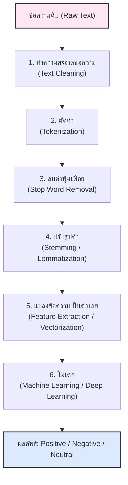
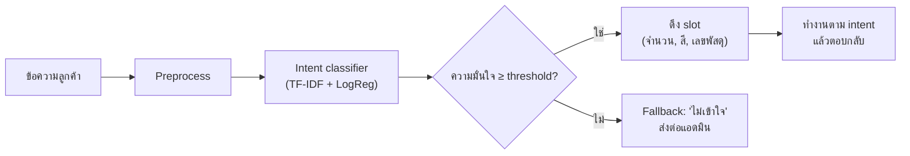
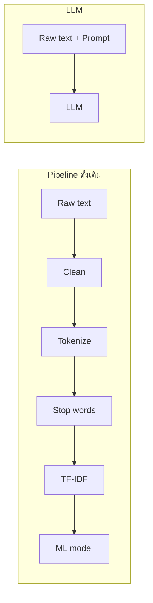

## วัตถุประสงค์การเรียนรู้

เมื่อจบบทนี้ นักศึกษาควรสามารถ

- อธิบายความแตกต่างระหว่าง NLP, NLU และ NLG พร้อมยกตัวอย่างการประยุกต์ใช้งานได้ (LLO4-1)
- อธิบายขั้นตอนของ NLP/NLU pipeline ตั้งแต่การรวบรวมข้อมูล การทำความสะอาด การตัดคำ จนถึงการสร้างฟีเจอร์ได้ (LLO4-1)
- แปลงข้อความเป็นเวกเตอร์ด้วย Bag-of-Words และ TF-IDF และคำนวณค่า TF-IDF ด้วยมือได้ (LLO4-1)
- สร้างโมเดลจำแนกข้อความ (sentiment analysis) และจำแนกเจตนา (intent classification) ด้วย scikit-learn พร้อมประเมินผลได้ (LLO4-2)
- เปรียบเทียบแนวทาง pipeline ดั้งเดิมกับการใช้ LLM และเลือกแนวทางที่เหมาะกับโจทย์จริงได้ (LLO4-2)

## 1. NLP คืออะไร: NLP, NLU และ NLG

### 1.1 ความหมาย

**NLP (Natural Language Processing)** หรือ **การประมวลผลภาษาธรรมชาติ** คือสาขาหนึ่งของปัญญาประดิษฐ์ที่ทำให้คอมพิวเตอร์สามารถ **"เข้าใจ ตีความ และสร้าง"** ภาษามนุษย์ (ภาษาที่เราใช้สื่อสารกันจริง เช่น ภาษาไทย ภาษาอังกฤษ) ได้อย่างมีความหมาย

พูดง่าย ๆ คือ ทำให้คอมพิวเตอร์สื่อสารและเข้าใจภาษาของคนได้ใกล้เคียงกับที่คนคุยกันเอง

ความยากของภาษาธรรมชาติคือ **ความกำกวม (ambiguity)** — คำเดียวกันมีหลายความหมาย ("ขัน" ที่ใช้ตักน้ำ กับ "ขัน" ที่แปลว่าตลก) ประโยคเดียวกันอ่านได้หลายแบบ ("ตากลม" = ตา + กลม หรือ ตาก + ลม) และความหมายจริงขึ้นกับบริบท เช่น ประโยค "สวยตายแหละ" ที่อาจเป็นคำชมหรือการประชดก็ได้

### 1.2 NLP vs NLU vs NLG

| คำ | ย่อมาจาก | ทำอะไร | ตัวอย่างงาน |
|---|---|---|---|
| **NLP** | Natural Language Processing | คำกว้างที่สุด ครอบคลุมทุกงานที่ประมวลผลภาษา | ตัดคำ, แท็กชนิดคำ, แปลภาษา |
| **NLU** | Natural Language Understanding | "อ่านแล้วเข้าใจ" ดึงความหมาย/เจตนาออกจากข้อความ | จำแนกเจตนา (intent), สกัดข้อมูล (entity/slot), วิเคราะห์ความรู้สึก |
| **NLG** | Natural Language Generation | "เขียน/พูดออกมา" สร้างข้อความจากข้อมูลหรือความหมาย | สรุปความ, ตอบแชต, เขียนรายงานอัตโนมัติ |


> [!NOTE]
> NLU และ NLG เป็น **ส่วนย่อย** ของ NLP ระบบ chatbot ที่สมบูรณ์จึงต้องมีทั้งสองฝั่ง คือ เข้าใจคำถาม (NLU) และสร้างคำตอบ (NLG)

### 1.3 ตัวอย่างการใช้งาน NLP ในชีวิตประจำวัน

| งาน | ประเภท | ตัวอย่าง |
|---|---|---|
| Chatbot / ผู้ช่วยเสมือน | NLU + NLG | ChatGPT, Siri, Google Assistant, LINE chatbot ของร้านค้า |
| การแปลภาษา (Machine Translation) | NLU + NLG | Google Translate ที่เข้าใจรูปประโยคแล้วแปลข้ามภาษา |
| แก้คำผิด / แนะนำคำ | NLP | Auto-correct, Auto-complete บนแป้นพิมพ์มือถือ |
| วิเคราะห์ความรู้สึก (Sentiment Analysis) | NLU | อ่านรีวิวสินค้าแล้วบอกว่าลูกค้าส่วนใหญ่ชมหรือติ |
| สรุปข้อความ (Summarization) | NLU + NLG | ย่อบทความยาวให้เหลือใจความสำคัญ |
| กรองสแปม / จัดหมวดเอกสาร | NLU | แยกอีเมลสแปม, จัดหมวดคำร้องของนักศึกษา |
| สกัดข้อมูล (Information Extraction) | NLU | ดึงชื่อคน สถานที่ วันที่ จากข่าว (Named Entity Recognition) |

## 2. NLP/NLU Pipeline ภาพรวม

ก่อนยุค LLM งาน NLP เกือบทุกงานทำเป็น **pipeline** คือส่งข้อความผ่านขั้นตอนย่อยทีละขั้น ตัวอย่างนี้คือ pipeline สำหรับ sentiment analysis



| ขั้นตอน | ทำอะไร | ตัวอย่าง |
|---|---|---|
| 0. รวบรวมข้อมูล (Data Collection) | หาข้อความพร้อม label | รีวิวจากเว็บขายของ, แชตลูกค้า, โพสต์โซเชียล, แบบสอบถาม |
| 1. Text Cleaning | ลบสิ่งที่ไม่ช่วยการวิเคราะห์ | HTML tag, URL, ตัวเลข, สัญลักษณ์พิเศษ, ตัวอักษรซ้ำ |
| 2. Tokenization | แยกข้อความเป็นหน่วยย่อย (token) | `"I love it"` → `["i", "love", "it"]` |
| 3. Stop Word Removal | ลบคำที่พบบ่อยแต่ไม่บอกความหมายหลัก | "ที่", "ซึ่ง", "และ", "is", "the" |
| 4. Stemming / Lemmatization | ทำให้คำที่ผันรูปกลับเป็นรูปเดียวกัน | running, ran → run |
| 5. Feature Extraction | แปลงเป็นเวกเตอร์ตัวเลข | Bag-of-Words, TF-IDF, Word Embeddings |
| 6. Modeling | ฝึก/ใช้โมเดลจำแนก | Naive Bayes, Logistic Regression, SVM, BERT |

> [!TIP]
> ขั้นตอนไม่จำเป็นต้องใช้ครบทุกขั้นเสมอ — ต้องเลือกตามภาษาและงาน เช่น งาน sentiment **ไม่ควรลบคำปฏิเสธ** ("not", "ไม่") และภาษาไทยแทบไม่ต้องทำ stemming เลย การออกแบบ pipeline คือการตัดสินใจว่าขั้นไหนช่วย ขั้นไหนทำลายข้อมูล

ในการรวบรวมข้อมูลมีประเด็นที่ต้องคิดตั้งแต่ต้น ได้แก่ (1) **label มาจากไหน** — ติดเองหรือใช้ดาวรีวิว (เช่น 4–5 ดาว = บวก) (2) **ความสมดุลของคลาส** (3) **ข้อมูลส่วนบุคคล** ในแชตลูกค้า เช่น เบอร์โทรและที่อยู่ ต้องลบหรือปิดบังก่อนนำไปใช้ และ (4) ข้อมูลต้อง **ตรงกับโดเมนที่จะใช้งานจริง** รีวิวร้านอาหารใช้ฝึกโมเดลรีวิวมือถือได้ไม่ดีนัก

## 3. การเตรียมข้อความภาษาอังกฤษ

### 3.1 Text Cleaning ด้วย Regular Expression

```python
import re

text = "OMG!!! This phone is AMAZING :) Battery lasts 2 days... <br> Visit http://shop.example.com #happy"

def clean_text(text):
    text = text.lower()                              # 1) ตัวพิมพ์เล็กทั้งหมด
    text = re.sub(r"<[^>]+>", " ", text)             # 2) ลบ HTML tag
    text = re.sub(r"http\S+|www\.\S+", " ", text)    # 3) ลบ URL
    text = re.sub(r"[^a-z\s]", " ", text)            # 4) เก็บเฉพาะตัวอักษร a-z และช่องว่าง
    text = re.sub(r"\s+", " ", text).strip()         # 5) ยุบช่องว่างซ้ำ
    return text

cleaned = clean_text(text)
print(cleaned)
```

```output
omg this phone is amazing battery lasts days visit happy
```

สังเกตว่าการทำความสะอาด **ทำให้ข้อมูลบางส่วนหายไป** เช่น อีโมติคอน `:)` ที่บอกอารมณ์เชิงบวกชัดเจน และตัวเลข "2 days" — ถ้างานของเราคือ sentiment อาจควรแปลงอีโมติคอนเป็นคำ (`:)` → `smile`) แทนการลบทิ้ง

### 3.2 Tokenization และ Stop Words

ภาษาอังกฤษมีช่องว่างคั่นคำ จึงตัดคำอย่างง่ายด้วย `split()` ได้ ส่วน stop words ใช้รายการที่ scikit-learn เตรียมไว้

```python
from sklearn.feature_extraction.text import ENGLISH_STOP_WORDS

tokens = cleaned.split()
print(tokens)

filtered = [t for t in tokens if t not in ENGLISH_STOP_WORDS]
print(filtered)
print("จำนวน stop words:", len(ENGLISH_STOP_WORDS))
print("'not' เป็น stop word?", "not" in ENGLISH_STOP_WORDS)

review = "the battery is not good"
print([t for t in review.split() if t not in ENGLISH_STOP_WORDS])
```

```output
['omg', 'this', 'phone', 'is', 'amazing', 'battery', 'lasts', 'days', 'visit', 'happy']
['omg', 'phone', 'amazing', 'battery', 'lasts', 'days', 'visit', 'happy']
จำนวน stop words: 318
'not' เป็น stop word? True
['battery', 'good']
```

> [!WARNING]
> ประโยค "the battery is **not** good" หลังลบ stop words เหลือแค่ `['battery', 'good']` — **ความหมายกลับขั้ว!** รายการ stop words มาตรฐานมักมีคำปฏิเสธ (not, no, nor) อยู่ด้วย สำหรับงาน sentiment ต้องเอาคำเหล่านี้ออกจากรายการ หรือไม่ลบ stop words เลยแล้วปล่อยให้ TF-IDF ลดน้ำหนักคำที่พบบ่อยเอง

### 3.3 Stemming vs Lemmatization

ทั้งสองวิธีพยายามทำให้คำที่ผันรูป (running, runs, ran) กลายเป็นคำเดียวกัน เพื่อลดจำนวนฟีเจอร์และรวมสถิติของคำที่มีความหมายเดียวกัน

| | Stemming | Lemmatization |
|---|---|---|
| หลักการ | ตัดคำต่อท้าย (suffix) ตามกฎ เช่น ตัด -ing, -es | ค้นรูปพจนานุกรม (lemma) โดยดูชนิดคำ (POS) |
| ผลลัพธ์ | อาจไม่ใช่คำจริง เช่น studies → `studi` | เป็นคำจริงเสมอ เช่น studies → `study` |
| ความเร็ว | เร็วมาก | ช้ากว่า ต้องใช้พจนานุกรม |
| ตัวอย่างเครื่องมือ | `PorterStemmer` (NLTK) | `WordNetLemmatizer` (NLTK), spaCy |

```python
import nltk
nltk.download("wordnet", quiet=True)          # ดาวน์โหลดพจนานุกรม WordNet (ครั้งแรกครั้งเดียว)
from nltk.stem import PorterStemmer, WordNetLemmatizer

ps = PorterStemmer()
wnl = WordNetLemmatizer()

print(f"{'word':<12}{'stem':<10}{'lemma(n)':<12}{'lemma(v)':<10}")
for w in ["running", "runs", "ran", "studies", "better", "was", "feet"]:
    print(f"{w:<12}{ps.stem(w):<10}{wnl.lemmatize(w):<12}{wnl.lemmatize(w, pos='v'):<10}")
```

```output
word        stem      lemma(n)    lemma(v)  
running     run       running     run       
runs        run       run         run       
ran         ran       ran         run       
studies     studi     study       study     
better      better    better      better    
was         wa        wa          be        
feet        feet      foot        feet      
```

ข้อสังเกต: stemmer ทำ `ran` ไม่ได้เพราะเป็นกริยาผันไม่ปกติ และตัด `was` เป็น `wa` ซึ่งผิด ส่วน lemmatizer ต้อง **บอกชนิดคำ** (`pos='v'`) จึงแปลง `ran` → `run` และ `was` → `be` ได้ถูกต้อง (ค่าเริ่มต้น `pos='n'` มองทุกคำเป็นคำนาม จึงแปลง `feet` → `foot` ได้แต่แปลงกริยาไม่ได้)

## 4. ภาษาไทย: ความท้าทายและการตัดคำ

### 4.1 ภาษาไทยต่างจากภาษาอังกฤษอย่างไร

| ข้อแตกต่าง | ภาษาอังกฤษ | ภาษาไทย |
|---|---|---|
| **การแบ่งคำ (Tokenization)** | **ง่าย:** ใช้ช่องว่างแบ่งคำได้ทันที | **ท้าทายมาก:** เขียนติดกันไม่มีช่องว่างระหว่างคำ ต้องใช้พจนานุกรมหรือโมเดลช่วยตัดคำ (เช่น PyThaiNLP) |
| **การผันรูปคำ (Stemming / Lemmatization)** | **จำเป็น:** คำเปลี่ยนรูปตาม tense และพจน์ (run, running, ran) | **แทบไม่จำเป็น:** ภาษาไทยเป็นภาษาคำโดด ไม่ผันรูปคำ ใช้คำประกอบแทน ("กำลังกิน", "จะกิน") |
| **โครงสร้างอักขระ** | เรียงต่อกันมิติเดียวจากซ้ายไปขวา | ซับซ้อนกว่า มีสระหน้า หลัง บน ล่าง และวรรณยุกต์ จึงพบการพิมพ์ผิดหรือพิมพ์อักขระซ้อนบ่อย |
| **ภาษาวิบัติ / แสลงโซเชียล** | มีบ้าง มักเป็นคำย่อหรือการสลับตัวพิมพ์ | **เปลี่ยนเร็วและวิเคราะห์ยาก:** ชอบลากเสียงหรือจงใจพิมพ์ผิดเพื่อสื่ออารมณ์ ("ม่ายยยยย", "ตั้ลล้าก", "ดีย์") ทำให้ตัวตัดคำที่อิงพจนานุกรมตัดไม่ถูก |
| **บริบทและการประชด (Context & Sarcasm)** | โครงสร้างไวยากรณ์บอกประโยคปฏิเสธชัดเจน | มักละประธาน และการประชดบางครั้งดูเหมือนคำชม (เช่น "สวยตายแหละ") ทำให้ AI แยกแยะได้ยากกว่า |

### 4.2 ตัดคำภาษาไทยด้วย PyThaiNLP

**PyThaiNLP** เป็นไลบรารี NLP ภาษาไทยแบบ open source ที่นิยมที่สุด ฟังก์ชัน `word_tokenize` รองรับหลาย engine โดยค่าเริ่มต้นคือ `newmm` (maximal matching ตามพจนานุกรม ร่วมกับกฎ Thai Character Cluster) ใน Google Colab ต้องติดตั้งก่อน

```python
!pip install -q pythainlp
```

```python
from pythainlp.tokenize import word_tokenize

text = "สินค้านี้ดีมากๆ ส่งไวมาก แต่กล่องบุบนิดหน่อย"
print(word_tokenize(text, engine="newmm"))
print(word_tokenize(text, engine="newmm", keep_whitespace=False))

# ความกำกวมและภาษาโซเชียล
print(word_tokenize("ไปหามเหสี", engine="newmm"))
print(word_tokenize("ไม่ชอบเลยยยยย ส่งช้ามากกก", engine="newmm"))
```

```output
['สินค้า', 'นี้', 'ดีมาก', 'ๆ', ' ', 'ส่ง', 'ไว', 'มาก', ' ', 'แต่', 'กล่อง', 'บุบ', 'นิดหน่อย']
['สินค้า', 'นี้', 'ดีมาก', 'ๆ', 'ส่ง', 'ไว', 'มาก', 'แต่', 'กล่อง', 'บุบ', 'นิดหน่อย']
['ไปหา', 'มเหสี']
['ไม่', 'ชอบ', 'เลย', 'ยยยย', ' ', 'ส่ง', 'ช้า', 'มาก', 'กก']
```

ผลลัพธ์ข้างต้นได้จาก PyThaiNLP 5.3 (เวอร์ชันอื่นอาจตัดต่างกันเล็กน้อยเพราะพจนานุกรมถูกปรับปรุง) สังเกตว่า

- ช่องว่างถูกนับเป็น token ด้วย ใช้ `keep_whitespace=False` เพื่อตัดทิ้ง
- "ไปหามเหสี" ถูกตัดเป็น "ไปหา | มเหสี" ซึ่งถูกตามความหมาย (ไม่ใช่ "ไป | หาม | เห | สี") — แต่ตัวตัดคำไม่ได้ถูกเสมอไป
- คำลากเสียง "เลยยยยย" ถูกตัดเป็น `เลย` + `ยยยย` ซึ่งเป็น token ขยะ จึงควร **ยุบตัวอักษรซ้ำก่อนตัดคำ** ด้วย regex `re.sub(r"(.)\1{2,}", r"\1", text)` (ตัวอักษรเดียวกันติดกันตั้งแต่ 3 ตัวขึ้นไปให้เหลือตัวเดียว)

### 4.3 Stop words ภาษาไทย — ใช้อย่างระวัง

```python
from pythainlp.corpus import thai_stopwords

sw = thai_stopwords()
print("จำนวน stop words ภาษาไทย:", len(sw))
for w in ["ไม่", "แต่", "มาก", "ส่ง", "ดี", "ชอบ"]:
    print(w, w in sw)
```

```output
จำนวน stop words ภาษาไทย: 1030
ไม่ True
แต่ True
มาก True
ส่ง True
ดี False
ชอบ False
```

คำว่า "ไม่" "แต่" และ "มาก" อยู่ในรายการ stop words ของ PyThaiNLP — ถ้าลบทิ้งในงาน sentiment ประโยค "ไม่ค่อยดี" จะเหลือแค่ "ดี" ดังนั้น **อย่าใช้รายการ stop words แบบไม่ดู** ให้ตรวจและปรับให้เหมาะกับงานเสมอ

## 5. Feature Engineering: แปลงข้อความเป็นตัวเลข

โมเดล ML รับได้เฉพาะตัวเลข ขั้นตอนนี้จึงเป็นหัวใจของ pipeline ดั้งเดิม

### 5.1 Bag-of-Words (BoW)

BoW สร้าง **คลังคำ (vocabulary)** จากทุกเอกสาร แล้วแทนแต่ละเอกสารด้วยเวกเตอร์ที่นับว่าแต่ละคำปรากฏกี่ครั้ง — **ไม่สนลำดับคำ** เหมือนเทคำทั้งหมดลงถุง

```python
import pandas as pd
from sklearn.feature_extraction.text import CountVectorizer, TfidfVectorizer

docs = ["good phone good price",
        "bad phone",
        "good camera"]

cv = CountVectorizer()
X_bow = cv.fit_transform(docs)          # ได้ sparse matrix ขนาด 3 เอกสาร x 5 คำ
print(pd.DataFrame(X_bow.toarray(), columns=cv.get_feature_names_out(), index=["d1", "d2", "d3"]))
```

```output
    bad  camera  good  phone  price
d1    0       0     2      1      1
d2    1       0     0      1      0
d3    0       1     1      0      0
```

ข้อจำกัดของ BoW: (1) คำที่พบบ่อยทุกเอกสาร เช่น "the" ได้ค่าสูงทั้งที่ไม่ช่วยแยกเอกสาร (2) เวกเตอร์ยาวเท่าขนาดคลังคำ (หลักหมื่นถึงแสนมิติ) และส่วนใหญ่เป็น 0 จึงเก็บเป็น **sparse matrix** (3) ไม่รู้ว่า "good" กับ "great" ความหมายใกล้กัน

### 5.2 TF-IDF

**TF-IDF (Term Frequency – Inverse Document Frequency)** ให้น้ำหนักคำที่ **พบบ่อยในเอกสารนั้น แต่พบน้อยในเอกสารอื่น** สูง

$$ \text{tfidf}(t, d) = \text{tf}(t, d) \times \text{idf}(t) $$

- $\text{tf}(t, d)$ = จำนวนครั้งที่คำ $t$ ปรากฏในเอกสาร $d$
- $\text{idf}(t)$ ในตำราทั่วไปคือ $\log\frac{n}{\text{df}(t)}$ เมื่อ $n$ = จำนวนเอกสาร และ $\text{df}(t)$ = จำนวนเอกสารที่มีคำ $t$

scikit-learn (`TfidfVectorizer` ค่าเริ่มต้น `smooth_idf=True`) ใช้สูตรที่ปรับเรียบแล้ว (ใช้ log ฐาน e)

$$ \text{idf}(t) = \ln\frac{1 + n}{1 + \text{df}(t)} + 1 $$

การบวก 1 ที่เศษและส่วนเหมือนมีเอกสารสมมติหนึ่งฉบับที่มีทุกคำ (กันหารด้วยศูนย์) ส่วน $+1$ ท้ายสุดทำให้คำที่อยู่ทุกเอกสารยังมีน้ำหนักไม่เป็นศูนย์ จากนั้นจะ **normalize แต่ละแถวด้วย L2 norm** (`norm="l2"`) ให้ความยาวเวกเตอร์เท่ากับ 1

**ตัวอย่างคำนวณมือ** (เอกสาร 3 ฉบับข้างบน, $n = 3$)

| คำ | df | idf = ln((1+3)/(1+df)) + 1 |
|---|---|---|
| bad, camera, price | 1 | ln(4/2) + 1 = 1.6931 |
| good, phone | 2 | ln(4/3) + 1 = 1.2877 |

เอกสาร d1 = "good phone good price"

1. ค่าดิบ tf × idf: good = 2 × 1.2877 = 2.5754, phone = 1 × 1.2877 = 1.2877, price = 1 × 1.6931 = 1.6931
2. L2 norm = $\sqrt{2.5754^2 + 1.2877^2 + 1.6931^2} = 3.3403$
3. หลัง normalize: good = 2.5754 / 3.3403 = **0.7710**, phone = **0.3855**, price = **0.5069**

ตรวจกับ scikit-learn

```python
tfidf = TfidfVectorizer()              # ค่าเริ่มต้น: smooth_idf=True, norm="l2"
X_tfidf = tfidf.fit_transform(docs)
print(pd.Series(tfidf.idf_, index=tfidf.get_feature_names_out()).round(4))
print(pd.DataFrame(X_tfidf.toarray(), columns=tfidf.get_feature_names_out(),
                   index=["d1", "d2", "d3"]).round(4))
```

```output
bad       1.6931
camera    1.6931
good      1.2877
phone     1.2877
price     1.6931
dtype: float64
      bad  camera    good   phone   price
d1  0.000   0.000  0.7710  0.3855  0.5069
d2  0.796   0.000  0.0000  0.6053  0.0000
d3  0.000   0.796  0.6053  0.0000  0.0000
```

ตรงกับที่คำนวณมือ สังเกตว่าใน d1 คำว่า "price" (พบในเอกสารเดียว) ได้น้ำหนักต่อครั้งสูงกว่า "phone" (พบ 2 เอกสาร) แม้ทั้งคู่ปรากฏ 1 ครั้งเท่ากัน

### 5.3 N-grams: เก็บลำดับคำบางส่วน

BoW และ TF-IDF ทิ้งลำดับคำ ทำให้ "good" กับ "not good" ดูคล้ายกัน **n-gram** คือลำดับคำติดกัน n คำ (unigram = 1 คำ, bigram = 2 คำ) ใช้พารามิเตอร์ `ngram_range`

```python
docs2 = ["the camera is good", "the camera is not good"]

for ng in [(1, 1), (1, 2)]:
    v = CountVectorizer(ngram_range=ng).fit(docs2)
    print(ng, len(v.vocabulary_), list(v.get_feature_names_out()))

v = CountVectorizer(ngram_range=(1, 2), stop_words="english").fit(docs2)
print("ลบ stop words:", list(v.get_feature_names_out()))
```

```output
(1, 1) 5 ['camera', 'good', 'is', 'not', 'the']
(1, 2) 10 ['camera', 'camera is', 'good', 'is', 'is good', 'is not', 'not', 'not good', 'the', 'the camera']
ลบ stop words: ['camera', 'camera good', 'good']
```

bigram `not good` ช่วยให้โมเดลเรียนรู้รูปปฏิเสธได้ แต่แลกกับจำนวนฟีเจอร์ที่เพิ่มขึ้นเร็วมาก และบรรทัดสุดท้ายแสดงอีกครั้งว่าการลบ stop words ทำให้สองประโยคที่ความหมายตรงข้ามกลายเป็นเวกเตอร์เดียวกัน

**Character n-grams** (`analyzer="char_wb"`) ตัดเป็นชิ้นตัวอักษรต่อเนื่องแทนคำ เหมาะกับภาษาไทยมากเพราะ **ไม่ต้องตัดคำก่อน** และทนต่อการพิมพ์ผิด/ลากเสียง (ใช้ในหัวข้อที่ 6.3 และ 7)

### 5.4 Word Embeddings (แนวคิด)

BoW/TF-IDF มองทุกคำแยกขาดจากกัน (one-hot) ทำให้ "ดี" กับ "เยี่ยม" ห่างกันพอ ๆ กับ "ดี" กับ "แย่" **Word embedding** แทนแต่ละคำด้วยเวกเตอร์หนาแน่น (dense) ขนาดเล็ก (เช่น 100–300 มิติ) ที่เรียนรู้จากข้อมูลจำนวนมาก โดยคำที่ปรากฏในบริบทคล้ายกันจะมีเวกเตอร์ใกล้กัน

- **Word2Vec** (Mikolov et al., 2013): ฝึก neural network ตื้น ๆ ให้ทายคำจากคำรอบข้าง (CBOW) หรือทายคำรอบข้างจากคำกลาง (Skip-gram) แล้วใช้น้ำหนักเป็นเวกเตอร์คำ ได้คุณสมบัติที่มีชื่อเสียงคือ $\vec{king} - \vec{man} + \vec{woman} \approx \vec{queen}$
- **Contextual embeddings** เช่น **BERT** และ **WangchanBERTa** (โมเดลภาษาไทยของ VISTEC/AIResearch) สร้างเวกเตอร์ของคำ **ตามบริบทในประโยค** คำว่า "ขัน" ใน "ขันน้ำ" กับ "เรื่องนี้ขันดี" จึงได้เวกเตอร์ต่างกัน ซึ่ง Word2Vec ทำไม่ได้ (หนึ่งคำหนึ่งเวกเตอร์)

ความใกล้ของเวกเตอร์วัดด้วย **cosine similarity** $\cos\theta = \frac{\mathbf{a}\cdot\mathbf{b}}{\|\mathbf{a}\|\|\mathbf{b}\|}$ ตัวอย่างด้วยเวกเตอร์สมมติ 3 มิติ (embedding จริงเรียนรู้จากข้อมูลและมีหลายร้อยมิติ)

```python
import numpy as np

emb = {"ดี":     np.array([0.9, 0.8, 0.1]),     # เวกเตอร์สมมติเพื่อการสาธิต
       "เยี่ยม": np.array([0.8, 0.9, 0.2]),
       "แย่":    np.array([-0.7, -0.8, 0.1])}

def cosine(a, b):
    return a @ b / (np.linalg.norm(a) * np.linalg.norm(b))

print("ดี vs เยี่ยม:", round(cosine(emb["ดี"], emb["เยี่ยม"]), 3))
print("ดี vs แย่:   ", round(cosine(emb["ดี"], emb["แย่"]), 3))
```

```output
ดี vs เยี่ยม: 0.99
ดี vs แย่:    -0.977
```

## 6. Text Classification: Sentiment Analysis

**Sentiment Analysis (การวิเคราะห์ความรู้สึก)** คือการใช้ NLP ระบุอารมณ์ ทัศนคติ หรือความรู้สึกที่อยู่ในข้อความ มักแบ่งเป็นเชิงบวก เชิงลบ หรือเป็นกลาง — เป็นงาน **text classification** แบบ supervised ที่ใช้เทคนิคจาก [บทที่ 3](/module/03) ได้ทั้งหมด

### 6.1 รีวิวสินค้าภาษาอังกฤษ: Naive Bayes vs Logistic Regression

ชุดข้อมูลตัวอย่าง: รีวิวสั้น 40 ข้อความ (บวก 20 ลบ 20)

```python
from sklearn.model_selection import train_test_split, cross_val_score, StratifiedKFold
from sklearn.naive_bayes import MultinomialNB
from sklearn.linear_model import LogisticRegression
from sklearn.pipeline import make_pipeline
from sklearn.metrics import classification_report, confusion_matrix

reviews = [
    # positive (1)
    ("great phone and the battery is excellent", 1), ("excellent camera, fast delivery, love it", 1),
    ("i love this laptop, great screen", 1), ("good quality and a great price", 1),
    ("works perfectly, highly recommend", 1), ("great sound, i love the bass", 1),
    ("fast shipping and a friendly seller, recommend", 1), ("amazing value, good product, would buy again", 1),
    ("very comfortable headphones, love them", 1), ("nice keyboard, works great", 1),
    ("perfect size and excellent quality", 1), ("happy with this purchase, great product", 1),
    ("battery life is great and charging is fast", 1), ("beautiful design, easy to use, love it", 1),
    ("arrived fast and works well, very happy", 1), ("best mouse ever, highly recommend", 1),
    ("nice screen, good speakers, great price", 1), ("easy setup and the app is excellent", 1),
    ("good product, very satisfied", 1), ("love the color, the quality is good", 1),
    # negative (0)
    ("terrible battery, it dies in two hours", 0), ("the screen broke after one week, bad quality", 0),
    ("slow delivery and the box was damaged", 0), ("poor sound quality, waste of money", 0),
    ("stopped working after a few days, very bad", 0), ("rude seller, slow reply, disappointed", 0),
    ("cheap plastic, poor quality, feels like a toy", 0), ("do not buy, total waste of money", 0),
    ("blurry camera and bad colors", 0), ("awful product, i want a refund", 0),
    ("broken charger and it gets very hot", 0), ("too expensive for such poor quality", 0),
    ("disappointed, it does not work", 0), ("the app keeps crashing, terrible", 0),
    ("bad keyboard, some keys are broken", 0), ("returned it, the fan is loud and annoying", 0),
    ("worst headphones, poor sound", 0), ("arrived late and parts were missing, disappointed", 0),
    ("the battery drains fast, waste of money", 0), ("broken on arrival, i want a refund", 0),
]
df = pd.DataFrame(reviews, columns=["text", "label"])

X_train, X_test, y_train, y_test = train_test_split(
    df["text"], df["label"], test_size=0.3, stratify=df["label"], random_state=42)

# Pipeline รวม vectorizer + model: fit เฉพาะ train ป้องกัน data leakage
nb_clf = make_pipeline(TfidfVectorizer(), MultinomialNB())
lr_clf = make_pipeline(TfidfVectorizer(ngram_range=(1, 2)), LogisticRegression(C=10, max_iter=1000))

nb_clf.fit(X_train, y_train)
lr_clf.fit(X_train, y_train)
y_pred = lr_clf.predict(X_test)
print(classification_report(y_test, y_pred, target_names=["neg", "pos"]))
print(confusion_matrix(y_test, y_pred))
```

```output
              precision    recall  f1-score   support

         neg       0.86      1.00      0.92         6
         pos       1.00      0.83      0.91         6

    accuracy                           0.92        12
   macro avg       0.93      0.92      0.92        12
weighted avg       0.93      0.92      0.92        12

[[6 0]
 [1 5]]
```

test set มีเพียง 12 ข้อความ ผิด 1 ข้อความ accuracy ก็ลดไป 8% แล้ว จึงควรดู **cross-validation** ประกอบ

```python
cv = StratifiedKFold(n_splits=5, shuffle=True, random_state=42)
for name, clf in [("MultinomialNB", nb_clf), ("LogisticRegression", lr_clf)]:
    s = cross_val_score(clf, df["text"], df["label"], cv=cv)
    print(f"{name:<20} CV accuracy = {s.mean():.3f} ± {s.std():.3f}")
```

```output
MultinomialNB        CV accuracy = 0.875 ± 0.112
LogisticRegression   CV accuracy = 0.925 ± 0.061
```

| โมเดล | หลักการ | จุดเด่น |
|---|---|---|
| **Multinomial Naive Bayes** | ใช้ Bayes' theorem โดยสมมติว่าคำแต่ละคำเป็นอิสระต่อกันเมื่อรู้คลาส | ฝึกเร็วมาก ทำงานดีแม้ข้อมูลน้อย เป็น baseline ที่ดี |
| **Logistic Regression** | หาน้ำหนักของแต่ละฟีเจอร์ ผ่าน sigmoid/softmax ได้ความน่าจะเป็น | มักแม่นกว่า NB เมื่อข้อมูลมากขึ้น อ่านน้ำหนักคำได้ |

### 6.2 ตีความโมเดล: คำไหนสำคัญ?

ข้อดีใหญ่ของ pipeline ดั้งเดิมคือ **อธิบายได้ (explainable)** น้ำหนัก `coef_` ของ Logistic Regression บอกว่าคำ (หรือ bigram) ไหนดันไปทางบวกหรือลบ

```python
vec = lr_clf.named_steps["tfidfvectorizer"]
lr = lr_clf.named_steps["logisticregression"]
coef = pd.Series(lr.coef_[0], index=vec.get_feature_names_out()).sort_values()
print("ดันไปทางลบ:\n", coef.head(5).round(3).to_string())
print("ดันไปทางบวก:\n", coef.tail(5).round(3).to_string())

new = ["the battery is great and delivery was fast",
       "broken screen, very disappointed",
       "not good, the sound is bad"]
print(lr_clf.predict(new))
print(lr_clf.predict_proba(new).round(3))
```

```output
ดันไปทางลบ:
 poor          -1.145
want refund   -0.901
refund        -0.901
want          -0.901
bad           -0.881
ดันไปทางบวก:
 works        1.225
recommend    1.244
good         1.363
love         1.507
great        1.890
[1 0 1]
[[0.404 0.596]
 [0.597 0.403]
 [0.499 0.501]]
```

ข้อความสุดท้าย "not good, the sound is bad" ถูกทำนายเป็น **บวก** ด้วยความน่าจะเป็นเพียง 0.501 (ก้ำกึ่งมาก) เพราะคำว่า "good" มีน้ำหนักบวกสูง และในข้อมูลฝึกไม่มี bigram "not good" ให้เรียนรู้ — นี่คือจุดอ่อนของวิธีนับคำ ซึ่งแก้ได้ด้วยการเพิ่มข้อมูลที่มีรูปปฏิเสธ หรือใช้โมเดลที่เข้าใจบริบท (หัวข้อที่ 8)

### 6.3 รีวิวภาษาไทยด้วย Character n-grams

ถ้ายังไม่อยากพึ่งตัวตัดคำ ใช้ `analyzer="char_wb"` สร้าง n-gram ตัวอักษรได้ทันที (`char_wb` ตัดภายในขอบเขตที่คั่นด้วยช่องว่าง และเติมช่องว่างที่หัว-ท้าย)

```python
th_reviews = [
    ("สินค้าดีมาก ส่งไว ชอบมาก", "pos"), ("คุณภาพดี คุ้มราคา แนะนำเลย", "pos"),
    ("แบตอึด ใช้ได้ทั้งวัน ดีมาก", "pos"), ("ส่งเร็ว แพ็คของดี ประทับใจ", "pos"),
    ("เสียงดี เบสแน่น ชอบมาก", "pos"), ("ร้านบริการดี ตอบไว ประทับใจมาก", "pos"),
    ("จอสวย ใช้งานง่าย คุ้มค่า", "pos"), ("ของแท้ ราคาดี จะกลับมาซื้ออีก", "pos"),
    ("ใส่สบาย สีสวย ชอบมาก", "pos"), ("ดีเกินราคา แนะนำเลยค่ะ", "pos"),
    ("กล้องชัด แบตดี คุ้มมาก", "pos"), ("ส่งไวมาก สินค้าตรงปก ดีมาก", "pos"),
    ("ของพังตั้งแต่แกะกล่อง แย่มาก", "neg"), ("ส่งช้ามาก รอเป็นอาทิตย์", "neg"),
    ("คุณภาพแย่ ไม่คุ้มราคา", "neg"), ("แบตเสื่อมเร็ว ผิดหวังมาก", "neg"),
    ("สินค้าไม่ตรงปก ขอคืนเงิน", "neg"), ("ร้านตอบช้า บริการแย่", "neg"),
    ("ใช้ได้สองวันก็เสีย ผิดหวัง", "neg"), ("เสียงแตก ไม่คุ้มเลย", "neg"),
    ("กล่องบุบ ของแตก แย่มาก", "neg"), ("จอเป็นเส้น ขอคืนสินค้า", "neg"),
    ("ราคาแพงแต่คุณภาพแย่", "neg"), ("ส่งของผิด ติดต่อร้านไม่ได้ ผิดหวังมาก", "neg"),
]
df_th = pd.DataFrame(th_reviews, columns=["text", "label"])

th_clf = make_pipeline(
    TfidfVectorizer(analyzer="char_wb", ngram_range=(2, 4)),   # n-gram ตัวอักษร 2-4 ตัว
    LogisticRegression(C=10, max_iter=1000))
scores = cross_val_score(th_clf, df_th["text"], df_th["label"],
                         cv=StratifiedKFold(n_splits=4, shuffle=True, random_state=42))
print("CV accuracy:", scores.round(3), "เฉลี่ย =", scores.mean().round(3))

th_clf.fit(df_th["text"], df_th["label"])
tests = ["ของดีมาก ส่งไวด้วย", "แย่มาก ของพัง", "ไม่ดีเลย ผิดหวัง"]
for t, p, pr in zip(tests, th_clf.predict(tests), th_clf.predict_proba(tests).max(axis=1)):
    print(t, "->", p, f"({pr:.2f})")

vec_th = th_clf.named_steps["tfidfvectorizer"]
print("จำนวนฟีเจอร์:", len(vec_th.vocabulary_))
print(vec_th.build_analyzer()("ส่งไว")[:8])
```

```output
CV accuracy: [1.    1.    1.    0.833] เฉลี่ย = 0.958
ของดีมาก ส่งไวด้วย -> pos (0.82)
แย่มาก ของพัง -> neg (0.79)
ไม่ดีเลย ผิดหวัง -> neg (0.85)
จำนวนฟีเจอร์: 906
[' ส', 'ส่', '่ง', 'งไ', 'ไว', 'ว ', ' ส่', 'ส่ง']
```

ได้ผลดีแม้ไม่ตัดคำ แต่ฟีเจอร์เป็นชิ้นตัวอักษรที่ตีความยากกว่าคำ ในใบงานจะเปรียบเทียบกับการใช้ PyThaiNLP ตัดคำก่อน

## 7. NLU สำหรับ Chatbot: Intent Classification และ Slot Filling

ใน chatbot งาน NLU หลักมีสองส่วน

1. **Intent classification** — ผู้ใช้ "ต้องการทำอะไร" (ถามราคา, สั่งซื้อ, ติดตามพัสดุ, ร้องเรียน) เป็น text classification แบบหลายคลาส
2. **Entity / Slot extraction** — ดึง "รายละเอียด" ที่ต้องใช้ทำงานนั้น เช่น จำนวน สี เลขพัสดุ



### 7.1 Intent classifier พร้อม Fallback

```python
import numpy as np
from sklearn.pipeline import Pipeline

intent_data = [
    ("ราคาเท่าไหร่ครับ", "ถามราคา"), ("ตัวนี้กี่บาท", "ถามราคา"), ("ขอราคาหน่อยค่ะ", "ถามราคา"),
    ("มีโปรลดราคาไหม", "ถามราคา"), ("ราคาส่งคิดยังไง", "ถามราคา"), ("รุ่นนี้ราคาเท่าไร", "ถามราคา"),
    ("ค่าส่งกี่บาทครับ", "ถามราคา"), ("ลดได้อีกไหมคะ", "ถามราคา"),
    ("สั่งซื้อ 2 ชิ้นค่ะ", "สั่งซื้อ"), ("เอาสีดำ 1 ตัวครับ", "สั่งซื้อ"), ("ขอสั่งของหน่อย", "สั่งซื้อ"),
    ("อยากสั่งซื้อรุ่นนี้", "สั่งซื้อ"), ("รับ 3 กล่องค่ะ", "สั่งซื้อ"), ("สั่งเพิ่มอีก 1 ชิ้น", "สั่งซื้อ"),
    ("ขอซื้อไซส์ M", "สั่งซื้อ"), ("โอนแล้ว ยืนยันการสั่งซื้อครับ", "สั่งซื้อ"),
    ("ของถึงไหนแล้วครับ", "ติดตามพัสดุ"), ("ขอเลขพัสดุหน่อย", "ติดตามพัสดุ"), ("ส่งของหรือยังคะ", "ติดตามพัสดุ"),
    ("พัสดุจะมาถึงวันไหน", "ติดตามพัสดุ"), ("เช็คสถานะการจัดส่งให้หน่อย", "ติดตามพัสดุ"),
    ("ยังไม่ได้รับของเลย", "ติดตามพัสดุ"), ("ขนส่งเจ้าไหนครับ", "ติดตามพัสดุ"), ("ของส่งออกไปยังครับ", "ติดตามพัสดุ"),
    ("ของที่ได้รับแตกเสียหาย", "ร้องเรียน"), ("ส่งของผิดสีครับ", "ร้องเรียน"),
    ("สินค้าใช้ไม่ได้เลย ขอคืนเงิน", "ร้องเรียน"), ("แอดมินตอบช้ามาก", "ร้องเรียน"),
    ("ของไม่ตรงปก ผิดหวัง", "ร้องเรียน"), ("ได้ของไม่ครบ ขาดไป 1 ชิ้น", "ร้องเรียน"),
    ("ขอเปลี่ยนสินค้า ของมีตำหนิ", "ร้องเรียน"), ("บริการแย่มาก", "ร้องเรียน"),
]
df_int = pd.DataFrame(intent_data, columns=["text", "intent"])

intent_clf = Pipeline([
    ("tfidf", TfidfVectorizer(analyzer="char_wb", ngram_range=(1, 3))),
    ("clf", LogisticRegression(C=10, max_iter=1000)),
])
intent_clf.fit(df_int["text"], df_int["intent"])

def understand(text, threshold=0.5):
    proba = intent_clf.predict_proba([text])[0]      # ความน่าจะเป็นของทุก intent
    best = int(np.argmax(proba))
    if proba[best] < threshold:                      # ไม่มั่นใจพอ -> ไม่เดา
        return "ไม่เข้าใจ (ส่งต่อแอดมิน)", proba[best]
    return intent_clf.classes_[best], proba[best]

for q in ["ราคาเท่าไหร่คะ", "สั่ง 5 ชิ้นครับ", "พัสดุถึงไหนแล้ว",
          "ของแตกมา ขอคืนเงิน", "วันนี้ฝนตกไหม", "แมวน่ารักจัง"]:
    intent, conf = understand(q)
    print(f"{q} -> {intent} [{conf:.2f}]")
```

```output
ราคาเท่าไหร่คะ -> ถามราคา [0.92]
สั่ง 5 ชิ้นครับ -> สั่งซื้อ [0.72]
พัสดุถึงไหนแล้ว -> ติดตามพัสดุ [0.84]
ของแตกมา ขอคืนเงิน -> ร้องเรียน [0.74]
วันนี้ฝนตกไหม -> ไม่เข้าใจ (ส่งต่อแอดมิน) [0.44]
แมวน่ารักจัง -> ไม่เข้าใจ (ส่งต่อแอดมิน) [0.31]
```

โมเดลจำแนกต้องเลือกคลาสใดคลาสหนึ่งเสมอ แม้คำถามจะอยู่นอกขอบเขต (out-of-domain) เช่น "วันนี้ฝนตกไหม" — การตั้ง **threshold บนความน่าจะเป็นสูงสุด** ช่วยให้ bot ยอมรับว่าไม่เข้าใจแทนการตอบผิด

> [!TIP]
> threshold เป็น trade-off: ตั้งสูงเกินไป bot จะส่งต่อแอดมินบ่อยแม้คำถามปกติ (เสียโอกาสตอบอัตโนมัติ) ตั้งต่ำเกินไป bot จะตอบคำถามนอกขอบเขตผิด ๆ ควรเลือกจากข้อมูล validation ที่มีทั้งคำถามในและนอกขอบเขต — และอย่าลืมว่า predict_proba ของโมเดลที่ฝึกจากข้อมูลน้อยมักไม่ calibrated

### 7.2 Slot Filling เบื้องต้น

เมื่อรู้ intent แล้ว bot ต้องรู้รายละเอียด (slot) ด้วย สำหรับ slot ที่มีรูปแบบชัดเจน ใช้ regex หรือรายการคำได้เลย ส่วนงานที่ซับซ้อน (ชื่อคน ที่อยู่) ใช้โมเดล **Named Entity Recognition (NER)** ซึ่งเป็นการจำแนกระดับ token (เช่น แท็ก B-LOC, I-LOC, O)

```python
def extract_slots(text):
    slots = {}
    m = re.search(r"(\d+)\s*(ชิ้น|ตัว|กล่อง)", text)
    if m:
        slots["จำนวน"] = int(m.group(1))
    m = re.search(r"สี(ดำ|ขาว|แดง|ฟ้า|ชมพู)", text)
    if m:
        slots["สี"] = m.group(1)
    m = re.search(r"[A-Z]{2}\d{8,12}", text)
    if m:
        slots["เลขพัสดุ"] = m.group(0)
    return slots

print(extract_slots("เอาสีดำ 2 ชิ้นครับ"))
print(extract_slots("เลขพัสดุ TH0123456789 ถึงไหนแล้วคะ"))
```

```output
{'จำนวน': 2, 'สี': 'ดำ'}
{'เลขพัสดุ': 'TH0123456789'}
```

ถ้า slot ที่จำเป็นยังไม่ครบ (เช่น สั่งซื้อแต่ไม่บอกสี) bot จะถามกลับ — เรียกว่า **slot filling** เป็นหลักการเดียวกับระบบ Dialogflow หรือ Rasa

## 8. ยุค LLM: Pipeline ดั้งเดิม vs (Mini) LLM

### 8.1 LLM เข้ามาแทนที่ pipeline แล้วหรือยัง?

คำถามที่ตามมาคือ "เทคโนโลยีแบบเดิมถูกแทนที่ด้วย LLM หรือยัง?" คำตอบคือ **"ใช่ ในหลาย use case กระบวนการเหล่านี้ถูกแทนที่ด้วย LLM แบบเบ็ดเสร็จ (end-to-end) แล้ว"** ในยุคของ Large Language Models (LLM) และโมเดลขนาดเล็ก (Small/Mini Language Models, SLM) ขั้นตอนหลายขั้นถูกลดรูปเหลือ **"ข้อความดิบ + คำสั่ง (prompt)"** แล้วให้โมเดลตอบกลับเลย



เหตุผลที่ LLM เข้ามาแทนที่ได้

1. **ลดความซับซ้อนของ pipeline** — ระบบเดิมต้องเขียนโค้ดตัดคำภาษาไทย ทำความสะอาด ลบ stop words และเทรนโมเดลเฉพาะทาง แต่ LLM รับประโยคดิบพร้อม prompt ได้เลย เช่น วิเคราะห์ "สินค้านี้ดีย์มากกก ส่งไวเวอร์" ได้ทันที
2. **เข้าใจบริบท แสลง และการประชด** — วิธีนับคำ (BoW/TF-IDF) มักพลาดเมื่อเจอบริบทซับซ้อนหรือคำวิบัติ แต่ LLM ใช้สถาปัตยกรรม **Transformer (attention mechanism)** จึงพิจารณาความสัมพันธ์ของทุกคำในประโยค
3. **รองรับหลายภาษาในตัวเดียว** — ไม่ต้องทำโมเดลแยกภาษาไทยและอังกฤษ

> [!NOTE]
> **Transformer โดยย่อ** (รายละเอียดใน [บทที่ 0](/module/00))
> - **กลไกหาบริบท: Self-Attention** — ทุก token คำนวณว่าควร "ให้ความสนใจ" token อื่นในประโยคมากน้อยเท่าใด เช่น คำว่า "มัน" ในประโยคยาวจะได้น้ำหนักสูงกับคำนามที่มันอ้างถึง ทำให้เข้าใจบริบททั้งประโยคพร้อมกัน (ต่างจาก BoW ที่นับคำแยกกัน)
> - **ส่วนประกอบหลัก:** **Encoder** (อ่านและเข้ารหัสข้อความเป็นเวกเตอร์ที่มีบริบท) และ **Decoder** (สร้างข้อความออกทีละ token) โดยแต่ละชั้นมี Multi-Head Self-Attention + Feed-Forward Network และใช้ Positional Encoding บอกลำดับคำ
> - **ตระกูลโมเดล:** Encoder อย่างเดียว เช่น BERT / WangchanBERTa (เหมาะกับการจำแนกข้อความ) · Decoder อย่างเดียว เช่น GPT, Llama (เหมาะกับการสร้างข้อความ / LLM) · Encoder–Decoder เช่น T5 (แปลภาษา สรุปความ)

### 8.2 Zero-shot และ Few-shot Prompting

- **Zero-shot**: บอกงานโดยไม่ให้ตัวอย่าง
- **Few-shot**: ใส่ตัวอย่างพร้อมคำตอบ 2–5 ตัวอย่างใน prompt ให้โมเดลเลียนแบบรูปแบบ (in-context learning) — ไม่มีการปรับน้ำหนักโมเดล

```text
คุณคือระบบวิเคราะห์รีวิวสินค้าภาษาไทย
จงจำแนกความรู้สึกของรีวิวเป็น positive, negative หรือ neutral
ตอบเป็น JSON รูปแบบ {"label": "...", "reason": "..."} เท่านั้น

ตัวอย่าง:
รีวิว: "ส่งไวมาก ของดีตรงปก" -> {"label": "positive", "reason": "ชมความเร็วและคุณภาพ"}
รีวิว: "สวยตายแหละ ใส่ได้วันเดียวขาด" -> {"label": "negative", "reason": "ประชด สินค้าเสียเร็ว"}

รีวิว: "สินค้านี้ดีย์มากกก ส่งไวเวอร์" ->
```

การบังคับรูปแบบคำตอบ (JSON, รายการ label ที่จำกัด) สำคัญมากเมื่อนำ LLM ไปต่อกับระบบจริง เพราะโค้ดต้องอ่านคำตอบได้เสมอ

### 8.3 เปรียบเทียบสองแนวทาง

| ประเด็น | Pipeline ดั้งเดิม (TF-IDF + NB/LogReg) | LLM (zero/few-shot) |
|---|---|---|
| ข้อมูลที่ต้องใช้ | ต้องมีข้อมูลติด label หลักร้อย–หลักพัน | ใช้ตัวอย่างไม่กี่ข้อหรือไม่ใช้เลย |
| ต้นทุนต่อข้อความ | ต่ำมาก รันบน CPU ได้ | สูงกว่ามาก (ค่า API หรือ GPU) |
| Latency | ระดับมิลลิวินาที | ระดับร้อยมิลลิวินาที–วินาที |
| ความแม่นยำกับแสลง/ประชด | อ่อน (นับคำ ไม่เข้าใจบริบท) | ดีกว่าชัดเจน |
| Explainability | ดี — ดูน้ำหนักคำได้ (`coef_`) | ต่ำ คล้ายกล่องดำ (คำอธิบายที่โมเดลเขียนเองไม่ใช่เหตุผลภายในที่แท้จริง) |
| ความคงเส้นคงวา | ผลลัพธ์เหมือนเดิมทุกครั้ง | อาจตอบต่างกันเมื่อเปลี่ยน prompt/รุ่นโมเดล |
| ความเป็นส่วนตัวของข้อมูล | อยู่ในเครื่องเราทั้งหมด | ถ้าใช้ API ภายนอก ข้อมูลออกนอกองค์กร (แก้ได้ด้วยโมเดล open-source รัน local) |
| การดูแลระบบ | ต้อง retrain เมื่อภาษาเปลี่ยน | ปรับ prompt ได้ทันที |

### 8.4 Open-source (Mini) LLM และหน่วยความจำที่ต้องใช้

มีโมเดล open-weight ขนาดเล็กที่รันบนเครื่องตัวเอง (local) ได้โดยไม่ต้องพึ่ง API เช่น ตระกูล **Llama** (Meta), **Qwen** (Alibaba — โดดเด่นในกลุ่มภาษาเอเชียรวมถึงไทย และมีรุ่นเล็กมากระดับ 0.5B), **Gemma** (Google) และโมเดลที่ปรับแต่งสำหรับภาษาไทย/เอเชียตะวันออกเฉียงใต้ เช่น **Typhoon**, **OpenThaiGPT**, **SeaLLM**, **WangchanGLM** ซึ่งเข้าใจบริบทและแสลงไทยได้ดีกว่า (รุ่นใหม่ออกเร็วมาก ควรตรวจรุ่นล่าสุดก่อนเลือกใช้)

การรันโมเดล (inference) ต้องคำนึงถึง **หน่วยความจำของการ์ดจอ (VRAM)** เป็นหลัก ซึ่งขึ้นกับ **จำนวนพารามิเตอร์** และ **quantization** (การบีบอัดตัวเลขให้ใช้บิตน้อยลง)

$$ \text{หน่วยความจำของน้ำหนัก} \approx \text{จำนวนพารามิเตอร์} \times \frac{\text{จำนวนบิตต่อพารามิเตอร์}}{8} \text{ ไบต์} $$

เช่น โมเดล 7B แบบ 16-bit ≈ 7 × 10⁹ × 2 ไบต์ ≈ 14 GB และต้องเผื่อหน่วยความจำสำหรับ context (KV cache) และ overhead อีกประมาณ 20% ขึ้นไป

**ตัวอย่างการคำนวณ (เฉพาะค่าน้ำหนัก)** — 1 ไบต์ = 8 บิต และ 1 GB ≈ 10⁹ ไบต์

| ขนาดโมเดล | 32-bit (4 ไบต์/ค่า) | 16-bit (2 ไบต์/ค่า) | 8-bit (1 ไบต์/ค่า) | 4-bit (0.5 ไบต์/ค่า) |
|---|---|---|---|---|
| 1B | 4 GB | 2 GB | 1 GB | 0.5 GB |
| 7B | 28 GB | 14 GB | 7 GB | 3.5 GB |
| 8B | 32 GB | 16 GB | 8 GB | 4 GB |
| 70B | 280 GB | 140 GB | 70 GB | 35 GB |

> [!TIP]
> ถ้าโจทย์ถามว่า "ใช้หน่วยความจำ **สำหรับเก็บค่าน้ำหนัก** เท่าใด" ให้ตอบด้วยสูตรตรง ๆ เช่น 8B แบบ 4-bit = 8 × 10⁹ × 4/8 = 4 × 10⁹ ไบต์ ≈ 4 GB ส่วนตัวเลขในตารางด้านล่างเป็น VRAM ที่ใช้งานจริง ซึ่งรวม KV cache และ overhead แล้วจึงสูงกว่า

| ขนาดโมเดล | ตัวอย่าง | VRAM โดยประมาณ | รันบนอะไรได้ |
|---|---|---|---|
| 0.5B–1.5B | Qwen รุ่นเล็ก | 1.5–3 GB | CPU, มือถือ, GPU เล็ก |
| 2B–3B | Gemma 2B | 3–5 GB | GPU ระดับเริ่มต้น |
| 7B–9B แบบ 16-bit | Llama 8B, Mistral 7B | 14–16 GB | GPU ระดับสูง |
| 7B–9B แบบ 4-bit | (โมเดลเดียวกันที่ quantize แล้ว) | 5–8 GB | GPU ทั่วไป 8–12 GB |

GPU ฝั่งผู้ใช้ทั่วไปมักมี VRAM 8–24 GB จึงต้องใช้ quantization เมื่อรันโมเดล 7B ขึ้นไป ส่วน TPU บนคลาวด์ใช้หน่วยความจำ HBM ขนาดใหญ่และทำงานเป็นกลุ่ม (pod) จึงเหมาะกับโมเดลใหญ่และ batch ใหญ่

### 8.5 Pipeline ดั้งเดิมตายแล้วหรือยัง?

แม้ Mini LLM จะชนะในแง่ "ความง่ายและความแม่นยำ" แต่ TF-IDF + Naive Bayes/Logistic Regression **ยังไม่สูญพันธุ์** เพราะ

- **ความเร็วและต้นทุน** — โมเดลคลาสสิกเร็วกว่า LLM หลายร้อยเท่า ใช้ CPU ธรรมดาประมวลผลข้อความหลักล้านได้ในเวลาสั้น ๆ โดยไม่ต้องใช้ VRAM
- **ความโปร่งใส** — อธิบายได้ว่าทำไมทำนายว่า "บวก" (เพราะเจอคำ "ดี" ที่มีน้ำหนักสูง) ส่วน LLM ทำงานคล้ายกล่องดำ
- **เป็น baseline** — ทุกโปรเจกต์ควรมี baseline ง่าย ๆ ไว้เทียบว่า LLM ช่วยได้คุ้มค่าจริงหรือไม่

> [!NOTE]
> **สรุปการเลือกใช้:** ถ้างานเน้น **ความแม่นยำสูง เจอแสลงเยอะ และมีทรัพยากร GPU** ให้พิจารณา Mini LLM ก่อน แต่ถ้าต้องประมวลผล **ข้อมูลมหาศาลแบบ real-time ด้วยต้นทุนต่ำที่สุด** หรือต้อง **อธิบายผลได้** pipeline ดั้งเดิมยังตอบโจทย์ และในระบบจริงมักใช้ร่วมกัน เช่น ให้โมเดลคลาสสิกคัดกรองก่อน แล้วส่งเฉพาะข้อความยากให้ LLM

### 8.6 จริยธรรม: อคติในข้อมูลข้อความ

ทั้งโมเดลคลาสสิก embeddings และ LLM เรียนรู้จากข้อความที่มนุษย์เขียน จึง **รับอคติ (bias) ของข้อมูลมาด้วย** ตัวอย่างที่ควรระวัง

- Word embedding ที่ฝึกจากข่าวจำนวนมากผูกอาชีพกับเพศ เช่น "homemaker" ใกล้เพศหญิง และ "computer programmer" ใกล้เพศชาย (Bolukbasi et al., 2016)
- โมเดลจำแนกข้อความหยาบคายอาจตัดสินภาษาถิ่น (อีสาน คำเมือง) หรือสำนวนของบางกลุ่มว่าเป็นเชิงลบเกินจริง ถ้าข้อมูลฝึกมีแต่ภาษากลาง
- ข้อมูลแชตลูกค้ามีข้อมูลส่วนบุคคล ต้องปฏิบัติตาม **พ.ร.บ. คุ้มครองข้อมูลส่วนบุคคล (PDPA)** — ปิดบังชื่อ เบอร์โทร ที่อยู่ก่อนนำไปฝึกโมเดล

แนวทางลดผลกระทบ: ตรวจสัดส่วนข้อมูลแต่ละกลุ่ม ประเมินผลแยกตามกลุ่มย่อย และมีมนุษย์ตรวจสอบในกรณีที่ผลกระทบสูง

## 9. ตัวอย่างโจทย์และวิธีทำ (แนวข้อสอบ)

### โจทย์ 1: หน่วยความจำของค่าน้ำหนักแบบจำลองภาษา

**1.1** แบบจำลองภาษาขนาด 13 พันล้านพารามิเตอร์ (13B) ใช้หน่วยความจำ GPU (VRAM) สำหรับเก็บค่าน้ำหนักเท่าใด เมื่อเก็บแบบ 16 บิต และแบบ 4 บิต (Quantization)

**1.2** GPU มี VRAM 24 GB จะเก็บค่าน้ำหนักของแบบจำลองภาษาได้ใหญ่ที่สุดกี่พันล้านพารามิเตอร์ เมื่อเก็บแบบ 16 บิต และแบบ 4 บิต

**หลักการ:** 1 ไบต์ = 8 บิต จึงแปลงบิตเป็นไบต์ต่อพารามิเตอร์ก่อน: 16 บิต = 2 ไบต์, 8 บิต = 1 ไบต์, 4 บิต = 0.5 ไบต์ และใช้ 1 GB ≈ $10^9$ ไบต์

$$ \text{หน่วยความจำ (ไบต์)} = \text{จำนวนพารามิเตอร์} \times \frac{\text{บิตต่อพารามิเตอร์}}{8} $$

**วิธีทำ 1.1**

- 16 บิต: $13 \times 10^9 \times 2 = 26 \times 10^9$ ไบต์ $= 26$ GB
- 4 บิต: $13 \times 10^9 \times 0.5 = 6.5 \times 10^9$ ไบต์ $= 6.5$ GB

Quantization จาก 16 เป็น 4 บิตลดหน่วยความจำลง 4 เท่า

**วิธีทำ 1.2** (กลับสูตร: จำนวนพารามิเตอร์ = หน่วยความจำ ÷ ไบต์ต่อพารามิเตอร์)

- 16 บิต: $\dfrac{24 \times 10^9}{2} = 12 \times 10^9$ = **12B**
- 4 บิต: $\dfrac{24 \times 10^9}{0.5} = 48 \times 10^9$ = **48B**

> [!WARNING]
> ตัวเลขข้างต้นเป็น**เฉพาะค่าน้ำหนัก** การใช้งานจริงต้องเผื่อหน่วยความจำสำหรับ KV cache (context) และ overhead อีกราว 20% ขึ้นไป GPU 24 GB จึงรันโมเดล 4 บิตขนาดราว 30B ได้จริง ไม่ใช่ 48B — ถ้าโจทย์ถาม "สำหรับเก็บค่าน้ำหนัก" ให้ตอบตามสูตร ถ้าถาม "ใช้งานจริง" ให้อธิบายเรื่อง overhead ด้วย

## สรุป

- **NLP** คือการให้คอมพิวเตอร์ประมวลผลภาษามนุษย์ โดยมี **NLU** (เข้าใจ) และ **NLG** (สร้าง) เป็นส่วนย่อย
- **Pipeline ดั้งเดิม**: รวบรวมข้อมูล → ทำความสะอาด → ตัดคำ → ลบ stop words → stemming/lemmatization → สร้างฟีเจอร์ → โมเดล แต่ละขั้นต้องเลือกให้เหมาะกับภาษาและงาน
- **ภาษาไทย** ไม่มีช่องว่างระหว่างคำ ต้องตัดคำ (PyThaiNLP `newmm`) หรือใช้ character n-grams แทน แทบไม่ต้อง stem และต้องระวังรายการ stop words ที่มี "ไม่"
- **BoW** นับคำ **TF-IDF** ถ่วงน้ำหนักคำที่หายาก (sklearn: $\text{idf} = \ln\frac{1+n}{1+\text{df}} + 1$ แล้ว L2 normalize) **n-grams** เก็บลำดับคำบางส่วน **embeddings** จับความหมายใกล้เคียง
- **Text classification** ด้วย `Pipeline(TfidfVectorizer, MultinomialNB/LogisticRegression)` ประเมินด้วย `classification_report` และ cross-validation และอ่าน `coef_` เพื่ออธิบายผล
- **Intent classification** + **threshold บน predict_proba** ช่วยให้ chatbot ตอบ "ไม่เข้าใจ" แทนการเดาผิด และใช้ **slot filling** ดึงรายละเอียด
- **LLM** ลดขั้นตอน pipeline และเข้าใจบริบทดีกว่า แต่แพง ช้า อธิบายยาก — pipeline ดั้งเดิมยังเหมาะกับงานปริมาณมาก ต้นทุนต่ำ และต้องอธิบายได้

## คำศัพท์สำคัญ

| ศัพท์ | ความหมาย |
|---|---|
| NLP / NLU / NLG | การประมวลผล / การทำความเข้าใจ / การสร้างภาษาธรรมชาติ |
| Corpus | คลังข้อความที่ใช้ฝึกหรือวิเคราะห์ |
| Token / Tokenization | หน่วยย่อยของข้อความ / การแยกข้อความเป็นหน่วยย่อย |
| Word segmentation | การตัดคำในภาษาที่ไม่มีช่องว่างระหว่างคำ เช่น ไทย จีน ญี่ปุ่น |
| Stop words | คำที่พบบ่อยแต่ไม่ค่อยบอกความหมายหลัก |
| Stemming | ตัดคำต่อท้ายตามกฎ ได้รากคำที่อาจไม่ใช่คำจริง |
| Lemmatization | แปลงคำเป็นรูปพจนานุกรม (lemma) โดยดูชนิดคำ |
| Vocabulary | ชุดคำทั้งหมดที่ vectorizer รู้จัก |
| Bag-of-Words | เวกเตอร์นับจำนวนครั้งของแต่ละคำ ไม่สนลำดับ |
| TF-IDF | น้ำหนักคำ = ความถี่ในเอกสาร × ความหายากในคลังเอกสาร |
| N-gram | ลำดับคำ (หรือตัวอักษร) ติดกัน n หน่วย |
| Sparse matrix | เมทริกซ์ที่ค่าส่วนใหญ่เป็นศูนย์ เก็บเฉพาะค่าที่ไม่ใช่ศูนย์ |
| Word embedding | เวกเตอร์หนาแน่นแทนคำ คำความหมายใกล้กันมีเวกเตอร์ใกล้กัน |
| Contextual embedding | เวกเตอร์คำที่เปลี่ยนตามบริบทในประโยค (BERT, WangchanBERTa) |
| Sentiment analysis | การวิเคราะห์ความรู้สึกของข้อความ |
| Intent | เจตนาของผู้ใช้ในข้อความหนึ่ง ๆ |
| Slot / Entity | รายละเอียดที่ต้องดึงจากข้อความ เช่น จำนวน วันที่ ชื่อสถานที่ |
| Fallback | คำตอบสำรองเมื่อระบบไม่มั่นใจ |
| Zero-shot / Few-shot | สั่งงาน LLM โดยไม่ให้ตัวอย่าง / ให้ตัวอย่างไม่กี่ข้อใน prompt |
| Quantization | การลดจำนวนบิตของน้ำหนักโมเดลเพื่อประหยัดหน่วยความจำ |

## คำถามทบทวนท้ายบท

**1.** ระบบ chatbot ร้านค้าออนไลน์ได้รับข้อความ "ของถึงไหนแล้วครับ" แล้วตอบ "พัสดุอยู่ที่ศูนย์กระจายสินค้าครับ" จงระบุว่าส่วนไหนของระบบเป็น NLU และส่วนไหนเป็น NLG

<details><summary>เฉลย</summary>

NLU คือส่วนที่อ่านข้อความแล้วตีความว่าเจตนาคือ "ติดตามพัสดุ" (intent classification) และดึงข้อมูลที่จำเป็น (เช่น เลขพัสดุ) ส่วน NLG คือการสร้างประโยคคำตอบภาษาธรรมชาติจากข้อมูลที่ค้นได้ ระหว่างกลางเป็นตรรกะของระบบ (ค้นฐานข้อมูล) ซึ่งไม่ใช่ทั้ง NLU และ NLG

</details>

**2.** ทำไมการลบ stop words ด้วยรายการมาตรฐานจึงอาจทำให้ความแม่นยำของ sentiment analysis ลดลง ยกตัวอย่างทั้งภาษาไทยและภาษาอังกฤษ

<details><summary>เฉลย</summary>

รายการ stop words มาตรฐานมีคำปฏิเสธและคำเชื่อมที่เปลี่ยนความหมาย เช่น ENGLISH_STOP_WORDS ของ scikit-learn มี "not" — "the battery is not good" จึงเหลือ `['battery', 'good']` ส่วน thai_stopwords ของ PyThaiNLP มี "ไม่" "แต่" "มาก" — "สินค้าไม่ค่อยดี" อาจเหลือ "สินค้า ดี" ความหมายกลับขั้ว ควรปรับรายการให้เหมาะกับงาน หรือไม่ลบเลยแล้วให้ TF-IDF ลดน้ำหนักคำทั่วไปเอง

</details>

**3.** มีเอกสาร 4 ฉบับ คำว่า "อร่อย" ปรากฏใน 1 ฉบับ จงคำนวณ idf ของ "อร่อย" ตามสูตรของ scikit-learn (smooth_idf=True) และถ้าคำนี้ปรากฏ 2 ครั้งในเอกสารนั้น ค่า tf × idf ก่อน normalize เป็นเท่าใด

<details><summary>เฉลย</summary>

idf = ln((1+4)/(1+1)) + 1 = ln(2.5) + 1 = 0.9163 + 1 = **1.9163**
tf × idf = 2 × 1.9163 = **3.8326** (จากนั้น scikit-learn จะหารด้วย L2 norm ของทั้งแถว)

</details>

**4.** เพราะเหตุใด `TfidfVectorizer(analyzer="char_wb", ngram_range=(2, 4))` จึงใช้กับภาษาไทยได้โดยไม่ต้องตัดคำ และมีข้อเสียอย่างไรเทียบกับการตัดคำด้วย PyThaiNLP

<details><summary>เฉลย</summary>

character n-gram ตัดข้อความเป็นชิ้นตัวอักษรต่อเนื่อง 2–4 ตัว จึงไม่ต้องรู้ขอบเขตคำ ชิ้นที่เป็นส่วนของคำสำคัญ (เช่น "แย่", "ดีม") ยังถูกจับได้ และทนการพิมพ์ผิด/ลากเสียงได้ดี ข้อเสียคือจำนวนฟีเจอร์มาก และฟีเจอร์เป็นชิ้นตัวอักษรที่ตีความยาก (อธิบายผลด้วยน้ำหนักคำได้ไม่ชัดเท่าการตัดคำ) และอาจจับชิ้นอักษรที่บังเอิญซ้ำกันข้ามคำที่ความหมายต่างกัน

</details>

**5.** chatbot ที่ใช้ `understand(text, threshold=0.5)` ตอบ "ไม่เข้าใจ" บ่อยเกินไปแม้ลูกค้าถามเรื่องราคาตามปกติ นักศึกษาจะแก้ไขอย่างไรบ้าง (ตอบอย่างน้อย 2 แนวทาง)

<details><summary>เฉลย</summary>

(1) ลด threshold โดยเลือกค่าจาก validation set ที่มีทั้งคำถามในและนอกขอบเขต (2) เพิ่มข้อมูลฝึกของแต่ละ intent ให้หลากหลายขึ้น (คำพ้อง สำนวน คำลงท้าย) ความมั่นใจจะสูงขึ้น (3) ปรับฟีเจอร์ เช่น ใช้การตัดคำร่วมกับ char n-grams หรือเพิ่ม n-gram (4) เพิ่ม intent "อื่น ๆ" ที่มีตัวอย่างคำถามนอกขอบเขตจริง เพื่อให้โมเดลเรียนรู้ขอบเขตชัดขึ้น

</details>

**6.** บริษัทต้องวิเคราะห์ความรู้สึกของคอมเมนต์ 5 ล้านข้อความต่อวันแบบ real-time และต้องรายงานผู้บริหารได้ว่าคำใดทำให้คะแนนลบเพิ่มขึ้น ควรเลือก pipeline ดั้งเดิมหรือ LLM เพราะเหตุใด

<details><summary>เฉลย</summary>

ควรใช้ pipeline ดั้งเดิม (เช่น TF-IDF + Logistic Regression) เป็นหลัก เพราะปริมาณมากและต้องการ real-time — โมเดลคลาสสิกเร็วและถูกกว่ามาก รันบน CPU ได้ และอธิบายได้ผ่านน้ำหนักคำ (`coef_`) ตรงกับความต้องการรายงาน อาจใช้ LLM เสริมเฉพาะข้อความที่โมเดลไม่มั่นใจ (ความน่าจะเป็นใกล้ 0.5) หรือใช้ LLM ช่วยติด label ข้อมูลฝึกเพิ่ม

</details>

## อ่านเพิ่มเติม

- Géron, A. *Hands-On Machine Learning with Scikit-Learn, Keras, and TensorFlow* (3rd ed.), Chapter 16: Natural Language Processing with RNNs and Attention
- Russell, S. & Norvig, P. *Artificial Intelligence: A Modern Approach* (4th ed.), Chapter 23: Natural Language Processing และ Chapter 24: Deep Learning for Natural Language Processing
- Jurafsky, D. & Martin, J. H. *Speech and Language Processing* (3rd ed. draft) — บท Naive Bayes, Text Classification, and Sentiment และบท Vector Semantics and Embeddings
- scikit-learn User Guide: [Text feature extraction](https://scikit-learn.org/stable/modules/feature_extraction.html#text-feature-extraction) และ [Working With Text Data](https://scikit-learn.org/stable/tutorial/text_analytics/working_with_text_data.html)
- PyThaiNLP Documentation: [https://pythainlp.org/docs](https://pythainlp.org/docs)
- NLTK: [Stemming and Lemmatization](https://www.nltk.org/api/nltk.stem.html)
- เนื้อหาต่อเนื่อง: การจำแนกและการประเมินผลใน [บทที่ 3](/module/03) และ neural network ใน [บทที่ 6](/module/06)
