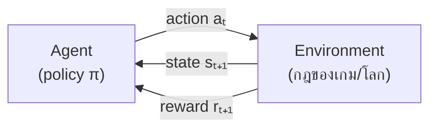
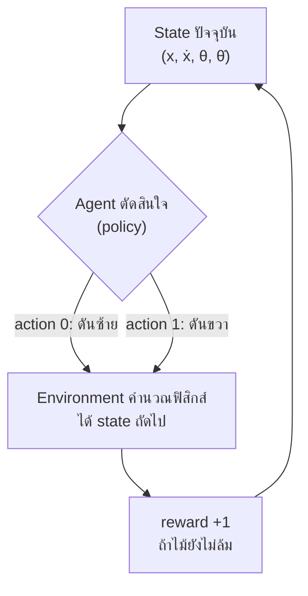
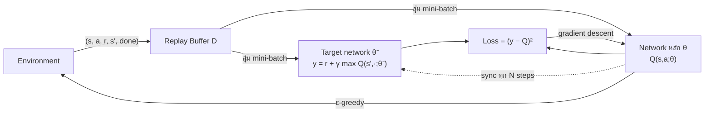

## วัตถุประสงค์การเรียนรู้

เมื่อจบบทนี้ นักศึกษาจะสามารถ (LLO4-3)

- อธิบายองค์ประกอบของ Reinforcement Learning ได้แก่ agent, environment, state, action, reward, policy, episode และ return และบอกได้ว่า RL ต่างจาก supervised/unsupervised learning อย่างไร
- คำนวณ discounted return และอัปเดตค่า Q ด้วยกฎของ Q-Learning (สมการ Bellman) ด้วยมือได้
- อธิบายปัญหา exploration vs exploitation และใช้ ε-greedy ร่วมกับการลดค่า ε (decay) ได้
- เขียน Q-Learning ด้วย NumPy ให้ agent เรียนรู้การเล่นเกม Grid World และออกแบบ reward พร้อมระวังปัญหา reward hacking ได้
- อธิบายว่าทำไมต้องขยับจาก Q-table ไปเป็น Deep Q-Network (DQN) และยกตัวอย่างการใช้ RL กับ game playing ได้

## 1. Reinforcement Learning คืออะไร

**Reinforcement Learning (RL, การเรียนรู้แบบเสริมกำลัง)** คือการเรียนรู้แบบ **ลองผิดลองถูก (trial and error)** โดย **agent** ตัดสินใจทำ action ใน **environment** แล้วได้ผลตอบกลับเป็น **reward** (รางวัล) หรือ **penalty** (บทลงโทษ) เป้าหมายคือหา **policy** ที่ทำให้ได้ reward **รวมระยะยาว** มากที่สุด ไม่ใช่แค่ reward ของก้าวถัดไป

ลองนึกถึงการหัดเล่นเกมใหม่โดยไม่อ่านคู่มือ เรากดปุ่มมั่ว ๆ ไปก่อน สังเกตว่ากดแบบไหนแล้วคะแนนขึ้นหรือตาย แล้วค่อย ๆ จำว่าในสถานการณ์แบบนี้ควรทำอะไร RL ทำแบบเดียวกันนี้ด้วยคณิตศาสตร์

| ประเด็น | Supervised Learning | Unsupervised Learning | Reinforcement Learning |
|---|---|---|---|
| ข้อมูลที่ได้ | (X, y) มีคำตอบที่ถูกต้องให้ | X อย่างเดียว | ประสบการณ์ (s, a, r, s') ที่ agent สร้างเองจากการโต้ตอบ |
| สัญญาณสอน | label ที่ถูกต้องทุกตัวอย่าง | ไม่มี | reward ซึ่งบอกแค่ว่า "ดีแค่ไหน" ไม่บอกว่า "ควรทำอะไร" |
| เวลา | ตัวอย่างเป็นอิสระต่อกัน (i.i.d.) | ตัวอย่างเป็นอิสระต่อกัน | ต่อเนื่องตามลำดับเวลา action ตอนนี้มีผลต่ออนาคต |
| ความยาก | overfitting | การตีความกลุ่ม | reward มาช้า (delayed reward) ต้องรู้ว่า action ไหนเป็นเหตุ (credit assignment) |
| ตัวอย่าง | จำแนกอีเมล spam | แบ่งกลุ่มลูกค้า | เล่นเกม หุ่นยนต์เดิน รถขับเอง |

งานที่ใช้ RL ได้ดี (จากแผนผังความรู้ของรายวิชา)

- **Game AI** เช่น หมากรุก หมากล้อม (AlphaGo) และวิดีโอเกม Atari
- **Real-time decisions** เช่น การควบคุมยานยนต์ไร้คนขับ การปรับไฟจราจร
- **Robot navigation และ skill acquisition** หุ่นยนต์เรียนรู้การเดินหรือหยิบจับสิ่งของ
- **Learning tasks** อื่น ๆ เช่น ระบบแนะนำสินค้าที่ปรับตามผลตอบรับ การจัดการพลังงานในศูนย์ข้อมูล

> [!NOTE]
> RL ไม่ต้องมีผู้เชี่ยวชาญมาบอกคำตอบที่ถูกต้องทุกขั้น ขอแค่ **นิยาม reward** ได้ว่าอะไรคือผลลัพธ์ที่ดี ข้อดีนี้มาพร้อมความเสี่ยง ถ้านิยาม reward ผิด agent จะเรียนสิ่งที่เราไม่ได้ต้องการ (ดูหัวข้อ 6)

## 2. องค์ประกอบของ RL และผลตอบแทนสะสม (Return)

### 2.1 วงจร Agent–Environment



ที่เวลา $t$ agent เห็น state $s_t$ แล้วเลือก action $a_t$ จากนั้น environment ตอบกลับด้วย reward $r_{t+1}$ และ state ใหม่ $s_{t+1}$ วนไปเรื่อย ๆ จนจบเกม

| คำ | สัญลักษณ์ | ความหมาย | ตัวอย่างในเกม Grid World |
|---|---|---|---|
| Agent | – | ผู้ตัดสินใจ/ผู้เรียนรู้ | ตัวละครที่เดินในตาราง |
| Environment | – | โลกที่ agent โต้ตอบด้วย กำหนดกฎและ reward | ตาราง 4×4 ที่มีกำแพง กับดัก และเป้าหมาย |
| State | $s$ | สถานการณ์ปัจจุบันที่ agent รับรู้ | ตำแหน่ง (แถว, คอลัมน์) |
| Action | $a$ | สิ่งที่ agent เลือกทำได้ | ขึ้น ขวา ลง ซ้าย |
| Reward | $r$ | ตัวเลขที่บอกว่าผลของ action ดีแค่ไหน (บวก/ลบ) | ถึง Goal +1, ตกกับดัก −1, เดินหนึ่งก้าว −0.04 |
| Policy | $\pi(a \mid s)$ | กฎการเลือก action ในแต่ละ state | "ที่ช่อง (0,0) ให้เดินขวา" |
| Episode | – | การเล่น 1 รอบตั้งแต่เริ่มจนจบ (terminal) | เริ่มที่ S จนถึง G หรือตกกับดัก |
| Return | $G_t$ | reward รวม (คิดส่วนลด) จากเวลา $t$ ไปจนจบ | ดูหัวข้อ 2.2 |

### 2.2 Discounted Return

agent ไม่ได้ต้องการ reward สูงสุดแค่ก้าวเดียว แต่ต้องการ **ผลรวมของ reward ในอนาคต** โดยให้น้ำหนักกับ reward ที่อยู่ไกลออกไปน้อยลงด้วย **discount factor** $\gamma$ ($0 \le \gamma \le 1$)

$$ G_t = r_{t+1} + \gamma r_{t+2} + \gamma^2 r_{t+3} + \dots = \sum_{k=0}^{\infty} \gamma^k r_{t+k+1} $$

**ตัวอย่างคำนวณด้วยมือ** agent เดิน 5 ก้าว (ได้ −0.04 ทุกก้าว) แล้วก้าวที่ 6 ถึง Goal (+1) ใช้ $\gamma = 0.9$

| ก้าวที่ $k$ | 0 | 1 | 2 | 3 | 4 | 5 |
|---|---|---|---|---|---|---|
| reward $r_{k+1}$ | −0.04 | −0.04 | −0.04 | −0.04 | −0.04 | +1 |
| $\gamma^k$ | 1 | 0.9 | 0.81 | 0.729 | 0.6561 | 0.59049 |
| $\gamma^k r$ | −0.04 | −0.036 | −0.0324 | −0.02916 | −0.026244 | 0.59049 |

$$ G_0 = -0.04(1 + 0.9 + 0.81 + 0.729 + 0.6561) + 0.59049 = -0.163804 + 0.59049 \approx 0.4267 $$

ตรวจด้วย Python และลองเปลี่ยนค่า $\gamma$

```python
import numpy as np

rewards = [-0.04, -0.04, -0.04, -0.04, -0.04, 1.0]   # เดิน 5 ก้าว แล้วถึง Goal ในก้าวที่ 6

def discounted_return(rewards, gamma):
    """G_0 = r_1 + γ r_2 + γ² r_3 + ..."""
    return sum((gamma ** k) * r for k, r in enumerate(rewards))

for gamma in [0.0, 0.5, 0.9, 0.99]:
    print(f"gamma = {gamma:<4} -> G0 = {discounted_return(rewards, gamma):.4f}")
```

```output
gamma = 0.0  -> G0 = -0.0400
gamma = 0.5  -> G0 = -0.0462
gamma = 0.9  -> G0 = 0.4267
gamma = 0.99 -> G0 = 0.7550
```

**การตีความ** เมื่อ $\gamma = 0$ agent "สายตาสั้น" สนใจแค่ reward ก้าวถัดไป (−0.04) ส่วน $\gamma = 0.5$ ลดน้ำหนักเร็วมากจน +1 ที่อยู่ห่างไป 6 ก้าวเหลือแค่ $0.5^5 \approx 0.03$ จึงมองว่าเส้นทางนี้แย่ เมื่อ $\gamma$ เข้าใกล้ 1 agent จะ "มองการณ์ไกล" ให้ความสำคัญกับเป้าหมายระยะยาว

```python
for gamma in [0.9, 0.95, 0.99]:
    half = np.log(0.5) / np.log(gamma)          # γ^k = 0.5  ->  k = log 0.5 / log γ
    print(f"gamma = {gamma}: รางวัลที่อยู่ห่าง {half:5.1f} ก้าวมีน้ำหนักเหลือครึ่งเดียว | 1/(1-γ) = {1/(1-gamma):.0f}")
```

```output
gamma = 0.9: รางวัลที่อยู่ห่าง   6.6 ก้าวมีน้ำหนักเหลือครึ่งเดียว | 1/(1-γ) = 10
gamma = 0.95: รางวัลที่อยู่ห่าง  13.5 ก้าวมีน้ำหนักเหลือครึ่งเดียว | 1/(1-γ) = 20
gamma = 0.99: รางวัลที่อยู่ห่าง  69.0 ก้าวมีน้ำหนักเหลือครึ่งเดียว | 1/(1-γ) = 100
```

> [!TIP]
> $1/(1-\gamma)$ คือ "ขอบเขตการมองไกล" โดยประมาณ ถ้าได้ reward +1 ทุกก้าวไปตลอด return จะเท่ากับ $1/(1-\gamma)$ เช่น CartPole ที่ได้ +1 ทุกก้าวและใช้ $\gamma = 0.99$ ค่า Q ของ agent ที่เก่งแล้วจึงเข้าใกล้ 100

## 3. MDP, Value Function และสมการ Bellman

### 3.1 Markov Decision Process (MDP)

ทฤษฎีของ RL อธิบายปัญหาด้วย **Markov Decision Process (MDP)** ซึ่งประกอบด้วย

- เซตของ state $S$ และเซตของ action $A$
- **Transition probability** $T(s, a, s') = P(s' \mid s, a)$ โอกาสที่จะไป $s'$ เมื่อทำ $a$ ใน $s$
- **Reward** $R(s, a, s')$ reward ที่ได้จากการเปลี่ยน state นั้น
- **Discount factor** $\gamma$

**Markov property** คือสมมติฐานว่า "อนาคตขึ้นกับ state และ action ปัจจุบันเท่านั้น ไม่ขึ้นกับเส้นทางในอดีต"

$$ P(s_{t+1} \mid s_t, a_t, s_{t-1}, a_{t-1}, \dots) = P(s_{t+1} \mid s_t, a_t) $$

ตัวอย่าง ภาพหน้าจอเกม Atari **ภาพเดียว** ไม่เป็น Markov เพราะบอกไม่ได้ว่าลูกบอลกำลังวิ่งไปทางไหน แต่ถ้า **ซ้อน 4 เฟรมล่าสุด** เป็น state เดียว (frame stacking) ก็จะเห็นทิศทางและความเร็ว ทำให้ state ใกล้เคียง Markov มากขึ้น (หัวข้อ 7.4)

### 3.2 Value Function และ Action-Value Function

| ฟังก์ชัน | นิยาม | ความหมาย |
|---|---|---|
| State-value $V^\pi(s)$ | $\mathbb{E}_\pi[G_t \mid s_t = s]$ | ถ้าอยู่ที่ $s$ แล้วเล่นตาม policy $\pi$ คาดว่าจะได้ return เท่าไร |
| Action-value $Q^\pi(s,a)$ | $\mathbb{E}_\pi[G_t \mid s_t = s, a_t = a]$ | ถ้าอยู่ที่ $s$ ทำ $a$ ก่อน แล้วเล่นตาม $\pi$ คาดว่าจะได้ return เท่าไร |

ค่า $Q$ เรียกอีกชื่อว่า **Quality value** ถ้ารู้ค่า $Q^*(s, a)$ ที่ดีที่สุดแล้ว policy ที่ดีที่สุดหาได้ทันทีด้วยการเลือก action ที่ $Q$ สูงสุด

$$ \pi^*(s) = \arg\max_a Q^*(s, a), \qquad V^*(s) = \max_a Q^*(s, a) $$

### 3.3 สมการ Bellman

Richard Bellman แสดงว่าค่าที่ดีที่สุดของ state หนึ่งเขียนแบบเวียนเกิด (recursive) ได้ว่า **reward ที่ได้ทันที + ค่าส่วนลดของ state ถัดไป**

$$ Q^*(s, a) = \sum_{s'} T(s, a, s')\left[ R(s, a, s') + \gamma \max_{a'} Q^*(s', a') \right] $$

ถ้า environment เป็นแบบ deterministic (ทำ $a$ แล้วไป $s'$ แน่นอน) จะลดรูปเหลือ

$$ Q(s, a) = R(s, a) + \gamma \max_{a'} Q(s', a') $$

ถ้ารู้ $T$ และ $R$ ครบ เราใช้ **Value Iteration / Q-Value Iteration** แก้สมการนี้ได้ตรง ๆ (แบบ dynamic programming) แต่ในเกมจริง agent **ไม่รู้กฎ** ล่วงหน้า จึงต้องเรียนรู้จากประสบการณ์ ซึ่งเป็นที่มาของ Q-Learning

## 4. Q-Learning และ Exploration vs Exploitation

### 4.1 กฎการอัปเดตของ Q-Learning

Q-Learning (Watkins, 1989) เก็บค่า $Q(s,a)$ ไว้ในตาราง (**Q-table**) ทุกครั้งที่ได้ประสบการณ์ $(s, a, r, s')$ หนึ่งชุด จะขยับค่า $Q(s,a)$ เข้าหาเป้าหมายตามสมการ Bellman ทีละน้อย

$$ Q(s,a) \leftarrow Q(s,a) + \alpha \Big[ \underbrace{r + \gamma \max_{a'} Q(s',a')}_{\text{TD target}} - Q(s,a) \Big] $$

ส่วนในวงเล็บเหลี่ยมเรียกว่า **TD error** ($\delta$) คือ "ความแปลกใจ" ระหว่างสิ่งที่คาดไว้กับสิ่งที่เพิ่งเห็น ถ้า $s'$ เป็น state จบเกม (terminal) ไม่มีอนาคตแล้ว TD target จึงเหลือแค่ $r$

| พารามิเตอร์ | ชื่อ | บทบาท | ค่าที่นิยม |
|---|---|---|---|
| $\alpha$ | learning rate | ขยับค่า Q เข้าหาเป้าแรงแค่ไหน (มาก = เรียนเร็วแต่แกว่ง, น้อย = นิ่งแต่ช้า) | 0.05–0.5 |
| $\gamma$ | discount factor | ให้ความสำคัญกับอนาคตมากแค่ไหน | 0.9–0.99 |
| $\varepsilon$ | exploration rate | โอกาสที่จะสุ่ม action เพื่อสำรวจ | เริ่ม 1.0 แล้วลดลงถึง 0.01–0.1 |

**ตัวอย่างอัปเดตด้วยมือ** กำหนด $Q(s,a) = 0.5$, ได้ $r = -0.04$, state ถัดไปมี $Q(s', \cdot) = [0.2, 0.8, 0.6, 0.1]$, $\alpha = 0.1$, $\gamma = 0.9$

1. TD target $= r + \gamma \max_{a'} Q(s',a') = -0.04 + 0.9 \times 0.8 = 0.68$
2. TD error $\delta = 0.68 - 0.5 = 0.18$
3. $Q(s,a)$ ใหม่ $= 0.5 + 0.1 \times 0.18 = 0.518$

```python
alpha, gamma = 0.1, 0.9
q_sa      = 0.50     # Q(s, a) เดิม
r         = -0.04    # reward ที่ได้
q_next    = np.array([0.20, 0.80, 0.60, 0.10])   # Q(s', a') ของทั้ง 4 actions

td_target = r + gamma * q_next.max()
td_error  = td_target - q_sa
q_new     = q_sa + alpha * td_error
print(f"TD target = {td_target:.4f}")
print(f"TD error  = {td_error:.4f}")
print(f"Q ใหม่     = {q_new:.4f}")
```

```output
TD target = 0.6800
TD error  = 0.1800
Q ใหม่     = 0.5180
```

> [!NOTE]
> Q-Learning เป็นแบบ **off-policy** คือ agent อาจเดินแบบสุ่ม ๆ (behavior policy) แต่ตัว update ใช้ $\max_{a'}$ ซึ่งเป็นค่าของ policy ที่ดีที่สุด (target policy) จึงเรียนรู้ policy ที่ดีที่สุดได้แม้ตอนเก็บประสบการณ์จะเล่นไม่เก่ง ส่วน **SARSA** เป็นแบบ on-policy ใช้ $Q(s', a')$ ของ action ที่ทำจริงแทน $\max$ นอกจากนี้ทั้งสองวิธีเป็นแบบ **model-free** คือไม่ต้องรู้ $T$ และ $R$ ล่วงหน้า

### 4.2 Exploration vs Exploitation

- **Exploitation (ใช้ประโยชน์)** เลือก action ที่ตอนนี้ $Q$ สูงสุด ได้ผลดีระยะสั้น แต่อาจติดอยู่กับทางที่ "พอใช้" และไม่เคยเจอทางที่ดีกว่า
- **Exploration (สำรวจ)** ลอง action อื่น ๆ เพื่อเก็บข้อมูลใหม่ อาจเสีย reward ตอนนี้ แต่ได้ความรู้ที่ใช้ทีหลัง

เหมือนการเลือกร้านอาหาร ถ้ากินแต่ร้านเดิมที่อร่อยพอใช้ (exploit) ก็จะไม่มีทางรู้ว่าร้านใหม่หน้ามหาวิทยาลัยอร่อยกว่า แต่ถ้าลองร้านใหม่ทุกวัน (explore) ก็จะเจอร้านไม่อร่อยบ่อย

วิธีที่ง่ายและนิยมที่สุดคือ **ε-greedy** สุ่ม action ด้วยความน่าจะเป็น $\varepsilon$ และเลือก action ที่ดีที่สุดด้วยความน่าจะเป็น $1-\varepsilon$

```python
rng = np.random.default_rng(0)

def epsilon_greedy(q_row, epsilon, rng):
    """q_row = Q(s, ·) ของ state ปัจจุบัน"""
    if rng.random() < epsilon:
        return int(rng.integers(len(q_row)))      # Exploration: สุ่ม action
    best = np.flatnonzero(q_row == q_row.max())   # Exploitation: action ที่ Q สูงสุด
    return int(rng.choice(best))                  # (ถ้าเสมอกันหลายตัว ให้สุ่มเลือก)

q_row = np.array([0.1, 0.7, 0.3, 0.2])
for eps in [0.0, 0.1, 0.5, 1.0]:
    picks = [epsilon_greedy(q_row, eps, rng) for _ in range(10_000)]
    print(f"epsilon = {eps:.1f} -> เลือก action ที่ดีที่สุด (1) {np.mean(np.array(picks) == 1):.1%}")
```

```output
epsilon = 0.0 -> เลือก action ที่ดีที่สุด (1) 100.0%
epsilon = 0.1 -> เลือก action ที่ดีที่สุด (1) 92.8%
epsilon = 0.5 -> เลือก action ที่ดีที่สุด (1) 62.6%
epsilon = 1.0 -> เลือก action ที่ดีที่สุด (1) 24.1%
```

ค่าที่ได้สอดคล้องกับทฤษฎี $P(\text{best}) = (1-\varepsilon) + \varepsilon/4$ เช่น $\varepsilon = 0.1$ ได้ $0.9 + 0.025 = 0.925$ (การสุ่มก็มีโอกาสเลือก action ที่ดีที่สุดเช่นกัน)

**ε-decay** ช่วงแรก agent ยังไม่รู้อะไรจึงควรสำรวจมาก แล้วค่อย ๆ ลด $\varepsilon$ เมื่อเรียนรู้มากขึ้น

```python
eps_start, eps_min, decay = 1.0, 0.05, 0.99
for ep in [0, 50, 100, 200, 300, 500]:
    eps = max(eps_min, eps_start * decay ** ep)
    print(f"episode {ep:3d}: epsilon = {eps:.3f}")
```

```output
episode   0: epsilon = 1.000
episode  50: epsilon = 0.605
episode 100: epsilon = 0.366
episode 200: epsilon = 0.134
episode 300: epsilon = 0.050
episode 500: epsilon = 0.050
```

> [!WARNING]
> `np.argmax` คืน index **ตัวแรก** เมื่อค่าเสมอกัน ตอนเริ่มต้นที่ Q-table เป็น 0 ทั้งหมด agent ที่ใช้ `argmax` ตรง ๆ จะเลือก action 0 ซ้ำ ๆ ในเกมที่ reward เป็น 0 เกือบทุกก้าว (เช่น FrozenLake) agent อาจไม่เคยเจอเป้าหมายเลย จึงควร **สุ่มเลือกเมื่อเสมอกัน** แบบในโค้ดด้านบน

## 5. ลงมือ: Q-Learning บนเกม Grid World ด้วย NumPy

### 5.1 สร้าง Environment

เกมของเราเป็นตาราง 4×4 agent เริ่มที่มุมซ้ายบน ต้องเดินไปเป้าหมายมุมขวาล่างโดยไม่ตกกับดัก

| | คอลัมน์ 0 | 1 | 2 | 3 |
|---|---|---|---|---|
| **แถว 0** | S (state 0) | . | . | . |
| **แถว 1** | . | # | . | T (−1) |
| **แถว 2** | . | . | . | . |
| **แถว 3** | T (−1) | . | # | G (+1) |

S = จุดเริ่ม, G = เป้าหมาย (+1 จบเกม), T = กับดัก (−1 จบเกม), # = กำแพง, เดินหนึ่งก้าว −0.04 (กระตุ้นให้รีบไปถึงเป้าหมาย) ชนขอบหรือกำแพงจะอยู่ที่เดิม เราเขียน environment ให้มี API แบบเดียวกับ **Gymnasium** คือ `reset()` และ `step(action)` ที่คืนค่า `(state, reward, terminated, truncated, info)` เพื่อให้นำโค้ด Q-Learning ไปใช้กับ Gymnasium ได้ทันที

```python
class GridWorld:
    """Grid World 4×4 ที่มี API คล้าย Gymnasium: reset() / step(action)

    S = จุดเริ่ม, G = เป้าหมาย (+1), T = กับดัก (-1), # = กำแพง, . = ช่องว่าง
    """
    MAP = ["S...",
           ".#.T",
           "....",
           "T.#G"]
    ACTIONS = [(-1, 0), (0, 1), (1, 0), (0, -1)]   # 0=ขึ้น 1=ขวา 2=ลง 3=ซ้าย
    ARROWS = "↑→↓←"

    def __init__(self, step_reward=-0.04, goal_reward=1.0, trap_reward=-1.0, max_steps=50):
        self.n_rows, self.n_cols = len(self.MAP), len(self.MAP[0])
        self.n_states, self.n_actions = self.n_rows * self.n_cols, 4
        self.step_reward, self.goal_reward, self.trap_reward = step_reward, goal_reward, trap_reward
        self.max_steps = max_steps

    def reset(self):
        self.pos, self.t = (0, 0), 0
        return self.state(), {}

    def state(self):
        return self.pos[0] * self.n_cols + self.pos[1]   # (row, col) -> เลข state 0..15

    def step(self, action):
        dr, dc = self.ACTIONS[action]
        r, c = self.pos[0] + dr, self.pos[1] + dc
        if 0 <= r < self.n_rows and 0 <= c < self.n_cols and self.MAP[r][c] != "#":
            self.pos = (r, c)                    # เดินได้ ถ้าไม่ชนขอบหรือกำแพง
        self.t += 1
        cell = self.MAP[self.pos[0]][self.pos[1]]
        if cell == "G":
            reward, terminated = self.goal_reward, True
        elif cell == "T":
            reward, terminated = self.trap_reward, True
        else:
            reward, terminated = self.step_reward, False
        truncated = self.t >= self.max_steps     # ตัดจบเมื่อเดินนานเกินไป
        return self.state(), reward, terminated, truncated, {}

env = GridWorld()
s, info = env.reset()
print("state เริ่มต้น:", s)
print("เดินขวา ->", env.step(1))
print("เดินลง  ->", env.step(2))   # ชนกำแพง (1,1) จึงอยู่ที่เดิม
```

```output
state เริ่มต้น: 0
เดินขวา -> (1, -0.04, False, False, {})
เดินลง  -> (1, -0.04, False, False, {})
```

`terminated` หมายถึงเกมจบตามกฎ (ถึง G หรือตก T) ส่วน `truncated` หมายถึงถูกตัดจบเพราะเกินเวลาที่กำหนด ความต่างนี้สำคัญ ถ้า terminated ไม่มีอนาคตแล้ว แต่ถ้า truncated อนาคตยังมีอยู่ เพียงแต่เราหยุดดูเอง

### 5.2 Training Loop ของ Q-Learning

```python
def q_learning(env, n_episodes=500, alpha=0.1, gamma=0.9,
               eps_start=1.0, eps_min=0.05, eps_decay=0.99, seed=42):
    rng = np.random.default_rng(seed)
    Q = np.zeros((env.n_states, env.n_actions))
    episode_rewards = []
    epsilon = eps_start
    for ep in range(n_episodes):
        s, _ = env.reset()
        total, done = 0.0, False
        while not done:
            a = epsilon_greedy(Q[s], epsilon, rng)                 # 1) เลือก action
            s_next, r, terminated, truncated, _ = env.step(a)     # 2) ทำ action
            target = r if terminated else r + gamma * Q[s_next].max()
            Q[s, a] += alpha * (target - Q[s, a])                 # 3) Q-learning update
            s, total = s_next, total + r
            done = terminated or truncated
        epsilon = max(eps_min, epsilon * eps_decay)                # 4) ลด ε ทีละน้อย
        episode_rewards.append(total)
    return Q, episode_rewards

Q, ep_rewards = q_learning(env)
ep_rewards = np.array(ep_rewards)
for start in range(0, 500, 100):
    print(f"episode {start:3d}-{start+99:3d}: reward เฉลี่ย = {ep_rewards[start:start+100].mean():6.3f}")
```

```output
episode   0- 99: reward เฉลี่ย = -0.595
episode 100-199: reward เฉลี่ย =  0.484
episode 200-299: reward เฉลี่ย =  0.698
episode 300-399: reward เฉลี่ย =  0.711
episode 400-499: reward เฉลี่ย =  0.752
```

ช่วงแรก agent เดินสุ่มจึงตกกับดักบ่อยหรือเดินวนจนหมดเวลา (reward เฉลี่ยติดลบ) เมื่อ $\varepsilon$ ลดลงและ Q-table แม่นขึ้น reward เฉลี่ยจะเพิ่มขึ้นจนเข้าใกล้ 0.8 ซึ่งเป็น reward ของเส้นทางที่สั้นที่สุด (5 × (−0.04) + 1) ที่ยังไม่ถึง 0.8 พอดีเพราะยังมีการสุ่ม 5%

### 5.3 อ่าน Policy และ Q-table ที่เรียนได้

```python
def show_policy(env, Q):
    for r in range(env.n_rows):
        row = ""
        for c in range(env.n_cols):
            cell = env.MAP[r][c]
            if cell in "#GT":
                row += f" {cell} "
            else:
                row += f" {env.ARROWS[Q[r * env.n_cols + c].argmax()]} "
        print(row)

show_policy(env, Q)
print()
print("V(s) = max_a Q(s,a)")
print(np.round(Q.max(axis=1).reshape(4, 4), 3))
```

```output
 →  →  ↓  ← 
 ↓  #  ↓  T 
 →  →  →  ↓ 
 T  ↑  #  G 

V(s) = max_a Q(s,a)
[[0.427 0.519 0.621 0.322]
 [0.184 0.    0.734 0.   ]
 [0.44  0.704 0.86  1.   ]
 [0.    0.026 0.    0.   ]]
```

```python
import pandas as pd

q_df = pd.DataFrame(np.round(Q, 3), columns=["↑", "→", "↓", "←"])
q_df.index.name = "state"
print(q_df.head(8))
```

```output
           ↑      →      ↓      ←
state                            
0      0.205  0.427  0.019  0.144
1      0.264  0.519  0.303  0.175
2      0.341  0.072  0.621  0.327
3     -0.037 -0.041 -0.815  0.322
4     -0.019 -0.086  0.184 -0.081
5      0.000  0.000  0.000  0.000
6      0.419 -0.948  0.734  0.462
7      0.000  0.000  0.000  0.000
```

```python
def run_greedy(env, Q):
    s, _ = env.reset()
    path, total, done = [s], 0.0, False
    while not done:
        s, r, terminated, truncated, _ = env.step(int(Q[s].argmax()))   # ε = 0
        path.append(s)
        total += r
        done = terminated or truncated
    return path, total

path, total = run_greedy(env, Q)
print("เส้นทาง (state):", path)
print(f"จำนวนก้าว = {len(path) - 1}, reward รวม = {total:.2f}")
```

```output
เส้นทาง (state): [0, 1, 2, 6, 10, 11, 15]
จำนวนก้าว = 6, reward รวม = 0.80
```

**การตีความ**

- policy (ลูกศร) พาจาก S ไป G ใน 6 ก้าว ซึ่งเป็นทางที่สั้นที่สุด และหลบกับดักทั้งสองจุด
- $V(\text{start}) = 0.427$ ตรงกับ discounted return ที่คำนวณด้วยมือในหัวข้อ 2.2 ($0.4267$) แปลว่า Q-Learning ประมาณค่าของ state เริ่มต้นได้ถูกต้อง
- state 6 (แถว 1 คอลัมน์ 2) มี $Q(s, \rightarrow) = -0.948$ เพราะเดินขวาคือตกกับดัก agent เรียนรู้ได้ว่า "ห้ามไปทางนั้น"
- state 5 และ 7 เป็นกำแพงและกับดัก ไม่เคยถูกอัปเดตจึงเป็น 0 ส่วน state ที่ไม่ค่อยถูกเยี่ยม เช่น แถว 3 คอลัมน์ 1 ($V = 0.026$) ค่ายังไม่ลู่เข้า แม้ลูกศรจะถูกทิศ นี่คือผลของการสำรวจที่น้อยลงเมื่อ $\varepsilon$ ต่ำ

## 6. การออกแบบ Reward (Reward Design)

reward คือ "ภาษา" เดียวที่เราใช้บอก agent ว่าต้องการอะไร agent จะ **ทำให้ reward สูงสุดตามตัวอักษร** ไม่ใช่ตามเจตนาของเรา

### 6.1 Sparse vs Shaped Reward

| แบบ | ลักษณะ | ข้อดี | ข้อเสีย | ตัวอย่าง |
|---|---|---|---|---|
| **Sparse reward** | ให้ reward เฉพาะตอนสำเร็จ/ล้มเหลว | นิยามง่าย ไม่ชี้นำผิดทาง | เรียนช้ามาก agent อาจไม่เคยเจอ reward เลย | FrozenLake (+1 เมื่อถึงเป้าหมายเท่านั้น), Montezuma's Revenge ซึ่ง DQN รุ่นแรกทำคะแนนได้ 0 |
| **Shaped reward** | เพิ่ม reward ระหว่างทางเพื่อชี้ทิศ | เรียนเร็วขึ้น | ถ้าออกแบบไม่ดี agent จะหาช่องโหว่ | ได้โบนัสเมื่อเข้าใกล้เป้าหมาย |

วิธี shaping ที่ปลอดภัยในทางทฤษฎีคือ **potential-based shaping** (Ng, Harada & Russell, 1999) ให้ reward เพิ่ม $F = \gamma\Phi(s') - \Phi(s)$ โดย $\Phi$ เป็นฟังก์ชันศักย์ (เช่น ลบด้วยระยะถึงเป้าหมาย) วิธีนี้รับประกันว่า optimal policy ไม่เปลี่ยน เพราะการเดินวนกลับมาที่เดิมจะได้โบนัสรวมเป็นศูนย์ (ไม่เกิน) จึงหาประโยชน์จากการวนไม่ได้

### 6.2 Reward Hacking

**Reward hacking** คือ agent หาวิธีได้ reward สูงโดยไม่ทำงานที่เราต้องการ ตัวอย่างที่มีชื่อเสียงคือเกมแข่งเรือ CoastRunners ที่ OpenAI รายงานในปี 2016 agent เรียนรู้ที่จะวนเรือเก็บเป้าโบนัสซ้ำ ๆ ในอ่าวเล็ก ๆ ได้คะแนนสูงกว่าการแข่งให้จบ ทั้งที่ไม่เคยเข้าเส้นชัย

ทดลองใน Grid World ของเรา ถ้าเปลี่ยน reward ต่อก้าวจาก −0.04 เป็น **+0.2** (ตั้งใจจะ "ให้กำลังใจ" agent)

```python
for step_reward in [-0.04, +0.2]:
    env_r = GridWorld(step_reward=step_reward)
    Q_r, _ = q_learning(env_r, n_episodes=1000)
    path, total = run_greedy(env_r, Q_r)
    print(f"step_reward = {step_reward:+.2f} -> เดิน {len(path) - 1} ก้าว, "
          f"จบที่ state {path[-1]}, reward รวม = {total:.2f}")
    show_policy(env_r, Q_r)
    print()
```

```output
step_reward = -0.04 -> เดิน 6 ก้าว, จบที่ state 15, reward รวม = 0.80
 →  →  ↓  ← 
 ↓  #  ↓  T 
 →  →  →  ↓ 
 T  ↑  #  G 

step_reward = +0.20 -> เดิน 50 ก้าว, จบที่ state 0, reward รวม = 10.00
 ↑  ←  ←  ← 
 ↑  #  ↑  T 
 ↑  ←  ↑  ← 
 T  ↑  #  G 
```

เมื่อเดินแต่ละก้าวได้ +0.2 การเดินชนขอบอยู่กับที่ไปเรื่อย ๆ มีค่าประมาณ $0.2/(1-0.9) = 2$ ซึ่งมากกว่า +1 จากการถึงเป้าหมาย agent จึง **ไม่ยอมจบเกม** เดินชนขอบที่ state 0 จนหมดเวลา 50 ก้าว ได้ reward รวม 10 สูงกว่าการไปถึง G แต่ผิดเจตนาของผู้ออกแบบโดยสิ้นเชิง ในทางกลับกัน ถ้าลงโทษต่อก้าวแรงเกินไป (เช่น −1) agent อาจเลือก "ตกกับดักให้จบเร็ว ๆ" แทน ซึ่งนักศึกษาจะได้ทดลองในใบงาน

### 6.3 กิจกรรม: ออกแบบ Reward ให้เกม

แบ่งกลุ่ม เลือกเกมหนึ่งเกม (เช่น Snake, Pac-Man, เกมแข่งรถ, Flappy Bird) แล้วตอบ

1. state, action และเงื่อนไขจบเกม (terminal) คืออะไร
2. ออกแบบ reward อย่างน้อย 3 รายการ (เป้าหมายหลัก, บทลงโทษ, reward ระหว่างทาง)
3. หาช่องโหว่อย่างน้อย 1 ข้อที่ agent อาจใช้ hack reward ของกลุ่มตัวเอง และเสนอวิธีแก้

<details><summary>ตัวอย่างคำตอบ: เกม Snake</summary>

- state: ตำแหน่งหัวงู ทิศทาง ตำแหน่งอาหาร และสิ่งกีดขวางรอบหัว, action: ตรงไป เลี้ยวซ้าย เลี้ยวขวา, terminal: ชนกำแพงหรือชนตัวเอง
- reward: กินอาหาร +10, ตาย −10, เดินหนึ่งก้าว −0.01 (กันการเดินวนไม่สิ้นสุด)
- ช่องโหว่: ถ้าให้ +0.1 เมื่อ "เข้าใกล้อาหาร" โดยไม่หักเมื่อถอยออก งูจะเดินเข้า-ออกใกล้อาหารวนไปมาเพื่อเก็บโบนัส แก้โดยใช้ potential-based shaping ($F = \gamma\Phi(s') - \Phi(s)$, $\Phi = -$ระยะถึงอาหาร) หรือจำกัดจำนวนก้าวต่ออาหารหนึ่งชิ้น

</details>

## 7. จาก Q-Table สู่ Deep RL

### 7.1 State ต่อเนื่อง: CartPole และการ Discretize

**CartPole** คือรถเข็นบนรางที่มีไม้ตั้งอยู่ agent ต้องดันรถซ้ายหรือขวาเพื่อไม่ให้ไม้ล้ม ได้ reward +1 ทุกก้าวที่ไม้ยังตั้งอยู่ observation มี 4 ค่าต่อเนื่อง คือ ตำแหน่งรถ $x$, ความเร็วรถ $\dot{x}$, มุมไม้ $\theta$ และความเร็วเชิงมุม $\dot{\theta}$ เกมจบเมื่อไม้เอียงเกินประมาณ 12° หรือรถออกนอกราง ($|x| > 2.4$) และใน `CartPole-v1` ถูกตัดจบ (truncated) ที่ 500 ก้าว



ค่าต่อเนื่องมีได้ไม่จำกัด จึงสร้าง Q-table ตรง ๆ ไม่ได้ วิธีแรกคือ **discretize** แบ่งแต่ละค่าเป็นช่อง (bin) โค้ดด้านล่างใช้จำนวน bin เดียวกับ Q-Learning agent ในเว็บแล็บของรายวิชา (3 × 3 × 8 × 12)

```python
# จำนวน bin และช่วงค่าของ (x, ẋ, θ, θ̇) — ค่าเดียวกับ QLearningAgent ใน cartpole_web/app/agents.py
BINS  = np.array([3, 3, 8, 12])
LOWS  = np.array([-2.4, -3.0, -0.21, -3.5])
HIGHS = np.array([ 2.4,  3.0,  0.21,  3.5])

def discretize(obs):
    ratios = (np.clip(obs, LOWS, HIGHS) - LOWS) / (HIGHS - LOWS)    # สเกลเป็น 0..1
    idx = np.minimum((ratios * BINS).astype(int), BINS - 1)          # แปลงเป็นเลข bin
    return tuple(int(i) for i in idx)

obs_examples = {
    "ตั้งตรงกลางราง":       [0.00,  0.0,  0.00,  0.0],
    "ไม้เอียงขวาเล็กน้อย":   [0.10,  0.2,  0.05,  0.4],
    "ไม้กำลังล้มไปทางซ้าย":  [-0.5, -0.8, -0.15, -2.0],
}
for name, obs in obs_examples.items():
    print(f"{name:<22} {obs} -> s = {discretize(np.array(obs))}")

q_table = np.zeros(tuple(BINS) + (2,))       # 2 actions: ดันซ้าย / ดันขวา
print("ขนาด Q-table:", q_table.shape, "=", q_table.size, "ค่า")
```

```output
ตั้งตรงกลางราง         [0.0, 0.0, 0.0, 0.0] -> s = (1, 1, 4, 6)
ไม้เอียงขวาเล็กน้อย    [0.1, 0.2, 0.05, 0.4] -> s = (1, 1, 4, 6)
ไม้กำลังล้มไปทางซ้าย   [-0.5, -0.8, -0.15, -2.0] -> s = (1, 1, 1, 2)
ขนาด Q-table: (3, 3, 8, 12, 2) = 1728 ค่า
```

สังเกตว่า "ตั้งตรง" กับ "เอียงขวาเล็กน้อย" ตกอยู่ใน bin เดียวกัน agent จึงแยกสองสถานการณ์นี้ไม่ออก นี่คือข้อจำกัดของการ discretize ถ้าแบ่งละเอียดขึ้น ตารางจะใหญ่ขึ้นแบบทวีคูณ (curse of dimensionality) และแต่ละช่องถูกเยี่ยมน้อยลงจนเรียนรู้ช้า ตัว bin จึงให้ความละเอียดกับ $\theta$ และ $\dot\theta$ มากกว่า $x$ และ $\dot x$ เพราะมุมไม้สำคัญที่สุดต่อการทรงตัว

### 7.2 Gymnasium: มาตรฐานของ Environment

**Gymnasium** (เดิมคือ OpenAI Gym ซึ่งหยุดพัฒนาแล้ว ปัจจุบันดูแลโดย Farama Foundation) เป็นไลบรารีมาตรฐานที่รวม environment ไว้ให้ใช้ด้วย API เดียวกัน โค้ดนี้ให้รันใน Google Colab (`pip install gymnasium` ถ้ายังไม่มี)

```python
import gymnasium as gym

env = gym.make("CartPole-v1")
obs, info = env.reset(seed=42)               # reset คืน (observation, info)
print("observation:", obs)                   # [x, x_dot, theta, theta_dot]

total, done = 0.0, False
while not done:
    action = env.action_space.sample()       # random agent
    obs, reward, terminated, truncated, info = env.step(action)
    total += reward
    done = terminated or truncated           # จบตามกฎ หรือถูกตัดที่ 500 ก้าว
print("reward รวม:", total)
env.close()
```

ตัวอย่างผลลัพธ์ (ค่าที่ได้จะต่างกันในแต่ละครั้ง) observation เป็น array 4 ค่าใกล้ 0 และ random agent มักได้ reward รวมเพียงประมาณ 10–50 (เฉลี่ยราว 20 กว่า) ขณะที่ agent ที่ฝึกดีแล้วได้เต็ม 500

`FrozenLake-v1` เป็นเกม grid 4×4 คล้ายของเรา แต่ **พื้นลื่น** (`is_slippery=True` ค่าเริ่มต้น) ทำ action แล้วจะไปทิศที่ตั้งใจเพียง 1/3 ที่เหลือไถลไปด้านข้าง จึงเป็น MDP แบบ stochastic และให้ reward +1 เฉพาะตอนถึงเป้าหมาย (sparse) observation เป็นเลข state 0–15 และ action คือ 0=ซ้าย 1=ลง 2=ขวา 3=ขึ้น ฟังก์ชัน `q_learning` ในหัวข้อ 5 ใช้กับเกมนี้ได้เกือบทันที (ใบงานข้อ 6)

> [!WARNING]
> โค้ดเก่าบนอินเทอร์เน็ตจำนวนมากใช้ `import gym` และ `obs = env.reset()`, `obs, reward, done, info = env.step(a)` (คืน 4 ค่า) ซึ่งเป็น API เก่า Gymnasium คืน **5 ค่า** โดยแยก `done` เป็น `terminated` กับ `truncated` และ `reset()` คืน `(obs, info)`

### 7.3 เว็บแล็บ RL ของรายวิชา (สาธิตในชั้นเรียน)

ผู้สอนเตรียมเว็บแอปจำลอง RL ไว้ที่ `02 Machine Learning/Machine Learning Vault/04_Reinforcement_Learning/cartpole_web` (FastAPI + Gymnasium ฝั่ง server ส่ง state ผ่าน WebSocket ไปวาดบน browser) รันด้วย Docker Desktop

```bash
docker compose up -d --build     # จากนั้นเปิด http://localhost:8000
docker compose down              # หยุดการทำงาน
```

| หน้า | สิ่งที่ได้เห็น |
|---|---|
| `/cartpole` | เปรียบเทียบ agent: Random (~25), Heuristic (PD controller ได้ 500), Q-Learning แบบ pretrained (500) และฝึกจากศูนย์ พร้อมกราฟ reward ต่อ episode |
| `/qtable` | Q-Table Lab เดิน Q-Learning **ทีละ step** แสดง discretize → ε-greedy → แทนค่าสมการ Bellman (TD target, TD error, Q ใหม่) และ heatmap ของ Q-table แกน θ × θ̇ |
| `/maze` | Maze DQN เขียนด้วย **NumPy ล้วน** (MLP 64-64 + Adam) แสดง replay buffer, target network และการแทนค่า DQN loss |
| `/atari` | Breakout DQN จาก pixel ตามตัวอย่าง Keras แสดงภาพ 4 เฟรมที่ซ้อนกัน feature map ของ CNN และ ε schedule |

ข้อสังเกตจากเว็บแล็บ Q-table ของ CartPole ที่ฝึก 3000 episodes มีกราฟ reward **ไม่เสถียร** (คะแนนตกแล้วกลับขึ้น) ซึ่งเป็นลักษณะปกติของ tabular Q-Learning บน state ที่ discretize จึงต้องเก็บ checkpoint ที่ดีที่สุดไว้ และค่า Q ของ agent ที่เก่งแล้วอยู่ราว 90 ใกล้ $1/(1-\gamma) = 100$ เมื่อ $\gamma = 0.99$

### 7.4 Deep Q-Network (DQN)

เมื่อ state เป็นภาพหน้าจอเกมขนาด 84×84 พิกเซล 4 เฟรม (ค่าละ 0–255) จำนวน state ที่เป็นไปได้คือ $256^{84 \times 84 \times 4} \approx 10^{67970}$ ตารางเก็บไม่ได้แน่นอน **DQN** (Mnih et al., DeepMind) จึงใช้ neural network $Q(s, a; \theta)$ รับ state แล้วทำนายค่า Q ของทุก action พร้อมกัน แทนการเปิดตาราง

การฝึก network ด้วย Q-Learning ตรง ๆ ไม่เสถียร DQN จึงเพิ่มสองเทคนิค

1. **Experience Replay** เก็บประสบการณ์ $(s, a, r, s', \text{done})$ ไว้ใน replay buffer $D$ แล้ว **สุ่ม** mini-batch มาฝึก ทำลายความสัมพันธ์ต่อเนื่องของข้อมูลที่เกิดติดกัน (correlation) และนำประสบการณ์เก่ามาใช้ซ้ำได้
2. **Target Network** ($\theta^-$) สำเนาของ network ที่ถูก "แช่แข็ง" ไว้ใช้คำนวณเป้าหมาย และ sync ให้เท่ากับ network หลักเป็นระยะ (เช่น ทุก 10,000 steps ในตัวอย่าง Atari ของ Keras) ทำให้เป้าหมายไม่ขยับตามทุกครั้งที่อัปเดต

$$ L(\theta) = \mathbb{E}_{(s,a,r,s') \sim U(D)} \left[ \left( \underbrace{r + \gamma \max_{a'} Q(s', a'; \theta^-)}_{\text{target } y \text{ จาก target network}} - \underbrace{Q(s, a; \theta)}_{\text{network หลัก}} \right)^2 \right] $$



ตัวอย่างด้านล่างจำลองกลไกนี้ด้วย NumPy โดยใช้ Q-table จากหัวข้อ 5 แทน "target network" เพื่อให้เห็นการคำนวณ target $y$ จาก mini-batch

```python
from collections import deque
import random

random.seed(0)
replay_buffer = deque(maxlen=1000)           # Replay Buffer D (เก็บได้สูงสุด 1000 transitions)

# เก็บประสบการณ์จากการเดินสุ่มใน GridWorld
env_d = GridWorld()
s, _ = env_d.reset()
for _ in range(200):
    a = random.randrange(4)
    s_next, r, terminated, truncated, _ = env_d.step(a)
    replay_buffer.append((s, a, r, s_next, terminated))
    s = env_d.reset()[0] if (terminated or truncated) else s_next

# สุ่ม mini-batch แล้วคำนวณ target y = r + γ max Q(s'; θ⁻) โดยใช้ Q จากหัวข้อ 5 เป็น "target network"
batch = random.sample(list(replay_buffer), 4)
Q_target = Q.copy()            # θ⁻ : สำเนาที่ถูกแช่แข็งไว้
Q_online = Q * 0.9             # θ  : สมมติว่าเครือข่ายหลักยังเรียนไม่เสร็จ
gamma = 0.9
for s, a, r, s_next, done in batch:
    y = r if done else r + gamma * Q_target[s_next].max()
    print(f"(s={s:2d}, a={GridWorld.ARROWS[a]}, r={r:+.2f}, s'={s_next:2d}, done={done!s:5}) "
          f"y = {y:+.3f}  Q(s,a;θ) = {Q_online[s, a]:+.3f}  squared error = {(y - Q_online[s, a])**2:.4f}")
print("ขนาด buffer:", len(replay_buffer))
```

```output
(s= 6, a=→, r=-1.00, s'= 7, done=True ) y = -1.000  Q(s,a;θ) = -0.853  squared error = 0.0216
(s= 3, a=↑, r=-0.04, s'= 3, done=False) y = +0.250  Q(s,a;θ) = -0.033  squared error = 0.0801
(s= 4, a=↑, r=-0.04, s'= 0, done=False) y = +0.344  Q(s,a;θ) = -0.017  squared error = 0.1304
(s= 1, a=→, r=-0.04, s'= 2, done=False) y = +0.519  Q(s,a;θ) = +0.467  squared error = 0.0027
ขนาด buffer: 200
```

transition แรกตกกับดัก (done=True) target จึงเท่ากับ $r = -1$ พอดี ส่วนรายการอื่นใช้ค่าจาก target network มาบวก ค่าเฉลี่ยของ squared error คือ loss ที่ DQN ใช้ปรับน้ำหนักของ network หลัก

**DQN สำหรับเกม Atari** (สถาปัตยกรรมของ DeepMind ที่ใช้ในตัวอย่าง Keras)

| ชั้น | รายละเอียด | ขนาด output | จำนวนพารามิเตอร์ |
|---|---|---|---|
| Input | 4 เฟรมขาวดำซ้อนกัน (frame stacking) | 84×84×4 | – |
| Conv2D | 32 filters 8×8 stride 4 + ReLU | 20×20×32 | 8,224 |
| Conv2D | 64 filters 4×4 stride 2 + ReLU | 9×9×64 | 32,832 |
| Conv2D | 64 filters 3×3 stride 1 + ReLU | 7×7×64 | 36,928 |
| Dense | 512 + ReLU | 512 | 1,606,144 |
| Dense | Q ของแต่ละ action (Breakout มี 4: NOOP, FIRE, RIGHT, LEFT) | 4 | 2,052 |

รวม 1,686,180 พารามิเตอร์ การซ้อน 4 เฟรมทำให้ network เห็น **ทิศทางและความเร็ว** ของลูกบอล (ภาพเดียวไม่บอก) โค้ดต่อไปนี้ปรับจากตัวอย่าง Keras ให้ใช้ Gymnasium 1.x ซึ่งเปลี่ยนชื่อ wrapper `FrameStack` เป็น **`FrameStackObservation`** และต้องลงทะเบียน environment ของ Atari ด้วย `ale_py` (ต้องติดตั้ง `pip install "gymnasium[atari]"` และใช้ GPU บน Colab)

```python
import gymnasium as gym
import ale_py
from gymnasium.wrappers import AtariPreprocessing, FrameStackObservation
import keras
from keras import layers

gym.register_envs(ale_py)
env = gym.make("BreakoutNoFrameskip-v4")
env = AtariPreprocessing(env)                       # frame skip 4, ขาวดำ, ย่อเป็น 84×84
env = FrameStackObservation(env, stack_size=4)      # observation shape = (4, 84, 84)
num_actions = env.action_space.n                    # 4

def create_q_model():
    return keras.Sequential([
        keras.Input(shape=(4, 84, 84)),
        layers.Permute((2, 3, 1)),                  # (4, 84, 84) -> (84, 84, 4) แบบ channels-last
        layers.Conv2D(32, 8, strides=4, activation="relu"),
        layers.Conv2D(64, 4, strides=2, activation="relu"),
        layers.Conv2D(64, 3, strides=1, activation="relu"),
        layers.Flatten(),
        layers.Dense(512, activation="relu"),
        layers.Dense(num_actions, activation="linear"),   # Q-value ของแต่ละ action
    ])

model = create_q_model()           # network หลัก θ
model_target = create_q_model()    # target network θ⁻
model_target.set_weights(model.get_weights())
model.summary()
# ใน training loop: ε-greedy เลือก action, เก็บ transition ลง replay buffer,
# ฝึกทุก 4 frames ด้วย Huber loss และ model_target.set_weights(model.get_weights()) ทุก 10,000 frames
```

> [!NOTE]
> การฝึก Breakout ให้เก่งใช้ประมาณ 10 ล้าน frames (หลายชั่วโมงถึงข้ามวัน) ในชั้นเรียนจึงดูเฉพาะ **กลไก** ผ่านหน้า `/atari` ของเว็บแล็บ ส่วน 50,000 frames แรกเป็นการเล่นแบบสุ่มล้วนเพื่อเติม replay buffer

### 7.5 Policy Gradient และ REINFORCE

DQN เรียนค่า Q แล้วค่อยเลือก action แต่ **Policy Gradient** ปรับ **policy โดยตรง** โดยให้ neural network $\pi_\theta(a \mid s)$ ส่งออกความน่าจะเป็นของแต่ละ action แล้วปรับ $\theta$ ด้วย gradient ascent ให้ return คาดหวังสูงขึ้น

$$ \nabla_\theta J(\theta) \approx \sum_t G_t \, \nabla_\theta \log \pi_\theta(a_t \mid s_t) $$

ขั้นตอนของ **REINFORCE** (Williams, 1992)

1. ให้ agent เล่นจนจบหลาย episode ด้วย policy ปัจจุบัน
2. คำนวณ return $G_t$ ของแต่ละก้าว (ย้อนจากท้าย episode) แล้ว normalize
3. เพิ่มโอกาสของ action ที่ได้ return ดี (ค่าบวก) ลดโอกาสของ action ที่ return แย่ (ค่าลบ)

```python
def discount_and_normalize(rewards, gamma):
    returns = np.zeros(len(rewards))
    running = 0.0
    for t in reversed(range(len(rewards))):     # คำนวณย้อนจากท้าย episode
        running = rewards[t] + gamma * running
        returns[t] = running
    return returns, (returns - returns.mean()) / returns.std()

returns, advantages = discount_and_normalize([0, 0, 1, 0, -1], gamma=0.9)
print("return G_t   :", np.round(returns, 3))
print("normalized   :", np.round(advantages, 3))
```

```output
return G_t   : [ 0.154  0.171  0.19  -0.9   -1.   ]
normalized   : [ 0.783  0.814  0.848 -1.132 -1.313]
```

action 3 ก้าวแรกได้ค่าบวก (นำไปสู่ +1) จึงถูกเสริม ส่วน 2 ก้าวสุดท้ายได้ค่าลบจึงถูกลดโอกาส Policy gradient เหมาะกับ action ต่อเนื่อง (เช่น แรงบิดของข้อต่อหุ่นยนต์) และเป็นพื้นฐานของอัลกอริทึมสมัยใหม่อย่าง Actor-Critic และ PPO

| | Q-Learning (ตาราง) | DQN | Policy Gradient |
|---|---|---|---|
| เรียนอะไร | ตาราง $Q(s,a)$ | network $Q(s,a;\theta)$ | network $\pi_\theta(a \mid s)$ |
| state | ไม่ต่อเนื่อง จำนวนน้อย | ใหญ่/ต่อเนื่อง/ภาพ | ใหญ่/ต่อเนื่อง |
| action | ไม่ต่อเนื่อง | ไม่ต่อเนื่อง | ไม่ต่อเนื่องหรือต่อเนื่อง |
| เทคนิคเสริม | ε-greedy | replay buffer, target network | normalize return, baseline |

## 8. RL กับ Game Playing

เกมเป็นสนามทดลองที่ดีของ AI เพราะกฎชัดเจน วัดผลด้วยคะแนนได้ และจำลองได้ไม่จำกัดครั้ง

| ปี | ระบบ | เกม | แนวคิดหลัก |
|---|---|---|---|
| 1959 | Arthur Samuel | หมากฮอส (checkers) | โปรแกรมเรียนรู้จากการเล่นกับตัวเอง ต้นกำเนิดคำว่า "machine learning" |
| 1992–1995 | TD-Gammon (Gerald Tesauro, IBM) | แบ็กแกมมอน | neural network ฝึกด้วย temporal-difference learning จากการเล่นกับตัวเอง จนเล่นได้ใกล้ระดับแชมป์โลก |
| 1997 | Deep Blue (IBM) | หมากรุก | ชนะ Garry Kasparov ด้วย **การค้นหา** (search) และฟังก์ชันประเมินที่ผู้เชี่ยวชาญออกแบบ **ไม่ใช่ RL** |
| 2013/2015 | DQN (DeepMind) | Atari 2600 | เรียนจากพิกเซลและคะแนนเท่านั้น ใช้ network และ hyperparameters ชุดเดียวกับทุกเกม ผลใน Nature (2015) เล่นได้ระดับเทียบเท่าหรือเกินผู้ทดสอบที่เป็นมนุษย์ในเกมจำนวนมากจาก 49 เกม |
| 2016 | AlphaGo (DeepMind) | หมากล้อม (Go) | supervised learning จากเกมของมืออาชีพ + RL เล่นกับตัวเอง + Monte Carlo Tree Search (MCTS) ชนะ Lee Sedol 4–1 ในเดือนมีนาคม 2016 |
| 2017 | AlphaGo Zero | หมากล้อม | ไม่ใช้ข้อมูลเกมของมนุษย์เลย เรียนจากการเล่นกับตัวเองล้วน ชนะ AlphaGo รุ่นที่แข่งกับ Lee Sedol 100–0 |
| 2017/2018 | AlphaZero | หมากรุก โชงิ หมากล้อม | อัลกอริทึมเดียวใช้ได้ทั้ง 3 เกม เรียนจากกฎของเกมและการเล่นกับตัวเอง ชนะโปรแกรมระดับแชมป์ของแต่ละเกม (เช่น Stockfish) |
| 2019 | AlphaStar / OpenAI Five | StarCraft II / Dota 2 | RL ขนาดใหญ่กับเกมเรียลไทม์ที่เห็นข้อมูลไม่ครบ (partial observability) และมีหลาย agent |

**เทียบกับ Adversarial Search ใน AIMA** ในส่วน AI ดั้งเดิม (Russell & Norvig บท Adversarial Search) เกมสองผู้เล่นอย่างหมากรุกหรือ OX แก้ด้วย **minimax** ซึ่งสมมติว่าคู่แข่งเล่นดีที่สุด แล้วค้นหาในต้นไม้เกม (game tree) ตัดกิ่งด้วย **alpha-beta pruning** และใช้ **evaluation function** ที่มนุษย์ออกแบบเมื่อค้นไม่ถึงจุดจบเกม วิธีนี้ต้องรู้กฎของเกมครบ (มี model) และไม่ได้ "เรียนรู้" จากประสบการณ์ ส่วน RL เรียนค่า $V$ หรือ $Q$ จากการเล่นจริงโดยไม่ต้องมีคนออกแบบฟังก์ชันประเมิน ระบบอย่าง AlphaZero **รวมสองโลกเข้าด้วยกัน** ใช้การค้นหา (MCTS) ที่นำทางด้วย policy network และ value network ซึ่งเรียนรู้ด้วย RL

## สรุป

- RL คือการเรียนรู้จากการโต้ตอบกับ environment โดยมี reward เป็นสัญญาณ เป้าหมายคือ policy ที่ให้ **discounted return** $G_t = \sum_k \gamma^k r_{t+k+1}$ สูงสุด
- ปัญหา RL นิยามด้วย MDP (state, action, transition, reward, γ) ภายใต้ Markov property ค่า $Q(s,a)$ บอกคุณภาพของการทำ action ใน state และเป็นไปตามสมการ Bellman
- Q-Learning อัปเดต $Q(s,a) \leftarrow Q(s,a) + \alpha[r + \gamma \max_{a'} Q(s',a') - Q(s,a)]$ เป็นแบบ model-free และ off-policy
- ε-greedy สร้างสมดุลระหว่าง exploration กับ exploitation และควรลด ε ลงตามเวลา
- reward ต้องออกแบบอย่างระวัง agent จะ hack reward ถ้ามีช่องโหว่ potential-based shaping ช่วยเร่งการเรียนรู้โดยไม่เปลี่ยน optimal policy
- state ต่อเนื่องหรือใหญ่มากใช้ Q-table ไม่ได้ ต้อง discretize (CartPole) หรือใช้ DQN ที่มี replay buffer และ target network (Atari) หรือใช้ policy gradient
- เกมเป็นเวทีสำคัญของ RL ตั้งแต่ TD-Gammon, DQN บน Atari จนถึง AlphaGo/AlphaZero ที่ผสาน RL เข้ากับการค้นหา

## คำศัพท์สำคัญ

| ศัพท์ | ความหมาย |
|---|---|
| Agent | ผู้ตัดสินใจและเรียนรู้ในระบบ RL |
| Environment | โลกที่ agent โต้ตอบด้วย ให้ state และ reward กลับมา |
| State ($s$) | ข้อมูลสถานการณ์ปัจจุบันที่ agent รับรู้ |
| Action ($a$) | ทางเลือกที่ agent ทำได้ |
| Reward ($r$) | ตัวเลขผลตอบกลับหลังทำ action |
| Policy ($\pi$) | กฎการเลือก action จาก state |
| Episode | การเล่นหนึ่งรอบตั้งแต่เริ่มจนจบ |
| Return ($G_t$) | ผลรวม reward ในอนาคตที่คิดส่วนลดแล้ว |
| Discount factor ($\gamma$) | น้ำหนักที่ให้กับ reward ในอนาคต (0–1) |
| MDP | แบบจำลองปัญหาการตัดสินใจตามลำดับ ภายใต้ Markov property |
| Q-value | return คาดหวังเมื่อทำ action $a$ ใน state $s$ แล้วเล่นต่ออย่างดีที่สุด |
| Bellman equation | ความสัมพันธ์เวียนเกิด: ค่าปัจจุบัน = reward ทันที + γ × ค่าของ state ถัดไป |
| TD error | ผลต่างระหว่าง TD target กับค่า Q เดิม |
| ε-greedy | สุ่ม action ด้วยความน่าจะเป็น ε ไม่เช่นนั้นเลือก action ที่ Q สูงสุด |
| Reward hacking | agent ได้ reward สูงด้วยวิธีที่ผิดเจตนาของผู้ออกแบบ |
| Experience replay | เก็บประสบการณ์ไว้ใน buffer แล้วสุ่มมาฝึก |
| Target network | สำเนา network ที่อัปเดตช้า ใช้คำนวณเป้าหมายใน DQN |
| Frame stacking | ซ้อนหลายเฟรมล่าสุดเป็น state เดียวเพื่อให้เห็นการเคลื่อนไหว |
| Policy gradient | ปรับพารามิเตอร์ของ policy โดยตรงด้วย gradient ascent |

## คำถามทบทวนท้ายบท

**1.** RL ต่างจาก supervised learning ในแง่ "สัญญาณที่ใช้สอน" อย่างไร และปัญหา credit assignment คืออะไร

<details><summary>เฉลย</summary>

supervised learning มี label ที่บอกคำตอบที่ถูกต้องของทุกตัวอย่าง ส่วน RL ได้แค่ reward ซึ่งบอกว่าผลลัพธ์ดีแค่ไหน ไม่ได้บอกว่าควรทำ action ใด และ reward มักมาช้า (เช่น ชนะเกมตอนจบ) credit assignment คือปัญหาการระบุว่า action ใดในอดีตเป็นเหตุให้ได้ reward นั้น ซึ่ง discounted return และสมการ Bellman ช่วยกระจาย reward ย้อนกลับไปยัง action ก่อนหน้า

</details>

**2.** agent ได้ reward 0, 0, 0, 10 ใน 4 ก้าว จงคำนวณ $G_0$ เมื่อ $\gamma = 0.9$

<details><summary>เฉลย</summary>

$G_0 = 0 + 0.9(0) + 0.81(0) + 0.729(10) = 7.29$

</details>

**3.** กำหนด $Q(s,a) = 1.0$, $r = 2$, $\max_{a'} Q(s',a') = 4$, $\alpha = 0.2$, $\gamma = 0.5$ จงหาค่า $Q(s,a)$ หลังอัปเดต ถ้า $s'$ เป็น terminal state ผลจะต่างไปอย่างไร

<details><summary>เฉลย</summary>

TD target $= 2 + 0.5 \times 4 = 4$, TD error $= 4 - 1 = 3$, $Q$ ใหม่ $= 1 + 0.2 \times 3 = 1.6$ ถ้า $s'$ เป็น terminal ไม่มีอนาคต TD target $= r = 2$, TD error $= 1$, $Q$ ใหม่ $= 1 + 0.2 \times 1 = 1.2$

</details>

**4.** ถ้าตั้ง $\varepsilon = 0$ ตั้งแต่ต้นและไม่สุ่มเมื่อค่าเสมอกัน จะเกิดอะไรขึ้นกับเกม FrozenLake และเหตุใดจึงนิยมลด ε ลงตามเวลา

<details><summary>เฉลย</summary>

Q-table เริ่มเป็น 0 ทั้งหมด และ FrozenLake ให้ reward 0 ทุกก้าวจนกว่าจะถึงเป้าหมาย `argmax` จะเลือก action 0 (ซ้าย) ซ้ำตลอด agent ไม่เคยไปถึงเป้าหมายจึงไม่ได้เรียนรู้อะไรเลย ช่วงแรกต้องสำรวจมาก (ε สูง) เพื่อค้นพบ reward และเมื่อ Q แม่นขึ้นจึงลด ε เพื่อใช้ความรู้ (exploit) ให้ได้ reward มากขึ้น

</details>

**5.** ใน Grid World ถ้าให้ reward ต่อก้าว +0.2 แทน −0.04 agent มีพฤติกรรมอย่างไร เรียกปรากฏการณ์นี้ว่าอะไร และควรแก้อย่างไร

<details><summary>เฉลย</summary>

agent จะเดินวนหรือชนขอบไปเรื่อย ๆ ไม่ยอมไปถึงเป้าหมาย เพราะการอยู่ต่อได้ return ประมาณ $0.2/(1-0.9) = 2$ มากกว่า +1 ของเป้าหมาย เรียกว่า reward hacking (หรือ specification gaming) แก้โดยให้ reward ต่อก้าวเป็นลบเล็กน้อยหรือ 0 ให้ reward หลักอยู่ที่เป้าหมาย หรือใช้ potential-based shaping

</details>

**6.** ทำไม DQN ต้องใช้ experience replay และ target network และทำไมเกม Atari ต้องซ้อน 4 เฟรม

<details><summary>เฉลย</summary>

ข้อมูลที่ได้ติดกันมีความสัมพันธ์สูง ทำให้ network เรียนแบบลำเอียง experience replay สุ่ม mini-batch จาก buffer เพื่อลด correlation และนำประสบการณ์มาใช้ซ้ำ target network ทำให้เป้าหมาย $y$ คงที่ช่วงหนึ่ง ไม่ขยับตามน้ำหนักที่เพิ่งอัปเดต การฝึกจึงเสถียร ส่วนภาพเดียวไม่บอกทิศทางและความเร็วของลูกบอล (ไม่เป็น Markov) การซ้อน 4 เฟรมทำให้ state มีข้อมูลการเคลื่อนที่

</details>

## อ่านเพิ่มเติม

- Géron, A. *Hands-On Machine Learning with Scikit-Learn, Keras, and TensorFlow* (3rd ed.) บทที่ 18 Reinforcement Learning (policy gradients, MDP, Q-Learning, DQN)
- Russell, S. & Norvig, P. *Artificial Intelligence: A Modern Approach* (4th ed.) บทที่ 5 Adversarial Search and Games, บทที่ 17 Making Complex Decisions (MDP) และบทที่ 22 Reinforcement Learning
- Sutton, R. S. & Barto, A. G. *Reinforcement Learning: An Introduction* (2nd ed., 2018) ตำรามาตรฐานของ RL เปิดให้อ่านฟรีที่ incompleteideas.net
- เอกสาร Gymnasium: https://gymnasium.farama.org (CartPole, FrozenLake, Atari wrappers)
- ตัวอย่าง Keras: Deep Q-Learning for Atari Breakout https://keras.io/examples/rl/deep_q_network_breakout/
- Mnih, V. et al. (2015). Human-level control through deep reinforcement learning. *Nature*, 518, 529–533
- Silver, D. et al. (2016). Mastering the game of Go with deep neural networks and tree search. *Nature*, 529, 484–489
- เว็บแล็บของรายวิชา: `04_Reinforcement_Learning/cartpole_web` (README อธิบายทุกหน้า)
